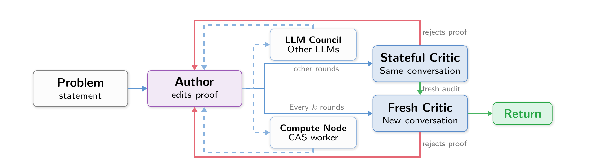
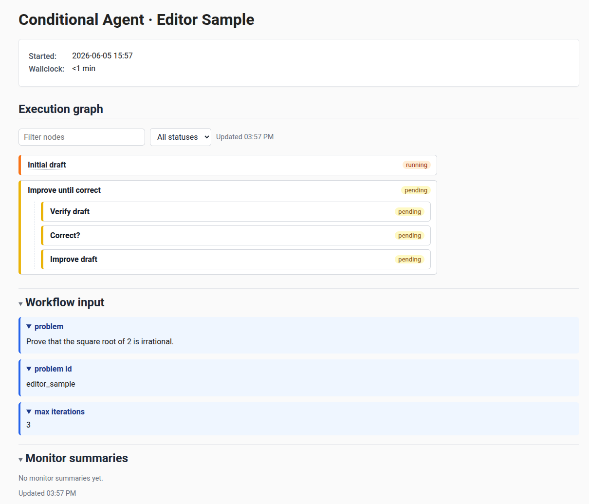
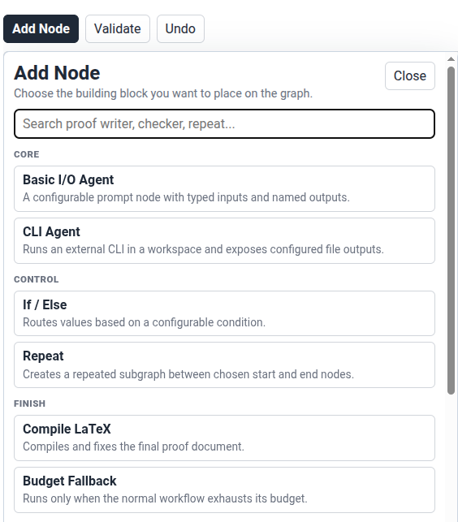
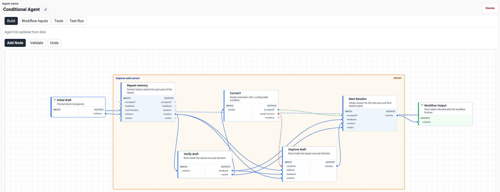
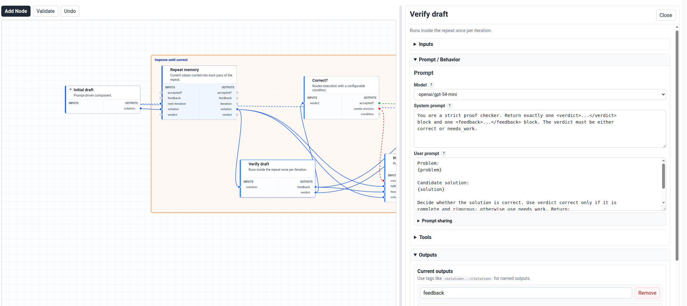
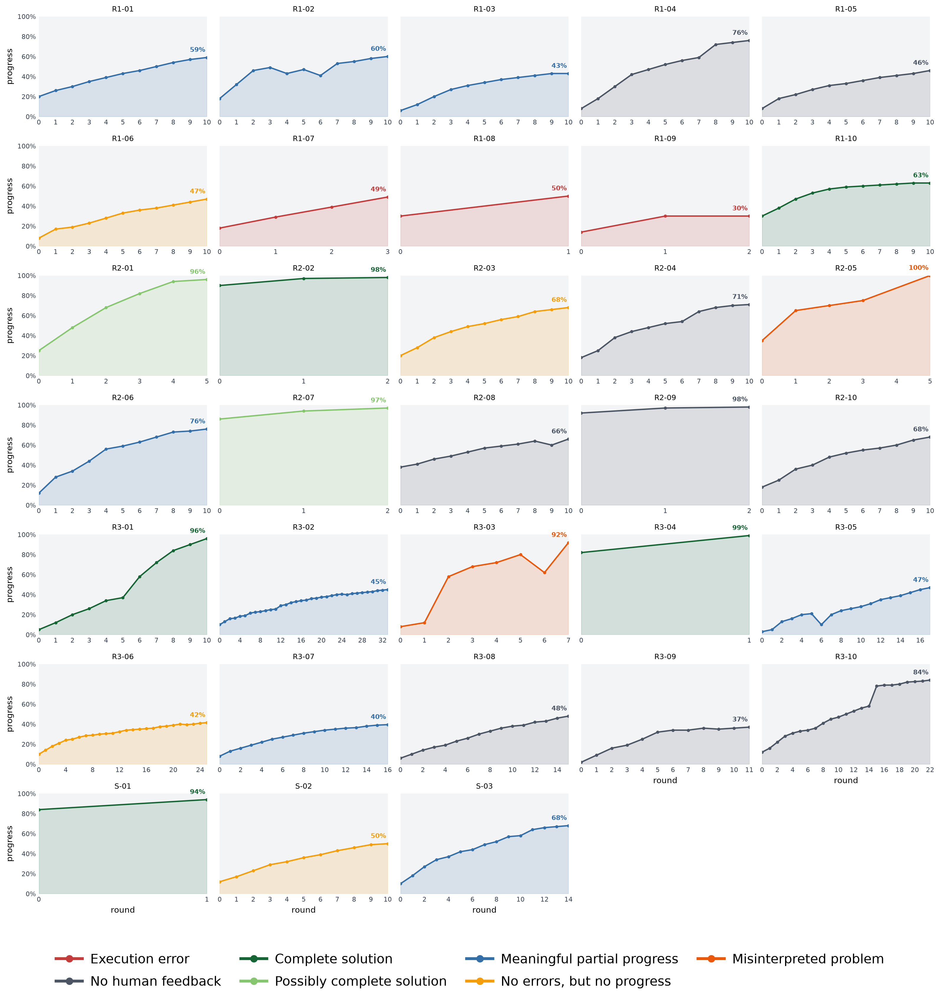
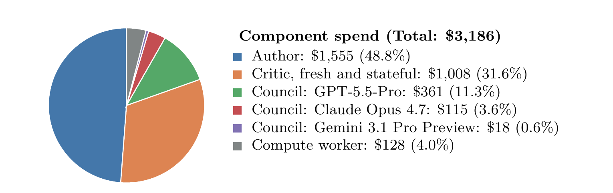

# ProofCouncil：求解开放数学问题的多智能体系统与条件 DAG 编排框架——深度精读综述

> **论文标题**：*ProofCouncil: An LLM Agent for Solving Open Mathematical Problems*  
> **论文链接**：[`arXiv:2607.09474v1`](https://arxiv.org/abs/2607.09474)（25 页，7 张插图，2026 年 7 月）  
> **作者与机构**：Johannes Schmitt¹, Tim Gehrunger¹, Jasper Dekoninck¹, Gergely Bérczi² 等（ETH Zurich, Aarhus University, Leiden University）  
> **开源仓库**：<https://github.com/eth-sri/proof-council>  
> **官方定位**：在第二届 **FirstProof** 挑战赛（`arXiv:2606.18119`）中作为 **System A (IMProofBench ProofCouncil)** 参赛并斩获**全场最佳**。

> **一句话概括**：ProofCouncil 复刻了真实数学家的科研协作范式——以“有状态作者-审稿人（Author-Critic）对抗闭环 + 定期记忆重置（$k=3$）+ 全新审稿人独立终审”为主轴，按需路由至“异构大模型顾问团（LLM Council）”与“配备 SageMath/GAP 等 CAS 工具链的持久计算沙盒（Compute Node）”，并基于自研的**条件有向无环图（Conditional DAG）**可视化编排库实现，在 FirstProof 10 道无公开答案的开放题中攻克 **6 题**（全场第一），并在研究者提供的 21 份有效反馈开放问题中产出 **5 份完全正确证明**，且在 Erdős Problem 539 上取得了被数据库收录的实质性突破。

---

## 1. Executive Summary（核心摘要与直觉类比）

### 1.1 科研协作直觉类比表

ProofCouncil 的系统设计并非盲目堆砌并发采样，而是高度拟人化地映射了人类数学家团队攻关未知猜想的真实工作流：

| ProofCouncil 组件 | 底层模型与工具配置 | 人类科研协作类比 | 核心职责与防退化机制 |
| :--- | :--- | :--- | :--- |
| **Author（作者）** | GPT-5.5-Pro (xhigh) `code_interpreter` + `web_search` | **主笔研究员** | 维护 `answer.tex`、`research_notes.tex`（持久化草稿本）与 `references.bib`；每轮根据审稿意见与外援结果迭代修稿，通过 XML 标签主动求助。 |
| **Stateful Critic（有状态审稿人）** | GPT-5.5-Pro (xhigh) `code_interpreter` + `web_search` | **跟进项目进度的资深合作审稿人** | 跨轮次保留上下文以追踪修改连贯性；**每隔 $k=3$ 轮强制重置**，防止陷入路径依赖或“被作者带偏”。 |
| **Fresh Critic（全新审稿人）** | GPT-5.5-Pro (xhigh) （无历史、终审时无作者思考链） | **独立盲审期刊裁判（Independent Referee）** | 仅在 Stateful Critic 放行后触发；**剥离历史对话与作者思维轨迹**进行冷酷终审，一票否决则打回重修（在 P10 上拦截了 7 次假阳性）。 |
| **LLM Council（顾问团）** | Gemini 3.1 Pro (high) + Claude Opus 4.7 (max) + GPT-5.5-Pro (xhigh) | **跨领域学术顾问委员会** | 当作者卡壳时通过 `<council>` 触发；成员**互不可见彼此回答**，提供建设性替代思路与跨界类比（而非第二审稿人）。 |
| **Compute Node（计算节点）** | Codex Agent + GPT-5.5 (xhigh) SageMath / GAP / Singular / Pari/GP | **专职科学计算与文献助理** | 拥有**跨轮持久化沙盒**与完整 HTTPS 网络权限；负责跑重型符号计算、构造反例、抓取 arXiv 源码与文献核验。 |

### 1.2 全文核心量化战绩

| 评估基准 | 题目规模 | 核心战绩 | 成本与对比 |
| :--- | :---: | :--- | :--- |
| **FirstProof 第二批挑战赛** *(24 小时全自主求解无公开答案题目)* | 10 题（有效提交 9 题，P6 因 API 超时未产出） | **6 / 10 题完全正确或至多微小修订** （P1, P2, P3, P5, P7, P9；**全场排名第一**）； 1 题（P10）有阶段性进展；2 题（P4, P8）被拒。 | 总成本 **\$3,186**（均摊 **\$350/题**）； 单次 GPT-5.5-Pro 基线仅 **\$12/题**，解出 **4/9 题**。 |
| **研究者真实开放问题集** *(ETH Zurich 等高校数学家征集)* | 30 题（收到 21 份人类专家评审）+ 3 道 Erdős 问题 | 21 份有效反馈中：**5 份完全正确**、**2 份极有希望**、**8 份有意义进展**、4 份无错无进展、**2 份误解题意**；**0 例数学错误却自称已解决**。 | 平均记录成本约 **\$213/题**； 超过 50% 的轮次调用了 Council 与 Compute Node。 |
| **Erdős Problem 539 专项突破** | 数论公开猜想 | 将公开上界从 $n^{2/3}$ 推进至 **$n^{1/2}\exp(C\sqrt{\log n})$**，精确确定幂指数 $\lim_{n\to\infty}\frac{\log h(n)}{\log n} = \frac{1}{2}$。 | 核心组合与渐近结论已由 Codex + GPT-5.5 在 **Lean 4.29.1** 中形式化验证。 |

---

## 2. 动机与问题定义 (Motivation & Problem Formulation)

尽管前沿大语言模型（LLMs）在竞赛数学（如 IMO、Putnam）及部分开放问题上表现惊艳，但将其直接用于**真实科研级开放数学问题**仍面临三大结构性瓶颈：
1. **幻觉与隐蔽逻辑跳跃（Hallucination & Subtle Gaps）**：单次生成极易在关键引理处“想当然”或伪造文献引用；
2. **路径依赖与自我确认偏误（Path Dependence & Confirmation Bias）**：单一模型在多轮自省中容易被自己先前写下的错误框架锁定；
3. **计算与工具链割裂**：复杂的代数验证、反例搜索和文献原文核对超出了通用 Python `code_interpreter` 的短暂沙盒限制。

为此，FirstProof 第二批挑战赛设定了极其严苛的评测协议：参赛智能体必须在 **24 小时窗口**内，仅使用公开可用的模型与工具，完全自主地攻克 **10 道尚无公开解答的前沿数学题**，并严格遵守 FirstProof LaTeX 提交规范（`12pt article`、最多 12 页、禁止篡改页边距与行距）。ProofCouncil 正是在这一真实高压场景下孕育而生的系统级方案。

---

## 3. 核心架构与系统机理 (Architecture & Conditional DAGs)

### 3.1 Author-Critic-Council-Compute 四元协同闭环

*图 1：ProofCouncil 核心工作流。Author 根据 Critic 反馈迭代修改证明，每隔 $k=3$ 轮重置 Stateful Critic，并通过结构化标签按需调用异构 LLM Council 与 CAS Compute Node；Stateful Critic 放行后仍需经过 Fresh Critic 独立冷启动终审。*

系统的运行受四个硬性终止条件约束：**解答被双重接受**、**达到最大轮数**（在最终 10 题运行中从 10 轮放宽至 200 轮）、**预算耗尽**或 **24 小时超时**。其核心控制流包含三个精妙设计：

1. **三文件持久化工作区契约（Author）**：
   Author 通过内置代码执行沙盒维护 `/mnt/data/` 下的三个核心文件：`answer.tex`（主证明）、`references.bib`（引用文献）以及至关重要的 **`research_notes.tex`**（持久化研究笔记，专门记录中间引理、反例检查、已排除的死胡同和文献摘要，避免将 `answer.tex` 变成冗长的日志）。
2. **双层审查与定期失忆机制（Stateful + Periodic Reset + Fresh Audit）**：
   - **Stateful Critic** 保留对话历史以追踪 Author 是否真正修复了上一轮指出的漏洞；
   - **每 $k=3$ 轮强制重置**：防止长上下文积累导致 Critic 对既有思路产生审美疲劳或顺从偏见；
   - **Fresh Critic 终审门禁**：当 Stateful Critic 输出 `<answer_ready>true</answer_ready>` 时，系统并不直接返回结果，而是启动一个**全新无历史对话、且看不到 Author 思考过程（no thinking traces）**的 Fresh Critic 进行独立盲审。只有当 Author (`<ready>true</ready>`)、Stateful Critic 和 Fresh Critic **三方同时达成共识**时，解答才会被正式交付。
3. **按需路由的双外援机制**：
   - **LLM Council（异构模型顾问团）**：由 **Gemini 3.1 Pro (high)**、**Claude Opus 4.7 (max)** 和 **GPT-5.5-Pro (xhigh)** 组成，独立并行作答且互不可见，专门在 Author 陷入瓶颈时提供“第二视角”；
   - **Compute Node（持久 CAS 计算节点）**：基于 Codex CLI 封装的 GPT-5.5 (xhigh) 智能体，拥有**跨轮持久化目录**（`code/`, `data/`, `papers/`, `notes/`）、完整 HTTPS 网络权限以及探测并使用 **SageMath、GAP、Singular、Pari/GP** 等专业计算机代数系统的能力。执行完毕后，整个工作区会被打包挂载回 Author 的只读环境中供其检查。

### 3.2 开源基础设施：将智能体系统编排为条件 DAG

为了支撑 ProofCouncil 的构建与快速迭代，作者团队同步开源了一套将智能体工作流抽象为**条件有向无环图（Conditional DAGs）**的通用编排库：

- **统一节点抽象**：节点可以是 LLM 调用、自定义 Python 块、CLI 计算智能体、确定性门控（如 `pdflatex` 编译检查）或嵌套的子智能体；边则通过条件表达式控制下游节点的激活（例如仅当 Author 输出包含 `<council>` 标签时才激活顾问团分支）。
- **循环展开与拓扑并行**：通过**有界重复块（bounded repeat blocks）**将 Author-Critic 反馈环展开为有限条件 DAG；运行时按拓扑序调度，所有依赖就绪且边条件满足的节点（如 Council 中的三个异构大模型）自动**并行执行**。
- **Blender 式可视化 UI 与人在环（HITL）**：受 Blender 节点编辑器启发，提供图形化 DAG 编辑、YAML 结构化输出定义与节点状态实时监控界面；同时支持将**人类数学家作为可互换节点**嵌入图中，运行至该节点时自动暂停等待人工审阅或提示后恢复执行。

| 运行启动监控 | 节点添加菜单 | 图结构与状态视图 | 节点配置编辑器 |
| :---: | :---: | :---: | :---: |
|  |  |  |  |

---

## 4. Prompt Engineering 与控制论深度拆解

通过剖析论文源码 `prompts/*.tex` 中公开的全部系统提示词，可以提炼出 ProofCouncil 在智能体工程上的四条高价值设计法则：

1. **严格隔离“交付物”与“草稿本”**：Author 提示词明确禁止将 `research_notes.tex` 写成面向 Critic 的修改日志（changelog），强制要求其作为跨轮次可接续的科研笔记；同时在 `answer.tex` 中规定了**诚实降级协议**——若题干有歧义必须在开头增设 `Problem statement and interpretation` 小节，若存在未解决缺口必须在结尾列出 `Remaining open issues` 并将 `<ready>` 设为 `false`。
2. **Critic 的双重硬性否决权（数学严密性 + LaTeX 合同门禁）**：Critic 不仅要逐段审计逻辑漏洞、通过 `web_search` 核验引文真实性，还承担确定性格式守门员职责——任何违反 FirstProof 排版契约（如使用 `\small`、篡改页边距、超 12 页或 `pdflatex` 编译失败）都必须强制输出 `<answer_ready>false</answer_ready>`。
3. **对抗性审稿（Critic）与建设性协作（Council）的提示词解耦**：
   - Critic 的定位是“严苛的数学裁判（strict mathematical referee）”；
   - Council 成员的系统提示词则明确写道：**“You are not a second Critic... Your role is closer to a research collaborator”**，即使 Author 问“X 是否正确”，也要求其给出建设性的替代路线、相邻文献或分解思路（限 600 词内），避免多路模型退化为同质化的“复读式挑刺”。
4. **Compute Worker 的“先探测、非交互、有界收尾”工程契约**：提示词要求 Codex 智能体在沙盒启动时先执行 `command -v sage gap singular gp` 探测实际工具链，严禁交互式阻塞调用（强制使用 `sage -c`、`gap -q -b`），并将核心结论浓缩至 `responses/response_round_{round}.md`（限 4000 词内），同时监听 `.pwc/runtime/WRAP_UP` 哨兵文件以优雅响应软超时。

---

## 5. 关键实验对比与消融剖析

### 5.1 33 道开放问题评估与事后进度审计

*图 2：全部 33 道开放问题（R1–R3 为三批 10 题运行，S 为 3 道单题预测试）的 GPT-5.5-Pro 事后进度审计曲线，颜色对应人类专家的最终判定状态。*

- **迭代轮数的价值与局部极小值陷阱**：事后审计曲线表明，多道成功求解的题目都是在经历多轮 Author-Critic 反馈后才逐步收敛至完整证明；但与此同时，失败案例中普遍出现了**局部极小值（local minimum）**现象——系统反复在同一个局部漏洞上打补丁，却无法跳出原有框架切换证明策略（作者指出并行多线程探索可缓解此问题，但会成倍推高成本）。
- **高频外援依赖**：超过 **50%** 的迭代轮次同时触发了 LLM Council 与 Compute Node，说明真实科研级难题高度依赖外部视角与符号计算。

### 5.2 FirstProof 战绩、成本分布与典型成败案例

*图 3：FirstProof 官方运行各组件模型开销分布（总计 \$3,186，均摊有效 9 题约 \$350/题）。Author 占 48.8%（\$1,555），Critic 占 31.6%（\$1,008），Council 占 15.5%（\$494），Compute worker 占 4.0%（\$128）。*

FirstProof 官方运行不仅验证了 **6/10（有效 9 题中 6 题）** 显著优于单次 GPT-5.5-Pro 基线（4/9，\$12/题），更通过组件级复盘揭示了极具价值的系统规律：
- **Fresh Critic 的救命拦截（P10）**：在 P10 上，Stateful Critic 先后 **7 次**被 Author 迭代说服并给出通过信号，但 Fresh Critic 在这 7 次审计中**全部予以拒绝**——最终人类裁判也确认 P10 确实存在重大缺口，仅属于阶段性进展。
- **审稿人的假阳性与假阴性边界（P8 vs P3）**：
  - **P8（假阳性）**：Author 引用了一篇文献来支撑某个核心技术断言，Critic 未能深究该引文内部是否真的证明了该断言，导致错误放行；事后诊断表明，GPT-5.5-Pro 在看到人类标准答案与裁判意见前，倾向于将该薄弱点误判为“仅需小修”。
  - **P3（假阴性）**：Critic 在每一轮都拒绝了解答，但人类裁判却认定其正确（至多需小修），说明前沿模型的“过度审慎/吹毛求疵”同样会带来成本浪费。
- **异构顾问团的性价比奇迹（Gemini 仅占 0.6% 成本）**：虽然 GPT-5.5-Pro 是 Council 的主力（\$361），但 **Claude Opus 4.7**（\$115，在 P3 上指明了正确方向）和 **Gemini 3.1 Pro**（仅 **\$18 / 0.6%**，在 P5 上提供关键路径验证并在 P3 上给出有效类比）证明了**跨模型家族的认知多样性**无法被单一模型重复采样所替代。

---

## 6. 硬核数学案例剖析：Erdős Problem 539

ProofCouncil 在数论开放问题 **Erdős Problem 539** 上的表现，充分展示了“问题等价转化 + 归纳结构构造 + CAS 辅助探索”的威力。

- **问题背景**：对任意 $n$ 元正整数集 $A \subseteq \mathbb{Z}_{>0}$，令 $Q(A) = \{ a/\gcd(a,b) : a,b \in A \}$，求 $h(n) = \min_{|A|=n} |Q(A)|$ 的渐近阶。此前公开文献已知界为 $n^{1/2} \ll h(n) \ll n^{2/3}$（Bollobás 与 Leader 曾在未发表的报告摘要中口头宣布否定 $2/3$ 指数，但无书面证明传世）。
- **ProofCouncil 的核心贡献**：证明了存在绝对常数 $C > 0$，使得对所有 $n \ge 2$：
  $$\frac{1+\sqrt{8n-7}}{2} \le h(n) \le n^{1/2}\exp(C\sqrt{\log n}) \implies \lim_{n\to\infty}\frac{\log h(n)}{\log n} = \frac{1}{2}$$
  该结果已正式被 Erdős Problems 数据库收录。
- **证明精妙之处（四步走）**：
  1. **素因子正投影等价**：通过素数幂指数向量 $v(a)$，将数论商集 $Q(A)$ 严格等价为高维整数格点上的正差分集 $D(F) = (F-F)^+$；
  2. **平方根下界**：利用 $F-F \subseteq D(F)-D(F)$ 与一维投影下界 $|F-F| \ge 2n-1$，直接推出 $q(q-1)+1 \ge 2n-1$；
  3. **分离悬置算子（Separated Suspension）**：从二维反对角条带 $B_W$ 出发，构造升维算子 $\mathcal{S}_K(F) = \{(j, x+jM\mathbf{1}, y-jM\mathbf{1}) : 0 \le j < K, x,y \in F\} \subseteq \mathbb{Z}^{2d+1}$。利用足够大的分离参数 $M$ 隔离不同层间的正差分干涉，使集合规模平方级膨胀至 $Km^2$，而正差分集仅增加 $2(K-1)|F-F|$；
  4. **变维数渐近优化**：将上述构造迭代 $s$ 次得到维数 $d_s = 3\cdot 2^s - 1$ 下的指数 $\alpha_s = \frac{1}{2} + \frac{1}{2(2^{s+2}-1)}$，最后令悬置深度 $s$ 随 $n$ 缓慢增长（取 $2^s \le \sqrt{\log n} < 2^{s+1}$），精准平衡指数误差与常数膨胀，锁定 $n^{1/2+o(1)}$ 上界。
- **Lean 4 形式化边界**：团队进一步使用 Codex (GPT-5.5 xhigh) 在 **Lean 4.29.1 + mathlib** 中形式化了核心下界、固定深度上界与 $\lim \log h(n)/\log n = 1/2$ 结论（显式 $\exp(C\sqrt{\log n})$ 因子目前仍为非形式化证明）。

---

## 7. 工程实战避坑与深度启示

1. **“共享题干盲区”是当前多智能体系统最隐蔽的失效模式**：在开放问题评估中，唯一出现严重偏差的 2 个案例均是“把原题理解成了更容易的变体”。由于 Author 和 Critic 共享对同一段自然语言题干的阅读偏见，内部对抗循环几乎不可能自发纠正题意误解——**在进入重型求解循环前，引入人类专家确认 Prescreen 后的形式化/重述题意（即 HITL 节点）性价比极高**。
2. **29 倍成本差下的路由优化空间**：ProofCouncil 将求解率从基线的 4/9 推高到 6/9，但单题成本也从 \$12 飙升至 \$350（近 29 倍）。其中仅 Author 与 Critic 的全量 `xhigh` 模型调用就吞噬了 **80.4%** 的预算。工程落地中亟需引入**分层模型路由**（如早期探索与格式检查交由轻量模型，仅在关键转折与终审调用旗舰推理模型）以及**局部极小值早停/重启机制**。
3. **“求解正确性”与“科研可读性”应当解耦**：多位数学家反馈系统输出的证明过于致密（dense），缺乏动机铺垫与背景过渡。在生产级科研助手中，完全可以在 Fresh Critic 终审通过后，在 DAG 末端挂载一个低成本的 **Exposition Agent（学术润色节点）**，专门负责展开引理、统一记号并重写为符合期刊审稿习惯的论文体例。
