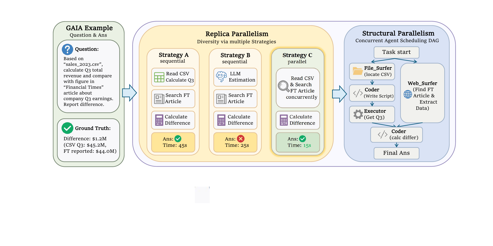
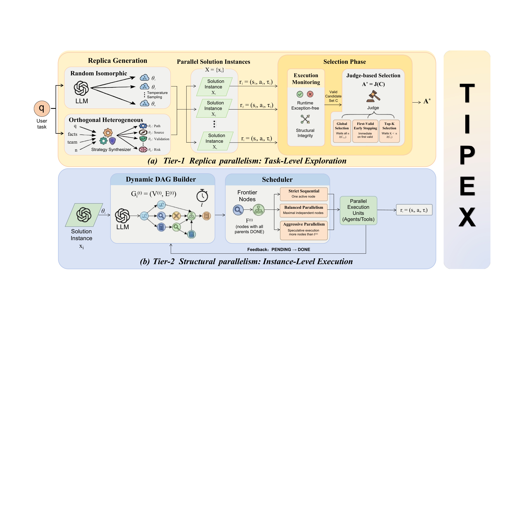
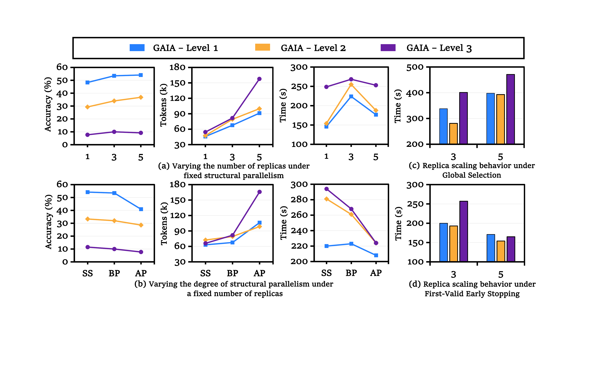

# 《多智能体大模型系统推理期并行的两级视角》中文精读综述

> **论文**：*A Two-Tier Perspective on Inference-Time Parallelism in Multi-Agent LLM Systems*  
> **作者**：Zihan Xu\*, Haolin Tian\*, Hai Jiang (通讯作者) (\* 表示同等贡献)  
> **机构**：北京邮电大学 (Beijing University of Posts and Telecommunications, BUPT)  
> **出处**：ICML 2026 录用 (arXiv:2608.05791v1)，计算机科学·多智能体系统 (cs.MA)  
> **核心贡献**：首次提出将大语言模型多智能体系统在推理阶段的并行执行统一建模为两级决策空间的形式化框架 **TIPEX** (Two-tier Inference-time Parallel EXecution)，将宏观任务级的**副本并行 (Replica Parallelism)** 与微观轨迹内的**结构并行 (Structural Parallelism)** 解耦与协同，系统性揭示了准确率、物理时延与 Token 成本之间的非加性交互规律与应用边界。  
> **一句话总结**：并行不是无脑拉高并发的“免费午餐”，而是一个精细可调的权衡旋钮——**副本并行用算力换解题覆盖率与鲁棒性，结构并行压缩关键路径砍物理时延**；中等复杂度任务是两级协同的最佳黄金期，过度激进的并发反而会导致严重的推理质量劣化与冗余浪费。

**阅读难度**：★★★☆☆。形式化建模清晰、数学符号严谨，实验覆盖 GAIA 基准 L1~L3 任务、跨骨干模型（Qwen-Plus、DeepSeek-v3.2、Gemini-3-Flash Preview），兼具理论深度与工程避坑参考价值。

---

## 0. 三分钟读懂（Executive Summary）

### 0.1 这篇论文在回答什么核心问题？

当下基于大语言模型（LLM）的多智能体系统（如 AutoGen、MetaGPT、Magentic-One 等）处理复杂长程任务时，普遍受制于**串行协调（Serial Coordination）**：
- 智能体反复按顺序调用 LLM 与工具，中间状态层层传递，上下文越来越长；
- 导致关键路径极长、物理等待时间巨大、早期错误层层放大。

业界此前探索过两种孤立的并行尝试：
1. **宏观方案**：多开几个团队或求解副本同时跑（类似 Self-Consistency 思想），但没管内部工具调用的串行等待；
2. **微观方案**：把单次工作流拆成任务图（DAG）让工具并发跑（类似 LLMCompiler），但依旧只在单条解题路径里打转，容易一错到底。

**核心问题**：这两层并行机制究竟是什么关系？它们各自在准确率、时延、Token 成本的权衡中扮演什么角色？两者结合是互相促进还是彼此冲突？怎样才能统一组织和调度？

---

### 0.2 两级并行的直观类比与机制概览

论文将推理期并行清晰解耦为两个正交层级：

| 维度 | 直觉生活类比 | 论文定义与形式化 | 核心解决的瓶颈 | 代价与风险 |
| :--- | :--- | :--- | :--- | :--- |
| **Tier-1: 副本并行**<br>*(Replica Parallelism)* | **多组并进，独立攻坚**<br>安排 $n$ 个互不干扰的独立攻坚小组，各自提出完全不同的技术路线进行解题，最后由评审专家（Judge）挑选最佳成果。 | 在任务层实例化多个独立候选解 $x_i \sim \Phi(q, \theta_i)$，覆盖解空间；通过判别器 $\mathcal{J}$ 选出最终输出 $A^*$。 | 消除单条解题路径的偶然性失败与局部死胡同，显著提升**任务准确率与鲁棒性**。 | 线性或倍数级增加 **Token 消耗**；极度依赖评审专家（Judge）的鉴别能力。 |
| **Tier-2: 结构并行**<br>*(Structural Parallelism)* | **组内协作，流水作业**<br>在单个攻坚组内部，把能同时干的调研、查数据、测代码任务拆成并发子任务，没有先后依赖的就同时做。 | 在单个解题路径内维护动态扩展的 DAG $G=(V, E)$，识别就绪前沿 $F(t)$，并行调度独立的智能体与工具调用。 | 打破严格串行执行链，压缩关键路径，大幅降低**端到端物理等待时间 (Latency)**。 | 调度协调开销；若拆分过细会导致上下文割裂、冗余执行与**推理质量退化**。 |

---

### 0.3 一张图看懂 TIPEX 架构流转

<p align="center">
  
  <br>
  <em>图 1：多智能体推理期两级并行图解：Tier-1 探索多条完整独立解题路径，Tier-2 在单路径内实现智能体与工具调用的 DAG 并发调度（引自论文 Figure 1）</em>
</p>

```text
用户任务输入 q
   │
   ▼
【Tier-1 副本并行：解生成 (Solution Generation)】
   ├─ 随机同构生成 (RIG)：相同 Prompt + 随机采样
   └─ 正交异构生成 (OHG)：生成语义、工具偏好与风险策略正交的参数 θ_1 ... θ_n
   │
   ├──────────────┬──────────────┐
   ▼              ▼              ▼
[副本 1: x_1]  [副本 2: x_2]  [副本 3: x_3]   (并行展开多条解题轨迹)
   │              │              │
   │ 【Tier-2 结构并行：动态 DAG 调度器 (Structural Scheduling)】
   │   ├─ 维护动态 DAG: G_i = (V_i, E_i)
   │   ├─ 计算因果就绪前沿 F(t)
   │   ├─ 策略选择：严格串行 (SS) / 均衡并行 (BP) / 激进并行 (AP)
   │   └─ 局部故障处理：硬依赖终止，独立分支继续前行
   │
   ▼              ▼              ▼
(结果 r_1)     (结果 r_2)     (结果 r_3)     r_i = (s_i, a_i, τ_i)
   │              │              │
   └──────────────┼──────────────┘
                  ▼
【Tier-1 副本并行：解选拔 (Solution Selection)】
   ├─ 步骤 1: 有效性过滤 (Validity Filtering，剔除异常/空输出) -> 候选集 C
   ├─ 步骤 2: 综合评分判别器 J (评估确定性、证据强度、逻辑一致性)
   └─ 调度控制：全局选拔 (GS) / 首个有效即停 (FVES) / 动态截断 (TKS, 如 Top-2)
                  │
                  ▼
              最终系统输出 A*
```

---

### 0.4 先记住这五个核心结论与关键数字

1. **40% 时延压缩**：在较难的 GAIA L2/L3 任务中，引入结构并行可将端到端物理耗时降低 **15% ~ 40%**（例如 L2 从 320s 降至 168~280s，L3 从 772s 降至 217~401s）。
2. **准确率大幅提升**：在 GAIA L1 上准确率从基线的 43.2% 跃升至 **56.7%**；在 L2 上从 25.8% 提升至 **38.7%**。
3. **最佳黄金组合——OHG + TKS + BP**：
   - 副本生成采用**正交异构生成 (OHG)**，解选拔采用 **Top-$K$ Selection (TKS)**，结构调度采用**均衡并行 (BP)**；
   - 在解空间覆盖率、评审准确度与时延/Token 消耗之间达到了最优 Pareto 平衡。
4. **两级协同的“中等难度黄金期”**：简单任务（L1）本身体量小、可并行空间有限；极难任务（L3）受限于底座本身的模型推理能力瓶颈；**中等难度任务（L2）最能充分享受结构并行砍时延与副本并行提精度的双重红利**。
5. **激进并发的反噬（Non-monotonicity）**：结构并行绝非越细越好。将调度粒度从均衡并行（BP）推向激进并行（AP）时，L2 准确率反而从 37% 跌至 25%，Token 消耗激增 25% 以上；盲目拉大副本数到 $n=5$ 也会导致收益停滞。

---

## 1. 背景与动机：多智能体系统的“串行之困”

### 1.1 串行协调的四大致命瓶颈

在当前以大模型为主控的多智能体系统（如 CAMEL、AutoGen、MetaGPT、Magentic-One）中，典型工作方式是**顺序交互与增量累加**：

$$\text{User Query} \longrightarrow \text{Agent}_1 \xrightarrow{\text{Context}_1} \text{Agent}_2 \xrightarrow{\text{Context}_2} \cdots \xrightarrow{\text{Context}_k} \text{Final Answer}$$

这种纯串行范式在面对需要几十轮甚至上百轮复杂推理的环境时，会遇到四大阻碍：
1. **超长关键路径（Critical Path Bloat）**：每个工具调用、每次模型推演必须等待前一个 Token 生成完毕，即使某些子任务完全互不依赖（例如同时调研两个不同网站的信息），也只能排队等待，导致**物理等待时间（Wall-clock Time）爆炸**。
2. **上下文膨胀与信息稀释（Context Dilution）**：所有历史对话、工具原始日志（HTML、JSON、终端输出）都被一股脑追加到同一个上下文中，导致有效信号被掩埋在海量噪声中，诱发幻觉。
3. **错误级联放大（Error Cascade）**：早期步骤中微小的工具解析错误或推理偏差，会在后续轮次中被后续智能体当成既定事实不断固化，最终导致“一步错、步步错”。
4. **单路径探索的局限性**：LLM 本身具有随机性，单一路径一旦掉入局部死胡同就无法自拔。

---

### 1.2 现有并行化工作的割裂与不足

针对上述问题，业界之前已有并行化探索，但均处于“各自为战”的割裂状态：

- **任务级副本探索（宏观派）**：例如 M1-Parallel 等，采用多智能体队伍并行跑多个候选方案，本质是把单模型时代的 Self-Consistency 搬到了多智能体，通过增加算力换准确率，但**完全忽视了每个队伍内部依然在遭受串行等待的折磨**；
- **子任务图调度（微观派）**：例如 LLMCompiler、Plan-over-Graph、DynTaskMAS 等，利用规划器生成 DAG 任务图，将无依赖的函数调用并行触发以缩短耗时，但**依然局限在单条求解路径内部**，一旦规划本身存在方向性缺陷，整个系统依然失败。

两派研究始终缺少一个统一的形式化视角：**如何在同一套调度语义下，将宏观的“多解探索”与微观的“轨迹内 DAG 调度”正交解耦并进行联合最优化？**

---

## 2. TIPEX 框架：两级并行的统一架构

为了填补这一空白，论文提出了 **TIPEX (Two-tier Inference-time Parallel EXecution)** 框架。

<p align="center">
  
  <br>
  <em>图 2：TIPEX 系统全景架构：Tier-1 负责任务级副本生成（RIG/OHG）与判别选拔（GS/FVES/TKS）；Tier-2 负责实例内动态 DAG 依赖分析与前沿并发调度（SS/BP/AP）（引自论文 Figure 2）</em>
</p>

### 2.1 形式化定义与双层解耦

对于用户输入查询 $q$：
1. **Tier-1 副本并行**：通过生成策略 $\Phi$ 初始化 $n$ 个相互独立的求解副本 $\mathcal{X} = \{x_i\}_{i=1}^n$：
   $$x_i \sim \Phi(q, \theta_i), \quad i = 1, \dots, n$$
   其中 $\theta_i$ 是第 $i$ 个副本的配置参数（控制不同副本间的异构性与求解偏好）。
2. **Tier-2 结构并行**：每个副本 $x_i$ 内部维护一个随推理动态生长的有向无环图 $G_i^{(t)} = (V_i^{(t)}, E_i^{(t)})$，由执行调度器在部分可观测环境下实时识别可执行节点并发射执行。
3. **执行结果产出**：每个副本执行完毕后输出三元组：
   $$r_i = (s_i, a_i, \tau_i)$$
   其中 $s_i \in \{0, 1\}$ 表示是否通过有效性过滤，$a_i$ 为最终产出答案，$\tau_i$ 为包含所有思考和工具调用的完整执行轨迹。
4. **元级编排判定**：由统一的**解编排器 (Solution Orchestrator)** 汇聚 $\{r_i\}$，依据预设的选拔机制输出最终答案 $A^*$。

---

### 2.2 Tier-1：副本并行（Replica Parallelism）机制

副本并行包含**解生成**与**解选拔**两个阶段。

#### 2.2.1 解生成策略：RIG vs. OHG

- **随机同构生成 (Random Isomorphic Generation, RIG)**：
  - 所有副本使用完全相同的 Prompt 设定，即 $\theta_1 = \theta_2 = \dots = \theta_n$；
  - 副本间的多样性完全依赖于大模型的随机解码采样（采样温度 $T > 0$）：
    $$x_i \stackrel{\text{i.i.d.}}{\sim} \Phi(q, \theta)$$
  - 这是传统 Self-Consistency 的直接自然扩展。
- **正交异构生成 (Orthogonal Heterogeneous Generation, OHG)**：
  - 作者提出基于元推理（Meta-Reasoning）的异构生成机制。此处的“正交”指**方法论上的多维度正交**，而非纯数学正交；
  - 由元规划器显式合成 $n$ 套语义互异的求解策略：
    $$\{\theta_1, \dots, \theta_n\} \leftarrow \text{Synthesize}(q, \text{facts}, \text{team}, n)$$
  - 强制在四个核心维度上形成差异化分工：
    1. **求解路径偏好**（如直接检索 vs 逆向代码验证 vs 多跳因果推导）；
    2. **信息源偏好**（如权威网页优先 vs 结构化文档优先 vs API 探测）；
    3. **验证机制**（如确定性断言检验 vs 跨模型互审）；
    4. **风险偏好**（激进试错 vs 保守收敛）。

> **论文实测多样性指标**：论文在附录中使用 `paraphrase-multilingual-MiniLM-L12-v2` 对生成的指令进行语义向量表征，计算两两之间的平均余弦距离（Cosine Distance）。实测数据显示：**OHG 在 L1~L3 任务上的多样性得分高达 0.294~0.322，而传统 RIG 仅有 0.005~0.010**。证明 OHG 真正拉开了求解思路的差距，而非简单的字词换用。

---

#### 2.2.2 判别式解选拔机制：两阶段过滤与评分

为防止低级报错污染结果，选拔过程分为两阶段：
1. **有效性过滤 (Validity Filtering)**：剔除因运行时异常、工具超时崩溃或未产出符合规范答案的副本，得到有效候选集 $\mathcal{C}$。
2. **综合评分判别器 (Judge Operator $\mathcal{J}$)**：由独立的大模型评估器从三个维度对候选副本的答案 $a_i$ 与轨迹 $\tau_i$ 进行结构化打分（每项 0~2 分）：
   - **答案确定性 (Answer Definiteness)**：是否直接给出明确结论，而非含糊其辞；
   - **证据强度 (Evidence Strength)**：轨迹中是否有清晰支撑结论的工具调用事实与数据；
   - **逻辑一致性 (Reasoning Consistency)**：推理全过程是否逻辑自洽、无前后矛盾。
   最终选出得分最高的副本：
   $$x^* = \arg\max_{x_i \in \mathcal{C}} S(a_i, \tau_i \mid q)$$

#### 2.2.3 选拔编排机制的三种模式

- **全局选拔 (Global Selection, GS)**：等待全部 $n$ 个副本完全执行完毕，再对整个候选集 $\mathcal{C}$ 统揽打分。准确率最高，但时延受制于“最慢木桶短板”。
- **首个有效即停 (First-Valid Early Stopping, FVES)**：一旦有任意一个副本顺利执行完成并通过有效性检查，立刻截断并输出。时延极低，但损失了横向比优的机会。
- **Top-$K$ 动态截断选拔 (Top-$K$ Selection, TKS)**：折中方案。只要收集齐 $k$ 个有效候选解（论文默认设为 $k = \lceil n/2 \rceil$，如 $n=3$ 时等齐 2 个），就立即启动 Judge 打分并返回胜者。兼顾了多样性比选与执行等待时间。

---

### 2.3 Tier-2：结构并行（Structural Parallelism）机制

结构并行专注于在**单条轨迹内部**压缩时延。

#### 2.3.1 动态 DAG 扩展与因果就绪前沿

在多智能体交互中，后续子任务往往依赖于前面工具返回的结果，因此完整的任务图无法在最开始静态生成，必须动态在线展开。

在时间步 $t$，调度器维护当前图 $G^{(t)} = (V^{(t)}, E^{(t)})$，并计算**因果就绪前沿 (Executable Frontier $F(t)$)**：

$$F(t) = \{ v \in V(t) \mid v \text{ 的所有前驱依赖在 } t \text{ 时刻均已满足} \}$$

调度器根据以下三种策略之一将 $F(t)$ 中的节点派发给执行器：
- **严格串行 (Strict Sequential, SS)**：按原智能体工作流的先后次序一步步串行执行，$|F(t)| \le 1$；
- **均衡并行 (Balanced Parallelism, BP)**：保持原高层任务划分逻辑，仅将天然解耦、输入无依赖的子任务（如同时下载并解析多份独立 PDF、同时查询多个无关网页）并发派发；
- **激进并行 (Aggressive Parallelism, AP)**：将工作流进一步细粒度切碎，尽可能拆解出更多可并发的原子操作，最大化挖掘并发度。

#### 2.3.2 局部故障处理与容错隔离

结构并行中若某个并发子任务失败，如何防止整条流水线雪崩？TIPEX 引入了依赖感知的局部容错策略：
- **硬依赖失效 (Hard Dependency Failure)**：若失败节点是后续必经链路的关键输入，且重试超限，则安全熔断该分支，避免产生垃圾数据污染后续上下文；
- **软依赖/独立分支隔离 (Soft / Independent Branch Continuation)**：若失败节点不影响其他并行分支的输入，则记录错误日志后，允许 DAG 前沿上的其他独立分支继续执行。

---

## 3. 核心实验与消融结果深度剖析

### 3.1 实验设置与评估体系

- **基准数据集**：采用多智能体高难度评测标杆 **GAIA (General AI Assistants Benchmark)**，覆盖信息检索、网页浏览、多模态处理与代码运行，严格按 Difficulty Level 1 (简单)、Level 2 (中等)、Level 3 (极难) 分层评测；
- **基线系统**：微软经典高鲁棒性多智能体框架 **Magentic-One**，TIPEX 完全构建于其底层之上，保证公平对照；
- **评测指标**：
  1. **实际准确率 (Accuracy, %)**；
  2. **理想上限准确率 (Oracle Accuracy, %)**：定义为并行候选集合 $\mathcal{C}$ 中只要有至少 1 个正确答案即计为成功，用于量化 Judge 选拔器的理论上限与实际选拔损失；
  3. **墙上时钟时延 (Wall-clock Time, s)**：从任务提交到给出最终答案的绝对物理时间；
  4. **Token 消耗量 (Token, k)**：整体消耗的计算成本；
- **骨干模型**：默认采用 Qwen-Plus；补充验证采用 DeepSeek-v3.2 与 Gemini-3-Flash Preview。

---

### 3.2 主实验对比（Table 1 精确数据）

论文核心主实验结果如下表所示（摘录自论文 Table 1）：

| 难度级别 | 评测指标 | Magentic-One (基线) | OHG + FVES | RIG + FVES | OHG + GS | OHG + TKS (默认) | RIG + GS | RIG + TKS |
| :---: | :---: | :---: | :---: | :---: | :---: | :---: | :---: | :---: |
| **L1**<br>*(简单)* | **Accuracy (%)**<br>*(Oracle)* | 43.2<br>- | 35.7<br>- | 39.0<br>- | 51.9<br>*(59.3)* | 56.5<br>*(60.9)* | **56.7**<br>*(70.0)* | 44.4<br>*(59.3)* |
| | **Time (s)** | 230.0 | 200.5 | **135.7** | 338.4 | 223.9 | 211.6 | 172.7 |
| | **Token (k)** | 38.8 | 60.1 | 48.4 | 82.1 | 67.6 | 70.9 | 54.1 |
| **L2**<br>*(中等)* | **Accuracy (%)**<br>*(Oracle)* | 25.8<br>- | 25.0<br>- | 28.1<br>- | **38.7**<br>*(48.4)* | 32.0<br>*(44.0)* | 23.1<br>*(42.3)* | 30.8<br>*(38.5)* |
| | **Time (s)** | 320.0 | 193.8 | **168.8** | 281.5 | 261.5 | 250.1 | 204.4 |
| | **Token (k)** | 41.4 | 56.8 | 52.2 | 81.8 | 79.2 | 80.9 | 66.0 |
| **L3**<br>*(极难)* | **Accuracy (%)**<br>*(Oracle)* | 9.2<br>- | 8.5<br>- | 7.7<br>- | **11.5**<br>*(16.2)* | 10.0<br>*(15.4)* | 10.8<br>*(11.5)* | 9.2<br>*(10.0)* |
| | **Time (s)** | 772.2 | 257.9 | **217.9** | 401.2 | 268.4 | 352.4 | 282.5 |
| | **Token (k)** | 50.4 | 64.0 | 63.0 | 130.9 | 81.7 | 84.0 | 94.9 |

从主表中可以提炼出四条关键实证规律：
1. **并行换取更优性能与更低时延**：相较于串行基线，引入两级并行的 TIPEX 在三个难度级别上均实现了准确率突破，同时将端到端时延压缩了 15%~40%，但 Token 消耗普遍增加了 50%~150%。
2. **OHG+TKS 的综合胜出**：OHG+GS 虽在某些场景下刷出最高准确率，但受制于长尾等待，时延居高不下；FVES 虽快但精度经常甚至不如基线；**OHG+TKS 保持了极高的准确率，同时大幅压低了等待时延，构成了最具工程落地价值的最佳平衡点**。
3. **OHG 比 RIG 具备更小的 Oracle Gap**：对比 Oracle 值与实测值，OHG 的实际精度更贴近 Oracle（如 L1 上 OHG+TKS 为 56.5 vs Oracle 60.9，差距仅 4.4%；而 RIG+GS 为 56.7 vs Oracle 70.0，差距达 13.3%）。这说明异构策略产出的方案特征鲜明，极大减轻了 Judge 的判别负担。
4. **时延削减效应随难度提升而放大**：在 L1 上时延下降幅度有限；但到了 L2/L3，由于子任务规模扩大，结构并行的威力充分释放，例如 L3 时延从 772 秒锐减到 268 秒（降低了 65%）。

---

### 3.3 为什么中等难度任务（L2）是“两级并行的黄金期”？

论文深入分析了任务复杂度与并行收益之间的关系：
- **L1（简单任务）**：本身步骤只有 3~4 步，结构简单、容错率高。串行执行本来就很快（230s），再做 DAG 并发调度带来的边际收益被框架调度开销部分抵消。
- **L3（极难任务）**：包含极其复杂的多步推理与长程规划，主要失败原因在于基础模型本身的数理推演与深度规划能力触顶，即使开辟 5 条并行路径，依然全盘沦陷（Oracle 也仅有 16.2%）。
- **L2（中等任务）**：既具备足够的步骤深度可供结构并行压缩关键路径（时延从 320s 砍到 170~260s），又在单路径中存在偶然性试错失误，能够被副本并行（OHG）有效纠正（准确率从 25.8% 大幅提升到 38.7%）。**因此中等难度任务最能充分享受两级并行的协同红利**。

---

### 3.4 关键消融分析：两级旋钮的非加性交互

<p align="center">
  
  <br>
  <em>图 3：消融实验曲线：(a) 副本数量对准确率的影响；(b) 结构调度策略对端到端时延的影响；(c) 任务复杂度分层下的关键路径压缩率（引自论文 Figure 3）</em>
</p>

论文在 GAIA L2 任务上固定 OHG+TKS，全面扫描了**副本数量 ($n=1, 3, 5$)** 与**结构调度策略 (SS, BP, AP)** 的交叉组合（见论文 Table 2）：

| 结构调度策略 | 副本 $n=1$<br>Acc / Time / Token | 副本 $n=3$<br>Acc (Oracle) / Time / Token | 副本 $n=5$<br>Acc (Oracle) / Time / Token |
| :---: | :---: | :---: | :---: |
| **严格串行 (SS)** | 29% / 164s / 51k | 33% (37%) / 281s / 72k | 33% (38%) / 207s / 88k |
| **均衡并行 (BP)** | 29% / 154s / 57k | 32% (44%) / 261s / 79k | **37% (47%)** / **188s** / 99k |
| **激进并行 (AP)** | 28% / 144s / 66k | 29% (31%) / 225s / 98k | 25% (34%) / 174s / 124k |

这组交叉消融揭示了极其深刻的**非加性交互规律**：
1. **结构并行充当了副本扩展的“时延缓冲池”**：在串行 SS 下，副本数从 1 增加到 3，时延从 164s 剧增至 281s（增加 71%）；而在均衡并行 BP 下，配合 TKS 的提前截断机制，副本数从 3 增加到 5 时延不仅没有上升，反而因更大概率较早凑齐 2 个完成者，时延进一步下降到 188s！
2. **激进并行 (AP) 严重反噬副本增益**：在 BP 下，副本扩展让准确率从 29% 稳健爬升至 37%；但在 AP 下，由于并发子任务拆分过碎，导致上下文信息割裂、工具重复调用，准确率反而从 28% 暴跌至 25%，同时 Token 消耗飙升至 124k。**这证明了盲目激进的结构并发会直接破坏解题质量**。

---

### 3.5 任务领域（Web/Code/Multimodal/File）的差异化适配

论文针对 L2 任务的不同模态领域进行了细分对比（见论文 Table 3）：

| 任务类型 | 指标 | 联合并行 (Combined) | 仅副本并行 (Replica-Only) | 仅结构并行 (Structural-Only) | 核心启示 |
| :---: | :---: | :---: | :---: | :---: | :--- |
| **Web 检索类** | Acc (%)<br>Time (s) | **27.12**<br>255s | 19.08<br>323s | 21.60<br>172s | 网页探索具有高度不确定性，极需**联合并行**（既要多路径探索防止死胡同，又要并发抓取多个网页）。 |
| **代码执行类** | Acc (%)<br>Time (s) | 28.20<br>165s | 25.32<br>301s | **32.28**<br>**111s** | 代码任务逻辑确定性强，单路径结构拆解即可高效完成；多副本反而引入噪声，**结构并行独挑大梁**。 |
| **多模态理解** | Acc (%)<br>Time (s) | **12.60**<br>266s | 12.00<br>318s | 7.08<br>169s | 图像/音频理解难以拆碎做结构并发，主要依赖**副本并行**的多角度观察与假设。 |
| **文档处理 (File)** | Acc (%)<br>Time (s) | **65.04**<br>233s | 54.60<br>239s | 39.96<br>124s | 文档解析同时受益于不同格式提取策略（副本）与并发读取多个章节（结构），**联合并行表现惊艳**。 |

---

## 4. 深入讨论与工程实战“避坑”指南

### 4.1 104 个失败案例的深水区归因

作者并不避讳系统的局限，深入剖析了 GAIA L1~L3 上的 104 个典型失败 Case，归纳为四大根因：

<p align="center">
  
</p>

1. **核心计算/逻辑推理错误（64 / 104，占 61.5%）**：
   - 智能体虽然检索到了完全正确的上下文与数字，但在最后一步算术运算、公式代入或逻辑归纳时犯错；
   - **工程启示**：并行可以帮你找到正确的材料，但不能凭空提高底座模型本身的数学计算能力。必须为智能体挂载 Python 沙盒计算器等确定性外部工具。
2. **信息检索与抽取失败（24 / 104，占 23.1%）**：
   - 网页被反爬挡住、复杂 PDF 多栏表格抽取错乱、多模态细节漏看；
   - **工程启示**：数据入口的解析质量（如专业 PDF 解析引擎）是多智能体系统的坚实地基。
3. **早期错误级联放大（11 / 104，占 10.6%）**：
   - 任务分解阶段给出的子目标出现方向性偏差，后续并发子智能体严格执行了错误指令；
   - **工程启示**：在 DAG 分解阶段需要引入前置校验器（Plan Verifier），避免在错误路线上高速并发。
4. **冗余无效执行（5 / 104，占 4.8%）**：
   - 并行分支之间缺乏通信，各自独立抓取了相同的资源，消耗了翻倍的 Token。

---

### 4.2 Judge 判别瓶颈与“Oracle 鸿沟”

在全篇论文的各项表格中，**实测准确率与 Oracle 准确率之间始终存在一道宽达 5%~15% 的鸿沟**：
- 这意味着：在并行跑出来的 3~5 个方案里，**明明已经有智能体给出了完全正确的答案，但最终被评审员（Judge）打低分淘汰了！**
- 论文在附录专门分析了 Judge 的开销与敏感性：
  - **开销极低**：Judge 仅占系统总时延的 4.3%~5.1%，占总 Token 的 3.9%~4.6%，说明 Judge 不是性能成本的瓶颈；
  - **模型质量是命门**：更换不同模型担任 Judge 时，对 Oracle 能力的还原比例差异巨大（Gemini-3-Flash 可还原 78.3%，而 Claude Sonnet 4.6 仅还原 65.9%）。
  - **工程警示**：如果你的多智能体系统打算做多方案采纳，**必须把最好、判别能力最强的模型放在 Judge 位置**，否则前面花费数倍算力探索出的好解法会被劣质 Judge 直接扔进垃圾桶。

---

### 4.3 为什么激进并行 (AP) 会导致负优化？

作者从多智能体认知负荷与调度语义解释了激进并行（AP）失败的原因：
1. **上下文碎片化**：当把一个原本连贯的思考链路切成太碎的子任务时，每个子智能体拿到的局部上下文被切断，失去了全局视野，容易产生“盲人摸象”式的局部结论；
2. **中间通信开销超过执行收益**：为了在碎片化节点之间传递状态，系统不得不频繁调用 LLM 总结中间变量，导致 Token 消耗激增；
3. **并发冲突与速率限制**：在实际工程中，大量并发请求容易触发大模型 API 的 Rate Limit 或导致网络抖动，引发重试与阻塞。

---

### 4.4 跨模型泛化性（GAIA2-mini 与 DeepSeek-v3.2 验证）

为了检验结论是否普遍成立，作者在附录中将 TIPEX 迁移至更动态复杂的 **GAIA2-mini**，并使用开源顶级模型 **DeepSeek-v3.2** 作为基座：
- 在 GAIA2-mini 上，严格串行 SS 耗时高达 681~1131 秒，而引入均衡并行 BP 后，耗时大幅压缩到 244~422 秒（**时延砍掉 60% 以上**）；
- 准确率从单副本的 6.88% 提升至 3 副本的 10.63% (Oracle 12.29%)；
- 再次复现了 AP 导致准确率滑落（8.12%）的非单调现象。
这充分证明：**两级推理期并行的规律具有极强的模型无关性与任务普适性**。

---

## 5. 总结与实践启示录

### 5.1 核心结论提炼

1. **统一视角**：TIPEX 建立了多智能体系统在推理阶段并行的两级正交坐标系——宏观解空间的**副本并行 (Replica)** 与微观因果图的**结构并行 (Structural)**。
2. **分工互补**：副本并行负责抗风险、提精度，以 Token 换准确率；结构并行负责解耦依赖、压缩关键路径，以并发调度换物理时延。
3. **非单调与非加性**：并发度不是越大越好。中等难度任务收益最大；配置上首推 **OHG (正交策略) + TKS (动态截断) + BP (均衡结构调度)**。

---

### 5.2 给多智能体开发者的实用配置指南

如果你正在搭建或优化生产级多智能体 Agent 框架，本论文提供了以下清晰的落地决策树：

```text
面对一个多智能体工程任务：
  │
  ├── 1. 评估任务类型：
  │     ├── 代码生成 / 单一逻辑链：优先开启结构并行 (BP)，关闭或维持单副本 (n=1)
  │     ├── 复杂多源检索 / 开放事实调研：开启两级并行 (OHG + TKS + BP)
  │     └── 纯视觉/多模态理解：优先开启多副本 (n=3)，结构调度维持简单串行
  │
  ├── 2. 调度粒度控制：
  │     └── 坚决不要采用过细的激进切片 (AP)，仅对独立工具调用与章节解析做均衡并发 (BP)
  │
  ├── 3. 截断与选拔策略：
  │     ├── 不要用等全员的 GS（太慢，受制于长尾木桶）
  │     ├── 不要用首个完成就返回的 FVES（容易采纳残次品）
  │     └── 采用 Top-K 动态截断（等齐一半有效结果立刻选拔）
  │
  └── 4. 评审专家 (Judge) 投入：
        └── 把最聪明、上下文理解最好的模型作为判别器，制定结构化 Rubric，这是避免“明明生成了正确答案却漏选”的关键防线！
```

---

## 6. 参考文献与相关文件索引

- **论文原文**：[A_Two-Tier_Perspective_on_Inference-Time_Parallelism_in_Multi-Agent_LLM_Systems.pdf](./A_Two-Tier_Perspective_on_Inference-Time_Parallelism_in_Multi-Agent_LLM_Systems.pdf)
- **LaTeX 完整源码与表格**：[`./source/`](./source/)
- **高清配图资产**：
  - [图 1：两级并行工作流示例 (data_construct.png)](./综述配图/data_construct.png)
  - [图 2：TIPEX 框架全景架构 (tipex_architecture.png)](./综述配图/tipex_architecture.png)
  - [图 3：消融与难度分层分析曲线 (experimental_analysis.png)](./综述配图/experimental_analysis.png)
- **arXiv 官方收录条目**：`arXiv:2608.05791v1 [cs.MA]` (ICML 2026 Accepted)
