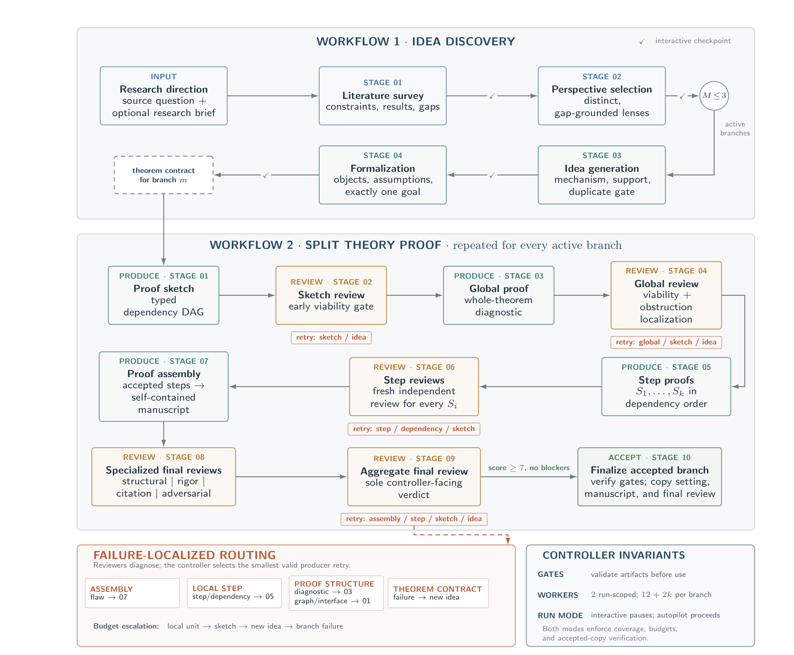
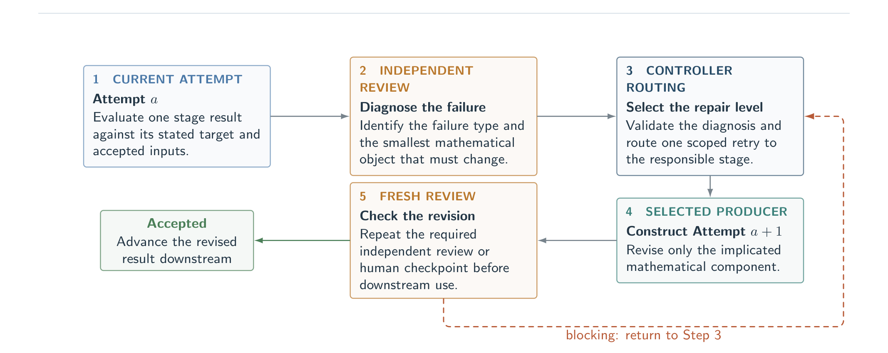

# VALG：面向机器学习理论研究的智能体系统深度精读综述

> **元信息**
> - **论文标题**：VALG: An Agentic System for ML Theory Research and Demonstrations on COLT 2026 Open Problems
> - **作者团队**：Dechen Zhang, Xuan Tang, Xinxiang Yin, Xingwu Chen, Jian Qian, Difan Zou（香港大学 & 深圳河套学院）
> - **论文链接**：[`arXiv:2608.13060`](https://arxiv.org/abs/2608.13060)
> - **开源仓库**：[VALG-ML-Theory-Agent (Skills & COLT Case Studies)](https://github.com/DechenZhang/VALG-ML-Theory-Agent)
> - **一句话概括**：针对机器学习理论研究中“**问题设定、定理目标与证明机制必须协同演化**”的独特挑战，VALG 构建了一套融合**源相对分支管理、契约式四阶段证明流水线（`sketch–global–step–assembly`）、`12+2k` 角色隔离审查与分层最小修复路由**的自主科研智能体系统，并在 5 篇 COLT 2026 开放问题论文的 9 个子问题上成功产出 22 个内部定稿候选定理（其中 2 个子问题实现完全作用域匹配）。

---

## 1. Executive Summary

### 1.1 核心直觉类比

| 传统数学证明 Agent | VALG（面向 ML 理论的 Agentic System） | 工程架构类比 |
| :--- | :--- | :--- |
| **给定固定定理陈述**，搜索证明路径（如 Lean/奥数证明） | **同时发现与精炼“问题设定 + 定理目标 + 证明机制”** | 从“按固定 PRD 写代码”升级为“**探索需求边界 → 锁定 API 契约 → 编码实现**” |
| **单体式生成**或简单草图分解，容易隐藏局部接口不匹配 | **草图（DAG）→ 全局诊断 → 局部步 → 组装**四阶段流水线 | **架构设计（DAG）→ 静态类型/接口联调（Global Proof）→ 模块实现（Step）→ 集成打包（Assembly）** |
| 失败时**笼统重写**，甚至**悄悄弱化目标/偷加假设**（Silent Target Substitution） | **分层故障定位 + 最小修复路由**，仅在形式化阻塞时显式开启源相关松弛分支 | **Git 分支隔离 + 精准根因回滚（只改最小责任模块，严禁私自修改测试断言）** |
| 生产者自查或单一裁判打分 | **“人类价值检查点 + `12+2k` 生产者/审查者隔离 + 四维独立终审”** | **产品评审（Human）+ 单元测试/集成测试/安全审计/模糊测试（4 个独立 Reviewer）** |

### 1.2 全文核心数据卡片

- **系统角色规模**：每个运行共享 `2` 个运行级工作者；每个活跃视角分支独占 **`12 + 2k`** 个互不共享身份的工作者（`12` 个分支级生产者/审查者 + `k` 个草图步骤各自对应的 `2` 个步级生产者/审查者）。
- **分支搜索预算**：每道子问题最多并行探索 **$M \le 3$** 个研究视角（Perspective），单分支耗时从 **8 小时到 91 小时**不等（基于 `GPT-5.6-sol` 最大推理强度）。
- **COLT 2026 实证战绩**：
  - **覆盖范围**：5 篇 COLT 2026 开放问题论文，**9 个独立子问题**（张量分解 ALS/GD、1-bit 均值估计、深度学习 vs 线性模型维度复杂度、差分隐私 PAC 学习、分段 Lipschitz 在线优化）。
  - **整体产出**：共运行 25 个视角分支，产出 **22 个内部定稿候选定理**（2 个分支耗尽变体预算 `Exhausted`，1 个分支被人工中断 `Interrupted`）。
  - **质量分布**：**2 个子问题**（1-bit 均值估计、Pfaffian 边界在线优化）取得 **10.00/10.00 满进展分**，完全匹配源问题作用域；其余 **7 个子问题**产出条件定理、特例或方法受限的部分进展结果（进展分 `2.25–7.00`）。

---

## 2. 动机与问题定义：为什么 ML 理论研究不能直接套用“固定目标证明器”？

在传统纯数学竞赛或 Lean 形式化定理证明（如 DeepSeek-Prover、AlphaGeometry）中，数学陈述 $T$ 与前提假设 $A$ 是**预先冻结且完全确定的**，系统的唯一任务是寻找从 $A$ 到 $T$ 的合法演绎链。

然而，机器学习理论（ML Theory）研究具有截然不同的结构特征：
1. **设定即定理（Setup as Theorem）**：数据分布族（如重尾 $k$ 阶矩）、训练协议（如非自适应 1-bit 量化 vs 交互式）、算法动力学（如全变量 SGD vs 约束子空间 GD）、渐近区间与失败概率容忍度，全部直接写入定理陈述本身。
2. **三元协同演化（Co-evolution）**：面对一个开放问题，研究者极少能在动手证明前就猜中“既为真、又有信息量”的精确参数区间与正则假设。往往是在尝试证明时发现某个障碍（如轨迹失控、无法跨越奇异点），进而反推需要补充什么条件或切换什么算法模型。
3. **“悄无声息偷换目标”的系统性风险**：如果直接让大模型自由修改命题来迎合证明，系统极易通过“假设目标性质已成立”、“把分布无关弱化为特定分布”或“改为自适应协议”等方式**隐蔽地偏离原问题**（ResearchMath-14K 基准已证实这是科研 Agent 的高频失效模式）。

因此，VALG 的核心设计哲学是：**允许问题形式化适应性演化，但必须用显式的数学契约（Theorem Contract）与源相对谱系（Source-Relative Provenance）将每一次修改“钉死在台账上”**。

---

## 3. 核心架构与方法论深度剖析

VALG 将自主理论研究拆解为 **Workflow 1（证明前阶段：理念发现与契约锁定）** 与 **Workflow 2（证明与审查阶段：契约驱动的图结构化证明）** 两大解耦流水线。

  
   
  图 1：VALG 双阶段工作流（原论文 Figure 1）。青色为生产者，琥珀色为独立审查者，绿色为通过所有门禁的最终输出。

### 3.1 Workflow 1：两级 `Perspective–Idea` 锚定与人类专家检查点

为了避免把所有算力赌在单一问题解读上，Workflow 1 采用“**广度选视角、深度生构想、契约锁目标**”的四步流程：

1. **文献调研（Literature Survey）**：强制将文献拆分为三类——**直接理论来源**、**基础理论框架**与**实证经验**——从而把“解释经验现象的理论缺口”与“可验证的理论测试床”分离。
2. **广度优先视角选择（Perspective Selection，$M \le 3$）**：选出至多 3 个互异的研究视角并行推进。每个视角被标准化为一个五元组：
   $$(\text{analysis target},\ \text{model class},\ \text{data assumption},\ \text{regime},\ \text{algorithm})$$
   该五元组划定了一个宽泛但有意义的探索区域（例如在张量 ALS 上界问题中，区分不同算法管线或分析工具），但保留具体细节留待下游收敛。
3. **深度优先构想生成（Idea Generation）与逐字段特化律**：每个视角分支内的构想生成器必须以上游五元组为**硬性锚点**。它可以将五元组中的任意字段进一步具体化（例如将一般网络特化为“无偏置两层 ReLU 网络”），但**严禁拓宽任何字段或与上游视角矛盾**，同时通过查重门禁剔除跨分支重复构想。
4. **形式化与定理契约（Formalization → Theorem Contract）**：将构想锁定为毫无歧义的数学对象、稳定编号的原始假设、严格量词顺序与**唯一一个数学目标**。

> **架构亮点——为什么 Workflow 1 用人类检查点，而 Workflow 2 用 Agent 审查？**
> 论文在 Section 3.2.2 中给出了一针见血的对比：Workflow 1 决定“什么问题值得研究、什么假设在科学上可接受”，这本质上是**开放式的科研价值判断**，无法靠规则自动化，因此每一步后都设有人类专家检查点（交互模式可随时介入修改，Autopilot 模式默认放行但仍受源方向约束）。而一旦进入 Workflow 2，**目标契约已冻结**，评判标准变为“目标对齐、假设保真、逻辑完备与推导严谨”，这恰恰是独立 Agent 审查者最擅长的**契约式验证（Contract-Based Review）**。

---

### 3.2 Workflow 2：`sketch–global–step–assembly` 四阶段流水线

作者在早期原型中曾尝试“单体式证明生成（Monolithic Proof Generation）”，结果发现定理架构、局部微积分放缩与文本叙述高度纠缠，审稿人根本无法核查。随后他们引入了 `sketch–step–assembly` 分解，却又踩中了第二个坑：**即使依赖图（DAG）在逻辑结构上完全自洽，局部步骤的推导仍可能因为上下游定量强度不匹配、概率/收敛模式不一致或递归不闭合而全部崩盘**。

为此，VALG 在草图与局部步之间创新性地插入了 **Stage 03：Global Proof（全定理诊断）**，形成四阶段流水线：

1. **Stage 01 — Proof Sketch（类型化依赖 DAG）**：将证明拆解为有向无环图。源节点是原始假设，内部节点是引理级小命题，唯一汇节点是目标定理。每个节点必须显式声明**允许使用的假设、预期证明工具与导出接口**。
2. **Stage 03 — Global Proof（全定理诊断蓝图）**：**这是整个系统最关键的工程创新之一**。Global Proof Worker 不直接写详细证明，而是对整个 DAG 做“静态联调”——逐节点核查可用输入能否支撑导出接口的定量强度、概率测度/收敛模式是否一致、极限与求和操作能否交换、边界/退化情形是否闭合。它输出一份“**定理感知蓝图**”（注意：诊断本身不充当证明证据，只用于指导并约束下游 Step Worker）。
3. **Stage 05 — Proof Step（按依赖序逐点攻克）**：为草图的第 $1, \dots, k$ 步分配**各自独立的生产者与审查者**。Step Worker 只能在给定形式设定、已通过审查的前置依赖和蓝图约束下完成该步证明，**严禁私自加强前提或削弱结论**。
4. **Stage 07 — Proof Assembly（自包含文稿组装）**：当所有步骤均获 `ACCEPTED` 后，Assembler 统一全篇符号，将各步拼接为可独立阅读的 LaTeX 论文文稿，但**严禁在组装阶段引入任何未经步骤审查的新数学引理**。

---

### 3.3 `12 + 2k` 角色隔离与四维独立终审

为彻底杜绝“既当运动员又当裁判员”的自验证幻觉，VALG 为每个分支配置了高达 **`12 + 2k`** 个互不共享身份的工作者，并在最后组装阶段（首次将所有组件合龙之处）部署了**四个正交维度的终审专家**：

| 终审维度 | 核心审计对象 | 典型拦截的 AI 常见造假/失误 |
| :--- | :--- | :--- |
| **结构审查** (`/proof-review-structural`) | 依赖图闭合性、草图覆盖率 | 组装时私自塞入未审查的新引理、存在孤立未证明步骤、假设未显式列出 |
| **严谨性审查** (`/proof-review-rigor`) | 实际数学推导正文 | 只看标签不看推导、量词顺序颠倒（$\forall\exists$ vs $\exists\forall$）、常数依赖被隐藏、极限积分随意交换 |
| **引用审查** (`/proof-review-citation`) | 外部文献定理与内部引用 | 幻觉引用、引用的定理前提条件未在当前设定下核销（Discharge）、符号未正确映射 |
| **对抗性审查** (`/proof-review-adversarial`) | 最薄弱环节与极端边界 | 构造最小假设/退化/极端参数反例进行“红队攻击”，拦截任何隐含假设加强或无依据的作用域升级 |

最后由 **Aggregate Final Reviewer** 汇总四份报告，给出唯一面向控制器的裁决（需 `score >= 7` 且**零阻塞项**方可通过 Stage 10 定稿）。

---

### 3.4 分层故障定位与最小修复路由（Revision Loops）

当审查不通过时，盲目重跑整个分支会造成算力爆炸。VALG 设计了一套受控的**最小修复路由机制**：

  
   
  图 2：VALG 受控修订环路（原论文 Figure 2）。独立审查定位最小责任层级，控制器只向该层级派发局部重试，上游修改后自动作废下游缓存并强制重审。

其路由优先级严格遵循“**由浅入深、最小改动**”原则：
$$\begin{aligned}
\mathrm{proof\ assembly} \to \mathrm{proof\ step} &\to \mathrm{proof\ sketch} \to \mathrm{idea} \\
\mathrm{global\ proof} &\nearrow
\end{aligned}$$

- **局部推导错** $\to$ 仅重做对应 `proof step`；
- **接口或跨步组合错** $\to$ 回退至 `global proof` 或 `proof sketch` 修改 DAG 结构；
- **只有被判定为 `IDEA_FAIL`（或低层级重试预算耗尽触发升级）** $\to$ 才允许回到 `idea` 层级修改问题设定或引入新的松弛条件。

这种机制保证：**只要原问题有解（如 P2 的 1-bit 均值估计），系统就不会轻易退化为弱定理；而当原问题在当前技术路线下确实受阻时（如 P1 的张量 ALS 下界），系统能优雅地收敛到一条边界清晰、诚实标注了额外条件的“部分进展定理”**。

---

## 4. COLT 2026 五大开放问题实证全景

作者选取了 **COLT 2026** 的 5 篇前沿开放问题论文（共拆解为 9 个子问题），全面检验 VALG 在真实未解科研难题上的表现。

| 问题领域与来源 | 子问题 | 最高进展分 ($P$) | 成果定性 | 核心数学进展与相对源问题的边界差异 |
| :--- | :--- | :---: | :--- | :--- |
| **P1: 张量分解 ALS** *(Arvanitakis et al., 2026)* | 上界 | `6.50` | **Partial Progress** *(条件次二次恢复)* | 设计“认证提议 + 同步着陆 + 循环 ALS”管线，达到次二次秩 $k = \Theta(r^{5/3}(\log r)^{5/2})$；**但需额外假设**有界尺度、弱干涉（$q_{\rm real} \le 1/4096$）与权重近平衡（$\Gamma \le 1.01$）。 |
| | 下界 | `3.00` | **Restricted / Conditional** | P1-Persp1 证明了**单因子受限于初始化张成空间**的 cALS/cGD 下界；P1-Persp2 在平衡梯度步下以**有限路径条件事件 $\mathcal{C}_{\rm path}$** 为前提证明正极限损失，尚未无条件闭环。 |
| **P2: 1-bit 均值估计** *(Lau et al., 2026)* | 非自适应率 | **`10.00`** | **Full-Scope Match** *(完全匹配源问题)* | **Idea 1 即一次成功**。利用“预提交平衡码定位块 + 预提交多尺度网格/掩码精炼块 + 解码端路径选择”，在全参数域、无限制 $k$ 阶矩类及全部三个 $k$ 区间（含 $k=2$ 的 $\log(\sigma/\epsilon)$）达到阶最优。 |
| **P3: 深度学习 vs 线性模型** *(Feldman et al., 2026)* | 神经网络 SGD | `5.25` | **Special Case / Conditional** | Persp 3 在**无偏置两层 ReLU、对跖奇函数类、严格高精度 $2\varepsilon < 1/(n+1)$** 下证明恒等映射精确表征（$\operatorname{dc}(\mathcal{H}) \le n \le TS$）；Persp 1 在常数深度与**鲁棒管初始化**下给出多项式近似维度界 $S^{L_0}$。 |
| | 统计查询 SQ | `3.00` | **Conditional** | 在额外假设“种子平均响应存在静态多项式秩证书 $r_A \le B(1+m/\tau^2)^k$”下证明 $\operatorname{dc}(\mathcal{H}) \le r_A$，尚未直接从自适应 SQ 接口导出 $O(m/\tau^2)$ 压缩。 |
| **P4: 差分隐私 PAC 学习** *(Nissim et al., 2026)* | 样本复杂度 | `6.50` | **Special Case** *(结构受限匹配界)* | 限定于**有限最细笛卡尔乘积 $C \simeq \prod C_i$ 且 $\operatorname{VC}(C_i)=1$、可数商空间**，以 $M_\oplus(C) = \sum (1+\log^*(d_i+1))$ 刻画并给出匹配上下界（小 $\delta$ 条件下）。 |
| | 类存在性 | `5.50` | **Partial Progress** | 证明含 $(k,N)$ 不相交阈值子式的类在小 $\delta_m$ 下需 $\Omega(k\log^* N)$ 样本；尚未给出 $\log|C_\kappa|$ 超多项式于 $\operatorname{VC}(C_\kappa)$ 的显式 $\Omega(\log|C_\kappa|)$ 构造。 |
| **P5: 分段 Lipschitz 在线优化** *(Balcan et al., 2026)* | 多项式边界 | `7.00` | **Partial Progress** *(充分条件上界)* | 在 $R \ge 1$ 及**端点正则条件密度均值上界**下导出 $C_{\mathcal{D}} \le O_\eta(Rd^2)$ 并构造见证分布，尚未覆盖充要条件及 $R < 1$。 |
| | Pfaffian 边界 | **`10.00`** | **Full-Scope Match** *(声明归一化下全匹配)* | 在**锚定单位范围归一化**下完成 `(R1)–(R5)` 全套结论：射影速度界、中心扫描界、仿射不等式、首一多项式精确恢复与 $1/\delta$ 反例紧致尺度。 |

---

## 5. 工程实战避坑与深度启示

VALG 不仅是一篇 ML 理论自动化论文，更是一份极高含金量的 **Agentic Harness（智能体脚手架）工程设计蓝图**。对构建复杂长程科研与代码智能体系统，有五点核心启示：

1. **“Global Proof”是长链条推理防崩盘的杀手锏**：
   许多 Multi-Agent 系统把任务拆成 DAG 后就直接并发派发子任务，结果子任务各自写完才发现接口类型对不上、误差阶数漏了 $\log n$ 因子。VALG 在 DAG 与局部实现之间加入**全局静态诊断阶段（Stage 03）**，用极低成本提前暴露跨节点接口与定量强度失配，非常值得迁移到大型软件重构的“接口契约联调”环节。
2. **用“源相对台账（Source-Relative Provenance）”根治 Agent 偷懒**：
   大模型在遇到难题时有极强的“投机倾向”——通过悄悄加一条强假设来让证明变简单。VALG 的 `Formalizer` 锁定单一目标契约、Step/Assembly 审查员严禁私自加强假设、仅允许控制器在 `IDEA_FAIL` 时显式开启新分支，这一机制可直接用于防止 Coding Agent 在修 Bug 时“悄悄删掉测试用例或放宽断言”。
3. **生产者与审查者的严格身份隔离**：
   同一分支内使用 `12 + 2k` 个不共享上下文的独立身份，并把终审拆分为**结构、严谨性、引用、对抗红队**四个正交视角，避免了单一长上下文带来的“自我合理化偏差（Self-Confirmation Bias）”。
4. **“成本高昂但可控”的长程算力经济学**：
   单个分支运行长达 **8–91 小时**、多分支并行且伴随大量审稿与回滚，这说明真正的科研级 Agent 必须具备**断点续传、产物归档、下游失效标记（Stale Marking）以及严格的层级重试预算（Retry Budget）**，否则算力会在局部死循环中彻底耗尽。
5. **从“能对”到“可读”与“可形式化”的最后一公里**：
   作者在文末坦诚指出当前两大痛点：一是 AI 生成的证明**过度堆砌符号（overuse notation）**，违背人类数学家的直觉行文习惯，导致专家复核成本极高；二是自然语言证明最终仍需面向 ML 理论（概率、优化、信息论）的轻量级 Lean 自动形式化层来完成内核级兜底验证。这也是下一代 AI4Theory 系统最值得深耕的方向。
