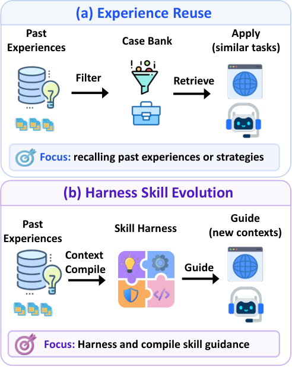
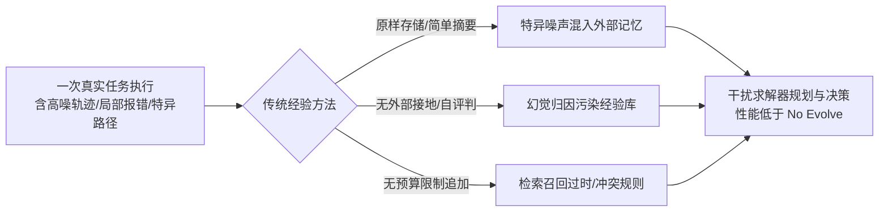
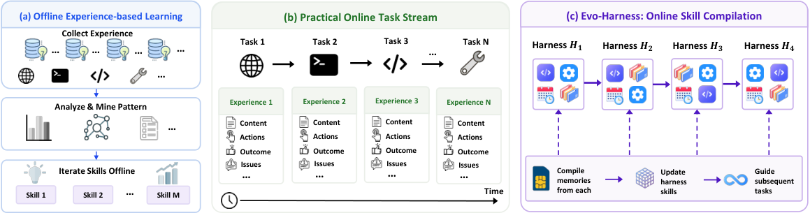
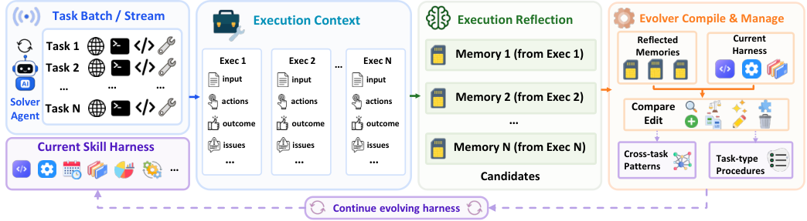
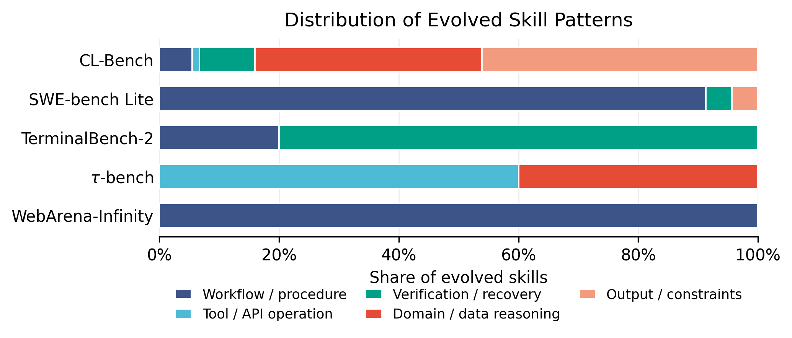
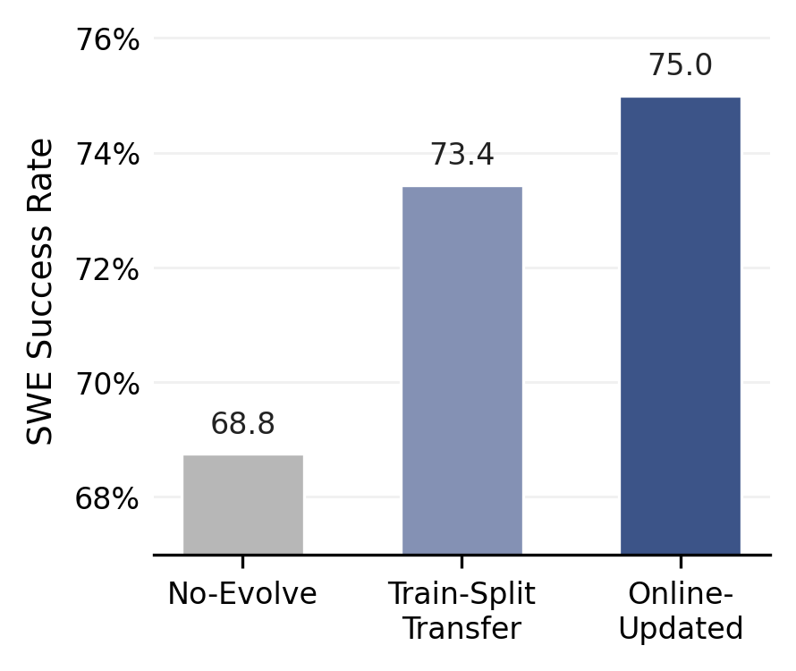
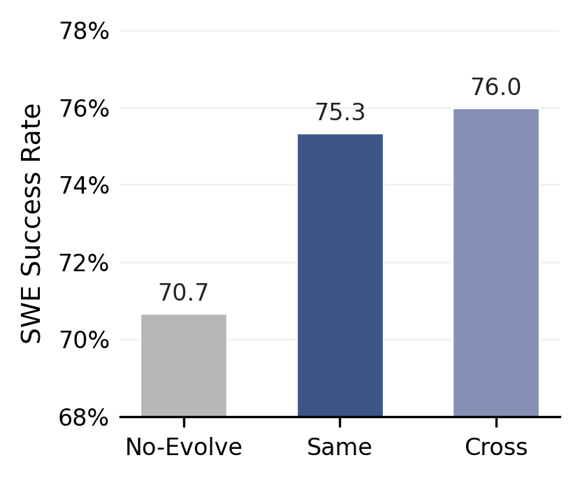
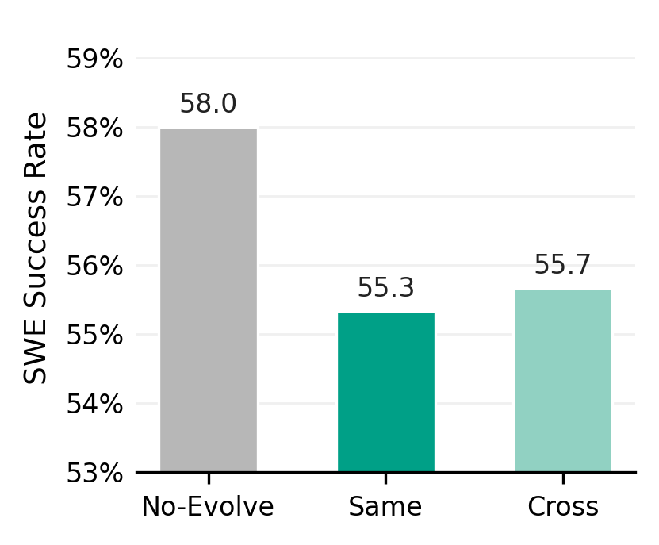

# Evo-Harness：面向自进化智能体的上下文到脚手架技能编译（深度精读综述）

> **论文信息**  
> - **英文原题：** *Evo-Harness: Context-to-Harness Skill Compilation for Self-Evolving Agents*  
> - **来源：** `arXiv:2608.15071v2`（UIUC / Amazon / PSU / Emory / AG2 AI / Northeastern）  
> - **开源代码：** [A-EVO-Lab/a-evolve (evo-harness)](https://github.com/A-EVO-Lab/a-evolve/tree/release/evo-harness)  
> - **默认骨干模型：** Claude Opus 4.6（并涵盖 Opus 4.7、Opus 4.5、Sonnet 4.5、Kimi-K2.5、GPT-OSS）

---

## 一、导读与核心摘要（Executive Summary）

### 1.1 一句话核心洞察

**在线自进化智能体不应把高噪的过往执行轨迹当作“被动记忆库”来检索，而应通过“失败触发的反思提案 + 预算受限的跨任务/主题编译”，将一次性（one-shot）执行上下文主动编译为结构化、可解释、可迁移的外部技能脚手架（Skill Harness）。**

### 1.2 第一性原理动机（Research Taste）

在真实的在线任务流中，智能体面临两个根本性的结构张力：
1. **一次性接触与经验复用之间的张力**：离线进化方法（如 ExpeL、Meta-Harness、Trace2Skill）假设智能体可以反复刷同一批训练任务，先攒够海量轨迹池再离线挖掘规律；但真实世界中的任务是顺序到达、一次即逝的（one-shot），智能体必须在单次执行后立即更新自身行为边界。
2. **高信息密度与高轨迹噪声之间的张力**：真实长程任务（如 Docker 命令行排障、GitHub 仓库修复、有状态网页交互）的上下文动辄数万 Token，其中既有决定成败的关键约束（例如“禁用自动标签不是删除它”、“必须先读完整失败测试断言”），也充斥着大量一次性的文件路径、报错堆栈、偶然工具输出与局部试错痕迹。如果直接检索原始轨迹或盲目追加记忆，不仅无法泛化，反而会**污染后续任务的上下文**（正因如此，Table 1 中多个基线方法反而比不做任何演化的 `No Evolve` 更差）。

作者由此提出核心抽象：**将“记忆检索（Retrieval）”升级为“脚手架编译（Compilation）”**——把外部脚手架视为与模型参数解耦的可编程控制支架，专门研究“在线更新何时有效、为什么有效、以及哪些因素（演化器、反馈接地、求解器能力、任务结构）决定了自进化的成败”。

*图 1：经验复用（被动检索过往案例）与脚手架技能演化（主动将经验编译为可复用指导）的对比。*

### 1.3 范式对比与核心实验数据看板

| 维度 | 传统经验/记忆方法 (AWM / Dynamic Cheatsheet / Evo-Memory) | **Evo-Harness（本文范式）** |
| :--- | :--- | :--- |
| **学习时机** | 离线多轮积累轨迹后统一挖掘，或每步直接追加 | **在线流式（Online Harness Learning）**：逐批单次执行后即时编译 |
| **信息载体** | 原始轨迹片段、自由文本速查表、被动信息存储 | **双层技能脚手架**：Cross-task 通用模式 + Task-type 局部规程（Markdown + YAML） |
| **触发条件** | 成功/失败全量录入或启发式摘要 | **仅针对失败/负反馈触发反思**（暴露能力边界，过滤成功轨迹中的特异噪声） |
| **整合机制** | 追加（Append）或向量检索拼接 | **编译式策展（Compile）**：$\{\textsc{Add}, \textsc{Merge}, \textsc{Revise}, \textsc{Skip}\}$ + 预算上限（$5$ 条） |
| **核心研究视角** | 追求单一基准分数 | **将脚手架作为可解释透镜**：隔离反馈接地、跨模型迁移、双层结构与能力门槛 |

**核心实验成绩看板（Claude Opus 4.6 求解器，成功率 %）：**

| 基准测试 | 任务数 | No Evolve | 最强基线 (XSkill) | **Evo-Harness** | 绝对提升 ($\Delta$ vs No Evolve) |
| :--- | :---: | :---: | :---: | :---: | :---: |
| **TerminalBench-2**（命令行/Docker） | 89 | 62.92 | 66.29 | **73.03** | **+10.11** |
| **CL-Bench**（自适应推理） | 1899 | 29.54 | 31.44 | **34.02** | **+4.48** |
| **TAU-Bench**（客服工具使用） | 165 | 72.73 | 73.94 | **76.97** | **+4.24** |
| **WebArena-Infinity**（有状态网页） | 80 | 72.50 | 73.75 | **76.25** | **+3.75** |
| **SWE-bench Lite**（软件工程） | 300 | 63.67 | 64.67 | **67.00** | **+3.33** |

---

## 二、研究背景与痛点剖析：为什么“存下来、搜出来”经常负优化？

在 Table 1 中有一个极其耐人寻味的实证现象：以 Claude Opus 4.6 为底座时，**AWM 在 4 个基准上低于 No Evolve，DC-Cu 在全部 5 个基准上低于 No Evolve，DC-RS 在全部 5 个基准上低于或持平 No Evolve**（例如 TerminalBench-2 从 62.92% 跌至 60.67%，WebArena 从 72.50% 跌至 70.00%）。

这揭示了传统“经验复用”的三重失效链路：

相比之下，离线学习与在线脚手架学习的设定差异如图 2 所示：真实线上智能体面对的是连续到达的异构任务流，没有机会在同一个训练集上反复采样刷榜，必须在“单次执行 $\rightarrow$ 失败归因 $\rightarrow$ 编译进脚手架 $\rightarrow$ 立即服务下一批任务”的闭环中实现稳健的正向积累。

*图 2：问题设定对比。(a) 离线方法积累轨迹池后挖掘模式；(b) 现实在线任务流仅提供一次性的执行经验；(c) Evo-Harness 将在线经验即时编译为不断演化的技能脚手架。*

---

## 三、核心方法与数学/架构深度拆解

### 3.1 总体架构与双阶段闭环

Evo-Harness 将求解器（Solver $\mathcal{A}$，参数完全冻结）与演化器（Evolver）解耦，围绕外部脚手架 $\mathcal{H}_i$ 构建了“**选择注入 $\rightarrow$ 执行 $\rightarrow$ 失败反思 $\rightarrow$ 批次编译**”的闭环（图 3）：

*图 3：Evo-Harness 框架概览。求解器基于当前脚手架执行任务批次；仅失败/负反馈上下文触发反思生成候选记忆；演化器将其与现有脚手架比对并编译为跨任务模式与任务类型规程。*

### 3.2 形式化定义与符号精解

设顺序到达的任务批次流为 $\{B_1, \dots, B_K\}$，其中第 $i$ 个批次包含 $m_i$ 个任务 $B_i = \{x_{i,1}, \dots, x_{i,m_i}\}$（实验中默认批次大小 $m_i = 16$）。

1. **脚手架状态与预算受限选择**：
   在批次 $B_i$ 开始前，外部脚手架 $\mathcal{H}_i = \{h_i^1, \dots, h_i^{n_i}\}$ 存储为带轻量 YAML 元数据的 Markdown 技能文件（包含 `trigger` 触发条件、`rule/procedure` 可操作规程、可选 `evidence` 证据与 `scope` 作用域）。对任务 $x_{i,j}$，系统通过固定检索器（实验中使用 Claude Sonnet 4.5）在预算 $b$ 内筛选最相关条目并注入提示词：
   $$\mathcal{S}_{i,j} = \mathrm{Select}(x_{i,j}, \mathcal{H}_i; b), \quad |\mathcal{S}_{i,j}| \leq b$$
   $$\tilde{x}_{i,j} = \mathrm{Inject}(x_{i,j}, \mathcal{S}_{i,j})$$
   - **工程意义**：注入预算 $b$ 防止了“把整个技能库塞进上下文”导致的注意力稀释；而 `trigger` 字段使得技能选择从模糊的语义相似度匹配升级为“条件-动作”匹配。

2. **冻结求解器执行与上下文捕获**：
   $$(\tau_{i,j}, y_{i,j}, f_{i,j}) = \mathcal{A}(\tilde{x}_{i,j}), \qquad c_{i,j} = (x_{i,j}, \tau_{i,j}, y_{i,j}, f_{i,j})$$
   其中 $\tau_{i,j}$ 为完整动作轨迹，$y_{i,j}$ 为最终结果，$f_{i,j}$ 为环境返回的反馈信号（如 Docker 验证器输出、单元测试报错、数据库状态比对或裁判细则反馈）。

3. **仅针对失败的执行反思（Execution Reflection）**：
   $$r_{i,j} = \mathrm{Reflect}(c_{i,j}), \qquad r = (\mathrm{lesson}, \mathrm{trigger}, \mathrm{evidence}, \mathrm{scope\_hint})$$
   - **为什么只反思失败或负反馈案例？** 因为成功轨迹往往包含大量任务特有的偶然路径，强行从中提取规则容易过拟合；而失败暴露了求解器当前的真实能力边界（错误假设、缺失约束、无效工具调用、弱验证或死循环恢复失败）。
   - **解耦边界**：反思阶段**不读取**当前脚手架 $\mathcal{H}_i$，只忠实提取单次任务中的候选信号，避免在任务侧混入全局库管理逻辑。

4. **批次级脚手架编译（Harness Evolution）**：
   收集整批候选记忆 $\mathcal{R}_i = \{r_{i,j}\}_{j=1}^{m_i}$ 后，演化器执行：
   $$\mathcal{O}_i = \mathrm{Evolver}(\mathcal{H}_i, \mathcal{R}_i), \qquad o = \pi_{\mathrm{evolve}}(r, \mathcal{H}_i, \mathcal{R}_i) \in \{\textsc{Add}, \textsc{Merge}, \textsc{Revise}, \textsc{Skip}\}$$
   $$\mathcal{H}_{i+1} = \mathrm{ApplyEdits}(\mathcal{H}_i, \mathcal{O}_i)$$
   - **硬性容量预算**：通用技能（General）上限为 **5 条**，每个任务类型主题（Topic）下技能上限也为 **5 条**。这一硬约束倒逼演化器优先执行 `MERGE` 与 `REVISE`（将新信号吸收进已有抽象规程），或 `SKIP` 掉无法通过“多任务可泛化性检验”的琐碎经验，从而彻底杜绝技能库无限膨胀。

### 3.3 双层脚手架结构与算法流程

演化器在每个批次结束后并行执行两类编译（对应 Algorithm 1 第 12–14 行）：
- `CompileTaskType` ($\mathcal{O}_i^{\mathrm{type}}$)：保留针对特定任务格式、UI 界面、仓库惯例或领域的局部规程（**Task-type procedures**）。当 $|B_i|=1$ 时，系统退化为纯任务类型在线更新。
- `CompileCrossTask` ($\mathcal{O}_i^{\mathrm{cross}}$)：跨多条候选记忆横向比对，剔除上下文特异引用，提炼跨任务共享的规划、验证、恢复与工具使用模式（**Cross-task patterns**）。

---

## 四、实验验证、消融分析与反直觉发现

### 4.1 跨模型与跨任务类别表现（RQ1）

Table 2 在 CL-Bench 上横跨 5 个求解器模型（Opus 4.7 / 4.6 / 4.5、Kimi-K2.5、GPT-OSS）与 4 个子类别（DKR 领域知识推理、EDS 经验发现与模拟、PTE 程序化任务执行、RSA 规则系统应用）做了细粒度剖析：

1. **强模型吃到的红利显著更大**：Opus 4.7 / 4.6 / 4.5 整体分别提升 **+3.7 / +4.5 / +3.8** 个百分点，而开源权重模型 Kimi-K2.5 与 GPT-OSS 仅提升 **+1.1 / +0.8**。强模型更擅长理解、语境化并严格遵守注入的脚手架约束。
2. **结构化程序执行（PTE）收益最大，开放探索（EDS）最脆弱**：所有模型在 PTE 上均稳定暴涨（Opus 4.6 与 4.5 均达到 **+9.8%**）；但在需要开放式试错与探索的 EDS 类别上，Opus 4.6 反而下降 **-2.5%**，GPT-OSS 下降 **-1.0%**。这说明**当任务缺乏重复性操作骨架时，过度具体的外部指导会束缚探索**。

### 4.2 脚手架学到了什么？双层组件的场景分化（RQ2）

*图 4：各基准测试上演化所得技能模式的分布情况。WebArena 集中在工作流/导航规程，TerminalBench-2 集中在验证与恢复，TAU-Bench 混合工具操作与领域推理，CL-Bench 覆盖领域推理与输出约束。*

Table 3 的组件消融揭示了一个关键的工程规律——**跨任务通用技能（General）与局部主题技能（Topic）并非谁替代谁，而是高度依赖环境结构**：

| 消融变体 | CL-Bench | SWE-bench Lite | 关键结论 |
| :--- | :---: | :---: | :--- |
| No Evolve | 29.54 | 63.67 | 基线 |
| No Propose（移除求解器反思提案） | 33.28 | 65.33 | 提案与演化器编译具有互补性 |
| **General Only**（仅跨任务技能） | 30.28 | **66.67** | SWE-bench 高度依赖通用的仓库检查、读测试与验证流 |
| **Topic Only**（仅任务类型技能） | **33.70** | 64.33 | CL-Bench 高度依赖针对异构题型的局部规则手册 |
| **Evo-Harness（完整双层）** | **34.02** | **67.00** | 双层协同在两个基准上均取得最优 |

### 4.3 迁移能力与“能力门槛”反直觉发现（RQ3）

*图 5：SWE-bench Lite 上不同演化设定对比（Opus 4.7 求解器）。No-Evolve 为 68.8%，由较小模型 Sonnet 4.5 在训练集演化出的技能直接迁移（Train-Split Transfer）达到 73.4%（+4.6%），而测试流原位在线更新（Online-Updated）达到 75.0%（+6.2%）。*

而图 6 的求解器-演化器交叉配对实验则暴露了一个极其重要的**反直觉现象**：

*图 6：SWE-bench Lite 上求解器-演化器配对效应。(a) Opus 4.7 求解器；(b) Sonnet 4.5 求解器。*

- **对强求解器（Opus 4.7）**：No-Evolve 为 70.7%；自己演化自己（Same）达到 75.3%；**用更弱的 Sonnet 4.5 当演化器（Cross）反而达到 76.0%**！
- **对较弱求解器（Sonnet 4.5）**：No-Evolve 为 58.0%；自己演化自己（Same）跌至 **55.3%**；**即使请来最强的 Opus 4.7 当演化器（Cross），依然只有 55.7%，双双低于不演化！**
- **核心洞察**：Sonnet 4.5 提炼出的技能本身是高质量的（能把 Opus 4.7 推到 76.0%），但它自己却用不好甚至被拖累。这证明**脚手架演化的收益存在“求解器能力门槛”**——若基础求解器无法可靠地解析、结合上下文灵活应用抽象规程，注入额外技能反而会变成干扰负担。

### 4.4 反馈接地：为什么 LLM“自我裁判”一定崩？（RQ4）

Table 4 在 CL-Bench 与 SWE-bench Lite 上对比了三种反馈源：

| 反馈层级 | 信号定义 | CL-Bench | SWE-bench Lite |
| :--- | :--- | :---: | :---: |
| No Evolve | 无演化 | 29.54 | 63.67 |
| **Self-Generated** | 无外部证据，由 LLM 自己判断是否成功及学什么 | **27.96 (-1.58)** | **61.67 (-2.00)** |
| **Minimal** | 仅环境二值信号（Pass / Fail） | 29.86 (+0.32) | **67.33 (+3.66)** |
| **Standard** | 完整环境诊断（报错堆栈、验证器输出、评分细则） | **34.02 (+4.48)** | 67.00 (+3.33) |

这里有两条极有价值的发现：
1. **无接地的自我评判（Self-Generated）是毒药**：在两个基准上全面负优化，说明没有外部验证器锚定，LLM 的自我反思会系统性地产生幻觉归因，把错误经验固化进脚手架。
2. **反馈粒度并非越细越好**：在依赖复杂逻辑与细则对齐的 CL-Bench 上，Standard 诊断反馈大幅领先 Minimal（34.02 vs 29.86）；但在 SWE-bench Lite 上，**仅提供 Pass/Fail 的 Minimal 信号（67.33%）微超带详细报错堆栈的 Standard（67.00%）**。原因在于 SWE-bench 的详细报错往往绑定了某个具体仓库/Issue 的局部符号，反而容易诱导演化器写出过拟合的规则，而稀疏的 Pass/Fail 信号倒逼反思聚焦于高层次、可泛化的工程习惯（如“先读完整测试断言再改代码”）。

---

## 五、典型案例与工程细节还原

### 5.1 五大基准上的真实 Fail-to-Pass 技能还原（附录 B–D）

| 基准 | 代表任务 | 基线失败原因 | 演化出的核心技能（Harness Guidance） | 改进热点占比 |
| :--- | :--- | :--- | :--- | :--- |
| **WebArena** | `task_h10` / `task_h65` | 误以为关闭自动标签成功、错猜企业邮箱域名（`acme.com`） | 区分“新建”与“禁用”独立操作并回列表二次确认；从权威来源读取角色邮箱，严禁自行推断域名 | 状态设置占 24%（72% 改进运行触发）；身份接地占 32% |
| **Terminal-Bench** | `adaptive-rejection-sampler` | 死循环重复运行同一失败的 R 测试命令 | 连续相似失败后立即止损，缩小输入构建最小复现（Minimal Reproducer），修复后再逐步恢复复杂度 | 可执行反馈恢复模式占全部逆转案例的 **100%** |
| **SWE-bench Lite** | `django__django-11133` | 盲目搜索源码并超时 | 修改前必须通读完整失败测试断言，严格匹配预期错误标识符与输出结构，提交前跑针对性测试 | Django 与 Sympy 仓库占全部逆转案例的 **66.7%** |
| **TAU-Bench** | `retail_task_5` | 遗漏多件商品换货中的部分操作或选错工具 | 逐项枚举所有请求操作，按当前订单状态匹配工具，并核查返回结果覆盖完整清单 | 零售工作流占 85.2%，**100%** 改进运行命中该技能 |
| **CL-Bench** | 提取/规则类任务 | 未严格遵循格式或遗漏字段约束 | 提取类任务必须逐字返回源文本，且仅匹配提示词指定的精确字段 | 主导了 RSA、PTE 与 DKR 三类任务的逆转 |

### 5.2 工程实现与提示词契约（附录 E–F, I）

1. **存储与检索接口**：技能以人类可读的 **Markdown + YAML 元数据**落盘（极易版本控制、审计与跨运行迁移）；任务执行前统一由 `Claude Sonnet 4.5` 根据 `trigger` 字段进行轻量检索并注入。
2. **双阶段 Prompt 契约**：
   - **Solver-Side Proposal Prompt**：输入评估结果、验证器/细则反馈、轨迹信号、压缩轨迹与相关现有技能；要求按独立问题提出技能（选择主题、`NEW`/`ENHANCE`/`NONE`、触发器描述、要点技巧与坑点），并**激进过滤**泛泛建议、基础工具用法与单任务重放。
   - **Evolver-Side Curator Prompt**：输入主题、当前技能库、预算（上限 5）与最新批次提案；执行 `ACCEPT` / `MERGE` / `SKIP`，强制优先合并、遵守预算并做“跨未见任务泛化性检验”。
   - **General Skill Curator**：专职跨任务横向扫描，仅当模式跨多个上下文反复出现时才提升为通用技能，且严禁出现任何特定上下文引用。
3. **运行与算力规模**：每批 `batch_size = 16`，16 路并行 worker，单次完整基准运行约 2–8 小时，全套主实验与消融实验（三次运行取均值，种子 42）在 AWS Bedrock 上的总 API 成本约 **$\$100\mathrm{K}$**。

---

## 六、局限性、适用边界与工程落地启示

### 6.1 作者承认的局限性
1. **单智能体与纯文本/工具边界**：尚未在具身智能体（Embodied Agents）或多智能体协同系统中验证（后者涉及更复杂的角色通信与并发状态反馈）。
2. **自然语言载体限制**：脚手架仅以自然语言技能文件实例化，未涵盖可执行代码技能（Code-as-Harness）或结构化程序。

### 6.2 对 Agent Harness 工程落地的 5 条硬核启示

1. **永远不要用“无外部接地的 LLM 自我裁判”来更新长期记忆**：Table 4 已经用实证证明，没有单元测试/验证器/环境状态锚定的自我反思必然导致经验库幻觉污染（性能负增长）。如果缺乏客观验证器，宁可不演化。
2. **用“预算上限 + 合并优先”对抗技能库熵增**：限制每个主题及通用库最多 5 条技能，配合 `MERGE/REVISE` 策展，能迫使系统不断提纯抽象原则，而不是退化为脆弱的经验堆积木。
3. **只对“失败/负反馈”做反思，别在成功轨迹里过度归纳**：失败精确标定了当前 Harness 的缺口；成功轨迹往往充满偶然路径，过滤掉它们能极大降低噪声。
4. **注意弱模型的“技能消化不良”现象**：不要默认给中小模型塞入复杂抽象的 Best Practices 就能涨点（Sonnet 4.5 在 SWE-bench 上注入技能反而掉点 2.3%–2.7%）。上线前必须在目标基座模型上做真实的 `No-Evolve` 对照验证。
5. **按任务结构配置双层技能与反馈粒度**：
   - 面对流程固定、有明确测试/状态验证器的工程任务（如 CLI 排障、代码修复）：重用 **General 通用调试/验证规程**，甚至使用简洁的 Pass/Fail 信号即可防过拟合。
   - 面对规则繁杂、题型异构的推理任务（如合规审查、特定领域提取）：重用 **Topic 局部操作手册**，并保留详细的判分细则/诊断反馈。
