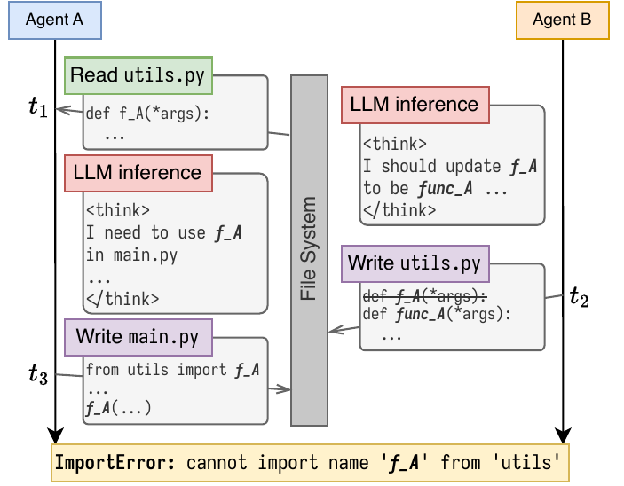

# 论文精读与深度综述：多智能体系统应当将并发控制列为首要任务 (ICML 2026 Position Paper)

> **论文题目**：*Position: Multi-Agent Systems Should Prioritize Concurrency Control*  
> **论文作者**：Xin Yang (浙江大学), Letian Li (清华大学), Zimo Ji (香港科技大学), Terry Jingchen Zhang (苏黎世联邦理工学院 ETH Zürich), Wenyuan Jiang (ETH Zürich, 通讯作者)  
> **发表会议**：ICML 2026 (Accepted Position Paper, arXiv: 2608.18092)  
> **论文源文件**：[本地 PDF 文档](./Multi-Agent_Systems_Should_Prioritize_Concurrency_Control.pdf) ｜ [完整 LaTeX 源码工程](./source/) ｜ [arXiv 链接](https://arxiv.org/abs/2608.18092)

---

## 📌 一句话核心概括

本立场论文针对当前大语言模型多智能体系统（MAS）中“规模越大反而越不可靠（41%～86.7% 失败率）”的严峻现实，提出颠覆性理论视角：**大量表面上被归咎为“沟通失效”、“对齐漂移”或“协作崩溃”的多智能体故障，其本质全都是经典的“共享状态并发控制问题”（Concurrency Control Problems）**。由于大模型长达数秒至数分钟的“思考时间窗口”与毫秒级工具执行之间存在巨大的**时间不对称性（Temporal Asymmetry）**，传统并发异常被急剧放大。论文呼吁将并发控制作为 MAS 系统设计的一等公民，并构建了涵盖**系统设计、基础设施与模型能力**的三层解构框架。

---

## 0. 三分钟读懂（Executive Summary）

### 0.1 核心直觉对比：直觉认知 vs. 系统并发真相

| 考察维度 | 直觉认知（传统 MAS 视角） | 系统并发真相（论文实证与理论视角） | 经典系统/数据库对应概念 |
| :--- | :--- | :--- | :--- |
| **协同失败归因** | 智能体 Prompt 写得不够好，或者大模型发生认知幻觉与理解偏差 | 智能体在并发读写共享环境状态时缺乏**隔离性**与**时序同步屏障** | **陈旧读 (Stale Read)**、**丢失更新 (Lost Update)** |
| **多 Agent 扩展瓶颈** | 智能体越多，对话历史越长，上下文注意力发生衰减与信息过载 | 多个推理线程在共享资源上缺乏冲突检测，**时间不对称性**导致写冲突概率随 $N$ 呈组合级爆炸 | **数据争用 (Data Race)**、**可串行化冲突 (Serialization Conflict)** |
| **消息与执行脱节** | Agent 规划逻辑混乱、指令遵循能力不足 | 智能体执行动作与接收通知异步交错，缺乏**原子性事务保障** | **动作-消息去同步化 (Action-Message Desynchronization)** |
| **加锁解决并发** | 遇到并发冲突直接加互斥锁（Mutex / 2PL）即可 | LLM 单次推理耗时数秒至数分钟，**悲观锁会导致严重的线程阻塞与雪崩式延迟** | **长事务阻塞 (Long-Lived Transaction Stalling)** |
| **乐观回滚解决** | 遇到冲突就回滚重试（Optimistic Concurrency Control） | LLM 推理成本极其高昂，简单回滚会**浪费大量 Token 与算力**，甚至造成活锁（Thrashing） | **高争用回滚开销 (High Abort/Retry Penalty)** |

---

### 0.2 全文三层解构逻辑图

```text
               ┌─────────────────────────────────────────────────────────┐
               │    多智能体协同失效核心根源：共享可变状态下的缺乏并发控制    │
               │   (Temporal Asymmetry: 秒级/分钟级推理 vs 毫秒级工具执行)  │
               └────────────────────────────┬────────────────────────────┘
                                            │
         ┌──────────────────────────────────┼──────────────────────────────────┐
         ▼                                  ▼                                  ▼
┌───────────────────────┐        ┌───────────────────────┐        ┌───────────────────────┐
│ 1. 系统设计层 (System) │        │2. 基础设施层 (Infra)  │        │  3. 模型能力层 (Model) │
├───────────────────────┤        ├───────────────────────┤        ├───────────────────────┤
│ • 隔离级别权衡         │        │ • Git 分支即隔离环境   │        │ • 冲突感知与检测基准  │
│   (RC 弱隔离 vs. SER) │        │   (CAID / EvoGit)     │        │   (Silo-Bench / MAST) │
│ • 悲观锁 vs. 乐观验证  │        │ • KV 缓存检查点回滚   │        │ • 冲突仲裁与协调微调  │
│ • 多版本并发控制 (MVCC)│        │   (KV-Cache Rollback) │        │   (SFT / MARL 训练)   │
│ • 细粒度资源抽象(函数级)│       │ • 现代推理引擎极速化   │        │ • 任务正交解耦 Prompt │
│ • 语义级冲突反馈解释   │        │   (缩短事务时间窗口)   │        │   (减少共享资源重叠)  │
└───────────────────────┘        └───────────────────────┘        └───────────────────────┘
```

---

### 0.3 四大代表性并发机制影响与核心数据看板

根据论文整理的跨基准实证数据，明确证实**引入显式并发控制机制对 MAS 性能具有决定性影响**：

| 系统 / 基准 | 引入的并发控制机制 | 实验对比与实证效果 | 核心并发启示 |
| :--- | :--- | :--- | :--- |
| **CAID** *(Geng & Neubig, 2026)* | **Worktree 工作区隔离 + 合并期语义验证** | 任务成功率从无隔离的 **55.5% 跃升至 63.3%**（甚至显著超越单 Agent 的 57.2%） | 乐观隔离能有效化解编码过程中的破坏性写冲突 |
| **CodeR** *(Chen et al., 2024)* | **依赖调度有向无环图 (Task Graph Scheduling)** | 具备依赖调度的任务解决率达到 **22%**，而移除任务图后暴跌至 **10%**（解决率折损超 54%） | 显式拓扑依赖能规避“前序未完、后序抢跑”的时序异常 |
| **Silo-Bench** *(Zhang et al., 2026)* | **同步屏障 (Barriers) 与状态冲突管理** | **67.1% 的 MAS 失败可归因于并发冲突**；在高资源争用下，相对协作开销（RCC）达到 **100%** | 缺乏屏障与冲突控制会导致多 Agent 系统发生严重性能坍塌 |
| **MegaAgent** *(Wang et al., 2024)* | **并行分组调度 (Parallel Scheduling)** | 端到端执行时间从串行基线的 **4505 秒缩短至 800 秒**（加速比超过 **5.6 倍**） | 合理的并发调度能在维持正确性的同时带来巨幅吞吐收益 |
| **SagaLLM** *(Chang & Geng, 2025)* | **Saga 补偿事务保障 (Compensating Transactions)** | 在动态多智能体规划场景下，实现了 baseline LLM planner 完全无法做到的**响应式正确回滚与规划** | 面对复杂跨 Agent 交互，必须提供原子性补偿与回滚能力 |

同时，在多智能体失败案例库中，**直接由并发根源导致的错误占据了主导地位**：
- **过早提交（Premature Submission）**：Silo-Bench 中 **37.2%** 的失败源于缺少同步屏障（Sync Barrier），智能体在前置条件未满足时抢跑提交；
- **共识崩溃（Consensus Failure）**：Silo-Bench 中 **29.9%** 的失败源于并发冲突状态；
- **智能体间失配（Inter-agent Misalignment）**：MAST 基准中 **36.9%** 的失配直接根源于陈旧读（Stale Reads）与不一致状态。

---

## 1. 动机与核心背景：多智能体协作的“阿喀琉斯之踵”

### 1.1 从单智能体扩展到多智能体的残酷现实

基于 ReAct 范式的自主智能体通过工具调用在软件工程、科学探索等领域取得了显著进展。然而，当业界尝试将单智能体扩展为多智能体系统（如 MetaGPT、ChatDev、AutoGen、Camel）以期突破更复杂的长链路任务时，却遭遇了严重的**可靠性悖论**：
- 在多个知名评测基准（如 AgentBench、Silo-Bench、MAST、SWE-bench）中，MAS 的失效率高达 **41% ～ 86.7%**；
- 简单增加智能体数量不仅没有带来线性的性能收益，甚至经常**低于单智能体的表现**。

传统观点往往将这一瓶颈归因于大模型的认知局限：如“智能体间缺乏理解”、“系统 Prompt 未对齐”、“通信噪音导致上下文衰减”。但本论文明确指出：**学术界长期开错了药方——这些失效场景绝大部分发生在多个智能体同时访问、修改共享的可变环境状态（Shared Mutable State）时**。

---

### 1.2 致命放大器：时间不对称性 (Temporal Asymmetry)

在传统单机多线程或分布式数据库中，一个 CPU 指令只需纳秒级，数据库行读写只需微秒级，冲突时间窗口非常微小。

然而，在基于大模型的多智能体系统中，存在着极其严重的**时间不对称性**：
1. **读写工具动作执行极快**：读取文件、写入磁盘、调用外部 API 通常在 **毫秒级 ($10^{-3}\sim 10^{-1}$ 秒)** 完成；
2. **LLM 内部思考/推理耗时极长**：模型理解上下文、生成思路、自反思、自纠错需要 **数秒至数分钟 ($10^1 \sim 10^2$ 秒)**。

这意味着：**在某个智能体读取了环境状态并陷入漫长推理思考的时间窗口内，整个共享环境可能已经被其他并发运行的智能体修改了数次！** 这种长达几万倍的时间差，使得传统软件工程中罕见的数据争用在 MAS 中成为了**高概率乃至必然事件**。

<p align="center">
  
  <br>
  <em>图 1：多智能体协同编码中的陈旧读隐患（Stale Read Hazard）。Agent A 读取 utils.py 后进入漫长的推理实现阶段；与此同时 Agent B 重构了 utils.py（将函数 f_A 重命名为 func_A）。从各自视角看，两位智能体局部操作完全正确，但交错执行后却导致了 main.py 中出现引用断裂（Broken Import）。这是长思考窗口放大经典并发异常的典型证据。</em>
</p>

---

## 2. 伪装成协作失败的四大经典并发隐患 (Concurrency Hazards in Disguise)

论文系统性地将多智能体实践中常见的四种典型失效，严格映射到了数据库与分布式系统的经典并发异常：

### 2.1 陈旧读 (Stale Read / Write-After-Read)
- **典型场景**：在多智能体协同软件开发中，Agent A 读取了配置文件 `config.yaml` 或基础库 `utils.py`，然后开始规划并编写模块 `main.py`。在 Agent A 耗时 40 秒推理写代码的过程中，Agent B 更新了配置或重构了工具函数。Agent A 随后将写好的代码落盘。
- **失效后果**：系统处于不一致状态，`main.py` 试图调用已不存在的接口或错误的端点。
- **本质机理**：Agent A 在推理期间持有的是过期的快照，其操作基于已被外部事务破坏的前置假设。

### 2.2 丢失更新 (Lost Update / Write-After-Write)
- **典型场景**：两个编码 Agent 并发维护同一个公共工具文件 `utils.py`。Agent A 负责优化函数 `func_1`，Agent B 负责修复函数 `func_2` 的缺陷。
- **失效后果**：两个 Agent 基于相同的初始文件版本各自修改。后执行落盘写入的 Agent 将前一个 Agent 的修改完全覆盖，导致前者的成果被静默抹除，且没有任何智能体感知到冲突。
- **本质机理**：缺乏互斥写入锁或版本冲突检测，导致非原子性的盲写（Blind Write）。

### 2.3 陈旧更正 (Stale Correction)
- **典型场景**：在基于消息总线的智能体协作中（如 AutoGen / CAMEL），Agent A 广播了一份行动计划；Agent B 发现漏洞并立刻发送了一条紧急修正；然而由于网络传输延迟或处理队列排队，Agent C 在收到 Agent B 的修正之前，就已经启动了原计划的工具调用。
- **失效后果**：错误的行动已被实施并对外部物理环境产生了不可逆副作用。
- **本质机理**：消息传递与行动生效之间缺乏时序同步屏障（Synchronization Barrier）与原子性保证。

### 2.4 动作-消息脱节 (Action-Message Desynchronization)
- **典型场景**：在具身智能或复杂虚拟环境（如 Minecraft / MineDojo / Voyager）中，智能体既通过自然语言交流意图，又通过动作改变物理世界。Agent A 告知 Agent B“我去采集木材，箱子里留了斧头”，但并发运行的 Agent C 在此瞬间取走了斧头。
- **失效后果**：Agent B 按照语言协议去拿工具时扑空，信念状态与物理真实世界发生严重脱节。
- **本质机理**：自然语言承诺（Semantic Commitment）与物理状态变更之间缺乏两阶段提交（2PC）或严格隔离保护。

---

## 3. 多智能体系统的形式化建模与 ACID 映射

为了使多智能体并发研究摆脱松散的经验主义，论文给出了形式化建模体系：

### 3.1 形式化定义
- **系统组成**：系统由 $n$ 个智能体构成，各自拥有私有内部状态 $\{\mathcal{A}^1, \mathcal{A}^2, \ldots, \mathcal{A}^n\}$，共同操作在一个**共享环境** $\mathcal{E}$ 中；
- **状态二分法**：
  - **环境状态（Environment State $\mathcal{E}$）**：任何智能体均可修改的状态（如代码仓库、共享内存黑板、消息邮箱 Mailbox、外部物理世界）；
  - **私有状态（Agent-Local State $\mathcal{A}^j$）**：仅本智能体可读写的私有状态（如上下文窗口、推理思维链 Trace、私有系统提示词）；
- **动作分类**：
  - **无副作用读动作（Read Action $r \in \mathcal{R}$）**：保持 $\mathcal{E}$ 不变（如读取文件、查看游戏画面、读取收件箱）；
  - **具副作用写动作（Write Action $w \in \mathcal{W}$）**：直接改变 $\mathcal{E}$（如覆盖写入文件、发送广播消息、执行机械臂移动）。
- **长事务特性**：LLM 的推理计算虽然对外部环境 $\mathcal{E}$ 是无副作用的，但它构成了**以读取集合为前置条件的漫长只读事务**，推理期间若 $\mathcal{E}$ 发生变化，该事务的写回操作将必然破坏一致性。

### 3.2 数据库 ACID 理论映射

论文精辟地指出了传统数据库两大约束在 MAS 中的具象化体现：

$$\text{MAS 正确性保障} = \text{全局一致性 (Consistency)} + \text{局部隔离性 (Isolation)}$$

1. **一致性（Consistency）—— 全局协同视角**：
   - 系统的整体状态在并发操作合并后必须满足预定义的系统不变式（Invariants），例如代码必须能够通过类型检查和编译测试、资源不能被多重分配、动作依据的观察在执行时必须依旧有效。
2. **隔离性（Isolation / 可串行化 Serializability）—— 局部智能体视角**：
   - 每一个 Agent 在执行其任务时，其体验应当等价于“系统中只有它自己在运行”。
   - 形式上，多智能体交错执行的最终调度轨迹（Interleaved Schedule）必须等价于某种串行执行序列（Serial Execution Order）。任何 Agent 都不应当窥视到其他 Agent 尚未提交的中间半成品状态。

---

## 4. 多智能体并发控制三层设计空间与权衡矩阵 (Design Space)

论文构建了一个涵盖**系统设计层、基础设施层、模型能力层**的三层完备设计空间，并基于四大核心权衡指标展开了严密的技术推演：
- **$S$ (Task Success Rate)**：最终任务成功率；
- **$C$ (Compatibility)**：与各类 MAS 拓扑的架构兼容性与即插即用程度；
- **$E$ (Execution Efficiency)**：执行效率与并发吞吐量（端到端完成时间、有效并行度）；
- **$I$ (Inference Cost)**：大模型推理成本（Token 消耗、因中止回滚带来的算力浪费）。

---

### 4.1 系统设计层 (System Design Layer)

```text
┌──────────────────────────────────────────────────────────────────────────────────┐
│                         系统设计层核心决策与帕累托权衡                            │
├─────────────────────┬────────────────────────────────────────────────────────────┤
│ 决策维度            │ 候选方案与权衡 (Trade-offs)                                │
├─────────────────────┼────────────────────────────────────────────────────────────┤
│ 1. 隔离级别         │ 弱隔离 (Read Committed) [E↑, S↓: 高并发但冒异常风险]        │
│    (Isolation Level)│                    ↕                                       │
│                     │ 强隔离 (Serializable) [S↑, E↓: 绝对正确但限制并发]          │
├─────────────────────┼────────────────────────────────────────────────────────────┤
│ 2. 并发控制策略     │ 悲观加锁 (2PL/Locking) [S↑, E↓: 长推理期锁死其他 Agent]    │
│    (Control Mode)   │                    vs.                                     │
│                     │ 乐观验证 (OCC/Validation) [E↑, I↓: 冲突高发时算力全浪费]   │
├─────────────────────┼────────────────────────────────────────────────────────────┤
│ 3. 多版本机制       │ 单版本状态 (实现简单) vs. MVCC [E↑: 读写互不阻塞; C↓: 复杂度高] │
├─────────────────────┼────────────────────────────────────────────────────────────┤
│ 4. 事务粒度         │ 细粒度单动作 [E↑, I↓: 冲突窗口短但开销频]                  │
│    (Granularity)    │                    vs.                                     │
│                     │ 粗粒度子任务 [I↑, S↓: 易发生大范围昂贵回滚]                │
├─────────────────────┼────────────────────────────────────────────────────────────┤
│ 5. 事务边界控制     │ 显式 BEGIN/COMMIT [C↑, I↓: 灵活但要求模型理解事务语义]     │
│    (Boundaries)     │                    vs.                                     │
│                     │ 运行时隐式推断 [I↑, C↓: 减轻 Agent 心智负担但易切错粒度]   │
├─────────────────────┼────────────────────────────────────────────────────────────┤
│ 6. 锁与资源细粒度   │ 粗粒度文件锁 [I↑, E↓] vs. 细粒度 AST/函数锁 [E↑, I↓: 并行度高]│
└─────────────────────┴────────────────────────────────────────────────────────────┘
```

#### 关键技术争鸣：悲观锁 vs. 乐观验证的长思考两难困境
这是本篇论文最具洞察力的系统分析之一：
- **若选用悲观锁（Pessimistic Locking / 2PL）**：Agent A 在开始写代码前锁住 `utils.py`。因为 Agent A 推理耗时 60 秒，导致 Agent B、C 被迫完全冻结 60 秒，整个多智能体系统的并发优势瞬间归零，沦为效率极差的串行单线程；
- **若选用乐观控制（OCC / Optimistic Concurrency Control）**：所有 Agent 不加锁自由思考。提交时进行验证。但在高资源争用下，一旦冲突，Agent A 耗费数十万 Token、思考了 2 分钟的成果只能被无情 `ABORT` 并重试。如果并发智能体很多，可能陷入持续互相打断的**活锁（Thrashing）**，推理成本呈指数级爆炸。
- **破局之道 —— 多版本并发控制 (MVCC)**：
  通过维护状态的历史版本链，让读者只读属于自己事务启动时的快照，遵循“**读永远不阻塞写，写永远不阻塞读**”准则，将冲突验证延迟到提交期，并配合轻量级合并策略。

---

### 4.2 基础设施支持层 (Infrastructure Support Layer)

为了避免在 MAS 框架中重新发明脆弱的轮子，应当积极将成熟的基础设施“下沉”为 Agent 的并发底座：

1. **版本控制即基础设施（Git-as-Infrastructure）**：
   - **Branch-per-subtask 模式**：为每个并发执行的子任务分配独立的 Git 工作树（如 Git Worktree 或轻量级沙箱）。每个 Agent 拥有独立的副本，彼此物理隔离；
   - **合并期语义校验（Validation-at-Merge）**：Agent 提交时不单纯依赖文本 Diff 合并，而是运行自动化测试套件、语法树解析（AST Parser）和类型检查。若存在语义破损则拒绝合并（如 CAID 框架）。
2. **上下文与记忆版本控制（Context Management）**：
   - 将类 Git 的分支与合并语义引入智能体的上下文记忆管理（例如 GCC 系统），支持在不同智能体分流推理时共享公共前缀，在合并时融合记忆图谱。
3. **推理引擎极速化（Inference Latency Reduction）**：
   - 采用连续批处理（Continuous Batching / Orca）、PagedAttention、推测解码（Speculative Decoding）和权重量化。**更快的推理不仅是性能指标，从并发角度看，推理提速等价于缩短了事务的生命周期，从而直接成倍压缩冲突概率窗口**。
4. **KV-Cache 检查点与快速回滚（KV-Cache Checkpointing & Rollback）**：
   - 传统 OCC 中止后需要重头重新生成上下文。现代推理引擎若支持 Paged KV 缓存快照，即可在冲突时仅撤销发生冲突分支后的 Token 缓存，实现**低开销的差量回滚**，避免算力全盘报废。

---

### 4.3 模型能力层 (Model Capabilities Layer)

单纯依赖外围系统锁是不够的，底层大语言模型本身必须具备并发感知与协调能力：

1. **并发能力基准评测（Benchmarking Concurrency Awareness）**：
   - 构建专门用于测试 Agent 是否能**前瞻性预判冲突（Anticipate）**、**从报错中检测冲突（Detect）**以及**通过协商退让解决冲突（Resolve）**的全新基准；
   - 现有的基准（如 SWE-bench）只看整体成功率，无法区分“由于代码逻辑不会写导致的失败”与“由于读到陈旧配置被并发覆盖导致的失败”。
2. **强化学习与微调训练（Training for Concurrency）**：
   - 收集包含锁拒绝、版本过期、合并冲突解决的高质量多智能体协作轨迹进行 SFT 监督微调；
   - 引入多智能体强化学习（MARL），在奖励函数中不仅奖励最终任务成功，而且**惩罚不必要的资源冲突与无脑重试消耗**，训练智能体学会自主退让（Backoff）、加锁顺序一致性（避免死锁）以及仲裁请求机制。
3. **推理期干预与正交任务分解（Inference-time Interventions）**：
   - **提示词工程注入**：在 Prompt 中明确告诫 Agent 处于多任务共享环境中，要求执行修改前先刷新读取最新状态；
   - **正交任务拆解**：主控架构师智能体在规划初期，必须刻意将子任务映射到**物理上彼此正交隔离的资源集合上**（Disjoint Resource Partitioning），从源头上消除争用。

---

## 5. 对四大替代流行观点的犀利反驳 (Alternative Views & Rebuttals)

论文专门开辟章节，对当前学术界和工业界常见的四种避重就轻的观点进行了严厉批驳：

```text
┌──────────────────────────────────────────────────────────────────────────────────┐
│                             四 大 流 行 观 点 的 辨 伪                           │
├──────────────────────────┬───────────────────────────────────────────────────────┤
│ 流行观点                 │ 论文的反驳依据与系统本质缺陷                         │
├──────────────────────────┼───────────────────────────────────────────────────────┤
│ 1. “只要基础模型足够聪明，│ • 当智能体数量 N 扩展时，冲突发生的概率在数学上逼近 100%； │
│    自然语言协商就能解决” │ • 纯依靠自然语言聊天去协商资源锁，是在海量浪费推理预算；   │
│                          │ • 隐藏在模型权重里的非确定性行为既无法审计，更无法排错。  │
├──────────────────────────┼───────────────────────────────────────────────────────┤
│ 2. “传统数据库事务与行锁  │ • 数据库操作是微秒级，LLM 推理是分钟级，时间不对称性达数万倍；│
│    直接生搬过来就能用”   │ • 传统锁死等会冻结系统；传统 OCC 回滚会烧穿财务预算；     │
│                          │ • Agent 具备语义不确定性，需要系统与模型的联合协同设计。 │
├──────────────────────────┼───────────────────────────────────────────────────────┤
│ 3. “利用 CRDT 或最终     │ • 混淆了「状态收敛 (Convergence)」与「语义正确性」；       │
│    一致性就足够了”       │ • CRDT 副本最终可能完全一致，但推理期间基于陈旧上下文生成的│
│                          │   代码依然会存在语法断裂与逻辑 Bug。                     │
├──────────────────────────┼───────────────────────────────────────────────────────┤
│ 4. “现有的 Git / CI 工具  │ • Git 的文本 Diff 合并无法在代码运行期感知长推理上下文的假设破坏；│
│    已经完全覆盖此问题”   │ • 缺乏 Agent 能够直接交互并具备快照/回滚保障的原语支持。   │
└──────────────────────────┴───────────────────────────────────────────────────────┘
```

---

## 6. 面向两大领域的行动倡议 (Call to Action)

论文最后向人工智能（ML）与计算机系统（Systems/DB/PL）两大社群发出了跨学科合作的行动倡议：

### 6.1 给机器学习与大模型研究者 (For ML Researchers)
1. **停止将并发问题泛化归咎于“协作失效”**：
   - 在遇到偶发性、依赖执行时序的 Agent 失败时，首要排查是否发生了共享状态竞争与陈旧读，明确问题根源。
2. **构建面向争用场景的评估基准**：
   - 在基准设计中引入不同的**资源争用烈度（Contention Levels）**，度量多智能体在争用环境下的有效并行度、回滚丢弃 Token 数和冲突解决率。
3. **将并发意识作为模型训练目标**：
   - 探索通过 MARL 机制，让模型内生习得并发协调协议（如退避算法、冲突自愈），克服预训练语料全为串行代码的偏置。

### 6.2 给系统、数据库与程序设计语言研究者 (For Systems Researchers)
1. **适配重构，而非生搬硬套（Adapt, Not Transplant）**：
   - 继承经典的可串行化理论（Serializability）与 MVCC 架构，但必须面向大模型语义驱动、非确定性输出的特性重新设计协议。
2. **专为时间不对称性设计新型调度原语**：
   - 研发支持**可抢占/可中断推理（Interruptible Inference）**、**KV-Cache 差量回滚**以及**争用自适应调度**的执行引擎。
3. **打造智能体友好的并发基础设施与可观测工具**：
   - 为 MAS 研发原生的版本快照、冲突侦测与回滚 API，并提供细粒度的并发调试器（如类似于 DB 事务监控的 Agent 追踪器），让数据争用清晰可查。

---

## 7. 总结与深度启示

《Position: Multi-Agent Systems Should Prioritize Concurrency Control》是一篇极具穿透力的立场论文。它为整个 AI 智能体社区长期以来“头痛医头、脚痛医脚”的 Prompt 修补困境指明了根本病灶。

### 对当前工程实践的四大关键落地启示：
1. **工作区物理隔离是第一道防线**：任何严肃的多智能体协作（如多 Agent 协同写代码、协同排查 Bug），必须采用类似于 CAID 或 Git Worktree 的机制，**默认分配独立分支与隔离目录，严禁在共享工作区直接并发修改**；
2. **读快照必须绑定版本号**：智能体在发起长达数十秒的深度思考前，所读取的文件或环境必须打上版本指纹（Hash/Timestamp）。在提交更新时，必须核对前置版本指纹是否已被篡改；若已被篡改，立即中断或启动差异重合；
3. **架构规划必须坚持正交分解原则**：主架构师在向工作智能体派发 Task 时，要从依赖图谱（DAG）层面确保不同 Agent 负责的模块在文件级或函数级互不重叠，最大化降低系统的临界区（Critical Section）大小；
4. **重视语义级错误反馈**：当合并冲突发生时，系统应当把冲突的具体代码段、冲突方 Agent 的意图作为结构化 Prompt 注入给负责合并的 Agent，利用大模型的语义理解能力高效化解冲突。

---

## 8. 参考文献与论文索引信息

- **arXiv 编号**：`arXiv:2608.18092`
- **主类分类**：`cs.AI`
- **引用格式**：
```bibtex
@article{yang2026position,
  title   = {Position: Multi-Agent Systems Should Prioritize Concurrency Control},
  author  = {Xin Yang and Letian Li and Zimo Ji and Terry Jingchen Zhang and Wenyuan Jiang},
  journal = {arXiv preprint arXiv:2608.18092},
  year    = {2026}
}
```
- **核心关联文献**：
  - *CAID: Effective Strategies for Asynchronous Software Engineering Agents* (Geng & Neubig, 2026)
  - *CodeR: Issue Resolving with Multi-Agent Systems* (Chen et al., 2024)
  - *Silo-Bench: Evaluating Concurrency and Scalability in Multi-Agent Systems* (Zhang et al., 2026)
  - *SagaLLM: Context Management, Validation, and Transaction Guarantees for Multi-Agent LLM Planning* (Chang & Geng, 2025)
  - *MegaAgent: Practical and Scalable Multi-Agent Systems via Parallel Scheduling* (Wang et al., 2024)
