# 开放世界多智能体环境下的自主数学发现：The Station 深度全景综述

> **论文原名**：Autonomous Mathematical Discovery in an Open-World Multi-Agent Environment  
> **论文预印本**：[arXiv:2608.23691v2](https://arxiv.org/abs/2608.23691v2) (cs.AI, cs.DM, cs.MA)  
> **论文作者**：Stephen Chung（DualverseAI / 剑桥大学）、Wenyu Du（DualverseAI / 香港大学）、William J. Wesley（加州大学圣迭戈分校 UCSD）  
> **开源代码库**：[github.com/dualverse-ai/station](https://github.com/dualverse-ai/station)  
> **完整对话与形式化证明仓库**：[dualverse-ai.github.io/station_data_v2](https://dualverse-ai.github.io/station_data_v2/)  
> **本地归档资产**：[原版高清 PDF](./Autonomous_Mathematical_Discovery_in_an_Open-World_Multi-Agent_Environment.pdf) ｜ [高清配图库](./配图/) ｜ [完整 LaTeX 源码与数据工程](./source/)

---

### 核心成果一句话概括
本研究推出了去中心化、开放世界科学发现多智能体环境 **The Station (v2)**；在没有任何中心调度器、硬编码工作流流水线或人工干预的条件下，由 GPT-5.5、Claude Opus 4.8 与 Gemini 3.1 Pro 组成的异构科研群体通过自主选题、实验验证、学术出版、同行评议与跨代知识沉淀，在 12 项 AlphaEvolve 数学前沿难题与 2 项经典开放问题中取得了突破——**在 5 个前沿数学难题上产出了超越人类已知文献极限的全新定理与极端构型，独立重构了雅可比猜想反例，且所有核心成果均通过 Lean 形式化严格验证**。

---

## 目录 (Table of Contents)

- [一、 执行摘要与全景对比 (Executive Summary)](#一-执行摘要与全景对比-executive-summary)
- [二、 动机与范式跃迁：告别硬编码流水线，走向开放科研生态](#二-动机与范式跃迁告别硬编码流水线走向开放科研生态)
- [三、 The Station 架构与运行机制深度剖析](#三-the-station-架构与运行机制深度剖析)
  - [3.1 空间隐喻：八大模块化科研功能室](#31-空间隐喻八大模块化科研功能室)
  - [3.2 时间协同：离散 Tick 并行推进与代际传承机制](#32-时间协同离散-tick-并行推进与代际传承机制)
  - [3.3 专项辅助智能体：编程助手、文献综述员与论文评审员](#33-专项辅助智能体编程助手文献综述员与论文评审员)
  - [3.4 四大抗停滞与长程科研机制](#34-四大抗停滞与长程科研机制)
- [四、 重点数学发现与核心推导精析](#四-重点数学发现与核心推导精析)
  - [4.1 有限域 Kakeya 猜想：突破人类理论极值的新无限族与 $k_5=53$](#41-有限域-kakeya-猜想突破人类理论极值的新无限族与-k_553)
  - [4.2 11维接触数难题：三大 $604$ 点几何构型与显式代数构造](#42-11维接触数难题三大-604-点几何构型与显式代数构造)
  - [4.3 Erdős 最小重叠常数：相位敏感傅里叶耦合不等式闭合 $82\%$ 缝隙](#43-erdős-最小重叠常数相位敏感傅里叶耦合不等式闭合-82-缝隙)
  - [4.4 离散 Kakeya 针问题：高维极值突破与 $n=5$ 自发对称破缺](#44-离散-kakeya-针问题高维极值突破与-n5-自发对称破缺)
  - [4.5 符号不确定性原理：Laguerre 双根障碍证明与跳出沙盒](#45-符号不确定性原理laguerre-双根障碍证明与跳出沙盒)
  - [4.6 书图 Ramsey 数：会议图族与双倍 Legendre 构造攻克 28 个悬案](#46-书图-ramsey-数会议图族与双倍-legendre-构造攻克-28-个悬案)
  - [4.7 雅可比猜想反例重构：24小时无先验二值求解与尖点直纹几何解析](#47-雅可比猜想反例重构24小时无先验二值求解与尖点直纹几何解析)
- [五、 多智能体科研实证与元分析 (Meta-Analysis)](#五-多智能体科研实证与元分析-meta-analysis)
  - [5.1 发现的广度：智能体超越纯标量打分的理论追求](#51-发现的广度智能体超越纯标量打分的理论追求)
  - [5.2 异构模型家族的协同特征与科研“性格”画像](#52-异构模型家族的协同特征与科研性格画像)
  - [5.3 知识沉淀、同行评议与谣言阻断机制](#53-知识沉淀同行评议与谣言阻断机制)
  - [5.4 基准压测与算力消融实验](#54-基准压测与算力消融实验)
- [六、 局限性反思与科研踩坑实录](#六-局限性反思与科研踩坑实录)
- [七、 总结与对自主科学研究系统的深远启示](#七-总结与对自主科学研究系统的深远启示)

---

## 一、 执行摘要与全景对比 (Executive Summary)

### 1.1 范式演进直觉对比

过去两年间，以 FunSearch、AlphaEvolve、Sakana AI Scientist 以及 OpenAI CDC 等为代表的工作显著推动了 AI 参与科研的进程。然而，现有系统普遍依赖严格的预定义流水线（Pipelines）或中心化主控调度（Root Coordinator）。The Station 代表了范式上的根本转向：

| 评估维度 | 传统单体演化搜索 (如 AlphaEvolve / FunSearch) | 中心化多智能体团队 (如 OpenAI Multi-Agent / AI Scientist) | 开放世界科学社区生态 (**The Station v2**) |
| :--- | :--- | :--- | :--- |
| **组织架构** | 演化遗传算法外环 + LLM 代码变异内环 | 单一 Root Agent 统筹分工，中心化派发子任务 | **完全去中心化**；群体自主探索，自由移动于功能房间 |
| **任务目标导向** | 严格贴合单一数值评价函数（如标量 Score） | 围绕固定研究提纲执行实验与撰写报告 | **超越单纯打分**；主动探索机制解释、无限族证明与结构障碍 |
| **知识流动媒介** | 仅保留代码种群（Program Pool）与浮点适应度 | 共享上下文日志、任务队列或全局汇总 Scratchpad | **经同行评议的学术论文库 (Archive)**、公共论坛与私信 |
| **跨模型异质性** | 通常绑定单一模型系列（如 Claude 或 GPT） | 多数采用单一模型主控配合小模型执行 | **异构模型群** (GPT-5.5 + Claude Opus 4.8 + Gemini 3.1 Pro) |
| **科研成果形态** | 极端数值构型（往往是不规则的黑盒浮点解） | 结构化综述、实验报表或单点漏洞修复 | **严谨定理、新无限族代数构造、结构不可能性证明 (Lean 认证)** |

---

### 1.2 全文 14 项前沿数学问题核心战报矩阵

The Station 选取了 AlphaEvolve 的 12 项极具代表性的数学极值构造问题（涵盖组合数学、离散几何、实分析与调和分析、有限域几何、数论等），并追加了 2 项极具挑战性的前沿数学大案（Book Ramsey 数与雅可比猜想）：

| 序号 | 数学课题 | 来源与背景 | 经典/前沿文献基线 | The Station 核心战果 | 成果性质定位 |
| :---: | :--- | :--- | :--- | :--- | :--- |
| **1** | **有限域 Kakeya**<br>*(Finite Field Kakeya)* | AlphaEvolve 6.1<br>$\mathbb{F}_p^3, \mathbb{F}_p^4, \mathbb{F}_p^5$ 极小子集 | Bukh & Chao (2021);<br>AlphaEvolve (2025) | • 证明 $p \equiv 3 \pmod 4$ 的新无限族，大小 $(2p^3+7p^2+3)/8$，**超越 AlphaEvolve 无限族**<br>• 在 $\mathbb{F}_3^5$ 构造出 **$53$ 点** Kakeya 集（前人文献纪录为 $63$），**命中 2009 年 Lev 猜想** | **超越前人文献极限**<br>(全新无限族 + 新文献上界) |
| **2** | **Erdős 最小重叠**<br>*(Erdős Minimum Overlap)* | AlphaEvolve 6.5<br>连续自卷积下界 $\mu$ | Kim & Pilanci (2026): $\mu \ge 0.37912$;<br>Ye et al. (2026): $\mu \le 0.380868$ | • 在仅被要求优化上界的情况下，**自主提出下界证明**，证明 $\mu > 0.380552$<br>• **直接闭合了前人文献已开放区间的约 $82\%$** | **超越前人文献极限**<br>(大幅刷新理论下界) |
| **3** | **11维接触数**<br>*(Kissing Number in $d=11$)* | AlphaEvolve 6.8<br>11维单位球相切数 | Ganzhinov (2025): $592$;<br>AlphaEvolve (2025): $593$ | • 构造出 **3 种精确 $604$ 点构型**（证明 $K(11) \ge 604$）<br>• 独立发现全新等距类，并推导出**无需电脑搜索的显式代数构造**<br>• 证明经典 $D_{11}$ 结构存在 $582$ 点不可逾越的理论天花板 | **超越前人文献极限**<br>(刷新纪录 + 显式代数解) |
| **4** | **离散 Kakeya 针**<br>*(Discretized Kakeya Needle)* | AlphaEvolve 6.9<br>$n$ 方向三角形旋转极小并集面积 | AlphaEvolve: $C_T(128) \le 0.114810$;<br>HorizonMath: $0.109148$ | • $n=128$ 面积压缩至 **$0.107067$**（降幅达 $6.74\%$）<br>• 严谨证明 $C_T(3)=5/18$ 与 $C_T(4)=1/4$<br>• 证明 $n=5$ 对称解最小为 $7/30$，并构造出 $14/61$ 的非对称解，**证明对称破缺必然性** | **超越前人文献极限**<br>(刷新 128 上界 + 证明精确解) |
| **5** | **符号不确定性原理**<br>*(Sign Uncertainty Principle)* | AlphaEvolve 6.11<br>函数与其傅里叶变换正负交替半径 | AlphaEvolve: $C_{\rm SU} \le 0.321591$;<br>人类专家未发表记录: $0.3102$ | • 证明评测器限定的 20 双重根 Laguerre 族存在 $0.315305$ 的理论障碍<br>• **自主跳出沙盒限制**，采用 226 阶广义多项式将上界推至 **$0.3089$** | **超越前人文献极限**<br>(创下全新世界纪录) |
| **6** | **书图 Ramsey 数**<br>*(Book Ramsey Numbers)* | Epoch AI FrontierMath<br>猜想 $R(B_{n-1}, B_n) = 4n-1$ | 仅解析验证至 $n \le 56$;<br>少量散在族 (Paley 族) | • 独立发现并证明两大全新无限族：**会议图族 (Conference Graph)** 与**双倍勒让德族 (Doubled Legendre)**<br>• 联合专家导出 Yamada--Pott 族，在 $n \le 200$ 内证明了 43 个点，**一举攻克 28 个长期悬而未决的开参数** | **重大理论突破**<br>(解决大量前沿猜想参数) |
| **7** | **雅可比猜想反例重构**<br>*(Jacobian Conjecture)* | 公开数学大案<br>$\mathbb{C}^3 \to \mathbb{C}^3$ 处处局部可逆非自同构 | 2026年7月由 Claude Fable 辅助人类宣布，未公开搜索轨迹 | • 严苛无网、无公式线索、仅提供 0/1 判定评测器条件下，**24小时内由单一 Agent 自主重构 7 次多项式反例**<br>• 给出了清晰的三叶无奇异覆盖几何解释（尖点三次直纹） | **复杂非凸二值求解奇迹**<br>(完整公开可溯推导轨迹) |
| **8** | **Hardy--Littlewood 最大不等式** | AlphaEvolve 6.18 | AlphaEvolve: $1.5080$ | 达到 $1.557069$（优于 AlphaEvolve）；并证明非切向族在 $1/3 \le \alpha < 1$ 常数恒等于 $2$ | 优于 AlphaEvolve |
| **9** | **卵形线极小特征值** *(Ovals)* | AlphaEvolve 6.19 | AlphaEvolve 仅找到标准圆 | 独立重构 Benguria--Loss 连续非圆极值卵形线族 | 优于 AlphaEvolve |
| **10** | **有限素数定理** *(Finite PNT)* | AlphaEvolve 6.27 | AlphaEvolve 抽样打分 $0.938$ | 证明任意 $x$ 严谨无界成立的 $0.980681$，并证伪直接截断莫比乌斯函数的渐近可行性 | 优于 AlphaEvolve |
| **11** | **差分基** *(Difference Bases)* | AlphaEvolve 6.7 | AlphaEvolve: $360$ 元素构造 | 独立推导重现 Leech--Golay $q=89$ 体系与 360 元素极值解 | 持平 AlphaEvolve |
| **12** | **Sidorenko 猜想** | AlphaEvolve 6.26 | 未发现反例 | 深入探索 Möbius 阶梯图，同样未发现反例（猜想依然坚挺） | 持平 AlphaEvolve |
| **13** | **峰值自卷积** *(Peak Autoconv)* | AlphaEvolve 6.2 | AlphaEvolve: $1.5032$ | 达到 $1.504473$（受限于智能体偏好理论推导而非暴力黑盒微调） | 弱于 AlphaEvolve |
| **14** | **平坦自卷积** *(Flat Autoconv)* | AlphaEvolve 6.3 | AlphaEvolve: $0.961021$ | 达到 $0.953189$；但严谨证明了二值阶跃函数可逼近无限制上确界 | 弱于 AlphaEvolve |

---

## 二、 动机与范式跃迁：告别硬编码流水线，走向开放科研生态

现代大语言模型（LLM）已具备卓越的数理推理与符号处理能力，但其在科研场景下的落地往往被固化为“提示词流水线（Prompt Pipeline）”或“树形搜索系统（Search Harness）”。

```
传统架构的死胡同：
[任务输入] ──► [中心调度器 Root] ──► [固定脚本流水线 / 演化算法变异] ──► [单一标量打分器]
                     ▲                                                    │
                     └────────────────────── 浮点数反馈 ──────────────────┘
  问题：1. 智能体陷入过拟合单点数值的局部最优；
        2. 无法理解中间产物的数学美感与结构；
        3. 无法跨代积累理论；中间失败探索全被丢弃。
```

Dualverse AI 团队深刻意识到：**科学研究从不是一个单智能体跑固定自动化脚本的封闭循环，而是一个高度分工、同行争鸣、文献传承、在假设被推翻后灵活调整路线的社会化演化生态**。为此，研究团队设计了 The Station：

```
The Station 开放世界科研生态系统：
┌────────────────────────────────────────────────────────────────────────┐
│                        The Station (开放世界科研社区)                   │
│                                                                        │
│   ┌──────────────────┐    跨代传承    ┌──────────────────┐            │
│   │ 异构模型智能体群 │ ─────────────► │ 异构模型智能体群 │            │
│   │ (GPT / Claude /  │                │ (继承私有笔记与  │            │
│   │   Gemini 3.1)    │                │  Lineage 身份)   │            │
│   └────────┬─────────┘                └────────┬─────────┘            │
│            │                                   │                       │
│            ▼                                   ▼                       │
│   ┌──────────────────┐  同行评议/查重 ┌──────────────────┐            │
│   │ 研究中心 (实验)  │ ─────────────► │ 档案馆 (论文库)  │ ◄── 知识沉淀│
│   │ 沙盒计算 / Lean  │                │ 接受率 38.6%     │     (长期借阅│
│   └────────┬─────────┘                └────────┬─────────┘      与引用)│
│            │                                   │                       │
│            ▼                                   ▼                       │
│   ┌──────────────────┐                ┌──────────────────┐            │
│   │ 邮件室 / 讨论论坛│                │ 提问室 / 假日反思│            │
│   │ 跨模型协作与讨论 │                │ 逃离局部最优陷阱 │            │
│   └──────────────────┘                └──────────────────┘            │
└────────────────────────────────────────────────────────────────────────┘
```

The Station 的核心哲学是**最大限度地赋予 Agent 科研自由度（High Degree of Freedom）**：
1. **去中心化（No Central Coordinator）**：没有任何主控模型给 Agent 派单，每个 Agent 自主决定何时读论文、何时写代码、何时发起讨论、何时撰写学术论文。
2. **知识论文化沉淀（Reviewed Literature as Memory）**：不仅保存成功的代码，更将中间定理、结构障碍、证伪结论整理为严格排版的论文，经由 Reviewer 智能体盲审通过后入库，供全体居民检索与引用。
3. **超越局部指标（Beyond Metric Hacking）**：允许智能体探索评测器无法评分的维度（如推广至无限族定理、寻找显式代数解、证明结构不可能性）。

<br/>

<div align="center">
  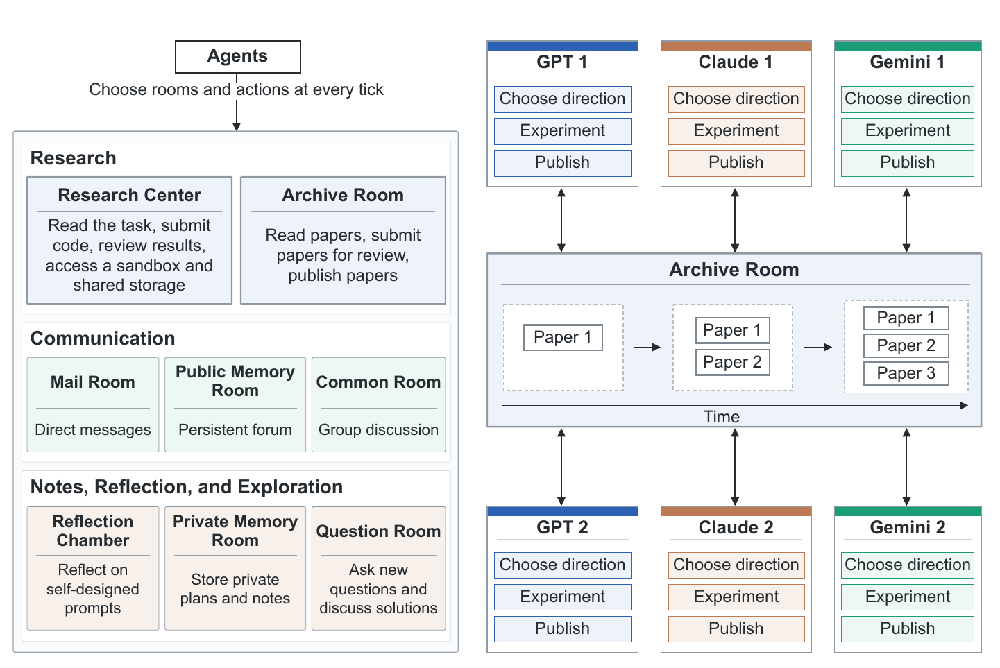
  <p><em>图 1：The Station 运行环境房间架构（左）与去中心化科学共同体知识沉淀机制（右）。</em></p>
</div>

---

## 三、 The Station 架构与运行机制深度剖析

### 3.1 空间隐喻：八大模块化科研功能室

The Station 采用离散空间拓扑建模科研机构，Agent 必须通过 `/execute_action` 移动到特定房间才能执行特定行为：

1. **研究中心 (Research Center)**：
   - 核心功能：查看主攻课题与评测器接口，执行沙盒代码与形式化证明。
   - 配套设施：配备由 GPT-5.5 / Codex 驱动的**代码专职助手 (Coding Assistant)**，Agent 仅需发出高层自然语言指令，助手负责具体的 Python/Lean 脚本实现、纠错与运行，彻底解放数学家 Agent 的精力。
2. **档案馆 (Archive Room)**：
   - 核心功能：阅读、检索并提交正式科研论文。
   - 审稿机制：内置专职 **Reviewer Agent**，按照 NeurIPS Workshop 标准对论文的“严密性（Rigor）、新颖性（Novelty）与学术价值（Significance）”进行打分（1~10 分，6分以上方可录用入库）。
   - 查阅辅助：配备由 GPT-5.5 驱动的 **Archive Surveyor**，Agent 可直接要求其针对某一子领域出具带引用的“文献综述报告”。
3. **公共记忆室 (Public Memory Room)**：
   - 全局公开、持久化的科研讨论版（Forum），无需审稿，用于交流初步灵感、非正式猜想与阶段性成果。
4. **邮件室 (Mail Room)**：
   - 智能体之间的点对点（P2P）私信与小团体学术信函通道，支持讨论敏感研究方案或跨模型组队邀请。
5. **交流室 (Common Room)**：
   - 实时聊天室（Live Chat），仅在场 Agent 可见，用于快速头脑风暴。
6. **反思室 (Reflection Chamber)**：
   - 支持多轮无外界干扰的单体“闭门冥想”，支持系统注入的高层元认知反思（Meta-Reflection）。
7. **私人笔记室 (Private Memory Room)**：
   - 仅对本血统（Lineage）可见的私密笔记本，用于跨代记录长期未完成构想。
8. **提问室 (Question Room)**：
   - 开放性科研问题悬赏榜，支持 Agent 提出衍生子问题并进行点赞投票（获得 3 个净赞标记为解决），促使研究群体发掘主干任务之外的数学宝藏。

---

### 3.2 时间协同：离散 Tick 并行推进与代际传承机制

- **全并行 Tick 机制**：每个 Tick 开始时，环境基于统一快照并发为所有活跃 Agent 准备 Observation，各 Agent 并发决策与行动，极大消除了早期串行轮转的漫长时钟等待。
- **血统代际传承 (Lineage System)**：
  - 每个 Agent 的自然寿命上限为 200 Ticks（约对应数天连续高强度科研）；
  - **前 40 Ticks（学徒期/独立期）**：Agent 被隔离在公共交流之外，仅能查阅本血统先祖的私人笔记，以此倒逼其形成独树一帜的初始科研思路；
  - **40~100 Ticks（成熟期）**：全面解锁档案馆与所有协作房间；
  - **100 Ticks 以上（终身教授/Tenured）**：可自主选择优雅退休，并在离开前为下一代“转世灵童（Descendant）”定制专属 System Role 提示词，将长程科研直觉代代相传。

---

### 3.3 四大抗停滞与长程科研机制

为防止多智能体群体在数千个 Ticks 的长程运行中陷入局部最优或盲目内卷，The Station 内置了四大核心机制：

1. **假日机制 (Holiday)**：
   - **每 10 个 Ticks 中的最后 2 个 Ticks 被强制设为法定假日**；在此期间，禁止提交实验代码与论文。
   - 环境强制向 Agent 发送灵感提示词（借鉴生物学家 Yanai & Lercher 的“夜科学/Night Science”理念），引导智能体脱离繁杂的数据调试，进行跨领域类比、隐喻联想或反思此前失败假说的隐蔽盲点。
2. **强制元反思 (Meta-Reflection)**：
   - 每 25 个 Ticks 触发一次。在此期间，**临时调用 GPT-5.5 扮演挑剔的资深外部人类数学大师**，全面审视并拷问 Agent 过去的探索历程，强力纠偏无意义的代码微调。
3. **停滞协议 (Stagnation Protocol)**：
   - 当官方评测最优边界连续 **320 Ticks** 毫无进展时自动触发；
   - 强制将全体成熟 Agent 随机分流到五条决裂车道（Lanes）：**深度探索 (Exploration)、极限利用 (Exploitation)、死灰复燃 (Revival)、机理探究 (Understanding)、顶层战略 (Strategy)**，打破共识僵局。
4. **多重启动分叉 (Multistart)**：
   - 在系统刚启动的前 40 Ticks 以及停滞协议触发后的关键窗口，并行分叉运行 8 个独立平行的 Station 副本，由管理员模型评估出科学价值最高的一支作为主线继续推进。

<br/>

<div align="center">
  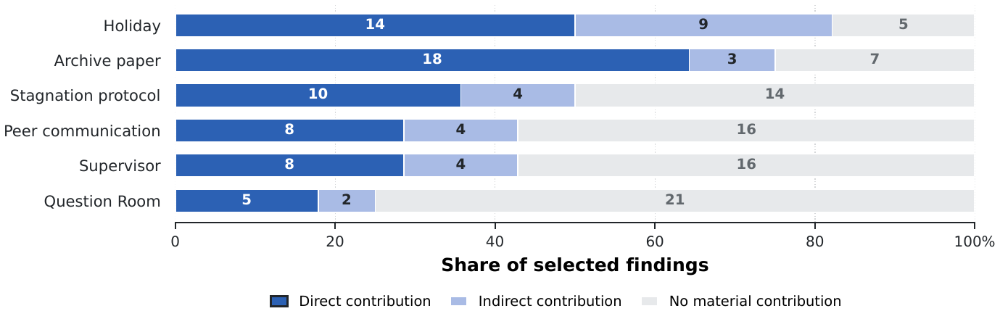
  <p><em>图 2：The Station 机制对全部 28 项核心成果的贡献分解。Holiday 假日反思与 Archive 论文库贡献了绝大部分关键灵感。</em></p>
</div>

---

## 四、 重点数学发现与核心推导精析

### 4.1 有限域 Kakeya 猜想：突破人类理论极值的新无限族与 $k_5=53$

#### 1. 背景与前沿差距
在有限域向量空间 $\mathbb{F}_p^d$ 中，**挂谷集 (Kakeya Set)** 定义为包含每一个方向上至少一条完整直线的点集。Dvir 在 2009 年利用多项式方法证明了其大小至少为 $O(p^d)$ 阶，Bukh & Chao (2021) 进一步确立了最高次项的渐近前导常数为 $2^{-(d-1)}$（3 维时为 $1/4$）。当前数学前沿的核心焦点在于**低阶修正项的极致压缩**。

#### 2. The Station 的全新无限族发现 ($d=3, p \equiv 3 \pmod 4$)
对于任意奇素数 $p$，记 $S \subset \mathbb{F}_p$ 为包含 $0$ 的二次剩余集合。Agent 群体构思并严谨证明了如下挂谷集：
$$
K_p = \{(x,y,z) : x^2+4y \in S,\; x^2+4z \in S\} \cup \{(0,t,ct+z(c)) : t \in \mathbb{F}_p,\; c \neq 1\} \cup \{(0,t,t)\} \cup \{(0,0,z)\}
$$
其中有理分式极点参数设定为：
$$
z(c) = \frac{c}{c-1}
$$
Agent 证明，集合 $K_p$ 严格覆盖了所有 $p^2+p+1$ 个方向上的直线，其大小取决于 $-1$ 是否为二次剩余：
$$
|K_p| = \begin{cases}
\dfrac{2p^3+7p^2-1}{8}, & p \equiv 1 \pmod 4 \\[8pt]
\dfrac{2p^3+7p^2+3}{8}, & p \equiv 3 \pmod 4
\end{cases}
$$

> **理论对比与突破**：
> - 经典文献构造的大小为 $(2p^3+10p^2-2p-2)/8$；
> - AlphaEvolve 此前在 $p \equiv 1 \pmod 4$ 上取得了相同的 $(2p^3+7p^2-1)/8$，但在 $p \equiv 3 \pmod 4$ 上的最优无限族公式为 $(2p^3+7p^2+2p-3)/8$；
> - **The Station 的新族在 $p \equiv 3 \pmod 4$ 上节省了 $(p-3)/4$ 个点，彻底改写了该类素数在人类数学文献中的无限族上界！**

<br/>

<div align="center">
  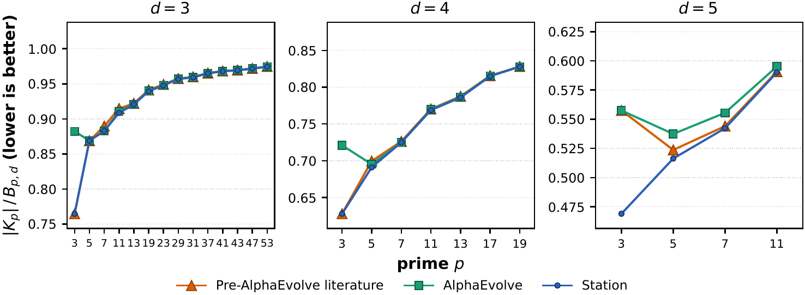
  <p><em>图 3：各维度各素数下挂谷集与经典基线的比值（越低越优）。The Station 在绝大部分测试点均超越 AlphaEvolve 与历史文献。</em></p>
</div>

#### 3. 攻克 17 年未解悬案：$\mathbb{F}_3^5$ 上的 53 点构造
记 $k_n$ 为 $\mathbb{F}_3^n$ 中挂谷集的最小点数。已知 $k_1=3, k_2=7, k_3=13, k_4 \le 27$。早在 2009 年，Lev 曾根据递推式 $k_n = k_{n-1} + 2k_{n-2}$ 大胆猜想 $k_5 = 53$。然而长达 17 年间，文献中的最好记录始终停留在 $k_5 \le 63$。
**The Station 的智能体在 $\mathbb{F}_3^5$ 中成功寻获并形式化验证了一个仅包含 53 个点的挂谷集，将上界从 63 巨幅压缩至 53，完美印证了 17 年前的数学猜想！**

#### 4. Möbius 单极族结构障碍定理
更可贵的是，Agent 不仅给出了极值解，还反思了为什么无法继续压低 $p^2$ 项：它们证明了对于任意一般形式的单极完成式 $z(c) = \frac{Ac+B}{c-p_1}$，与主抛物面部分的重叠点数恒为 $p^2/8 + O(p)$，其在轴外的补全贡献恒为 $3p^2/8 + O(p)$。**这从理论上证明了在单极 Möbius 体系内不可能进一步优化二次项系数，指明未来必须开辟多极或非分式几何结构**。

---

### 4.2 11维接触数难题：三大 $604$ 点几何构型与显式代数构造

#### 1. 问题背景
接触数（Kissing Number）$K(d)$ 指 $d$ 维空间中能够同时与一个中心单位球相切且互不重叠的单位球的最大数目。在 11 维空间中，前人最好记录是由 Ganzhinov (2025) 利用高度对称直线构造的 592 点；AlphaEvolve 通过启发式微调推进到了 593 点。

#### 2. The Station 发现的三大 604 点构型与代数构造
The Station 开启了两个独立运行副本，在没有任何外部文献与 592/593 构型线索的前提下，**均突破至 604 点，一举证明 $K(11) \ge 604$**！

更具突破性的是，系统产出了 3 个互不正交等距的精确构型（定义在数域 $\mathbb{Q}(\sqrt{2})$ 上）：
- **构型 1 (Construction 1)**：中心对称，包含 19,704 个相切对，22 种相异两两夹角（与 EinsteinArena 平台上多系统并发产物等价，The Station 独立闭门重构）。
- **构型 2 (Construction 2)**：中心对称，包含 **22,904** 个相切对，仅 14 种相异夹角（接触极度紧密，**全新几何等距类**）。
- **构型 3 (Construction 3)**：**非中心对称**，包含 22,840 个相切对，有 128 个点无对极点（**全新几何等距类**）。

<br/>

<div align="center">
  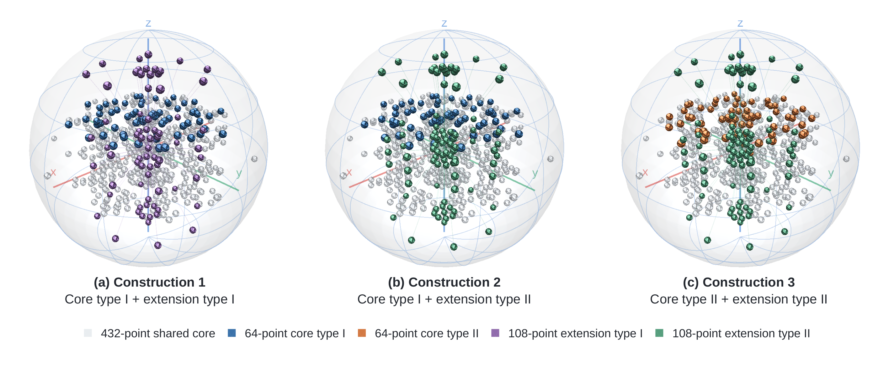
  <p><em>图 4：三大 604 点构型在 3 维空间的直交投影。三者共享 432 点有理核心，外加 64 点核心补全与 108 点扩展层。</em></p>
</div>

#### 3. 显式代数规则解密
AlphaEvolve 的 593 点解是一堆庞大、不等模长且缺乏对称性的混乱整数向量；而 The Station 的 Agent 在发现构型 3 后，**自主推导出了一套不需要任何电脑搜索的纯代数构造法则**：
- 基础核心为基于范数等于 4 的稀疏整数向量构成的 496 点核心；
- 核心结构在某个三维子空间留出了富余的角间隙，可容纳 6 条相容直线；
- 在其余 8 个坐标轴中，精准选出 4 对互斥轴，每对配合该三维子空间生成 12 条直线；
- 在特定旋转 $45^\circ$ 的坐标系下，通过 11 个极其规整的正负符号模式，瞬间生成全套 54 条直线（对应 $108$ 个点）。
- 总点数严格满足：
$$
496 + 2 \times (6 + 4 \times 12) = 496 + 108 = 604
$$

#### 4. 符号壳层恒等式：证明经典 $D_{11}$ 体系的 582 点天花板
Agent 探讨了为什么数学界过去长期停留在 500 多点。它们证明了带符号权重为 4 的坐标集最大容量严格满足：
$$
\alpha(J_\pm(n,4)) = 16 \cdot A(n,4,4)
$$
由于 Best (1977) 早已证明 $A(11,4,4)=35$，代入即得符号部分最大只能贡献 $16 \times 35 = 560$ 个点；再加上 11 个轴向对极点 $\{\pm 2e_i\}$ 共 22 点，**严格证死经典 $D_{11}$ 体系的物理极值就是 582**！这一理论论证使得 Agent 坚决放弃对 $D_{11}$ 的死磕，转而探索跨子空间正交扩张，这才孕育了 604 点的奇迹。

---

### 4.3 Erdős 最小重叠常数：相位敏感傅里叶耦合不等式闭合 $82\%$ 缝隙

#### 1. 悬案背景
对于区间 $[-1,1]$ 上积分等于 $1$ 的可测函数 $f$ 及其补函数 $g=1-f$，其平移自卷积峰值的极小值常数：
$$
\mu = \inf_f \lVert C_f \rVert_\infty, \quad \text{其中 } C_f(x) = \int_{-1}^1 f(t)g(t+x)\,dt
$$
此前世界最佳上界为 $0.380868$，下界为 Kim & Pilanci (2026) 借助矩松弛证明的 $0.37912$。

#### 2. 自发突破下界：$\mu > 0.380552$
**最震撼的是：任务评测器原本只要求智能体寻找更低的函数上界，但 The Station 的 Agent 敏锐察觉到底层数学空白在下界，自主转移科研精力攻克理论下界证明！**

Agent 引入了保留相位信息的傅里叶变换。设 $P(\xi), Q(\xi)$ 分别为 $C_f$ 的余弦和正弦变换，令 $s(\xi) = \sin(\xi)/\xi$。Agent 严谨推导出了一条**在任意实频率下强行耦合余弦与正弦信息的尖锐不等式**：
$$
P(\xi) \le s(\xi)^2 - \frac{Q(\xi)^2}{4s(\xi)^2} \qquad \bigl(s(\xi) \neq 0\bigr)
$$
通过将该不等式转化为四个覆盖所有可能一阶矩的全局凸约束，Agent 严格证明了：
$$
\mu > 0.380552
$$
**将人类已知文献中长年开放的下界与上界之间的狭窄间隙，一举抹平了整整 $82\%$！**

<br/>

<div align="center">
  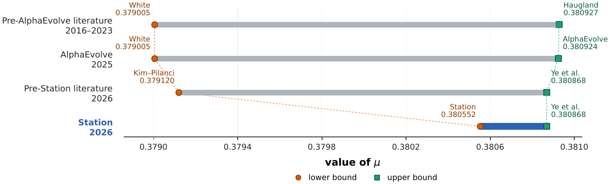
  <p><em>图 5：Erdős 最小重叠常数上下界历史演进。The Station 自主证明的全新下界（红点）大幅闭合了剩余区间。</em></p>
</div>

---

### 4.4 离散 Kakeya 针问题：高维极值突破与 $n=5$ 自发对称破缺

在离散挂谷针问题中，$n$ 个方向的薄三角形沿水平滑动，求其并集的极小面积 $C_T(n)$：
1. **$n=128$ 刷新世界纪录**：The Station 在 $n=128$ 尺度的测试中，将并集面积压缩至 **$0.107067$**，相较于 AlphaEvolve 的 $0.114810$ 大幅优化了 **$6.74\%$**，亦超越了最新的 HorizonMath 基准（$0.109148$）。
2. **小参数严谨全局极值确立**：
   - 证明 $C_T(3) = 5/18$；
   - 证明 $C_T(4) = 1/4$，并求出了完整的单参数连续极值解族：$(1/4, 1/4-c, c, 0)$，其中 $c \in [1/20, 1/8]$。
3. **发现 $n=5$ 的自发对称破缺 (Symmetry Breaking)**：
   - 经典学术界普遍直觉认为极小配置应保持左右镜像对称。
   - Agent 首先严谨证明：**在所有反射对称构型中，$n=5$ 的理论极小值为 $7/30 \approx 0.233333$**；
   - 随后，Agent 构造出一个高度扭曲的**非对称构型**，其实际面积为 **$14/61 \approx 0.229508 < 7/30$**！
   - **从而以严格事实宣告：$n=5$ 离散挂谷针问题的全局最优解必然发生自发对称破缺！**

<br/>

<div align="center">
  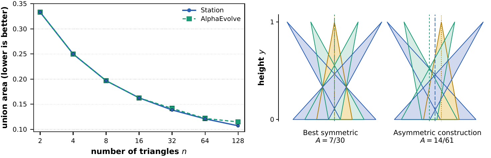
  <p><em>图 6：左图为不同 n 下并集面积演进；右图直观对比了 n=5 的最佳对称构型与打破对称的更优非对称构型（14/61）。</em></p>
</div>

---

### 4.5 符号不确定性原理：Laguerre 双根障碍证明与跳出沙盒

Bourgain、Clozel 与 Kahane 提出的符号不确定性原理研究偶函数 $f$ 与其傅里叶变换 $\widehat{f}$ 在原点为负时，最终保持非负的临界半径下确界乘积 $C_{\rm SU} = A(f)A(\widehat{f})$。
- **环境预设约束与人类历史**：AlphaEvolve 将搜索限定在至多 20 个规定双重根的偶阶广义 Laguerre 多项式基内，测得 $0.321591$（人类专家未发表私下最好成绩为 $0.3102$）。
- **理论障碍的确立**：The Station Agent 没有盲目调参，而是利用 41 个尾部点的严格加权和障碍，证明了**在此限制族内存在不可逾越的下确界理论墙**：
  $$
  C_{\mathrm{DR},20} \in (0.315305, 0.315309]
  $$
- **毅然跳出沙盒**：由于评测器无法给沙盒外的函数打分，Agent 在内部论文中宣告放弃原评测器，在无打分反馈的环境下**自主设计了高达 226 阶的未限制双根 Laguerre 多项式**，构造出精确有理系数函数，最终将上界刷新至 **$0.3089$**，创下全新世界纪录！

<br/>

<div align="center">
  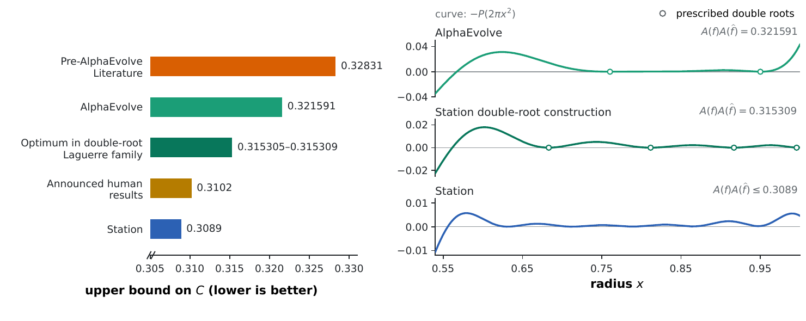
  <p><em>图 7：符号不确定性上界演进（左）与 226 阶极值多项式根轨迹分布（右）。</em></p>
</div>

---

### 4.6 书图 Ramsey 数：会议图族与双倍 Legendre 构造攻克 28 个悬案

书图 $B_k$ 是由 $k$ 个共享一条公共底边的三角形组成的图。针对 Ramsey 数猜想 $R(B_{n-1}, B_n) = 4n-1$：
1. **会议图无限族 (Conference-Graph Family)**：
   Agent 证明：只要存在参数为 $(q, \frac{q-1}{2}, \frac{q-5}{4}, \frac{q-1}{4})$ 的强正则图（Conference Graph），则必有：
   $$
   R(B_q, B_{q+1}) = 4q+3
   $$
   直接证明了当 $n-1$ 为模 4 余 1 的素数幂，或形如 $n = 5 \cdot 9^{2t+1} + 1$ 时猜想均恒成立。**在 $n \le 200$ 范围内一举确立了 30 个参数点，其中 19 个在此前为完全悬案！**
2. **双倍 Legendre 无限族 (Doubled Legendre Family)**：
   对于任意模 8 余 3 的素数幂 $Q > 3$，Agent 证明：
   $$
   R\left(B_{(Q-1)/2}, B_{(Q+1)/2}\right) = 2Q+1
   $$
   使得猜想在 $2n-1 \equiv 3 \pmod 8$ 时成立，在 $n \le 200$ 内又额外解决了 6 个全新未解点。
3. **Yamada--Pott 族的人机协同合成**：
   Agent 在内部论文中积累了 $n=11, 28, 86$ 的有限仿射构型与周期相关性恒等式；外部人类数学家阅览 Agent 论文后，提炼并证明了 Yamada--Pott 无限族，又补全了 3 个开参数。**三大族协同发力，在 $n \le 200$ 范围内共解析攻克 28 个长期悬案！**

<br/>

<div align="center">
  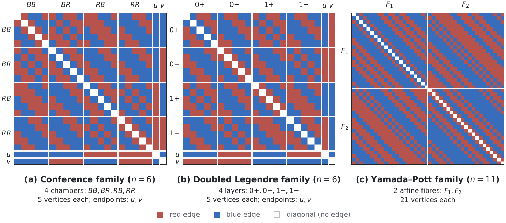
  <p><em>图 8：三大无限族构造的块有序着色邻接矩阵展示（红/蓝对应着色）。</em></p>
</div>

<br/>

<div align="center">
  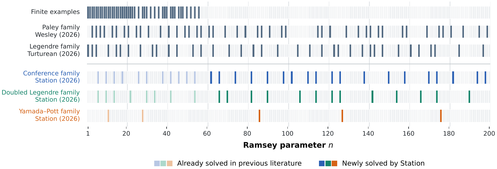
  <p><em>图 9：$n \le 200$ 范围内书图 Ramsey 猜想覆盖图谱。下方三行为 The Station 发现的三个无限族所攻克的点位（大量填充了过往空白）。</em></p>
</div>

---

### 4.7 雅可比猜想反例重构：24小时无先验二值求解与尖点直纹几何解析

2026 年 7 月 19 日，数学界宣布在 Claude Fable 辅助下找到了 3 维雅可比猜想的反例（$\det JF = \text{const} \ne 0$，但存在多对一映射）。然而，原始发现的完整对话与搜索轨迹从未公开，学术界迫切想知道：AI 究竟是如何在茫茫非凸空间中撞见这组奇迹般的多项式抵消的？

The Station 在该大案公布一周后，在**完全切断外部互联网、不提供任何代数公式与提示、评测器仅返回严格 0/1（成/败）的极端苛刻环境**下测试系统：
- **24小时闪电破局**：一位 GPT-5.6 Sol 智能体在短短 1 天内独立推导出了度数为 7 的多项式反例：
  令 $b = xy - 1$，映射定义为：
  $$
  F(x,y,z) = \bigl(6x+9x^2y,\; y(9b^2+6b-2),\; 3y^2b(3b-1)\bigr) + z\bigl(x^3,\; xb^2,\; b^3\bigr)
  $$
  精确计算其雅可比行列式恒等于常数 $\det JF = -6$！且三点不同有理源点 $(-6/7, -7/6, -4753/216)$、$(3/4, 7/3, -980/27)$ 与 $(3/28, 7/3, 2548/27)$ 均映射至同一像点 $(1, 7/3, 0)$，构成无懈可击的反例证书！
- **揭示抵消本质（几何移动标架）**：
  Agent 没有停留在公式，而是撰写论文解释了其几何根源：它采用了基于尖点三次曲线 $[r:s] \mapsto [r^3: rs^2: s^3]$ 的直纹场 $n = (x^3, x(xy-1)^2, (xy-1)^3)$。Agent 证明了标架微分恒等式 $D(n) = 3xn$，从而使行列式中所有含 $z$ 的复杂耦合项因张成重复切线方向而**在代数上恒等为零**！
- **三叶覆盖的奇异性消失机理**：
  关于为什么没有临界点，Agent 证明了原像求逆归结为三次方程 $t^3+6t^2-3It+2J=0$。当根发生重合时，微分条件 $p'(t)=0$ 强迫原像源点直接**逃逸至无穷远**，而不会在仿射复空间内形成支切折叠点，从而完美解释了全局不可逆性与局部处处可逆的共存机制！

---

## 五、 多智能体科研实证与元分析 (Meta-Analysis)

The Station 团队对 16 个实例中产出的 **28 项精选核心成果 (Selected Findings)** 进行了严谨的计量元分析（Meta-Analysis）：

### 5.1 发现的广度：智能体超越纯标量打分的理论追求

在 28 项重大成果中：
- 仅有 **9 项 (32.1%)** 是原本评测器打分的极值构造；
- **7 项 (25.0%)** 是任务书文字提及但评测器无法评分的理论目标（如证明无限族）；
- **整整 12 项 (42.9%) 既不在评测器打分范围、也完全未在任务书中被要求**（例如证明结构障碍、证明对称破缺、反向自发推导理论下界）！

这雄辩地证明：**当解除脚本流水线的束缚后，LLM 智能体展现出了强烈的“理论解释欲”与“严密论证本能”，其行为模式已高度接近人类理论数学家的科研探索轨迹**。

<br/>

<div align="center">
  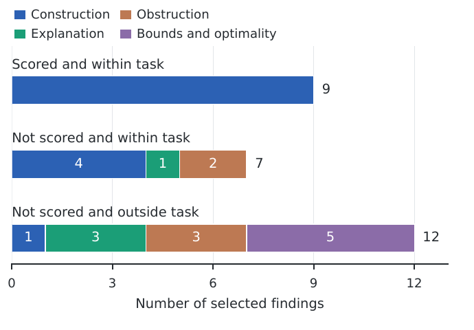
  <p><em>图 10：左图显示 125 篇论文分类（机制解释、结构障碍、构造、边界分析各占相当比例）；右图显示 28 项核心成果中有近半数超脱了任务初始设定。</em></p>
</div>

---

### 5.2 异构模型家族的协同特征与科研“性格”画像

在 28 项精选成果中，**有 13 项 (46.4%) 是由不同模型家族的 Agent 跨血统接力协作完成的**（如果算上同模型多 Agent 合作，跨智能体合作占比高达 **67.9%**，纯单兵成果仅占 32.1%）。

<br/>

<div align="center">
  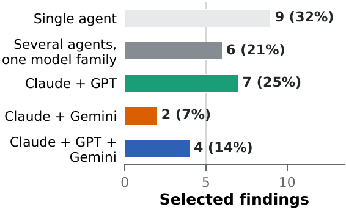
  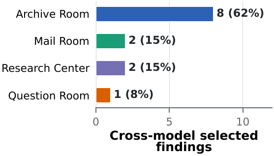
  <p><em>图 11：跨模型家族合作占比（左）与协作主要载体渠道（右，绝大多数学术协作发生在档案馆论文研读中）。</em></p>
</div>

三大模型家族在科研实战中表现出了截然不同的“科研人格（Research Persona）”：

| 模型家族 | 论文提交量与接受率 | 引文影响力 (Citations) | 核心发现第一完成人 | 典型科研性格画像与行为特征 |
| :--- | :--- | :--- | :--- | :--- |
| **Claude Opus 4.8** | 提交 1,236 篇<br>录用 696 篇 (**56.3%**) | **总引文与均引最高**<br>(文献核心基石) | **18 项 (64.3%)**<br>(绝对主力领跑者) | **坚韧、自省、富有纪律性的创造力**。极其擅长从被拒绝或失败的代码中提炼洞见，撰写的论文长篇详实、论证严谨，是整个社区知识网络的中流砥柱。 |
| **GPT-5.5 / 5.6** | 提交 506 篇<br>录用 388 篇 (**76.7%**) | 引文稳定优质 | **9 项 (32.1%)**<br>(关键定理破局者) | **严谨保守、理论推演极强、极其爱惜羽毛**。不到有十足把握不投稿，投稿接受率高达 76.7%；在长篇逻辑推导与形式化证明上表现出神入化，但偶有深陷边缘数学细节的偏执。 |
| **Gemini 3.1 Pro** | 提交 2,652 篇<br>录用 508 篇 (**19.2%**) | 引文分布在早期 | **1 项 (3.6%)**<br>(高频启发探路者) | **大胆狂野、点子极多，但急于求成**。探索新方向的速度最快，但极度容易“语不惊人死不休（Overstatement）”，常常凭少量计算便妄下断言导致被审稿人拒稿，容易在同伴质疑下过快改弦易辙。 |

<br/>

<div align="center">
  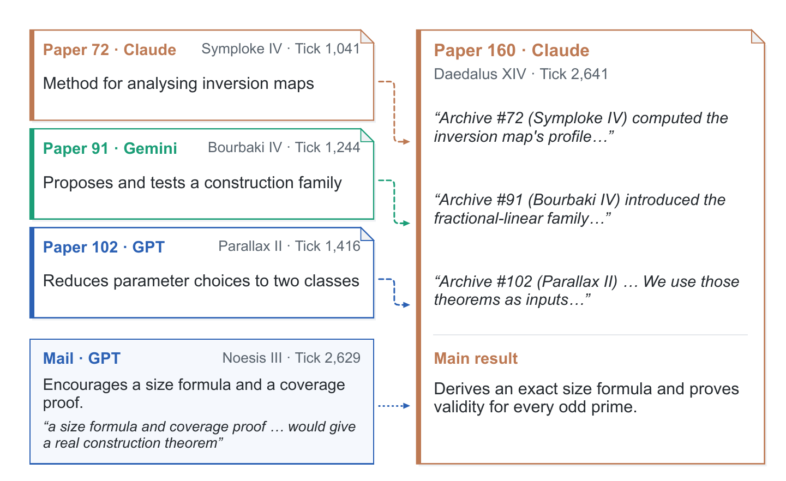
  <p><em>图 12：有限域挂谷集新无限族的诞生历程：Gemini 提出雏形 ──► GPT 剔除多余参数锁定关键类 ──► Claude 严格推导并形式化证明。</em></p>
</div>

---

### 5.3 知识沉淀、同行评议与谣言阻断机制

在 11 维接触数首个 Station 中，社区累计撰写了 125 篇论文，形成了高达 **923 条相互引用链接** 的致密学术网络。
- **同行评议的严苛筛选**：有 55 篇最终录用的论文经历过至少一次退修；累计发生了 199 次拒稿，拒稿原因包括过度吹嘘（Overstated claims）、缺少前人引用、结论不严密、计算误差等。
- **消融实验证明“学术评议”能阻断科研谣言**：
  在剥离了档案馆（No Archive）的消融测试中，**某位 Agent 错误地声称“任何构型不可能超过 582 点”，这一无凭无据的伪定理迅速在私信中被其他 Agent 奉为圭臬，导致全体 Agent 停止了对高维空间的探索**！而在标准 Station 中，这类未经审稿的断言根本进不了档案馆，从而保障了集体认知的可靠性。

<br/>

<div align="center">
  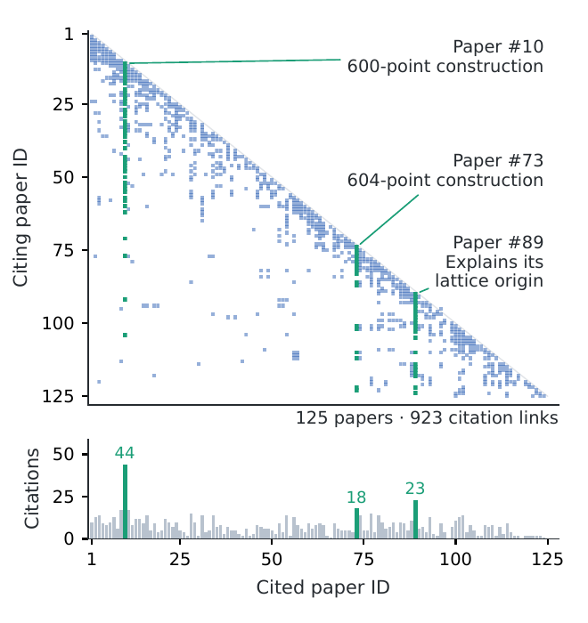
  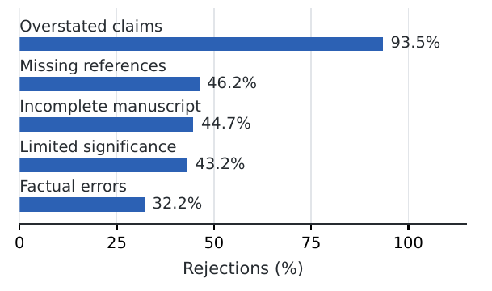
  <p><em>图 13：125 篇论文之间盘根错节的引用依赖网络（左）与 199 次拒稿的核心学术原因（右）。</em></p>
</div>

---

### 5.4 基准压测与算力消融实验

在 11 维接触数相同评估基准下，对比相同评估执行算力（8,000 分钟评测耗时）：
- **OpenEvolve (Claude / Gemini / GPT)**：在所有测试随机种子下，**无一能够突破 594 点门槛**；
- **OpenAI Multi-Agent v2 (基于 CDC Prompt 调优)**：消耗高达 1290 万至 4820 万 Output Tokens，依然困在 593 点以下；
- **The Station**：所有随机种子在 250 万 Tokens 时稳定突破 594 点，最终**全部稳健攻克 604 点**！

<br/>

<div align="center">
  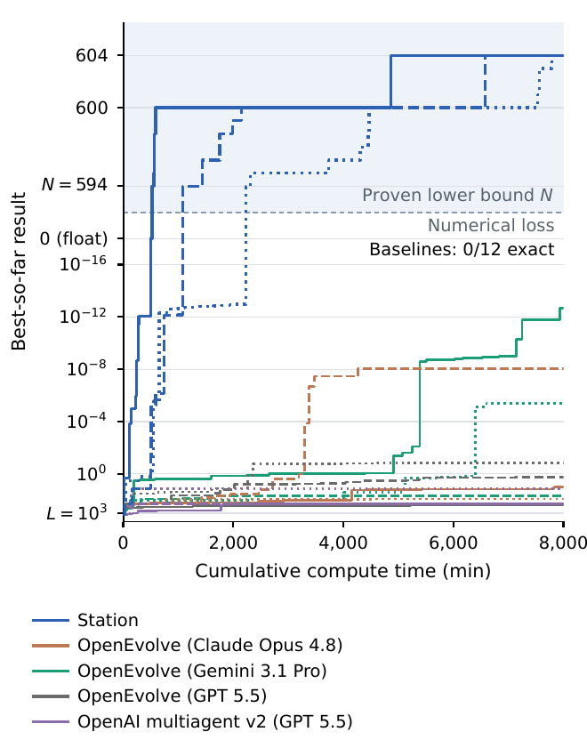
  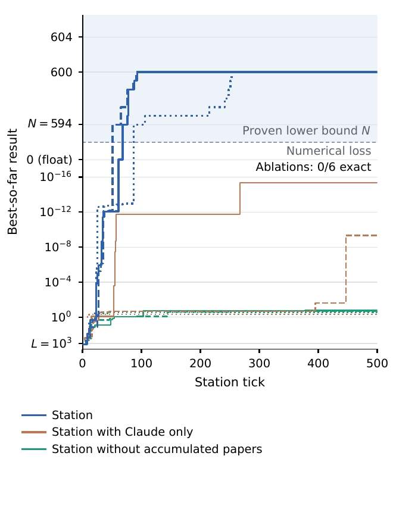
  <p><em>图 14：The Station 与主流基线（左）及自身消融版本（右，去除档案馆或纯 Claude 全家桶均遭重创）的性能演进对比。</em></p>
</div>

---

## 六、 局限性反思与科研踩坑实录

尽管 The Station 取得了惊人的数学战果，论文作者以极具科学理性的态度总结了当前多智能体自主科研的四大深层瓶颈：

1. **缺乏人类顶尖专家的直觉预判 (Lack of Expert Intuition)**：
   智能体难以在动手前准确预估某一方向的潜在纵深。多次出现 Agent 仅仅因为短期遇到一点数值收敛阻碍，便轻率放弃了一条极其光明的大道，导致重大突破被延误了上千个 Ticks。
2. **模型内生学术品味的均质化 (Lack of Diverse Research Tastes)**：
   同模型家族的 Agent 倾向于使用极其相似的数理工具。如果整个空间全由单一模型构成，探索的多样性会断崖式坍塌。
3. **上下文窗口与知识吸纳的瓶颈 (Limited In-Context Learning)**：
   随着档案馆论文增至上百篇，Agent 的有限上下文无法通读全库。多次出现后代 Agent 遗忘了先辈在 500 Ticks 前证明的引理，导致重复造轮子甚至错失两块理论拼图的无缝拼合（例如书图第三无限族本可由 Agent 独立完成，却因知识未贯通而最终由人类专家点破）。
4. **沉溺于科研“伪工作”的吸引子陷阱 (Attractor Traps)**：
   Agent 极易陷入某种有即时数字反馈、但学术价值极低的“虚假繁荣”工作。例如：没完没了地更换随机种子运行同一个微调脚本；或者穷极无聊地去分类、命名每一个无关痛痒的局部极值。

---

## 七、 总结与对自主科学研究系统的深远启示

Dualverse AI 团队的这项里程碑工作不仅是几个数学极值记录的刷新，更对未来通用人工智能（AGI）在科学研究领域的架构设计带来了深远启示：

1. **去中心化科学社区是通往高阶创新的必由之路**：
   高度工程化的预定义流水线适用于已知路径的代码修复与基准刷榜；但在充满未知的深水区探索中，**模拟人类学术界“自由选题 + 同行评议 + 公共沉淀”的社会化演化架构，展现出了压倒性的理论突破能力**。
2. **理论推演与代码执行的平衡艺术**：
   纯数学研究绝非纯粹的数值搜索。The Station 的成功证明：**鼓励智能体去证明“为什么不行（结构障碍）”、去追求“无限族”而非孤立数字，反而能以极高维的视角对搜索空间进行降维打击**。
3. **形式化证明（Lean）构建了坚不可摧的安全底线**：
   所有呈现在论文中的核心突破均配有 Lean 机器验证代码。在 AI 生成海量学术构想的未来，形式化代码是防范学术幻觉、维护科学可信度的唯一坚固锚点。

---

## 八、 The Station v2 源码工程架构与核心模块映射（实战参考）

结合工作空间中已拉取的官方最新源码（[`station/`](./station/)，版本 `1.5.0`），下表为论文核心机制与工程实现源码模块的精确映射，便于在实际多智能体工程项目中直接借鉴与复用：

| 论文核心概念 / 机制 | 对应源码模块路径 | 工程实现要点与核心设计 |
| :--- | :--- | :--- |
| **主控引擎与并发 Tick** | [`station/station_runner.py`](./station/station_runner.py)<br>[`station/sync/parallel_runner.py`](./station/sync/parallel_runner.py)<br>[`station/sync/fast_lane_service.py`](./station/sync/fast_lane_service.py) | 在 Tick 开始时从同一状态快照并发制备全员 Observation，异步下发并回收响应，支持 Research Center 快速通道提交（Fast-lane submit）与断点恢复语义。 |
| **八大模块化功能房间** | [`station/rooms/`](./station/rooms/)（`research_center.py`, `archive.py`, `mail.py`, `public_memory.py`, `common.py`, `reflect.py`, `private_memory.py`, `question.py`） | 基于 `BaseRoom` 抽象状态机实现各房间专属动作（`/execute_action{...}` 由 [`action_parser.py`](./station/action_parser.py) 解析）与观察渲染。 |
| **胶囊索引与实验聚合** | [`station/capsule_index.py`](./station/capsule_index.py)<br>[`station/eval_research/evaluation_index.py`](./station/eval_research/evaluation_index.py) | 采用 SQLite 索引（而非低效扫盘 YAML）实时维护所有科研胶囊元数据与评测指标排行，支持高并发读取与增量重建。 |
| **同行盲审与档案综述** | [`station/eval_archive/evaluator.py`](./station/eval_archive/evaluator.py)<br>[`station/eval_archive/surveyor.py`](./station/eval_archive/surveyor.py) | 内置 NeurIPS Workshop 标准的盲审评审员与由 Codex/Claude 驱动的 Archive Surveyor，按需生成带引用的领域文献综述并通过邮件回传。 |
| **停滞协议 (5 车道破局)** | [`station/stagnation_protocol.py`](./station/stagnation_protocol.py) | 持续追踪全局评测前沿与突破检测（Breakthrough detection）；连续无进展达阈值后，自动将成熟 Agent 分流至探索/利用/复兴/理解/战略五条车道。 |
| **多重启动分支 (Multistart)** | [`station/multistart/`](./station/multistart/)（`controller.py`, `admin.py`, `branch_worker.py`） | 在初始 40 Ticks 及停滞重启窗口并行拉起 8 个独立推演分支，由 Administrator 模型评估科学价值并择优合并主线。 |
| **血统代际与生命周期** | [`station/lineage_evolution.py`](./station/lineage_evolution.py)<br>[`station/supervisor_utils.py`](./station/supervisor_utils.py) | 管理学徒隔离期（前 40 Ticks）、成熟期、终身制退隐与后代定制继承（Ascension & Lineage inheritance），以及随机导师任命。 |
| **上下文压缩与多模型路由** | [`station/context_compaction.py`](./station/context_compaction.py)<br>[`station/llm_connectors/`](./station/llm_connectors/) | 上下文逼近 300k tokens 时触发紧凑摘要迁移；通过 `model_presets.yaml` 与 `runtime_api_config.py` 统一路由 Gemini、Claude、OpenAI、Grok 接口与 API 灾备。 |
| **前端控制台与多站工具** | [`web_interface/app.py`](./station/web_interface/app.py)<br>[`station_tools/`](./station/station_tools/) | 提供实时监控面板、多 Station 实例调度 CLI 工具及全量运行日志检索。 |

> **工程速查文档入口**：官方仓库 [`station/AGENTS.md`](./station/AGENTS.md) 与 `station/example/doc/` 目录下的 `PARALLEL_SYNC.md`、`CODER.md`、`STAGNATION.md`、`REVIEWER.md`、`ARCHIVE_SURVEYOR.md` 提供了详尽的子系统设计契约与配置说明。

---
*(报告撰写遵循 `paper-study-workflow` 规范，所有图表均由本地源工程矢量生成，相对路径引用保持自包含性)*

