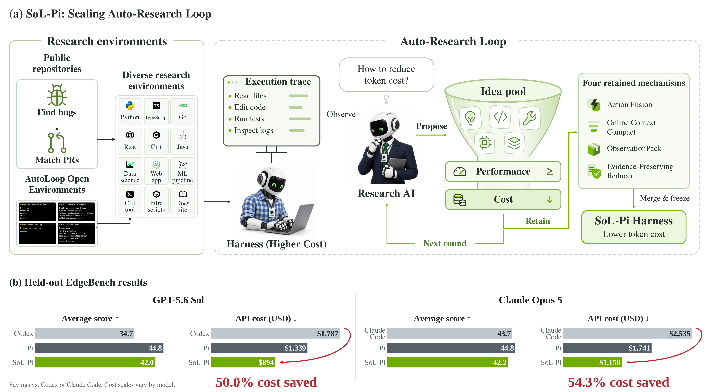
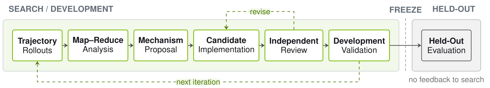
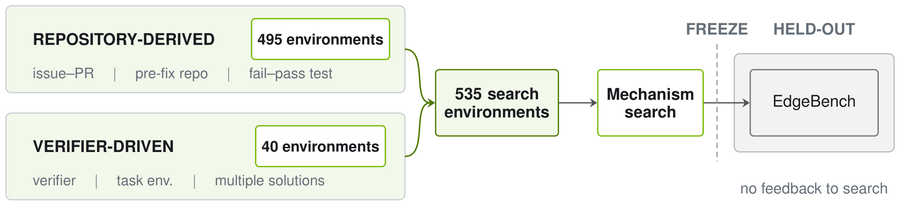
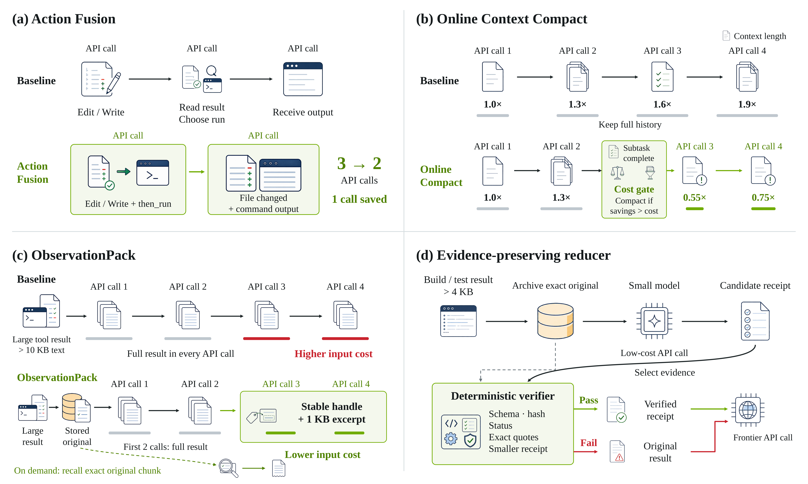
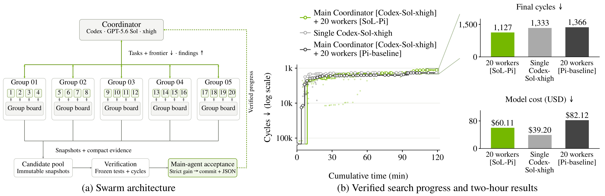
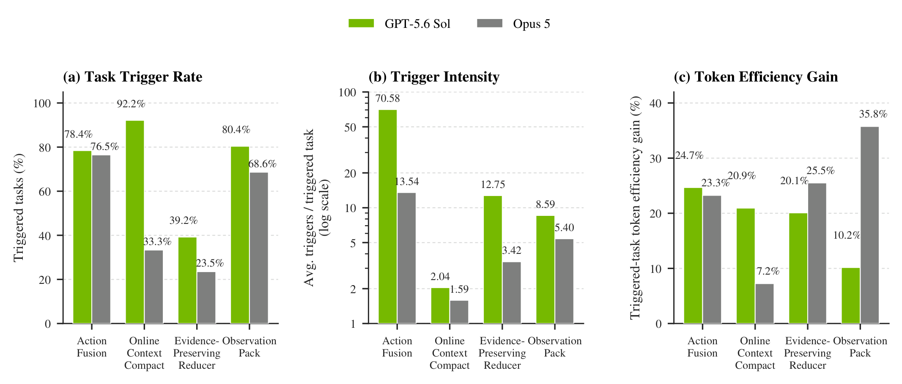
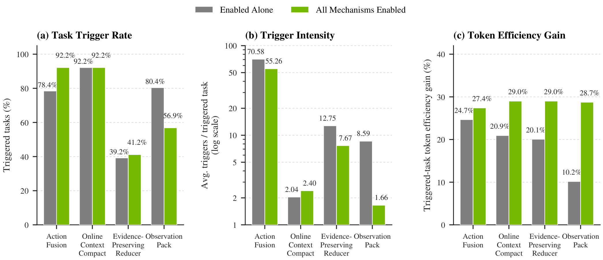
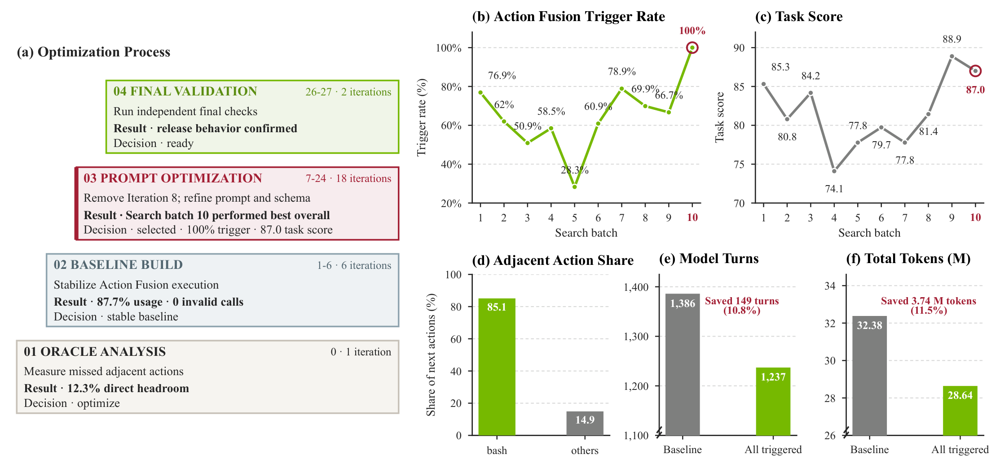

# SoL-Pi 深度精读综述：递归扩展自动研究循环以构建高效智能体脚手架

> **论文信息：** *SoL-Pi: Recursively Scaling Auto-Research Loops for Efficient Agent Harness* (arXiv:2609.20519v1)  
> **作者团队：** Haozhe Liu*, Tian Ye*, Sensen Gao†, Qihang Cao†, Yitong Li†, Mingchen Zhuge, Duomin Wang, Ruihua Zhang, Ping Luo, Jiawang Bian, Lei Zhu, Ligeng Zhu, Enze Xie, Song Han  
> **所属机构：** NVIDIA、南洋理工大学（NTU）、麻省理工学院（MIT）  
> **开源资产：** [GitHub (`NVlabs/SoL-Pi`)](https://github.com/NVlabs/SoL-Pi) · [官方博客](https://nvlabs.github.io/SoL-Pi/) · [原版 PDF](./SoL-Pi.pdf) · [英文原文解析](./2609.20519_SoL-Pi_原文解析.md) · [全文中文翻译](./2609.20519_SoL-Pi_中文翻译.md)

---

## 一、导读与核心摘要（Executive Summary）

### 1. 一句话核心洞察

**SoL-Pi 证明了在不微调底层大模型权重、不改动推理服务引擎的前提下，通过在 535 个隔离的可执行环境中规模化运行“由广入深”的 AI 自动研究循环（Auto-Research Loops），可以自动发现并组合出四项可跨模型（GPT-5.6 Sol → Opus 5）与跨任务泛化的智能体脚手架（Agent Harness）效率机制，在维持相当任务表现的同时将 Token 流量削减 44.7%–49.0%、API 成本降低约三分之一。**

### 2. 学术直觉与第一性原理动机（Research Taste）

当编程智能体从单轮代码补全走向 7×24 小时无人值守的长程探索（Long-Horizon Exploration）时，系统的成本瓶颈不再仅仅是“单 Token 的算力单价”，而是**长轨迹交互中不断滚雪球式膨胀的上下文重复传输与冗余往返**。现有的效率研究主要集中在注意力核优化（FlashAttention）、推理引擎（vLLM）、模型量化（SmoothQuant/GPTQ）或模型路由（RouteLLM）等**模型层与基础设施层**；然而，真正决定模型每一步“看到什么、能做什么、何时遗忘”的**智能体脚手架（Agent Harness）**却长期依赖工程师手工翻阅冗长轨迹（Traces）、凭经验打补丁。

从第一性原理看，脚手架优化之所以难以人工规模化，是因为其内部存在**强耦合的系统张力**：工具调用、上下文压缩、结果观测、委派验证与恢复策略相互纠缠——局部看似省 Token 的改动（例如激进压缩上下文），往往会破坏 Prompt Cache 前缀复用，或导致信息丢失从而引发后续更多轮次的盲目重试，反而把 Token 成本转移并放大到轨迹后端。

与此同时，早期的自动化脚手架搜索（如 RHI、Meta-Harness）面临一个致命的泛化陷阱：**优化智能体很容易对搜索集上的特定任务过拟合，甚至通过“面向验证集打补丁”来投机取巧（Reward/Criteria Gaming）**。SoL-Pi 的核心研究品味在于：**将“科研方法论中的双盲/留出隔离”硬编码为自动研究系统的架构边界**——用大基数、多样化的公开可执行环境做“脚手架预训练”，用独立的审查者（Reviewer）与归约器（Reducer）做“由广入深”的机制提纯，并把最终基准（EdgeBench）锁死在搜索循环之外，验证失败绝不回流修补。

### 3. 核心实验数据看板（EdgeBench 51-Task 公开集）

| 运行工作点 / 对比基线 | 后端模型 | 总 Token 流量 (B) | API 成本 ($) | 平均得分 ↑ | Token 效率 ($/score) ↓ | 核心定位与收益 |
| :--- | :--- | :---: | :---: | :---: | :---: | :--- |
| **Codex** (原生脚手架) | GPT-5.6 Sol | 3.0537 B | \$1,787 | 34.738 | 1.0086 | 相比 Codex，SoL-Pi [Eff.] 成本 **-50.0%**，得分 **+20.9%** |
| **Pi** (基础脚手架) | GPT-5.6 Sol | 2.1538 B | \$1,339 | 44.833 | 0.5855 | 基础对照组 |
| **SoL-Pi [Efficiency]** (四机制全开) | GPT-5.6 Sol | **1.0990 B** (`-49.0%`) | **\$894** (`-33.2%`) | 42.003 (`93.7%`) | **0.4174** (`-28.7%`) | **极致力省**：每小时节省 \$4.36–\$5.71 (vs Pi) / \$8.75–\$13.50 (vs 原生) |
| **SoL-Pi [Performance]** (`ObservationPack`) | GPT-5.6 Sol | 2.0224 B (`-6.1%`) | \$1,271 (`-5.1%`) | **47.208** (`+5.3%`) | 0.5280 (`-9.8%`) | **提分增效**：得分反超 Pi 2.38 分 |
| **Claude Code** (原生脚手架) | Opus 5 *(未见)* | 2.0045 B | \$2,535 | 43.689 | 1.1377 | 相比 Claude Code，SoL-Pi [Eff.] 成本 **-54.3%** |
| **Pi** (基础脚手架) | Opus 5 *(未见)* | 2.3697 B | \$1,741 | 44.756 | 0.7625 | 零修改迁移对照组 |
| **SoL-Pi [Efficiency]** (四机制全开) | Opus 5 *(未见)* | **1.3101 B** (`-44.7%`) | **\$1,158** (`-33.5%`) | 42.224 (`94.3%`) | 0.5376 (`-29.5%`) | **零修改跨模型迁移成立** |
| **SoL-Pi [Performance]** (`Action Fusion`) | Opus 5 *(未见)* | 2.1016 B (`-11.3%`) | \$1,605 (`-7.8%`) | **50.482** (`+12.8%`) | 0.6235 (`-18.2%`) | Opus 5 下单机制提分达 **+12.8%** |

---

## 二、研究背景与痛点剖析

在长程自主智能体（如 SWE-agent、Codex、Claude Code、Pi）的运行过程中，Token 消耗呈现出显著的**二次方累积特征**与**结构性浪费**：

1. **碎片化动作往返（Turn Fragmentation）**：智能体在编辑完代码后，往往需要再发起一次独立的模型推理，仅仅是为了发出 `pytest` 或 `cargo build` 命令；每次多余的往返都会把当前不断增长的完整上下文重新发送一遍。
2. **大体积观测的幽灵重传（Ghost Re-transmission of Large Observations）**：一次长达 20 KB 的日志读取或搜索输出，在后续的 20 轮对话中哪怕早已过时，依然会作为历史消息随每次 API 请求被重复读取或缓存读取。
3. **无差别历史上下文与缓存前缀悖论（Prefix-Cache Paradox）**：如果从不压缩历史，Cache Read 的绝对总量会飙升至数十亿 Token；但如果盲目压缩，又会打破 Prompt Cache 前缀，触发高昂的 Cache Write 费用与摘要调用开销。
4. **验证与诊断耦合（Diagnostic Overload）**：让昂贵的前沿推理模型亲自逐行阅读数千行的构建/测试日志来寻找一条报错，属于严重的算力错配；但若直接交给小模型总结，又极易出现幻觉、遗漏关键退出码或篡改报错原文。

面对这些耦合痛点，SoL-Pi 选择了一条系统化的自动化发现路径（见图 1）：

---

## 三、核心方法与架构深度拆解

### 1. 由广入深的搜索漏斗与隔离编排（Broad-to-Deep Funnel）

SoL-Pi 的搜索体系建立在三项工程原则之上：**广度与深度兼顾**、**开发与留出严格隔离**、**用后即弃的隔离谱系（Disposable Lineages）**。

如图 2 所示，整个自动研究流水线分为**外层广度探索**与**内层深度精炼**两个阶段，累计涵盖约 **~150 个提案方向**（确切为 152 个）、**535 个可执行环境**、超过 **3,000 次运行**与 **60,000+ 次智能体—环境交互**：

- **六大提案家族（152 个初始方向）**：
  - 上下文（Context）、进度（Progress）、工具（Tools）、委派（Delegation）、提示词与策略（Prompt & Policy）、改进与评测（Improvement & Evaluation）。
  - 注意：提案家族仅按“假设起源”分类，而不限制代码最终改在何处（例如 `ObservationPack` 源于两条上下文假设，最终却落在了观测边界层的实现上）。
- **先知分析（Oracle Analysis）前置过滤**：在分配昂贵的推演（Rollout）预算前，先由 Oracle Analysis 扫描基础脚手架的历史轨迹，量化“可避免的冗余工作”（headroom），只有指明具体开销来源且有明确改进空间的提案才能进入内层开发。
- **扩展版自动研究循环（Ralph Loop + Analyzer-Reducer）**：
  1. **实现者（Implementer）** 在复制出的隔离技能模板（Shared Skill Template）中编码实现候选机制，并通过 Ralph Loop 迭代打磨直至满足显式完成标准；
  2. **独立审查者（Independent Reviewer）** 在评测前对代码进行静态/逻辑审查，未通过则打回修订；
  3. **多轨迹并行分析与归约**：每次评测产生多条执行轨迹，由多个 **独立分析器（Analyzers）** 各自聚焦一条轨迹，排查重复动作、上下文增长、大体积观测与稀疏诊断信号；再由 **归约器（Reducer）** 汇总为候选级摘要，指导下一轮迭代。
- **双门控非支配筛选（Two-Gate Nondominated Selection）**：
  - 能力指标、容差阈值与效率指标在实验前即**完全锁死且对优化智能体不可见**（防止刷榜或修改评测脚本）；
  - 候选机制必须先通过**能力门控**（所有能力指标均在预设容差内），再通过**效率门控**（至少在一条效率指标上严格提升），最终仅保留帕累托非支配解（Nondominated results）。

### 2. 双轨搜索环境与单向留出隔离（Search Environments & Held-Out Boundary）

为了避免“在玩具环境上过拟合”，SoL-Pi 构建了 **535 个可执行环境**，并在物理上与最终评测集 EdgeBench 完全隔离（见图 3）：

- **495 个仓库衍生环境（Repository-Derived Environments）**：基于真实 GitHub Issue–PR 配对与修复前仓库状态构建，配齐离线依赖；隐藏 PR 补丁与回归测试，且严格过滤仅保留“修复前测试失败、修复后测试通过”的确定性环境。
- **40 个验证器驱动合成环境（Verifier-Driven Environments）**：采用 Terminal-Bench-2 风格的成功验证器接口，不绑定唯一参考轨迹，允许智能体探索多种有效求解路径。
- **单向留出验证（One-Way Held-Out Validation）**：EdgeBench 的 51 项公开任务中，11 项用于冻结候选的**单向验收**，其余 40 项用于最终泛化评测。**一旦冻结进入 EdgeBench 评测，失败即淘汰，结果绝不回流搜索循环。**

---

### 3. 四大保留机制的底层工程契约与协同架构

经过上述严苛漏斗筛选，最终共有四项机制存活下来并集成为 **SoL-Pi**。它们精准切中了智能体—环境循环中的四个正交环节（见图 4）：

#### 机制一：Action Fusion（动作融合 —— 动作执行层）
- **痛点**：基础版 Pi 在修改文件后，极高概率紧接着发起一条独立的 Bash/测试命令，导致一次无意义的中间模型推理与全量上下文重传。
- **工程机制**：为文件修改工具（`Edit` / `Write`）在 Tool Schema 中增加可选的后续命令参数（`then_run`），将“文件变更 + 命令执行”合并为单次工具请求，并在同一条 Observation 中打包返回两者的执行结果，**直接将 API 调用次数从 3 次压缩为 2 次**。
- **边界条件**：对于依赖先检视修改结果才能决定的后续命令，仍保持分离执行，不强行融合。

#### 机制二：Online Context Compact（在线上下文压缩 —— 上下文管理层）
- **痛点**：传统固定阈值压缩不考虑任务剩余步数与 Prompt Cache 重写代价，常常在“任务马上结束、压缩根本回不了本”时触发压缩，反而白白支付一次 Cache Write 费用。
- **工程机制**：利用智能体通过 `update_plan` 维护的计划步骤完成边界（Subtask Completion Boundary），触发一套**动态缓存成本门控（Cost Gate）**：
  1. 根据已完成步骤间的平均请求数 × 未完成步骤数，估算**剩余模型请求次数**（并以当前增长速率填满上下文窗口所需请求数为上限）；
  2. 计算“预计未来节省的输入读取成本”是否大于“重写 Prompt Cache 的估算额外开销”（基于上下文大小与 Cache Write/Read 价格比）；
  3. 若此前已有过压缩，后续压缩评估还会**计入尚未收回的历史重写成本**，并要求更高的节省余量；
  4. 仅当 Cost Gate 通过，或上下文已逼近窗口上限（且压缩确实能缩短上下文）时，才调用 Pi 原生压缩。

#### 机制三：ObservationPack（观测打包 —— 观测存储层）
- **痛点**：超过 10 KiB 的大体积工具输出（如长文件读取、全量搜索结果）在产生后的前 1–2 轮内对当前推理至关重要，但到第 3 轮以后往往已变成无用的历史包袱。
- **工程机制（延迟折叠 / Deferred Folding）**：
  1. 对超过 **10 KiB** 的工具输出在本地归档；
  2. 在接下来的 **前 2 次提供商请求（API calls 1 & 2）中完整发送原文**，确保当前步与紧邻下一步的推理信息零损失；
  3. 从 **第 3 次请求开始**，自动将其替换为**稳定句柄（Stable Handle）+ 原始大小 + 约 1 KB 的完整首尾行摘要片段**；
  4. 智能体若后续需要细节，可通过稳定句柄按页按需调取精确原始分块。小于 10 KiB 的输出保持原样。

#### 机制四：Evidence-Preserving Reducer（保真证据归约器 —— 委派阅读层）
- **痛点**：构建日志（Build Logs）与测试日志（Test Logs）动辄数千行，直接喂给前沿大模型既昂贵又低效；但若直接让小模型总结，又容易出现幻觉、丢掉关键报错行或退出码。
- **工程机制（小模型提取 + 确定性验证 + 原文兜底）**：
  1. 仅针对来自预定义命令集且体积 **$\ge$ 4 KiB** 的构建与测试日志生效（文件读取与搜索结果绕过此机制）；
  2. 先将精确原始日志归档，随后委派低成本辅助模型（**GPT-5.6 Luna, `high`**）将关键证据提取为结构化的紧凑回执（Receipt）；
  3. **五重确定性校验（Deterministic Verifier）**：校验回执的 ① **Schema 结构**、② **源日志哈希（Source Hash）**、③ **退出状态码（Exit Status）**、④ **精确原文引文（Exact Quotes，逐字核对防幻觉）**、⑤ **体积确实小于原日志**；
  4. **安全回退（Fallback）**：若五重校验任一项失败、疑似包含凭据（Credentials）或未能减小体积，立即无缝回退至原始日志。
- **与 ObservationPack 的层级协同**：Reducer 在 ObservationPack 投影上下文**之前**运行；ObservationPack 会识别 Reducer 生成的回执标记并**跳过这些结果**，避免对已经过严格验证的精简证据做二次截断，确保诊断权始终掌握在主智能体手中。

---

## 四、实验验证、消融分析与反直觉发现

### 1. 跨基准泛化：Terminal-Bench 4 与 IMO 2026（Lean 4）

除了 EdgeBench，作者还在 **Terminal-Bench 4（63 项纯 CPU 任务）** 与 **IMO 2026（6 道奥数题，要求 Lean 4 形式化验证，每题限时 150 分钟）** 上评测了 SoL-Pi（见原文 Table 3）：
- **Terminal-Bench 4**：Codex 与 Pi 各解出 18/63 题（总成本分别为 \$272.35 与 \$286.45），SoL-Pi 解出 15/63 题，但总成本降至 **\$211.12（-26.3%）**，单题求解成本降至 **\$14.07（-11.6% vs Pi）**。
- **IMO 2026（Lean 4）**：使用 GPT-5.6 Sol (`xhigh`)，Codex 通过 5/6 题（\$114.47，单题 \$22.89），Pi 与 SoL-Pi 均通过 3/6 题，但 SoL-Pi 总成本仅 **\$62.69**，创下全场最低的**单题通过成本 \$20.90**（对比 Pi 的 \$25.32）。

### 2. 多智能体集群（Agent Swarm）内核优化实战

在 Anthropic 开源的内核优化挑战（起始基线 147,734 simulated cycles，限时 2 小时）中，作者对比了三种架构（见图 5）：
1. **单智能体**：1 个 Codex (GPT-5.6 Sol `xhigh`)
2. **Pi 基线集群**：1 个 Codex 协调器 + 20 个 Pi 工作智能体 (GPT-5.6 Luna `xhigh`)，分为 5 个四人小组，组内共享白板，协调器跨组同步并提交不可变快照验证
3. **SoL-Pi 集群**：将 20 个工作智能体的脚手架替换为四机制全开的 SoL-Pi

实验结果极具工程说服力：
- **SoL-Pi 集群以 \$60.11 的成本达到 1,127 cycles**，通过全部 8 项速度阈值；
- **Pi 基线集群耗资 \$82.12 仅达到 1,366 cycles**，不仅成本高出 36.6%（即 SoL-Pi 省钱 **26.8%**），且未能突破第 8 项速度阈值（< 1,363 cycles）；
- **单智能体虽然最省钱（\$39.20）**，但停留在 1,333 cycles。
这说明在固定时间与预算约束下，**更高效的单兵脚手架能够直接转化为整个多智能体集群更高的探索吞吐量与更深的性能前沿**。

### 3. 单组件消融与两大反直觉发现

通过加一法消融实验（原文 Table 4）与机制激活分析（图 6、图 7），论文揭示了两个对 Harness 工程极具价值的反直觉洞察：

#### 反直觉发现一：不要唯“Prompt Cache 命中率”论，要算“全任务总账”
传统直觉认为“破坏 Prompt Cache 前缀会触发昂贵的 Cache Write，得不偿失”。但 Table 4 的数据证明：**在 GPT-5.6 Sol 上，SoL-Pi [Efficiency] 的 Cache Write 确实从 0.0141 B 翻倍到了 0.0316 B，但 Cache Read 却从 2.1326 B 腰斩至 1.0605 B，最终总成本从 \$1,339 暴降到 \$894**。只要缓存读取的单价与累积长度足够大，有节制地打破前缀以换取后续几十轮上下文的瘦身，在全局账本上是绝对划算的。

#### 反直觉发现二：跨后端激活衰减 vs 机制互补增强
- **跨后端激活衰减（图 6）**：由于四项机制完全基于 GPT-5.6 Sol 的轨迹搜出，迁移到未见后端 Opus 5 时，所有机制的**触发率（Trigger Rate）与触发强度（Trigger Intensity）均明显下降**；但令人惊喜的是，**只要被触发，每项机制在 Opus 5 上依然稳定带来正的 Token 效率增益**。
- **组合互补性（图 7）**：当四项机制合并为完整栈时，**每一项机制在各自触发子集上的 Token 效率增益都高于其单独运行时的表现**。同时，`ObservationPack` 在完整栈中变得更加“挑剔”（选择性提高），原因正是前置的 `Evidence-Preserving Reducer` 已经把大量构建/测试日志消化成了紧凑回执，减少了无意义的冗余重传。

---

## 五、典型案例还原：Action Fusion 的 27 轮演化全史

图 8 完整记录了 `Action Fusion` 从一次轨迹观察到最终通过留出验证的 27 轮演化谱系，堪称 AI 自主研发脚手架的教科书级样本：

1. **阶段 01 · 先知分析（Iteration 0）**：通过扫描历史轨迹，发现文件编辑后紧邻的下一步动作中有 **85.1% 都是 `bash` 命令**；若完全融合，理论上可直接减少 **10.8% 的模型轮次（1,386 → 1,237）** 与 **11.5% 的总 Token（32.38M → 28.64M）**，存在 **12.3% 的直接优化空间（Headroom）**。
2. **阶段 02 · 基线构建（Iterations 1–6）**：最初尝试仅靠 System Prompt 诱导模型融合动作，结果触发极不稳定。优化智能体随即果断**修改 Tool Schema**，直接将融合动作暴露为一等公民工具参数，从而建立起 **87.7% 使用率、0 次无效调用（0 invalid calls）** 的稳定工程基线。
3. **阶段 03 · 提示词与模式精炼（Iterations 7–24，18 轮探索）**：优化智能体在开发任务上不仅优化任务得分，还**自主发明了一个机制专属的中间验收指标——Trigger Rate（触发率）**，与 Task Score 协同筛选并行批次中的最优候选（如剔除退化的 Iteration 8）。最终 Search Batch 10 以 **100% 触发率与 87.0 任务得分**胜出并被冻结。
4. **阶段 04 · 最终留出验证（Iterations 26–27）**：在独立留出集上确认发布行为稳定，正式纳入 SoL-Pi。

---

## 六、局限性、适用边界与工程落地启示

### 1. 客观局限性与权衡边界
- **效率与绝对得分的权衡（Trade-off）**：在追求极致省钱的 `SoL-Pi [Efficiency]`（四机制全开）模式下，EdgeBench 平均分相对 Pi 略降约 **5.7%–6.3%**（GPT-5.6 Sol: 44.833 → 42.003；Opus 5: 44.756 → 42.224），Terminal-Bench 4 解题数也从 18 降至 15。因此，对于**容错率极低、不计成本冲榜**的场景，应选用单机制 `SoL-Pi [Performance]`（`ObservationPack` 或 `Action Fusion`，反而能提分 **+5.3% 至 +12.8%**）；对于**大规模并发、7×24 小时自主探索或预算受限的 Swarm**，则应启用 `SoL-Pi [Efficiency]`。
- **单后端训练偏置**：机制在训练后端（GPT-5.6 Sol）上触发最充分，跨模型虽可迁移但激活率偏低，未来需要“多后端联合训练（Multi-Backend Training）”。
- **未证实的递归复利**：作者提出的“用更省钱的 SoL-Pi 作为下一代自动研究循环的底座，从而实现**递归高效改进（Recursive Efficient Improvement）**”目前仍属于未来愿景，尚未在本研究中给出实证。

### 2. 对 Agent Harness 工程落地的可操作启示

如果你正在构建或优化自己的 Coding Agent / Research Agent Harness，可以直接复用 SoL-Pi 验证有效的四大工程模式：

1. **Tool Schema 融合优于纯 Prompt 说教**：当高频出现 `Edit -> Bash(test)` 的相邻工具调用模式时，直接修改 Tool Schema 增加可选 `then_run` 参数，比在 System Prompt 里反复叮嘱“请合并操作”可靠得多。
2. **为大体积观测引入“2 轮冷却期”**：不要在工具返回瞬间就暴力截断长输出，也不要让它永久留在上下文里。采用 **“前 2 轮完整保留，第 3 轮起自动降级为 Handle + 1 KB 首尾摘要”** 的延迟折叠策略，既保护了即时推理精度，又斩断了长尾重传成本。
3. **用“小模型提取 + 确定性校验”替代裸摘要**：让小模型读取 >4 KB 的测试/构建日志时，必须强制输出结构化回执，并由宿主代码做 **Schema + Source Hash + Exit Code + Exact Quote 逐字匹配** 校验，任何一项不过直接无缝回退原日志——这是工程化消除摘要幻觉的最佳实践。
4. **在 Plan 节点算“缓存重写回本账”**：把上下文压缩时机绑定到 `update_plan` 等子任务完成边界，用“预计剩余步数 × 节省的 Cache Read”减去“Cache Write 惩罚”作为硬性门控，避免在任务尾声做无效压缩。
