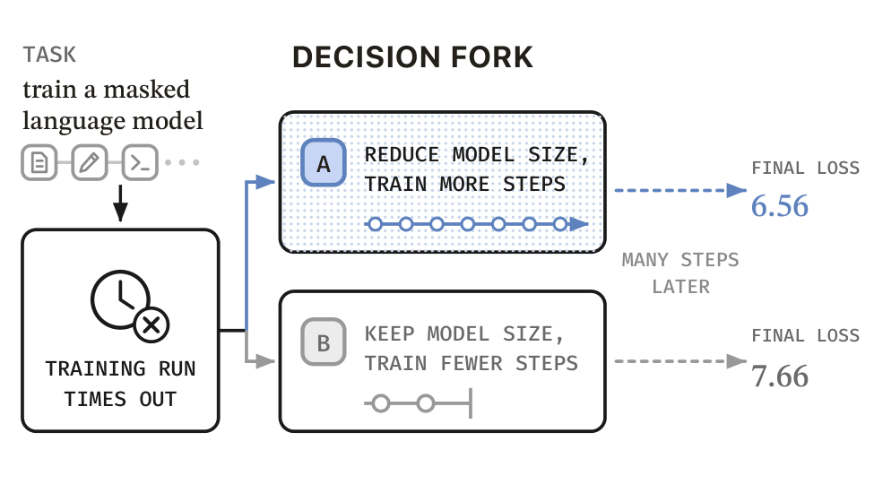
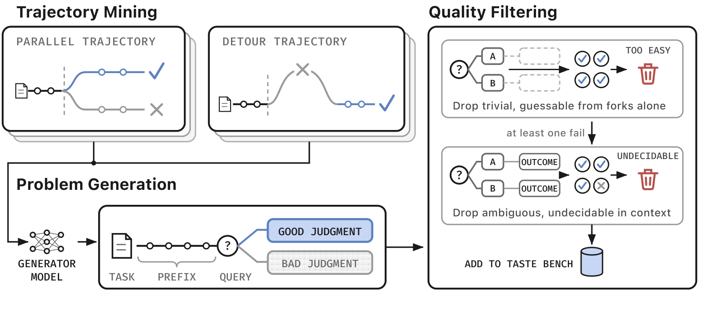
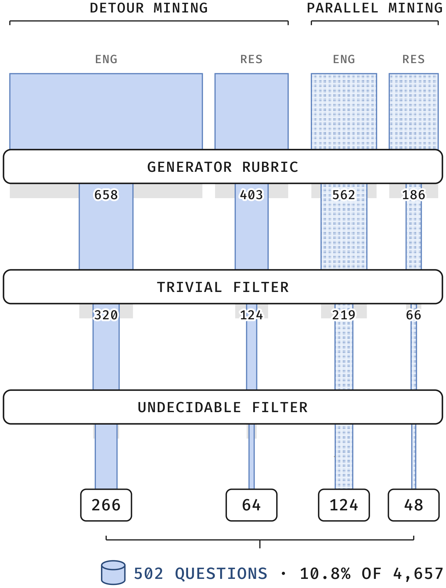
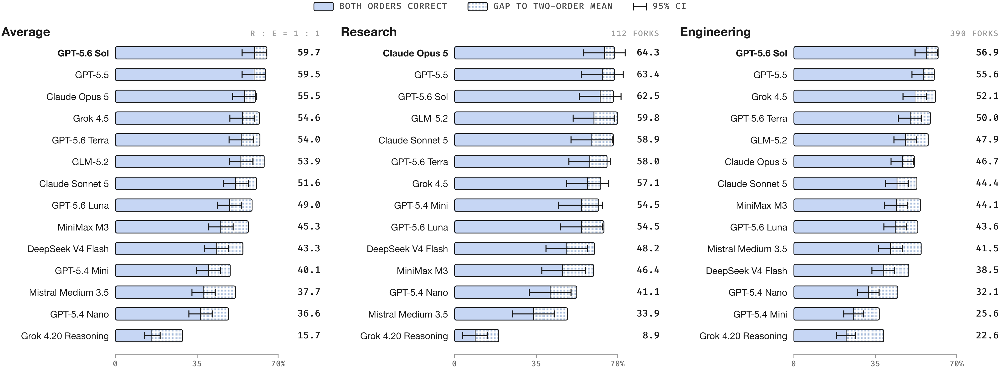
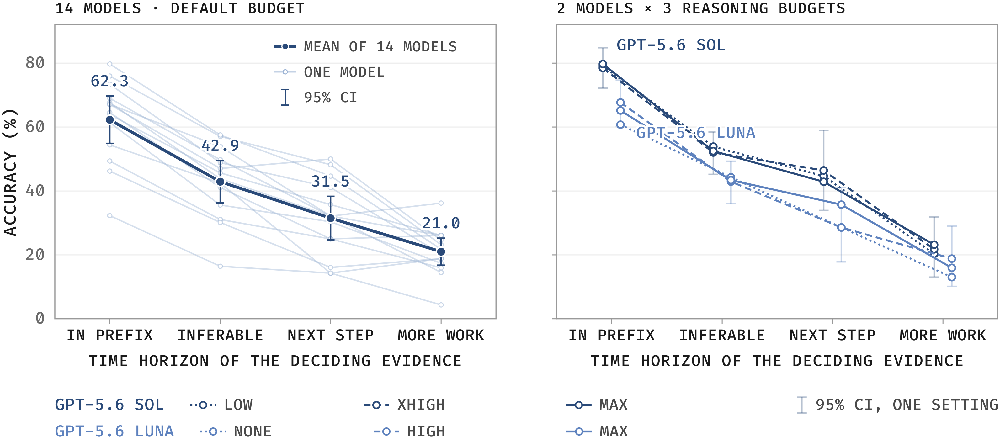
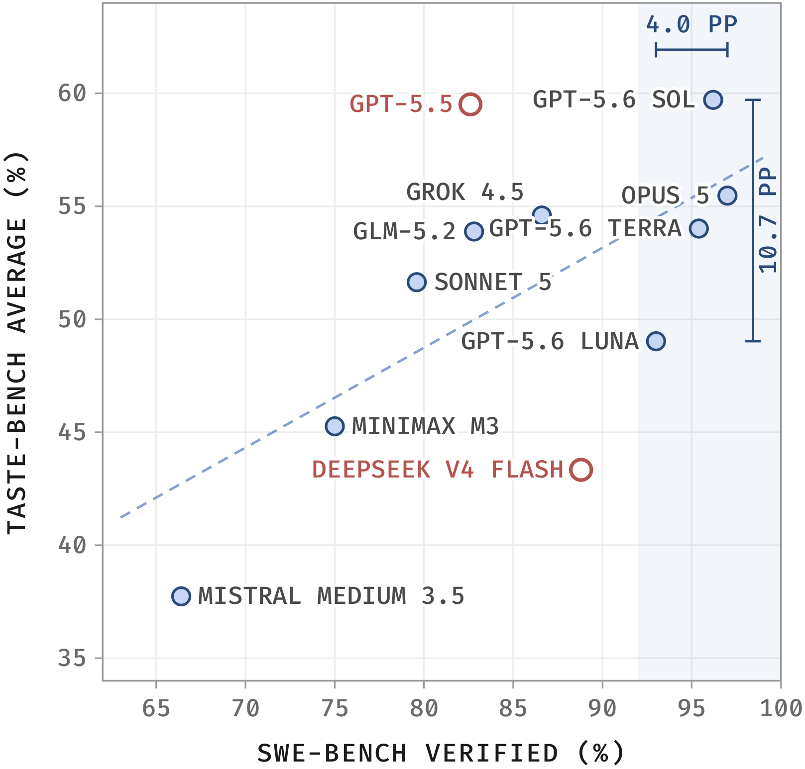
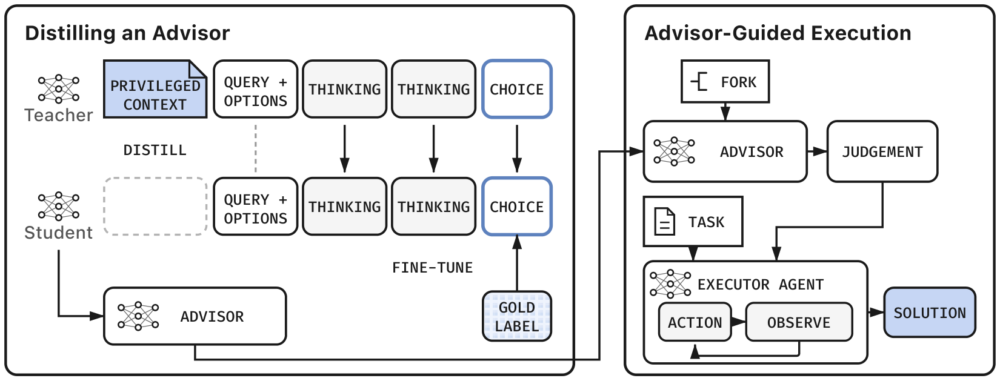
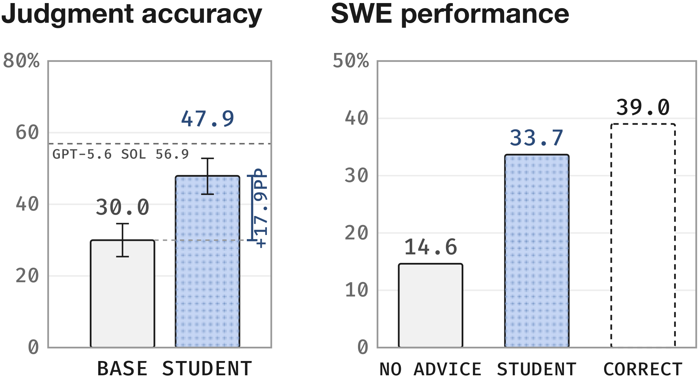

# 《The Tasteful Agent: Measuring and Improving Taste in Long-Horizon Tasks》深度精读综述

> **论文标题**：The Tasteful Agent: Measuring and Improving Taste in Long-Horizon Tasks  
> **作者团队**：Wenbo Pan¹†, Zhichao Liu², Shujie Liu³, Jingying Zeng³, Chin-Yew Lin³, Xianfeng Tang³, Yan Lu³, Qi He³, Xiaohua Jia¹  
> **机构信息**：¹ 香港城市大学 (City University of Hong Kong)；² 独立研究者；³ 微软 (Microsoft) *(† 微软实习期间工作)*  
> **论文来源**：[arXiv:2609.25804](https://arxiv.org/abs/2609.25804) · 2026 年 9 月  
> **开源代码**：<https://github.com/wbopan/tastebench>  
> **开源数据集**：<https://huggingface.co/datasets/wenbopan/taste-bench>  

---

## 一、核心摘要与研究动机：为什么我们需要测量智能体的“品味”？

随着大语言模型智能体（LLM Agents）在长程任务（Long-Horizon Tasks）上的能力边界不断扩展——从端到端完成机器学习科研、跨版本演进大型软件项目，到在部署期间自我优化脚手架（Scaffold）——智能体在执行过程中需要频繁做出**影响深远的关键决策**：例如在科研中应该验证哪一个假设、在工程中应该基于哪一种实现架构继续重构、或者下一步应当运行哪一组实验。

论文将智能体在**结果尚未显现之前**、于长程任务关键节点做出正确技术方向选择的能力定义为智能体的 **“品味”（Taste / Long-Horizon Judgment）**。

*图 1：来自机器学习科研轨迹的一个决策分叉（Decision Fork）。在后续损失（Loss）尚未揭示候选方向 A 更优之前，被测模型必须在决策点做出选择。*

然而，评估智能体的“品味”面临两大根本性挑战：
1. **现有基准的盲区**：SWE-bench、SWE-bench Pro、MLAgentBench、RE-Bench 等主流长程基准只度量最终的**端到端任务成功率（End-to-End Success）**，无法剥离执行质量与环境随机性，从而无法单独度量智能体在路径分叉点上的“判断力”。
2. **延迟显效与专家标注困境**：糟糕的决策在做出当下往往显得十分合理（例如一段仓促编写的代码同样能通过当前单元测试，但其架构缺陷直到后续所有扩展都变得举步维艰时才暴露），只有耗费大量推理预算之后代价才会显现；同时，直接由人类领域专家对长轨迹中的关键抉择进行标注，成本高昂且极难跨领域扩展。

**本文的核心破局点（Key Observation）**：  
**智能体历史轨迹的“后半段”，天然构成了其“前半段”决策的“事后证据（Hindsight Evidence）”。**  
在实际运行中，智能体系统经常对同一任务进行多次尝试，或者在单次尝试中先走弯路再自我修正。一旦轨迹出现分叉，最终记录的成败结果就能直接反推出分叉点上哪一个方向更优。基于这一洞察，作者提出了自动化构建的长程判断力基准 **Taste-Bench**（共 502 道题），并对 14 个前沿大模型展开了系统性评测，进一步证明了**品味是可以通过推理蒸馏来训练并迁移到真实端到端任务中的**。

---

## 二、形式化定义与 Taste-Bench 构建体系

### 2.1 长程判断力的形式化建模

考虑针对任务 $q$ 的多次尝试，它们在分叉时刻 $t$ 之前共享等价的轨迹前缀 $h_t = (o_0, a_0, \ldots, o_t)$（其中 $o$ 为观测，$a$ 为动作），随后在 $t$ 时刻分叉进入两个候选方向 $c_1$ 和 $c_2$。每个分支 $i \in \{1, 2\}$ 继续执行至结束，产生观测证据 $E_i$（如单元测试结果或科研实验指标），并由结果度量函数 $U$ 映射为标量效用 $U(E_i)$。

具备良好“品味”的模型，应当在**完全看不到 $t$ 时刻之后任何工作**的前提下，选出期望收益 $\mathbb{E}[U \mid h_t, c_i]$ 更高的候选方向。由于分叉前的状态等价，且分支间的差异主要由该分叉处的决策引起，真实观测到的分支结果便可以作为期望收益的无偏估计，从而定义出**受支持候选方向（Supported Candidate）**的真实标签 $y$：

$$
y = \arg\max_{i \in \{1, 2\}} U(E_i)
$$

每道测试题被构造为四元组 $x = (q, h_t, c_1, c_2)$，分叉时刻 $t$ 之后的所有信息对被测模型 $\pi$ 严格隐藏。模型输出选择 $\pi(x)$，其在数据集上的品味估计 $\widehat{T}(\pi)$ 即为答对题目的比例。

---

### 2.2 双源轨迹挖掘：并行轨迹 vs. 迂回轨迹

为了从非结构化的原始执行日志中无人工干预地提炼高质量决策分叉，论文设计了两种互补的挖掘范式（如图 2 所示）：

*图 2：Taste-Bench 的双源构建与双重过滤管线。并行构造对比同一任务的不同分支；迂回构造对比单条轨迹中被放弃的方向与后续恢复方案；过滤阶段剔除仅凭选项措辞即可猜出答案的“平庸题（Trivial）”和标签与记录不一致的“不可判定题（Undecidable）”。*

1. **并行轨迹（Parallel Trajectories）——捕捉“智能体从未察觉的错误”**
   - **数据源与配对**：针对同一任务，将一个成功尝试与一个失败尝试配对（优先同模型同推理配置配对）。
   - **对齐与切分**：生成器模型（GPT-5.6 Sol，高推理强度）通读两条完整轨迹，定位两者在解决同一子问题时发生分歧的决策点，截取此前等价的前缀作为 $h_t$，并将两条分支的真实动作改写为语气中立、细节对等（Parallel Wording）的候选选项 $c_1, c_2$。
   - **特点**：在这类轨迹中，失败分支的智能体自始至终没有意识到自己选错了方向，一直执行到任务结束并失败。

2. **迂回轨迹（Detour Trajectories）——捕捉“智能体中途踩坑后自我纠偏的错误”**
   - **机制定位**：生成器通读单条包含自我纠偏的完整轨迹，按时间顺序严格引用四段原文摘录（Verbatim Excerpts）：（1）投入错误方向的步骤；（2）导致放弃该方向的显式失败信号（如非零退出码或报错信息）；（3）转向新恢复方向的步骤；（4）恢复方向最终成功的证据。
   - **严格防泄漏规则**：分叉点被精确置于智能体采纳错误方向的前一步。程序化机械校验要求四段引文必须原文逐字匹配且时间严格递增；同时要求两个候选方向在分叉前都看似合理（不能“事后诸葛亮”式地命名恢复方案）。
   - **特点**：直接检验被测模型能否**比当时正在执行的智能体更早地识别出潜在陷阱**。

---

### 2.3 数据来源、三级过滤漏斗与人工复核

| 维度 | 软件工程域 (Engineering Pool) | 机器学习科研域 (Research Pool) |
| :--- | :--- | :--- |
| **原始任务来源** | SWE-bench Pro（517 个任务，11 个开源代码库） | RE-Bench 与 HCAST 科研子集（47 个 AI R&D 任务，来自 METR 公开的 MALT 轨迹库） |
| **原始轨迹规模** | 2,677 条带评分轨迹（由 GPT-5.4 与 GPT-5.5 跑出） | 1,132 条带原生评分轨迹（由 Claude 3.5/3.7/4 Sonnet/Opus 与 DeepSeek V3 跑出） |
| **最终题量分布** | **390 题**（并行工程 124 题 + 迂回工程 266 题） | **112 题**（并行科研 48 题 + 迂回科研 64 题） |

生成器最初从两个轨迹池中共提出了 **4,657 个候选分叉**，经过严苛的三级过滤漏斗后，最终仅保留了 **10.8%（即 502 题）**：

*图 3：Taste-Bench 三级过滤漏斗统计。从 4,657 个初始候选出发，依次经过生成器 Rubric 校验、平庸题过滤（Trivial Filter）与不可判定题过滤（Undecidable Filter），最终留存 502 题。*

1. **第一级：生成器准则与机械校验（Generator Rubric）**：剔除因拼写错误、环境崩溃、超时、缺少依赖、硬编码或单纯执行质量差异导致的胜负，确保胜负因果明确指向决策方向本身。通过后剩 1,809 题（迂回工程 658、迂回科研 403、并行工程 562、并行科研 186）。
2. **第二级：平庸题过滤（Trivial Filter）**：由独立于生成器的 4 个裁判模型（Kimi K2.5、GPT-4.1、Llama 4 Maverick、Mistral Large 3）组成评审团，**仅看任务与两个选项（隐藏轨迹前缀）**作答。若**所有**裁判模型都答对，说明答案仅凭选项措辞或常识即可猜出，直接剔除！此步后剩 729 题（320 / 124 / 219 / 66）。
3. **第三级：不可判定题过滤（Undecidable Filter）**：裁判模型阅读**完整记录（含任务、完整轨迹及最终结果）**，仅当**所有裁判模型一致认同**该标签确实由该决策因果导致时才予以保留。最终定格为 **502 题**（266 / 64 / 124 / 48）。

**高质量人工复核（Human Review）**：  
作者随机抽取了 100 题（70 道发布题 + 15 道被 Trivial 过滤题 + 15 道未获全票通过题）交由两名人类评审员进行两阶段盲测。在给出后续结果摘要后的明确 A/B 判断中（共 172 人次有效判断），**人类专家与自动挖掘标签的一致率高达 98.8%（170/172）**；两位评审员在 74 道重叠有效题上的一致率为 98.6%（73/74），Cohen's $\kappa = 0.973$。这有力证明了**基于事后轨迹证据自动化构建品味标签的极高可靠性**。

---

### 2.4 抗位置偏置评测协议

由于二选一问题普遍存在严重的位置偏置（Position Bias），仅仅交换 Option A 与 Option B 的顺序就会导致模型翻转答案。因此 Taste-Bench 采用严格的**双序一致评测协议（Both-Order Consistency Protocol）**：
- 每道题被评测两次：一次按确定性随机种子顺序呈现，一次按完全相反的顺序呈现。
- **核心指标（Accuracy）**：仅当模型在**两次顺序下均答对**（即 CC）才算正确；任何一次翻转（CW/WC）或格式无法解析均算错误。在该协议下，随机猜测的期望得分为 **25%**（$0.5 \times 0.5$），而死选某一固定位置的模型得分为 **0%**。
- 汇总指标 **Average** 定义为科研子集准确率与工程子集准确率的 **1:1 均值**（避免被题量更大的工程子集淹没）。

---

## 三、前沿大模型评测结果与三大核心发现

作者在统一的提示词、65,536 输出 Token 预算与评测接口下，测试了涵盖 Claude、GPT、Grok、DeepSeek、GLM、MiniMax 和 Mistral 家族的 **14 个当代前沿模型**。

### 3.1 总体排行榜与核心发现 1：前沿模型的“品味”依然十分有限

*图 4：14 个前沿模型在 Taste-Bench 上的总体平均分（Average）、科研子集（Research）与工程子集（Engineering）表现。实心柱代表双序均答对的严格准确率，虚线延伸部分代表双序平均准确率（Mean Accuracy），误差棒为 95% Bootstrap 置信区间。*

| 排名 | 模型 | Average (%) | 工程子集 Eng. (%) | 科研子集 Res. (%) | 并行工程 P-Eng | 并行科研 P-Res | 迂回工程 D-Eng | 迂回科研 D-Res | 双序平均 Mean acc. | CC / CW / WC / WW | 未解析数 Unparsed |
| :---: | :--- | :---: | :---: | :---: | :---: | :---: | :---: | :---: | :---: | :---: | :---: |
| 1 | **GPT-5.6 Sol** | **59.7** | **56.9** | 62.5 | **75.8** | 56.2 | **48.1** | 67.2 | **65.2** | 292 / 25 / 29 / 156 | 0 |
| 2 | **GPT-5.5** | **59.5** | 55.6 | 63.4 | 73.4 | 56.2 | 47.4 | **68.8** | 64.6 | 288 / 26 / 24 / 164 | 0 |
| 3 | **Claude Opus 5** | 55.5 | 46.7 | **64.3** | 71.0 | **64.6** | 35.3 | 64.1 | 60.3 | 254 / 26 / 25 / 197 | 0 |
| 4 | **Grok 4.5** | 54.6 | 52.1 | 57.1 | 61.3 | 56.2 | 47.7 | 57.8 | 62.0 | 267 / 40 / 43 / 152 | 10 |
| 5 | **GPT-5.6 Terra** | 54.0 | 50.0 | 58.0 | 70.2 | 58.3 | 40.6 | 57.8 | 62.2 | 260 / 40 / 46 / 156 | 0 |
| 6 | **GLM-5.2** | 53.9 | 47.9 | 59.8 | 64.5 | 60.4 | 40.2 | 59.4 | 64.0 | 254 / 52 / 49 / 147 | 17 |
| 7 | **Claude Sonnet 5** | 51.6 | 44.4 | 58.9 | 62.1 | 56.2 | 36.1 | 60.9 | 60.7 | 239 / 37 / 52 / 174 | 0 |
| 8 | **GPT-5.6 Luna** | 49.0 | 43.6 | 54.5 | 67.7 | 50.0 | 32.3 | 57.8 | 58.9 | 231 / 48 / 51 / 172 | 0 |
| 9 | **MiniMax M3** | 45.3 | 44.1 | 46.4 | 64.5 | 56.2 | 34.6 | 39.1 | 57.2 | 224 / 61 / 51 / 166 | 3 |
| 10 | **DeepSeek V4 Flash** | 43.3 | 38.5 | 48.2 | 58.1 | 50.0 | 29.3 | 46.9 | 54.9 | 204 / 59 / 55 / 184 | 2 |
| 11 | **GPT-5.4 Mini** | 40.1 | 25.6 | 54.5 | 26.6 | 54.2 | 25.2 | 54.7 | 49.5 | 161 / 46 / 59 / 236 | 112 |
| 12 | **Mistral Medium 3.5** | 37.7 | 41.5 | 33.9 | 43.5 | 41.7 | 40.6 | 28.1 | 51.8 | 200 / 70 / 67 / 165 | 24 |
| 13 | **GPT-5.4 Nano** | 36.6 | 32.1 | 41.1 | 46.0 | 43.8 | 25.6 | 39.1 | 48.8 | 171 / 65 / 61 / 205 | 93 |
| 14 | **Grok 4.20 Reasoning** | 15.7 | 22.6 | 8.9 | 28.2 | 8.3 | 19.9 | 9.4 | 29.0 | 98 / 78 / 72 / 254 | 459 |

> **发现 1（Finding 1）：当前前沿模型展示出有限的品味。**  
> 尽管每道题只是二选一，但最强模型 GPT-5.6 Sol 的平均准确率也仅有 **59.7%**（GPT-5.5 为 **59.5%**，Claude Opus 5 为 **55.5%**），远未达到解决该基准的水平。此外，**构建方式之间的难度差距大于领域之间的差距**：14 个模型的均值在“并行工程（58.1%）”最高，在“迂回工程（35.9%）”最低——要求模型在智能体踩坑之前就预判其代码实现上的隐蔽陷阱，比直接对比两条差异化分支要困难得多。

---

### 3.2 时间视界效应与推理预算失效（发现 2 & 发现 3）

为什么模型会答错？论文引入了**时间视界（Time Horizon）**这一关键维度——由裁判模型（GPT-5.5）在看到事后真相的前提下，标注出“站在分叉点上的观察者需要往未来看多远才能明确证明正确选项”。作者将标注聚合为四个递进层级：
1. **In prefix（前缀已显，158 题）**：前缀中已经存在排除某一选项的决定性事实（如报错信息或明确约束）。
2. **Inferable（可由前缀推断，219 题）**：没有单一铁证，但综合前缀中的线索与领域知识足以推断。
3. **Next step（下一步即明，56 题）**：分叉后的第一个直接观测结果即可证明。
4. **More work（需更多后续工作，69 题）**：必须等待局部验证测试或大段下游实现/实验结果出来后才能分出高下。

*图 5：**左图**：14 个模型在不同时间视界层级上的准确率变化，随时间视界拉长急剧下降；**右图**：GPT-5.6 Sol 与 GPT-5.6 Luna 在三种不同推理预算（Reasoning Effort）下的表现，高推理预算在所有视界层级上均未带来显著增益。*

> **发现 2（Finding 2）：模型错误高度集中在长视界（Long Time Horizon）决策分叉上。**  
> 从图 5 左图可见，14 个模型的平均准确率从 `In prefix` 的 **62.3%** 断崖式跌落至 `Inferable` 的 **42.9%**、`Next step` 的 **31.5%**，最终在 `More work` 层级跌至 **21.0%**——**甚至低于随机猜测的 25% 基线**！

那么，让模型“想得更久（Test-time Scaling / 增大推理预算）”能否弥补前瞻视野的不足？作者在 GPT-5.6 Sol（`low / xhigh / max`）和 GPT-5.6 Luna（`none / high / max`）上做了严格控制变量的推理预算实验（共 6,024 次响应）：

> **发现 3（Finding 3）：更大的推理预算无法提升品味。**  
> 从最低到最高推理预算，GPT-5.6 Sol 的准确率变化为 **$-0.2$ 个百分点**（56.2% $\to$ 56.0%），GPT-5.6 Luna 仅变化 **$+2.2$ 个百分点**（43.4% $\to$ 45.6%），两者在统计上均无显著交互作用（$p=0.80$ 与 $p=0.82$）。更耐人寻味的是，**模型恰恰在 `More work` 层级消耗了最多的推理 Token，但该层级的准确率却是最低的**。这说明模型其实已经隐约“感知”到了这些分叉的棘手程度，但由于决定性证据尚未在现实中发生，单纯增加内部推演（Chain-of-Thought）无法凭空预测未来。

---

### 3.3 与端到端基准（SWE-bench Verified）的对比

*图 6：Taste-Bench 平均分与 Vals AI 排行榜上 SWE-bench Verified 得分的相关性分析（剔除未解析率超过 9% 的 3 个模型后剩余 11 个模型）。*

- **仅为中等程度相关**：总体 Average 与 SWE-bench Verified 的 Pearson 相关系数为 $r = +0.63$（仅能解释 $R^2 = 39\%$ 的方差）；更令人惊讶的是，在最接近 SWE-bench 的**工程子集（Engineering）上，相关系数仅有 $r = +0.37$**！
- **显著的排名置换与头部区分度**：在 SWE-bench Verified 上排名第 5 的 DeepSeek V4 Flash 在 Taste-Bench 跌至第 10；而 SWE-bench Verified 排名第 8 的 GPT-5.5 在 Taste-Bench 高居第 2。此外，**在 SWE-bench Verified 上分数扎堆于 4.0 分区间内的前 4 名顶尖模型，在 Taste-Bench 上的分差被拉大到了 10.7 个百分点**——说明 Taste-Bench 捕捉到了传统端到端基准未能区分的高阶决策能力。

---

## 四、品味可以训练吗？上下文推理蒸馏与端到端增益

既然单纯靠推理期“多想一会儿”无法提升品味，能否直接从带事后结果的历史轨迹中**把“品味”训练进模型权重里**？

*图 7：**左图**：将“看过正确答案演示”的特权教师推理过程蒸馏给“只看原始问题”的学生模型；**右图**：在未见过的真实 SWE-bench Pro 任务上，由蒸馏后的学生充当顾问（Advisor）生成避坑建议，注入固定执行器（Executor）上下文中提升端到端成功率。*

### 4.1 蒸馏配方：为什么必须蒸馏“推理过程”而非直接拟合标签？

作者以 **Qwen3.6-27B** 为基座模型（使用 LoRA，rank 16, $\alpha=32$，可训练参数 79.7M），将 390 道工程题按任务严格隔离（Task-Disjoint）划分为 2 折交叉验证（每折 195 题，确保训练与测试绝不共享任何任务、源码仓库轨迹或前缀）：

1. **特权教师生成推理（Privileged Teacher）**：如果直接用二元标签 `A/B` 做监督微调，模型只会死记硬背而无法习得判断逻辑。因此，作者让同一个冻结的 Qwen3.6-27B 在上下文中额外注入一段 **演示（Demonstration）**——即明确告知它在这个分叉上哪个方向成功、哪个方向失败——作为“特权教师”自由生成完整的思考过程（Reasoning Trace）与最终选择。
2. **SDPO 风格的教师采样前向 KL 蒸馏**：训练学生模型（上下文中**完全没有演示**）去对齐教师在推理 Token（均匀采样最多 512 个位置）和最终答案 Token 上的概率分布，采用**在教师采样序列上计算的前向 KL 散度（Forward KL）**（计算学生概率分布的前 100 个 Token 加剩余质量汇总项）。作者特别指出：**必须在教师采样的轨迹而非学生自身采样的轨迹上算 KL**，因为学生自己采样的路径往往根本不会触及教师因看到演示而产生的关键转折 Token。
3. **结构化防泄漏（Structural Leakage Control）**：由于最终答案被严格限制为闭集 `{"answer":"A"}` 或 `{"answer":"B"}`，且教师序列在输出答案后立即截断，保证了演示文本不会被表面复制泄漏。
4. **自生成校准（Calibration）**：蒸馏完成后，让学生在训练集上按自己的推理风格自由生成轨迹，仅在最终答案位置用交叉熵损失微调 1 个 Epoch，使最终决策与学生自身的推理分布校准对齐。

---

### 4.2 实验结果与核心发现 4：跨任务迁移与真实端到端收益

*图 8：**左图**：在 390 道严格任务隔离的未见工程题上，学生模型双序准确率从基座的 30.0% 提升至 47.9%（+17.9pp）；**右图**：在 41 个未见 SWE-bench Pro 任务上，注入学生建议使执行器成功率从 14.6% 跃升至 33.7%（+19.1pp），接近 39.0% 的理论上限。*

- **未见任务判断力大幅跃升**：在任务完全隔离的保留集（Held-out Fold）上，蒸馏后的 Qwen3.6-27B 学生模型双序严格准确率从基座的 **30.0% 飙升至 47.9%**（$+17.9$ 个百分点），双序平均准确率从 42.7% 升至 62.4%。放到前述 14 个前沿模型工程子集榜单中，27B 的蒸馏学生模型已经**追平 GLM-5.2（47.9%）并超越 Claude Opus 5（46.7%）**！
- **端到端代理执行增益**：作者进一步选取 41 个未见 SWE-bench Pro 任务（共含 98 个决策分叉，学生正确判断了其中 77 个），将学生的判断写成结构化的“避坑指南（Task-specific pitfall notes）”注入到**固定不变的 Qwen3.6-27B 执行器（SWE-agent 1.1.0，关闭思考模式）**的初始任务上下文中：
  - **无建议基线（No Advice）**：**14.6%** 任务通过率
  - **学生建议（Student Advice）**：**33.7%** 任务通过率（**净提升 $+19.1$ 个百分点**）
  - **全对建议上限（Correct Advice）**：**39.0%** 任务通过率（$+24.4$ 个百分点，$p \le 0.004$）

> **发现 4（Finding 4）：品味可以被蒸馏，且更好的判断力直接转化为端到端任务成功率的提升。**  
> 学生模型不仅学会了在未见任务上分辨优劣方向，其作为 Advisor 输出的判断还能实打实地帮助执行器避开深水区陷阱，拿下了接近“全知正确建议”理论上限的绝大部分收益。

---

## 五、深度剖析与工程/科研启示

### 5.1 为什么说这篇论文重新定义了 Agent 能力评估？
1. **从“结果导向”走向“分叉点因果评估”**：传统的端到端评测把“选错方向”和“写错代码/环境配置失误”混为一谈。Taste-Bench 巧妙利用了同一任务并行多跑与单轨纠偏的历史副产物，以极低的边际成本实现了**可随 Agent 系统运行量自动扩展（Scales with trajectories）**的高信噪比监督信号。
2. **揭示了 Test-Time Compute 的边界**：在数学竞赛题或封闭式逻辑推理中，增加推理 Token（`reasoning_effort`）往往立竿见影；但在充满未知外部反馈的长程工程与科研中（`More work` 层级），**“闭门造车式”的长思考无法替代真实世界的信息获取**。智能体真正需要的是识别“何时必须先做低成本探针/局部验证，而不是盲目押注一条重型路线”。

### 5.2 对 Agent Harness 与模型训练的实战启发
- **分离“执行器（Executor）”与“品味顾问（Taste Advisor）”**：论文第 5.3 节展示了一种极富潜力的系统架构——无需重新训练庞大的端到端代理策略，只需训练一个轻量级（如 27B）的“品味顾问”模型，在关键架构分叉或任务起步阶段注入避坑约束（同时配合强制验证契约 `SUBMISSION CONTRACT` 防止盲从建议不跑测试），即可带来近 20 个百分点的成功率飞跃。
- **离线轨迹资产的二次金矿**：无论是科研探索还是工业界 Coding Agent 每天产生的海量成功/失败 Rollout 日志，都不应只用来做简单的 SFT 或 Rejection Sampling。通过本文的**并行对比 + 迂回纠偏挖掘 + 平庸题过滤**，这些废旧日志可以直接提炼为高质量的“决策分叉训练/评测集”。
- **局限性与未来方向**：当前 Taste-Bench 仍以静态离线的二选一形式呈现（且仅覆盖了代码工程与 AI R&D 两个领域，端到端实验依赖于预先挖掘的 Task-specific 分叉位置）。如何在**真实在线执行流（Online Trajectory）**中让智能体自主识别“此刻正处于一个关键决策分叉”并主动触发高品味决策或低成本试探，将是下一步最值得期待的突破口。

---

## 六、本文配套归档资产

- 📄 **原论文 PDF**：[The_Tasteful_Agent.pdf](The_Tasteful_Agent.pdf)
- 📝 **无损英文原文解析**：[2609.25804_TastefulAgent_原文解析.md](2609.25804_TastefulAgent_原文解析.md)
- 🇨🇳 **全文如实中文翻译**：[2609.25804_TastefulAgent_中文翻译.md](2609.25804_TastefulAgent_中文翻译.md)
- 🖼️ **300 DPI 高清论文配图集**：[配图/](配图/)
