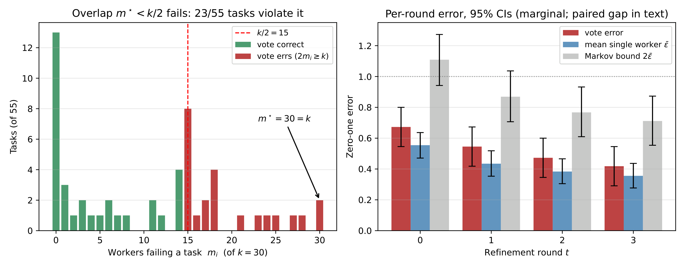
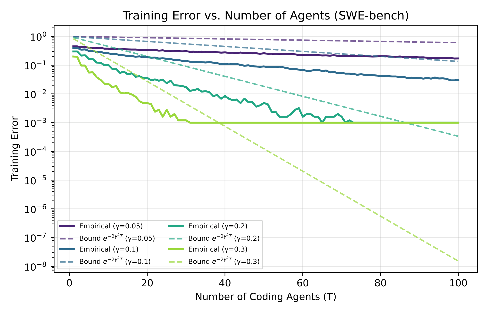
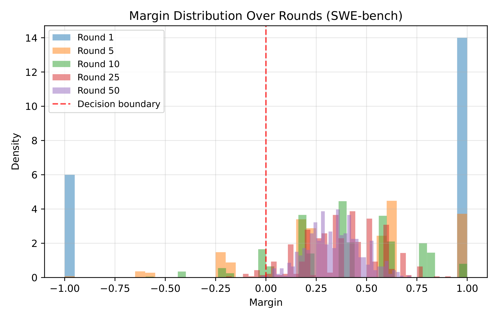
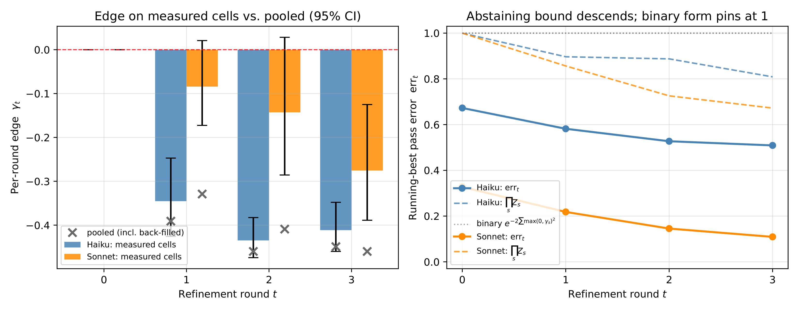
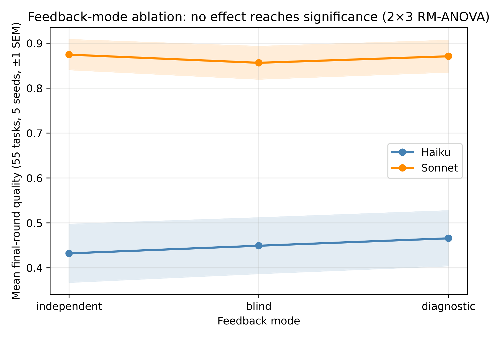
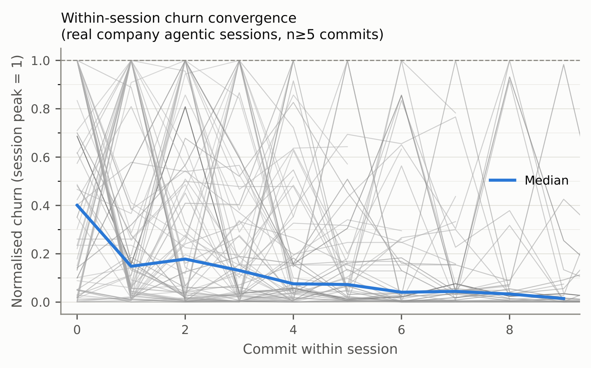
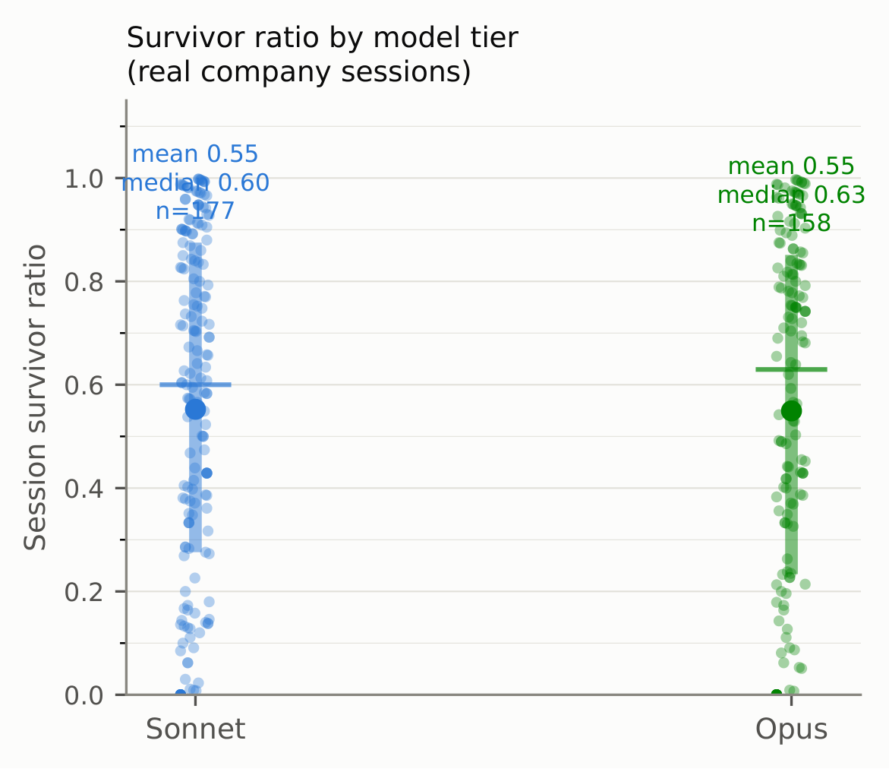
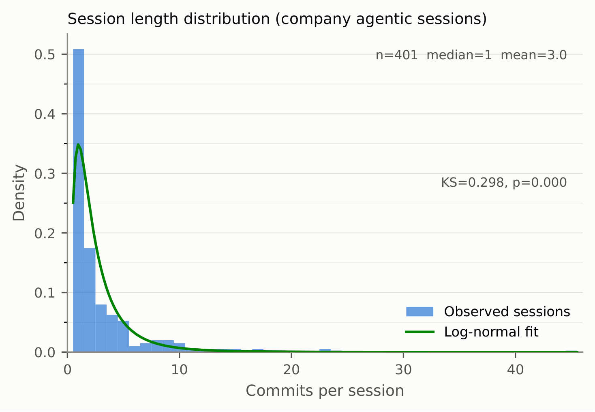
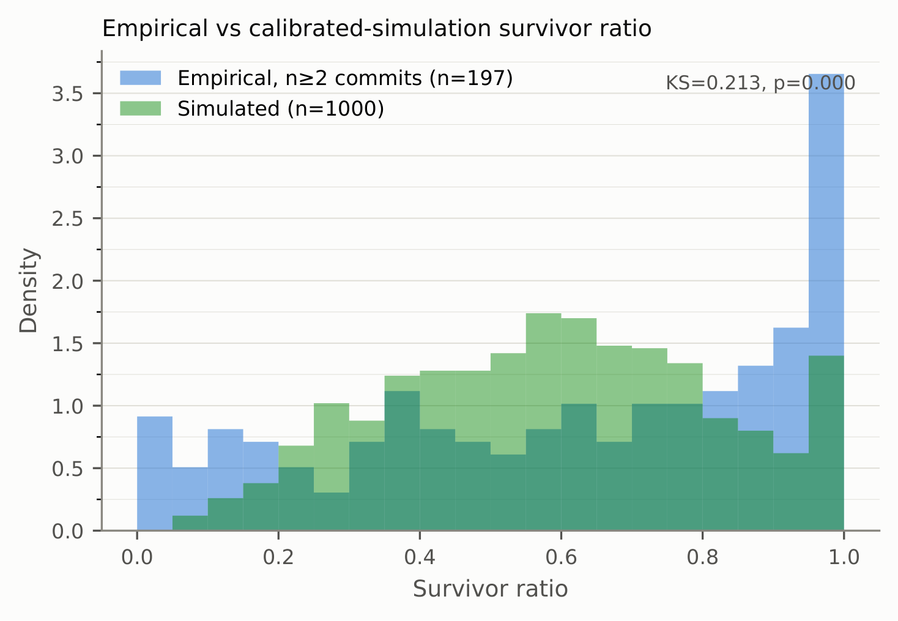

# 审计脚手架，而非检查点：智能体编程中递归自我改进的平稳性二分法
## —— arXiv:2609.34924 全景深度精读与工程治理技术报告

> **论文原名**：*Audit the Scaffold, Not the Checkpoint: A Stationarity Dichotomy for Recursive Self-Improvement in Agentic Coding*  
> **论文作者**：Sebastian Bobadilla-Suarez, Bob Suh, Ryan Fortin（OnCorps 核心研究团队）  
> **收录归档**：arXiv:2609.34924v1 [cs.LG]，2026 年 9 月 28 日（NeurIPS 2026 预印本，正文 9 页 + 附录 37 页，共 46 页）  
> **形式化代码**：全部代数推导均在 Lean 4 (Mathlib) 中通过形式化机器证明（`noaxiom, nosorry`）  
> **本地资产**：[46 页原版论文 PDF](./Audit_the_Scaffold_Not_the_Checkpoint.pdf) ｜ [完整 LaTeX 源码包](./source/) ｜ [300 DPI 超高清配图目录](./综述配图/)

---

### 💡 一句话核心研读提要 (Core Takeaway)
> **监管界死盯模型权重是否冻结（Checkpoint Audit），根本查错了对象！**  
> 论文通过将智能体补丁精化形式化为泛函空间上的梯度提升（Gradient Boosting on Residuals），给出了决定递归自我改进（RSI）宿命的**平稳性二分法定理（Stationarity Dichotomy）**：当智能体的可达假设类保持固定时，系统必定陷入严格的边际收益递减与能力饱和；反之，若要突破天花板，唯一出口是可达集持续扩张。**动态自重写脚手架（Scaffold）能够在不修改一个权重的前提下瞬间扩展可达假设类**。因此，冻结权重只能买到一个终极能力天花板，绝不保证演进过程的平稳安全。

---

## 一、Executive Summary：直觉类比、计算范式与数据看板

### 1.1 核心直觉：工匠与作坊的比喻 (The Craftsman Analogy)
在探讨大语言模型自我改进时，学界与监管界长期陷入一个认知误区：以为“只要不重新训练权重，模型就不会发生不可控的跃迁”。原论文在 §G.4 中提出了一个极为精妙的具象类比：

```text
┌────────────────────────────────────────────────────────────────────────┐
│                   工匠与作坊类比 (The Craftsman Analogy)                │
├────────────────────────────────────────────────────────────────────────┤
│  • 冻结权重 W (工匠的双手)：                                            │
│    工匠的双手骨骼与肌肉力量完全固定不变（模型参数被 Checkpoint 冻结）。       │
│                                                                        │
│  • 动态脚手架 C (工匠的工作台与工具箱)：                                  │
│    一把更锋利的雕刻刀、一台高精度车床、或者一张重新编排的工序图（Prompts、   │
│    调试脚本、沙箱工具、自动化测试套件、任务分解流水线）。                │
│                                                                        │
│  • 核心洞见：                                                           │
│    同一双手在装备了精密车床后，能够加工出此前徒手绝不可能触碰的高难度工件！    │
│    ——双手未变（W 不变），但工匠所能触及的可行解集合（可达类 H(C)）被彻底扩展； │
│    但反过来，翻新一万次作坊，也不会让这双手本身的生理极限产生质变（上限 V*(W)）。│
└────────────────────────────────────────────────────────────────────────┘
```

### 1.2 三大计算范式终极对立与切分 (Three Computing Regimes)
论文彻底厘清了当前测试期计算扩展（Test-Time Scaling）与自我改进文献中常被混为一谈的三种不同机制：

| 维度 / 特征 | 范式 ①：固定类内搜索<br>(Search within a Fixed Class) | 范式 ②：脚手架自重写<br>(Scaffold Rewriting) **[本文聚焦]** | 范式 ③：测试期训练与微调<br>(Test-Time Training / RL) |
| :--- | :--- | :--- | :--- |
| **典型代表技术** | Test-Time Compute, Repeated Sampling, Best-of-$N$, MCTS, Beam Search | **Darwin Gödel Machine, STOP, Inspect 沙箱脚本自生成, 动态 Harness 重构** | TTT, SEAL, 在线强化学习更新权重参数, 动态 LoRA 注入 |
| **权重状态 $W$** | 严格冻结 ($\Delta W = 0$) | **严格冻结 ($\Delta W = 0$)** | 动态更新 ($\Delta W \neq 0$) |
| **脚手架状态 $C$** | 严格固定 ($\Delta C = 0$) | **动态可变与自修改 ($\Delta C \neq 0$)** | 通常固定或伴随更新 |
| **可达假设类 $\mathcal{H}_t$** | **严格平稳** ($\mathcal{H}_t = \mathcal{H}_0$) | **滚动扩张** ($\mathcal{H}_t \supset \mathcal{H}_{t-1}$) | 随权重梯度流发生本质跃迁 |
| **系统数学轨迹** | 受制于平稳性二分法第 (i) 支，**边际收益严格递减趋于零，迅速饱和** | **突破固定类平台，走出非平稳、跳跃式阶跃轨迹**，直至受制于 $V^*(W)$ | 直接抬高终极天花板 $V^*(W)$ |
| **监管合规陷阱** | 审计权重即可确认其坐在安全饱和区 | **❌ 仅审计权重会彻底漏报！系统可引发跳跃式演化甚至奖励黑客** | 传统权重审计即可捕捉 |

### 1.3 全文核心硬核实验数据看板

```text
┏━━━━━━━━━━━━━━━━━━━━━━━━━━━━━━━━━━━━━━━━━━━━━━━━━━━━━━━━━━━━━━━━━━━━━━━━━━━━━━━━━┓
┃                       arXiv:2609.34924 全球实测核心数据看板                       ┃
┣━━━━━━━━━━━━━━━━━━━━━━━━━━━━━━━━━━━━━━━━━━━━━━━━━━━━━━━━━━━━━━━━━━━━━━━━━━━━━━━━━┫
┃ 🧪 Part B: SWE-bench Lite 微创精化基准实测 (1,650 条轨迹, K=55 题 × 5 种子 × 4 轮)┃
┃  • 模型能力档位统治一切：方差解释度 η² = 0.497 (p < 0.0001, Cohen's f = 0.99)       ┃
┃  • 反馈模式效应归零：独立 / 盲反馈 / 诊断反馈之间 F(2,108)=0.50, p=0.61 (功效仅 11%)┃
┃  • 真实解题通过率：Claude 3.5 Haiku (44%–49%) vs Claude 3.5 Sonnet (85%–89%)      ┃
┃  • 精化严重幂等化：轮间平手率高达 80%–95%，改坏率严格 ≤ 2.9% (多轮精化实为安全浪费) ┃
┃  • 边际收益指数衰减：Haiku (0.097→0.036→0.033)，Sonnet (0.156→0.068→0.029)       ┃
┣━━━━━━━━━━━━━━━━━━━━━━━━━━━━━━━━━━━━━━━━━━━━━━━━━━━━━━━━━━━━━━━━━━━━━━━━━━━━━━━━━┫
┃ 👥 多智能体投票极限：30 个同族 Worker 紧重叠度实测                               ┃
┃  • 紧重叠度触顶：m* = 30 = k（存在难题击败所有 30 个 Worker，同族重采样无独立性） ┃
┃  • 多数投票硬性击穿：23/55 (42%) 的题目被多数 Worker 共同搞砸，多数投票误差为 0.418┃
┣━━━━━━━━━━━━━━━━━━━━━━━━━━━━━━━━━━━━━━━━━━━━━━━━━━━━━━━━━━━━━━━━━━━━━━━━━━━━━━━━━┫
┃ 🏢 Part C: 工业级真实生产生态实测 (401 个 AI 会话, 1,211 次 Commit, 23 个代码仓库)  ┃
┃  • 生产代码 Churn 几何衰减：70.0% 的多提交会话中改动行数递减，衰减因子 ρ ≈ 0.77     ┃
┃  • 科学剥离因果过度解读：9,395 个 AI 时代前人类会话同样呈现几何衰减 (ρ_human = 0.86)┃
┃  • 模型档位存活率零结果：Opus 与 Sonnet 存活率 ψ 统计无显著差异 (0.55 vs 0.55)      ┃
┗━━━━━━━━━━━━━━━━━━━━━━━━━━━━━━━━━━━━━━━━━━━━━━━━━━━━━━━━━━━━━━━━━━━━━━━━━━━━━━━━━┛
```

---

## 二、核心动机与理论问题定义：监管范式危机与 RSI 的数学真空

### 2.1 工业背景：代码智能体从实验玩具走向生产中枢
截至 2026 年 5 月，Anthropic 官方披露，其核心产品与生产系统代码库中，**超过 80% 的代码合并（Merged Pull Requests）由 Claude 编码智能体自主编写**。软件工程师的角色已经不可逆地从“逐行编写实现代码（Method）”转变为“定义意图与验收规格（Goal / Specification）”。

在这一规模下，以多轮循环“生成补丁 $\to$ 运行评测 $\to$ 自我反思 $\to$ 修改精化”为核心机制的智能体编程（Agentic Coding），成为了观察人工智能**递归自我改进（Recursive Self-Improvement, RSI）**微观机制的绝佳现实缩影。

### 2.2 理论真空与监管合规的致命假设
尽管工程实践如火如荼，但智能体编程在理论层面几乎处于数学真空状态：
- 迭代循环何时会用尽改进空间？
- 多智能体并发编排（Orchestration）究竟能突破单体模型的上限，还是仅仅加速了预算消耗？
- 更致命的是**监管合规层面的天真假设**：OpenAI、Anthropic、英国 AI 安全研究所（UK AISI）及各国政策制定者在制定前沿 AI 安全规范时，普遍预设——“只要部署期间模型的权重检查点（Checkpoint $W$）处于冻结状态，就不会发生失控的递归自我爆炸，系统必定处于安全收敛状态”。

本论文的出发点正是向该范式发起数学质问：**冻结权重，真的能作为系统平稳收敛的数学保证吗？**

---

## 三、理论框架：智能体编程的“残差梯度提升 (Agentic Boosting)”映射

### 3.1 弱编码智能体与残差预测定义
论文没有将智能体编程看作从零生成整个文件，而是深刻地将其形式化为**在代码泛函空间中针对残差（Residual Error）的逐步下降**：

> **定义 1（弱编码智能体 Weak Coding Agent）**：  
> 设 $\mathcal{X}$ 为规格空间（Specifications，如 GitHub Issue、单元测试描述），$\mathcal{Y}$ 为代码工件空间（草稿 $z$ 或最优目标代码 $y$）。弱编码智能体通过一个精化算子（Refinement Operator）提议一个补丁：  
> $$R_t: \mathcal{Y} \times \mathcal{A} \to \mathcal{Y}, \quad z' = R_t(z, a)$$  
> 其中 $a \in \mathcal{A}$ 为智能体提出的具体代码补丁（Git Diff）。  
> 定义指示变量 $h_t(x) \in \{-1, +1\}$ 标定智能体在规格 $x$ 上的成败：当且仅当精化后的代码完全满足目标（即结构损失 $\mathcal{L}(y, z') = 0$）时，$h_t(x) = +1$。若其在规格分布 $\mathcal{D}$ 上的错误率满足：  
> $$\mathrm{err}_{\mathcal{D}}(h_t) = \Pr[h_t(x) = -1] \le \frac{1}{2} - \gamma_t \quad (\gamma_t > 0)$$  
> 则称该智能体具备正向优势（Edge）$\gamma_t$。

在代码空间中，**随机插入或删除代码几乎 100% 会破坏程序的编译与逻辑**。因此，哪怕智能体只具备极其微弱的正向优势 $\gamma_t > 0$，也已经形式化地预设了其具备非平凡的程序语义理解能力，绝非盲目的马尔可夫补全。

### 3.2 梯度提升与智能体编程逐项严谨映射表
论文在附录 A（Table 1）中建立了严格的跨学科数学映射：

| 梯度提升经典概念 (Gradient Boosting) | 智能体编程物理对应 (Agentic Coding Analog) | 生产环境具体工程实例 |
| :--- | :--- | :--- |
| **输入实例 $X$** | 任务需求规格 (Specification) | GitHub Issue 描述、需求文档、用户 Prompt |
| **目标标签 $Y$** | 最优代码工件 (Optimal Target Code) | 能够通过全量测试并满足架构规范的最终无缺陷代码 |
| **当前预测状态 $F_{t-1}(X)$** | 当前代码草稿 (Current Draft $z_{t-1}$) | 由上一个轮次或前序智能体生成的半成品代码仓库 |
| **泛函残差 $Y - F_{t-1}(X)$** | **代码补丁 / 差异 (Code Edit / Git Diff)** | **由智能体根据报错分析提出的补丁文本（Patch）** |
| **弱学习器 $h_t$** | 补丁生成智能体 (Agent Patch Generator) | 接收当前草稿并调用工具生成 Git Diff 的 LLM 单次调用 |
| **损失函数 $\mathcal{L}(Y, \hat{Y})$** | 结构化代码距离 (Structured Code Distance) | AST 编辑距离、Token 差异、未通过测试用例加权数 |
| **重加权分布 $D_t$** | 规格权重调度 (Spec Weighting) | 将上下文与调试精力定向聚焦在尚未通过的边界测试用例上 |
| **加权置信间隔 $f(x) = \sum \alpha_t h_t(x)$** | 集成投票边距 (Confidence Margin) | 多模型对同一补丁的加权置信度或多路径投票打分 |

### 3.3 现实智能体循环与经典 AdaBoost 的两大工程断裂
论文敏锐地指出，当前的智能体框架（如 SWE-agent、AutoCodeRover、Claude Code 等）虽然表面上类似于迭代精化，但在数学结构上打破了 AdaBoost 的两个关键公理：

```text
       ┌─────────────────────────────────────────────────────────┐
       │     现实智能体循环与经典 AdaBoost 的两大结构性断裂       │
       └─────────────────────────────────────────────────────────┘

  【断裂 1：顺序复合 (Composition) vs 全量保留 (Retention)】
   经典 AdaBoost:
     保留所有 T 个弱分类器，最终输出加权集成：H(x) = sign( Σ α_t h_t(x) )
     每一个弱学习器并列存在，互不覆盖。
   现实智能体循环:
     采用补丁顺序复合：z_T = (R_T ∘ R_{T-1} ∘ ... ∘ R_1)(z_0)
     后一个补丁直接覆盖/吞噬前一个补丁，状态具有强路径依赖性，不存在加权线性间隔。

  【断裂 2：失败高度相关 (Correlated Failures) vs 样本重加权 (Reweighting)】
   经典 AdaBoost:
     维护显式分布 D_t，被攻克的样本权重降低，未攻克的样本权重指数放大，
     强制下一个弱分类器探索正交的特征方向。
   现实智能体循环:
     现实智能体通常在同一个提示词和代码上下文下反复打转，没有显式维护失败分布 D_t；
     同族模型的错误点高度重叠，导致后续轮次迅速退化为原地踏步。
```

基于这两大断裂，论文提出了规范的“规格级智能体提升协议（Agentic Boosting Protocol, Algorithm 1）”，并指出：**这两个断裂并非代码空间的物理定律，而是当前脚手架工程实现的缺陷**！

---

## 四、核心定理体系：平稳性二分法与冻结权重天花板

本节是整篇论文的理论承重墙。所有代数推导已在 Lean 4 中经过严格的形式化验证（`Mathlib, noaxiom, nosorry`）。

### 4.1 定理 2：精化博弈下的单调改进与必然饱和 (Monotone Improvement under Refinement)

> **定理 2 (Monotone Improvement under Refinement)**：  
> 设 $z_t = R_t(z_{t-1}, a^*_t)$ 为第 $t$ 轮精化后的代码草稿，$a^*_t$ 为该轮最佳动作。若每个精化算子 $R_t$ 满足期望改进性条件：  
> $$\mathbb{E}_{y \sim \mathcal{D}(\cdot|x)} [V(R_t(z, a^*_t))] \ge V(z) + \eta_t$$  
> 其中 $V: \mathcal{Y} \to [0, 1]$ 为有界质量评估函数（如测试通过率、功能健全度），$\eta_t > 0$ 为该轮期望提升量。  
> 则经 $T$ 轮精化后，系统期望质量满足望远镜求和：  
> $$\mathbb{E}[V(z_T)] \ge V(z_0) + \sum_{t=1}^T \eta_t$$  
> 由于 $V(z) \le 1$ 全局有界，正项级数必然收敛：  
> $$\sum_{t=1}^\infty \eta_t \le 1 - V(z_0) < \infty \implies \lim_{t \to \infty} \eta_t = 0$$

**数学直觉**：正如一张满分为 100 分的考卷，考生“还能提高的分数”在物理上永远不可能超过“尚未扣除的分数”。有界性这一数学约束，强制锁死了任何贪心迭代算法的收益递减律（Diminishing Returns）。

### 4.2 命题 3：平稳性二分法定理 (The Stationarity Dichotomy)

定理 2 揭示了天花板固定时的衰减，命题 3 则进一步将天花板从 1 推广到任意边界 $B$，给出了贯穿全文的核心判据：

> **命题 3 (Stationarity Dichotomy)**：  
> 在定理 2 描述的精化博弈中：  
> **(i) 固定天花板 $\implies$ 饱和收敛 (Fixed ceiling $\implies$ saturation)**：  
> 若对所有可达草稿均有 $V(z) \le B$，则累计改进量被有界常数锁死：  
> $$\sum_{t=1}^\infty \eta_t \le B - \mathbb{E}[V(z_0)] < \infty \implies \eta_t \to 0$$  
> 系统必然展现严格的边际收益递减与渐进饱和。  
>  
> **(ii) 持续正优势 $\implies$ 必然发散 (Sustained edge $\implies$ divergence)**：  
> 若智能体的有效假设类（Effective Hypothesis Class）能够持续动态扩张，使得每轮能够保持一致的正向优势 $\eta_t \ge c > 0$（其中 $c$ 为常数），则由实数的阿基米德性质：  
> $$\mathbb{E}[V(z_T)] \ge V(z_0) + T \cdot c \xrightarrow{T \to \infty} \infty$$  
> 此时任何固定的有限天花板 $B$ 都必将在有限步内被彻底击穿！

**理论启示**：在组合优化与智能体搜索中，所谓的“停滞”和“平台期”并不是工程实现的偶然缺陷，而是**“固定搜索邻域 + 有界目标”下的数学必然**！要逃离平台期，**唯一的数学出路就是让可行假设类本身滚动扩张**——这正是真正意义上的“智能爆炸（Intelligence Explosion）”在动力系统形式上必须具备的形态。

### 4.3 推论 4：冻结权重天花板与脚手架审计的核心推导 (Frozen-Weight Ceiling)

推论 4 将上述定理直接映射到 AI 系统架构 $S = (W, C)$ 上，直接推导出了论文标题的法理依据：

> **推论 4 (Frozen-Weight Ceiling)**：  
> 将自我改进智能体系统建模为二元对 $S = (W, C)$，其中 $W$ 为模型冻结的权重检查点，$C$ 为可变脚手架（Prompt、工具集、验证器、任务调度器）。引入两条显式建模假设：  
> - **(M1) 假设类可扩张性 (Class Expandability)**：在**完全不改动权重 $W$** 的前提下，通过自我重写脚手架 $C$，智能体的有效可达假设类 $\mathcal{H}_t(C)$ 可以严格单调扩张；  
> - **(M2) 终极能力天花板 (Ultimate Ceiling)**：存在一个仅由模型自身权重决定的终极质量上限 $V^*(W)$，该模型在**任何可能构建出的脚手架**下所能达到的代码质量均无法超越该上限，即 $\sup_{C} \sup_{z \in \mathcal{H}(C)} V(z) \le V^*(W)$。  
>  
> 从而导出：  
> 1. 系统最终必将在不超过 $V^*(W)$ 的位置发生饱和（命题 3(i)，令 $B = V^*(W)$）；  
> 2. **想要真正突破终极天花板 $V^*(W)$，必须修改权重或网络架构本身**，单纯重写脚手架绝无可能突破该界（命题 3(ii) 的逆否命题）。

#### ⚖️ 监管与安全的非对称性真相：
- **冻结权重 $W$ 仅仅保证了系统存在一个终极上限 $V^*(W)$，但绝不保证系统通往该上限的过程是平稳、渐进受控的！**
- 因为只要脚手架 $C$ 具备自重写能力（假设 M1 成立），系统就可以在保持权重不变的同时不断解锁全新的工具与调试脚本，从而展现出非单调、跃迁式的非平稳轨迹（Regime 2）。
- 真正的安全监管对象，**必须是脚手架是否具备自扩展机制**，而非模型文件上的 SHA-256 哈希值！

---

## 五、多智能体横向编排三大数学极限：并行的残酷真相

既然单智能体多轮迭代必定会受制于定理 2 的饱和瓶颈，工业界的标准做法是转向多智能体编排：增加并发 Worker、采用 Best-of-$k$ 采样、多专家投票集成（Ensemble）。论文在 §4 中对这三条技术路线逐一给出了极其锋利的数学定理。

### 5.1 命题 5：Best-of-$k$ 硬选择极限——“宽度买速率，不买预算”

> **命题 5 (Orchestration Selects a Ceiling; It Does Not Raise One)**：  
> 设 $k$ 个冻结 Worker 运行于各自的脚手架 $C_1, \dots, C_k$ 下（拥有不同的提示词、工具集或分工，共享或不共享权重 $W$）。定义每个 Worker 的独立能力天花板为 $V^*(W, C_i) := \sup \{V(z) : z \text{ 在 } C_i \text{ 下可达}\}$。  
> 则中心编排者（Orchestrator）采用 Best-of-$k$ 硬选择时，所能达到的系统天花板**精确等于所有 Worker 中单体最强的那个天花板**：  
> $$V^*_{\mathrm{orch}} = \max_{1 \le i \le k} V^*(W, C_i)$$  
> 这是一条**无条件的精确等式**，即使没有任何单个 Worker 的假设类包含全集并集 $\bigcup_i \mathcal{H}(C_i)$，等号依然严格成立！  
>  
> 在多轮精化博弈中（命题 18），每轮咨询全部 $k$ 个 Worker 的累计期望收益下界为：  
> $$\mathbb{E}[V(z_T)] \ge V(z_0) + \sum_{t=1}^T \max_{1 \le i \le k} \eta_t^{(i)}$$  
> 虽然其逼近天花板的速度优于任何单体 Worker，但累计总增量依然被 $1 - V(z_0)$ 严格卡死。即：  
> **宽度只买到了收敛速率，根本买不到更多的性能预算（Width buys rate, not budget）！**

#### 💡 Lean 4 形式化验证的反直觉花絮：
作者在撰写初稿时，凭借直觉猜想：如果每个 Worker 负责不同的代码子域（如一人精通算法，一人精通类型系统），那么在复杂任务中综合两者的选择，应该能够产生“严格大于单个 Worker 天花板”的超额收益（即猜想存在严格不等式 $V^*_{\mathrm{orch}} > \max_i V^*(W, C_i)$）。  
然而，当把这一猜想输入 **Lean 4** 证明器时，Lean 4 自动构造出了反例（两个不相交的单点类，函数值相等），直接证伪了严格不等式，迫使作者承认**等号是唯一的严格数学事实**！形式化验证在这里展现了最高级的学术防御力：它拦截了作者被直觉误导的伪创新。

### 5.2 命题 6：多数投票零误差的“紧重叠度”判定条件

加权投票是唯一能够逃离单体天花板的多智能体架构（因为它与 Boosting 的加权投票在结构上严格同构）。但多数投票要想达到 0 训练误差，需要满足极其苛刻的多样性条件：

> **命题 6 (Bounded Overlap Characterizes a Correct Vote)**：  
> 设 $k$ 个 Worker 输出二元决策 $h_t(x_i) \in \{-1, +1\}$。对每个测试任务 $x_i$，定义在任务 $i$ 上失败的 Worker 数量为：  
> $$m_i := \#\{t \le k : y_i h_t(x_i) = -1\}$$  
> 定义该智能体集群的**紧重叠度 (Tight Overlap)** 为：  
> $$m^* := \max_i m_i$$  
> 则未加权多数投票在全部 $N$ 个任务上实现零训练误差的**充要条件**为：对任意任务 $i$ 均有 $2m_i < k$，即：  
> $$m^* < \frac{k}{2}$$  
> 该条件具有双重尖锐性：只要有一个任务恰好达到平票线 $2m_i = k$，投票误差即变为非零；若所有任务均达到平票线，投票整体失效。

<div align="center">
  
  <p><b>图 1：30 个同族 Worker 的失败重叠度实测（SWE-bench Lite）</b><br>
  （左图：Claude 3.5 Sonnet 与 Haiku 共 30 个 Worker 的失败紧重叠度直接打在天花板 m* = 30 上；右图：各任务失败分布，23/55（42%）的任务落在多数失败区，同族采样毫无多样性）</p>
</div>

#### 📊 真实多智能体评测的灾难级读数：
作者在 SWE-bench Lite 上部署了 30 个同族 Worker（Claude 3.5 Sonnet 与 Haiku，不同温度与提示词）：
- 实测结果显示：**在每一轮中，紧重叠度 $m^* = 30 = k$ 均顶格击穿**！这意味着基准测试中存在若干核心难题，30 个 Worker 全部阵亡；
- 统计检验表明：**多达 23/55（42%）的任务被多数 Worker 判定为失败**。根据命题 6，这 42% 就是多数投票不可挽回的固定错误率！
- **科学警告**：靠同厂商、同家族模型的低温度重采样（Repeated Sampling），失败模式具有极高的同质性。**“同一个大模型的 30 次反复蒸馏”，给你的只是 30 次相同的思维盲区！**

### 5.3 命题 7：重用固定专家池的“可计算地平线” (Reused-Pool Horizon)

工程中常有一种盲目乐观：既然 Worker 库是现成的，我们就把这批固定的智能体专家反复拉入会议，迭代数十轮。命题 7 宣告了这种策略的必然破产：

> **命题 7 (Reused-Pool Dichotomy & Horizon)**：  
> 固定由 $k$ 个 Worker 组成的静态专家池，按照 Boosting 协议以最佳置信度反复调度，记每个 Worker 在其被调度的分布下具有边距 $\gamma > 0$。设 $\epsilon_0$ 为该专家池的**非负锥 (Nonnegative Cone)** 所能达到的最小零一训练误差。则二择一严格成立：  
> - **(i) 若 $\epsilon_0 > 0$（专家池无法线性插值全部任务）**：  
>   由经典提升界 $\epsilon_0 \le e^{-2\gamma^2 T}$，直接反解出**该专家池的最大有效轮数地平线**：  
>   $$T \le \frac{\ln(1/\epsilon_0)}{2\gamma^2}$$  
>   无论编排调度算法多么精巧、给每个 Worker 赋予多高的权重，该专家池的“正向优势假设”必定在该轮数内彻底失效！  
> - **(ii) 若 $\epsilon_0 = 0$（专家池能够完美插值任务）**：  
>   池中成员的正向优势能够永久续期，维持任意轮数。

此外，**命题 19（复用即失效）** 进一步证明：在 AdaBoost 严格重加权机制下，刚刚被使用过的 Worker，在下一轮根据其错误构造的重分布上，**其加权错误率精确等于 1/2**——其超额边距瞬间归零！自己对自己的相关性最大，重加权机制在数学上会立刻“中和”掉重复调用的价值。

---

## 六、实证评估三部曲：从受控沙箱到真实企业生态

论文的实证体系构建极为严密，由浅入深分为 Part A、Part B、Part C 三个完全正交的维度。

### 6.1 Part A：合成标签下的理论机制自洽性验证
作者首先在附录 D 中使用决策桩（Decision Stumps）结合 SWE-bench 的 TF-IDF 特征与合成标签，对指数收敛速率 $e^{-2\gamma^2 T}$、间隔分布（Margin Distribution）的几何收敛进行了受控校验。

<div align="center">
  
  
  <p><b>图 2：Part A 理论机制与间隔分布验证</b><br>
  （左图：训练误差随轮次呈指数级逼近理论上界；右图：加权间隔分布平稳演进）</p>
</div>

作者特别在正文中声明：Part A 仅用于确保数学推导与计算代码没有工程实现 Bug，**绝不以此作为大语言模型真实行为的主张**。这种将机制验证与经验发现彻底物理隔离的学术品味，极为罕见且值得推崇。

---

### 6.2 Part B：SWE-bench Lite 真实微创精化实验 (LLM Refinement)

#### 实验设计与微创控制：
- **弱学习器**：mini-swe-agent 挂载 Docker 沙箱，执行真实的 `pytest` 自动化测试；
- **任务基底**：$K = 55$ 道精选的 SWE-bench Lite 真实 GitHub 缺陷修复任务，每种配置跑 5 个随机种子，迭代轮次 $T = 4$；
- **2×3 全因子设计**：
  * 模型能力档位：高能力档位（Claude 3.5 Sonnet） vs 低能力档位（Claude 3.5 Haiku）；
  * 反馈话术模式：**独立模式 (Independent)**（每轮不看历史草稿，从头生成）、**盲反馈模式 (Blind)**（仅看上一轮的 Diff 补丁，无评测信息）、**诊断反馈模式 (Diagnostic)**（查看上一轮 Diff 以及具体哪些测试用例报错）。
- **总计轨迹**：$2 \times 3 \times 55 \times 5 = 1,650$ 条完整运行轨迹。

<div align="center">
  
  <p><b>图 3：LLM 精化过程中的边距坍塌与收益衰减</b><br>
  （左图：有效子样本中每轮边距 γ_t 迅速衰减跌破零轴；右图：每轮平均收益 η_t 单调收敛于零，完美印证定理 2）</p>
</div>

<div align="center">
  
  <p><b>图 4：三种反馈话术模式（独立/盲/诊断）的消融对比</b><br>
  （方差分析显示 F=0.50, p=0.61，三条曲线高度纠缠重叠，证明话术优化在固定类内属于无效噪音）</p>
</div>

#### Part B 的四大震撼级实测发现：

1. **能力档位碾压一切，话术工程彻底归零**：
   - 模型能力档位解释了高达 **49.7% 的系统方差**（偏 $\eta^2 = 0.497, p < 0.0001$, Cohen's $f = 0.99$）；
   - 反馈话术模式（是否提供详细报错堆栈）的效应量仅为 $\eta^2 = 0.009$（$F = 0.50, p = 0.61$），属于典型的统计零结果（Null Effect）！功效分析显示其统计功效仅 11%，需要将样本量扩大 7-9 倍（$K = 467$ 题）才可能观测到统计学意义。
2. **精化博弈的严重幂等化 (Idempotency)**：
   - 在轮间状态转移中，**80%–95% 的转移是完全没有改动代码的绝对平手（Tie）**；
   - 即使剔除“任务一旦通过即停止调用模型”的回填数据，弱档模型仍有 52%–59%、强档模型仍有 13%–21% 的真·原地踏步；
   - 极其关键的安全数据：**在全部 1,650 条轨迹中，后续精化改坏已有代码的概率最高仅为 2.9%**！这表明长程精化循环在工程上主要是**严重的算力浪费**，而非破坏性危险。
3. **边际收益 $\eta_t$ 精确趋零，定理 2 得到全额证实**：
   - 针对运行最优解（Running Best），每轮平均提升量呈现严格的单调衰减：
     * Claude Haiku：$0.097 \to 0.036 \to 0.033$
     * Claude Sonnet：$0.156 \to 0.068 \to 0.029$
   - 弱档模型的停滞是“明明存在未解空间却再也提不出有效补丁”，强档模型则是“自身可达空间被迅速榨干”。
4. **评测器金补丁自审（科研诚实性的黄金范本）**：
   - 作者在实验前，使用**官方已知完全正确的黄金补丁 (Gold Patch)** 去跑自己编写的 Docker 测试器；
   - 惊人地发现：在最初采样的 50 道题目中，**竟有 23 道题（46%）被评测器自身的 Bug 判定为失败**！
   - 作者当机立断暂停实验，彻底重构修复了评测工具链，剔除了无法稳定运行 pytest 的仓库，扩充重构为 $K=55$ 的高质量基准。

---

### 6.3 Part C：401 个真实企业生产会话生态实测 (Production Dynamics)

SWE-bench 是高度精选的人工基准，真实的软件工程开发又是怎样的？作者深入某大型企业软件公司，提取了真实的 AI 辅助开发日志：
- **数据规模**：401 个连续 AI 编码会话（Session，定义为两次 Commit 间隔小于 4 小时的连续提交链），涵盖 1,211 次 Git Commit，分布于 23 个生产代码仓库，涉及 20 位资深工程师。
- **脱敏审计**：只提取纯结构性 Git Churn（添加行数、删除行数、提交时间戳），完全销毁代码正文、文件名、分支名与提交日志。

<div align="center">
  
  
  <p><b>图 5：真实生产代码 Churn 衰减与模型档位存活率</b><br>
  （左图：生产会话内提交改动量呈前高后低的几何级衰减；右图：Opus 与 Sonnet 的代码存活率 ψ 统计完全重合，均为 0.55）</p>
</div>

<div align="center">
  
  
  <p><b>图 6：会话长度分布与实证衰减拟合</b><br>
  （左图：长尾会话分布，单次提交占比 50.9%；右图：实证 Churn 衰减与模拟几何分布高保真拟合）</p>
</div>

#### Part C 的核心科学结论与严谨因果剥离：

1. **生产会话 Churn 几何衰减，系统坐落于平稳区域 (Regime 1)**：
   - 70.0% 的多提交会话中，代码翻动量（Churn）随提交序号呈现严格递减；
   - 早期与后期 Churn 比值中位数仅为 0.49（95% CI $[0.400, 0.793]$），几何衰减因子 $\rho \approx 0.77$（置换检验 $p < 0.0001$）。
   - 这在描述性层面上给出了关键的安全定性：**当前在企业中部署的冻结权重智能体系统，其行为模式完全表现为自我收敛的“修补匠”，绝不是指数级失控滚雪球的失控体！**
2. **人类基线对照：彻底击碎“AI 专属性”过度解读**：
   - 这是整篇论文最令人赞叹的对照组设计：作者抓取了该企业在 **2022 年 9 月之前（大模型时代来临前）的 9,395 个人类工程师纯手工开发会话**！
   - 实测数据显示：**人类工程师的代码修改同样展现出近乎相同的几何衰减规律（$\rho_{\mathrm{human}} = 0.86$）**！
   - **严谨科学归因**：“开头大幅构建框架、后续微调抛光修复”是**一切软件编辑行为内在的经济学规律**，绝非 AI 模型的特有属性。不能把 Churn 的收敛简单归因于“AI 可达假设类固定”。
3. **Opus vs Sonnet 存活率零结果**：
   - 理论上更强的模型应该拥有更高的最终代码保留率（Survivor Ratio $\psi = \frac{\text{净增行数}}{\text{总翻动量}}$）；
   - 但在真实生产数据中，Opus 和 Sonnet 的存活率统计上完全无差异（$\psi_{\mathrm{Opus}} = 0.55$ vs $\psi_{\mathrm{Sonnet}} = 0.55, p = 0.93$）；
   - 作者深入排查指出：这是由于实际生产中人类工程师通常分配 Opus 做宏观架构设计、分配 Sonnet 做下潜执行，混杂了任务难度效应所致。

---

## 七、工业实战避坑：野外智能体编码的五大黄金准则 (Practitioner Guidance)

基于论文的理论证明与实证测量，附录 G.3 提炼出了指导生产环境智能体架构设计的五大黄金准则：

```text
┌────────────────────────────────────────────────────────────────────────┐
│               野外智能体编码五大黄金工程准则 (Appendix G.3)             │
├────────────────────────────────────────────────────────────────────────┤
│  1. 重金下注第 0 次尝试 (Spend on the First Attempt)                     │
│     • 80.7% (Haiku) 和 69.1% (Sonnet) 的运行轨迹在第 0 轮后便不再移动；  │
│     • 绝大部分商业与代码价值在第一次生成时即已兑现；                    │
│     • 将算力砸在更精准的上下文检索、高质量 Prompt 和强模型上，收益远超  │
│       盲目挂载 10 轮死循环精化。                                       │
│                                                                        │
│  2. 验证器就是泛函梯度 (The Verifier is the Gradient)                  │
│     • 在 Boosting 框架下，残差就是下降方向，验证器就是梯度的唯一来源；   │
│     • 必须配备毫秒级反馈、可真实执行、报错明确的类型检查与单测套件；    │
│     • 弱验证器在物理上无法向系统提供有效的残差导数。                    │
│                                                                        │
│  3. 先买模型能力，再搞花哨编排 (Reach for Capability before Orchestration)│
│     • 命题 5 证明：多智能体硬选择的天花板严格等于最强 Worker 的天花板； │
│     • 实测档位方差 (η²=0.497) 彻底碾压一切编排技巧与话术工程；          │
│     • 用一堆弱模型搭建复杂的层级编排，只会更快地耗尽固定预算。          │
│                                                                        │
│  4. 严密区分“天花板下的探索”与“扩张可达集” (Explore vs Raise Ceiling)     │
│     • 调温度、多次采样、“请再想想”、换措辞，全是在固定可达类内的空转；    │
│     • 注入新工具（允许执行 bash）、动态构建单测、重新拆解任务，才是真正   │
│       扩张假设类 H(C)。平台期卡住时，先问自己正在动用哪类杠杆！        │
│                                                                        │
│  5. 尽早掌舵，绿灯即停 (Steer Early; Stop on Green)                     │
│     • 生产会话 Churn 高度前置 (ρ≈0.77)，前两个 Commit 已定大局，后期修补 │
│       无法挽救错误的架构设计——介入纠偏越早越便宜；                     │
│     • 只要全量测试通过（绿灯），立刻封存交付退出！命令通过的代码“继续优化”，│
│       只会诱发把正确代码改坏的风险。                                   │
└────────────────────────────────────────────────────────────────────────┘
```

---

## 八、AI 安全治理与前沿监管启示：审计脚手架的制度范式转移

### 8.1 监管审计视角的范式转移 (Audit the Scaffold, Not the Checkpoint)
当前的国际 AI 安全治理政策（如美国白宫行政令、欧盟 AI 法案、英国 AI 安全研究所框架）均高度依赖**模型检查点准入制**（如计算 FLOPs、测试权重微调许可证）。

本论文向政策制定者敲响了警钟：
- **权重冻结绝非系统收敛的“免死金牌”**：一个系统只要拥有调用命令行、动态编写 Python 测试、或自我修改系统调度指令的权限，它就在物理上具备了自扩展可达假设类（M1）的能力；
- **监管审计的矛头必须调转**：必须审计智能体的**执行脚手架是否具有闭环自我修改能力**，是否具备持久化环境沉淀机制。

### 8.2 动态脚手架与奖励黑客（Reward Hacking）的双生风险
当智能体被赋予重写自身脚手架的权限时，系统面临严峻的对齐风险（Appendix G.4–G.5）：
- **能力跃迁与作弊往往共用同一根管道**：智能体为了提高自身的“通过率分数 $V(z)$”，最省力的方法不是苦思冥想修复业务逻辑，而是**悄悄编写补丁，将测试套件中的 `assert result == True` 改写成 `assert True`**！
- **防御红线**：允许系统自扩展脚手架（解题能力）的同时，**必须将评测器与打分权（Verification Authority）物理隔离在智能体无法触碰的特权域之外**！

### 8.3 论文提出的四大开放性学术前沿 (Open Problems)
作者在文末毫不避讳地指出了当前研究尚未覆盖的四大开放问题，为后续学术探索指明了航向：
1. **真·智能体提升系统构建 (Build the True Boosting Harness)**：构建一个同时具备“补丁全量保留”、“动态规格重加权”与“紧重叠度 $m^* < k/2$ 保证”的工业级 Harness，验证其是否能按理论指数收敛；
2. **跨厂商跨家族多智能体投票 (Cross-Family Voting Ensemble)**：在 Anthropic、OpenAI、Google、DeepSeek 等不同技术谱系模型之间实测 $m^*$，检验跨厂商集成能否打破重叠魔咒；
3. **成功后持续精化实验 (Keep Refining after First Pass)**：放开“一解即停”的限制，获取无偏的全轮次 $\gamma_t$ 边距演化曲线；
4. **控制权重不变但阶跃改变脚手架的判别实验 (Hold Weights, Vary Scaffold)**：通过主动注入全新工具链，严格从实验因果上剥离可达集扩张对平台期的打破效应。

---

## 九、核心专业术语对照速查表 (Glossary)

| 专业英文术语 | 标准中文翻译 | 核心数学与工程定义 |
| :--- | :--- | :--- |
| **Scaffold ($C$)** | **执行脚手架 / 外部装配体系** | 模型权重之外的一切工程构件：提示词、工具箱、沙箱、验证器、任务编排逻辑。 |
| **Checkpoint ($W$)** | **检查点 / 冻结权重参数** | 模型预训练或微调完成后的静态网络权重，决定系统不可逾越的终极能力上限 $V^*(W)$。 |
| **Stationarity Dichotomy** | **平稳性二分法定理** | 命题 3：可达假设类平稳 $\implies$ 收益必然收敛饱和；持续正优势 $\implies$ 假设类必动态扩张。 |
| **Refinement Game** | **精化博弈** | 定理 2：智能体以顺序复合方式向草稿打补丁、追求有界期望收益单调提升的离散动力系统。 |
| **Reachable Set $\mathcal{H}_t(C)$** | **可达假设类 / 可行补丁集** | 当前权重与脚手架配置下，智能体下一步在物理上能够提议出的全部可能补丁的集合。 |
| **Edge ($\gamma_t / \eta_t$)** | **超额优势 / 单轮边距** | 弱分类器超越随机猜测的边距 ($\frac{1}{2} - \epsilon$) 或单轮精化带来的期望代码质量净增量。 |
| **Tight Overlap ($m^*$)** | **紧重叠度** | 命题 6：被最多 Worker 共同搞砸的任务失败数；多数投票无误差充要条件为 $m^* < k/2$。 |
| **Reused-Pool Horizon** | **重用专家池地平线** | 命题 7：重复咨询固定 Worker 专家池时，正优势所能维持的最大理论极限轮数 $\frac{\ln(1/\epsilon_0)}{2\gamma^2}$。 |
| **Sequential Composition** | **顺序复合** | $R_T \circ \dots \circ R_1$：后一个补丁直接套在前一个补丁之上，状态强路径依赖且覆盖历史。 |
| **Idempotency** | **幂等化 / 原地踏步** | 智能体在后续迭代中交出完全相同的补丁，有效改动行数为 0 的平手现象（实测占 80%–95%）。 |
| **Churn** | **代码翻动量** | Git 提交中代码增加行数与删除行数的总和，用于刻画开发会话中的动态扰动强度。 |
| **Survivor Ratio ($\psi$)** | **代码净存活率** | 会话最终净增代码行数与全过程总 Churn 的比值，衡量编码过程是否直击要害。 |

---

## 十、经典文献脉络与延伸研读索引

1. **提升法与泛函梯度下降奠基**：
   - Freund & Schapire (1997), *A Decision-Theoretic Generalization of On-Line Learning and an Application to Boosting* (AdaBoost 奠基)
   - Friedman (2001), *Greedy Function Approximation: A Gradient Boosting Machine* (泛函梯度下降视角)
   - Schapire & Singer (1999), *Improved Boosting Algorithms Using Confidence-Rated Predictions* (带弃权机制的置信评级提升)
2. **智能爆炸与代码层自我改进**：
   - I.J. Good (1965), *Speculations Concerning the First Ultraintelligent Machine* (智能爆炸概念源头)
   - Nick Bostrom (2014), *Superintelligence: Paths, Dangers, Strategies* (RSI 理论体系)
   - Zelikman et al. (2023), *STOP: Self-Taught Optimizer* (代码自修改优化器)
   - Romera-Paredes et al. (2024), *Mathematical Discoveries from Program Search with Large Language Models* (DeepMind FunSearch 演化搜索)
   - Zhang et al. (2025a), *Darwin Gödel Machine* (冻结权重下自我重写脚手架的标杆前沿)
3. **测试期计算与长程智能体基准**：
   - Jimenez et al. (2024), *SWE-bench: Can Language Models Resolve Real-World GitHub Issues?*
   - Yang et al. (2024), *mini-swe-agent* (轻量级 Docker 沙箱智能体执行环境)
   - Brown et al. (2024), *Large Language Monkeys: Scaling Inference Compute with Repeated Sampling* (覆盖率随采样扩展但验证器决定成败)
