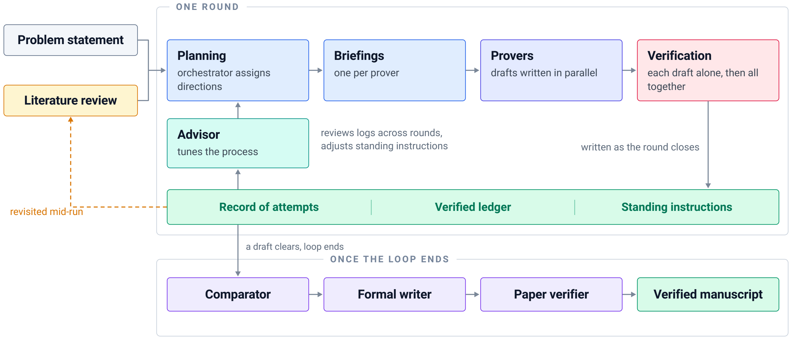

# 《Cogentic：面向开放难题自动证明发现的多智能体编排框架》中文精读综述

> **论文**：*Cogentic: Multi-Agent Orchestration for Automated Proof Discovery*  
> **作者**：Yang Cai（Google Research / 耶鲁大学）, Vineet Gupta（Google DeepMind）, Yanchen Jiang, Christopher Liaw, Aranyak Mehta, Grigoris Velegkas, Di Wang（Google Research）  
> **出处**：arXiv:2609.40324v2，2026 年 10 月，18 页，包含 5 篇配套顶级理论成果论文  
> **项目主页**：[https://sites.google.com/view/cogentic](https://sites.google.com/view/cogentic)  
> **基础模型**：Gemini 3.1 Pro / Gemini 4 Argon（早期版本），智能体执行端集成 Google Antigravity Agent  
> **一句话概括**：Cogentic 抛弃了传统大模型“单次死磕提示词”或“盲目试错形式化代码”的粗暴路线，通过**Orchestrator 调度 + 并行独立 Provers + 双层对抗式 Verifiers + 持久化已验证引理账本（The Ledger）+ 流程顾问（Process Advisor）**的精巧闭环，在仅需 $O(100) \sim O(1000)$ 次模型调用的超低推理预算下，实现了真正意义上无人类专家提示（Zero Expert Hints）的开放科学理论难题自动化求解，一举破解与大幅刷新了在线学习、拍卖理论、机制设计与自动出价等领域的 5 项世界级公开猜想。

**阅读难度**：★★★★☆。前半部分系统工程架构（The Harness）清晰优雅，任何对 Multi-Agent 系统感兴趣的工程师都能轻松看懂；后半部分涉及理论计算机科学（TCS）、微观经济学与在线凸优化领域的严密数学推导与对偶极值分析，本综述将配合直观背景、物理类比与定理拆解，带你全面看透这套前沿系统的架构精髓与理论成果。

---

## 0. 三分钟读懂（Executive Summary）

### 0.1 这篇论文在解决什么核心痛点？

当前前沿大语言模型（如 Gemini 3.1 Pro、Gemini 4 Argon）在单次交互（Single-shot）中已经展现出惊人的数学洞察力与推导灵感。然而，面对真正的**前沿开放科学难题（Open Research Problems）**时，传统的单次推理与简单的 Chain-of-Thought（CoT）几乎必然失效。主要瓶颈在于：

1. **假设空间的多分支冲突**：开放问题往往有多个相互竞争的猜想与证明路线，模型很容易在局部错误思路上越陷越深；
2. **缺乏长程状态沉淀与引理复用**：一次几万字推导若因中间某一处不等式漏洞失败，整个长上下文往往被全盘丢弃，无法保留哪怕已经证明正确的关键中间引理；
3. **验证器“软弱共谋”与过度顺从**：传统的自我反思（Self-Reflection）或普通审查很容易被证明者流畅的代码或严密的行文语气蒙蔽，出现幻觉共谋（Collusion of Hallucinations）；
4. **形式化证明（Lean / Isabelle）门槛过高**：将开放式的非结构化数学草稿形式化为 Lean 代码代价极其昂贵，极度限制了前期的发散探索速度。

**Cogentic 的第一性原理抽象**：将开放科学发现的推理搜索空间解耦为**探索（Exploration）**、**对抗性证伪（Adversarial Falsification）**、**状态沉淀（State Persistence）**与**元级流程控制（Meta-Process Adaptation）**四个正交维度——调度层（Orchestrator）仅负责资源配额与方向划分，严禁持有数学偏见；证明者（Provers）以独立智能体形态背靠背并行推演；双层验证器（Verifiers）基于“默认有错”的对抗性先验执行单篇深挖与跨篇横向比对；中间有效片段经隔离复验后固化进持久化引理账本（The Ledger），实现跨越上下文窗口限制的渐进式知识累积。

---

### 0.2 核心架构抽象与权责契约矩阵

| 系统角色 / 数据结构 | 解决的理论或工程张力 | 在系统中的核心权责与运行机制 | 关键隔离约束（防失效契约） |
| :--- | :--- | :--- | :--- |
| **Orchestrator（中央协调器）** | 全局搜索广度 vs. 单一推理路径锁死 | 追踪全局状态、将 Prover 槽位划分至互斥/互补方向、派生 Summarizer 生成独立 Briefing、管理公共账本与档案 | **零数学主观偏见约束**：不推演公式、不猜测答案走向、不单方面宣布某数学方向“毫无希望” |
| **Literature Reviewer（文献调研员）** | 外部先验知识缺失 vs. 上下文窗口过载 | 启动阶段检索相关定义、定理与对偶框架；当 Prover 在特定技术瓶颈停滞时于运行中途二次定向派发 | 禁止全量倾倒无关文献，按阻塞节点需求精准检索并输出结构化定义 |
| **Provers（并行证明者）** | 搜索多样性坍塌 vs. 长文档上下文退化 | 基于专属 Briefing 独立并行起草完整证明；依托 Google Antigravity Agent 架构按需选择性读取磁盘文件 | 实例间完全隔离、互不通信，防止同质化思路近亲繁殖 |
| **Individual Verifier（单篇独立验证器）** | LLM 生成流利幻觉与隐藏跳跃漏洞 | 逐行审查单份草稿，严格核验不等式方向、边界奇异点、半正定条件与外部引用真实性 | **对抗性怀疑先验**：默认每一步推导皆为错、每处引用皆为假，直至作者给出无可辩驳的证明 |
| **Cross-Draft Verifier（跨篇横向验证器）** | 同源训练模型共享的“群体性直觉盲点” | 将同轮次所有 Prover 提交的草稿并排横向比对，交叉识别共同默认假设与潜在互补路线 | 只有**同时通过**单篇与跨篇双层审查的草稿才被判定为有效 |
| **The Record & The Verified Ledger** | 长程推理状态丢失与“从零重启”陷阱 | **Record** 归档失败尝试、所用方法与驳回异议；**Ledger** 由 Auditor 抽取正确片段并经隔离复验后存入有效引理与反例 | 经隔离复验入库的中间引理可由后续 Prover 免证直接复用，已证伪界限直接剪枝 |
| **Process Advisor（流程顾问）** | 微观调度器上下文受限 vs. 跨轮次系统性偏置 | 脱离单轮调度负载，通读全周期验证日志，捕获反复出现的代数漏洞或审查盲点，动态微调指令与配额 | 仅优化流程规范与证明严格度标准，同样受“零数学主观偏见”约束 |
| **Consolidation Stage（合并与终审）** | 零散证明片段 vs. 可独立审阅发表的学术论文 | Comparator 择优，Formal Writer 扩展为完整符号体系与背景完备的 LaTeX 文稿，Final Audit 逐行防篡改复核 | 严防阐释与排版扩展过程中引入任何新的数学笔误或断言偏移 |

---

### 0.3 全文逻辑架构图

```text
               +-------------------------------------------------------------+
               |              用户输入：开放问题陈述 + 基础文献链接              |
               +-------------------------------------------------------------+
                                              |
                                              v
+-----------------------------------------------------------------------------------------+
|                                  COGENTIC 闭环工作流                                      |
|                                                                                         |
|  [ Literature Reviewers ] <---------+ (当遭遇技术阻塞时二次定向检索)                         |
|            |                        |                                                   |
|            v                        |                                                   |
|   +------------------+              |                                                   |
|   |   Orchestrator   | <------------+---------------------+                             |
|   +------------------+                                    |                             |
|       |          |                                        |                             |
|       |          | (派生 Summarizer 压缩历史)               |                             |
|       |          v                                        |                             |
|       |     [ Briefing 1 ]    [ Briefing 2 ]              |                             |
|       |           |                 |                     |                             |
|       v           v                 v                     |                             |
|  方向划分 ---> [ Prover 1 ]       [ Prover 2 ]  (Antigravity Agents 并发推导)            |
|                   |                 |                     |                             |
|                   +--------+--------+                     |                             |
|                            |                              |                             |
|                            v                              |                             |
|               +-------------------------+                 |                             |
|               |  双层对抗性验证系统       |                 |                             |
|               |  - Individual Verifiers |                 |                             |
|               |  - Cross-Draft Verifier |                 |                             |
|               +-------------------------+                 |                             |
|                            |                              |                             |
|                 +----------+----------+                   |                             |
|                 |                     |                   |                             |
|           [ 全部通过? ]           [ 发现缺陷/部分通过 ]     |                             |
|                 |                     |                   |                             |
|                 | 是                  v 否                |                             |
|                 |         +-----------------------+       |                             |
|                 |         | 提取已验证有效引理/反例 |       |                             |
|                 |         +-----------------------+       |                             |
|                 |                     |                   |                             |
|                 |                     v                   |                             |
|                 |         +-----------------------+       |                             |
|                 |         | 更新 Record 与 Ledger |-------+                             |
|                 |         +-----------------------+                                     |
|                 |                     |                                                 |
|                 |                     v                                                 |
|                 |         +-----------------------+                                     |
|                 |         | Process Advisor 复盘  | (调整下轮指令与资源配比)              |
|                 |         +-----------------------+                                     |
|                 v                                                                       |
|  +-------------------------------------------------------+                              |
|  | Consolidation: 最优证明挑选 -> 完整 LaTeX 论文扩写 -> Final Audit 终审核验               |
|  +-------------------------------------------------------+                              |
+-----------------------------------------------------------------------------------------+
                                              |
                                              v
               +-------------------------------------------------------------+
               | 交付产物：可直接由人类数学家复核并发表的高水准独立学术论文与定理证明 |
               +-------------------------------------------------------------+
```

---

### 0.4 你先记住这五个代表性突破数据

1. **$O(100) \sim O(1000)$ 次模型调用**：全流程完全自主运转，绝大多数难题在数百次 Gemini 调用内收敛结题，最难问题仅消耗约千次调用，样本效率碾压传统暴力蒙特卡洛/RL 搜索；
2. **$20,000 \to 2$ 人**：在双边市场 Bulow-Klemperer 拍卖定理中，将前人证明所需的“双边各招募 $\ge 20,000$ 额外交易者”常数极限，暴降至**仅在短缺方增补 $+2$ 人**，并严格证明 $+1$ 人在任何机制下均不可行（紧界）；
3. **$O(d)$ 统一无悔界**：在在线逆线性优化中，打破了学术界长达 5 年依赖时域 $T$ 的 $O(d \ln T)$ 枷锁，给出了**首个确定性、Proper 且单步仅需 $O(d^2)$ 计算的 $O(d)$ 统一界算法**；
4. **$0$ 渐进代价（Zero Price for Anytime）**：终结了 Harvey 等人的未决猜想，证明当专家数 $n \to \infty$ 时，随时（Anytime）无悔界的前导常数与已知终点（Fixed-horizon）的理论最优常数完全吻合（均为 $\sqrt{t \ln n / 2}$）；
5. **$5.2 \to 3.52$ 近似比**：在多物品独立可加买家机制设计中，将独立分售（SRev）与大捆绑销售（BRev）相对于全局最优收益（OPT）的近似比上限从 5.2 大幅刷新至 3.52。

---

## 1. 动机与背景问题

在理论计算机科学（TCS）、微观经济机制设计与机器学习理论领域，一项定理证明的诞生往往需要数周乃至数月的推敲。回顾当前 AI 在数学与算法领域的探索范式，主要存在三大技术路线，但各自在开放性科研中均面临天花板：

### 1.1 形式化交互式定理证明器（ITP: Lean, Isabelle, Coq）
以 Lean 4 为代表的形式化证明器提供了绝对可靠的机器检查保证（Machine-checked Guarantees）。近期诸如 AlphaProof、LeanDojo 等工作通过强化学习在国际数学奥林匹克（IMO）级别题目上取得了银牌乃至金牌水平。
- **痛点**：形式化证明的前提是“命题已经被清晰形式化”，且需要将每一步直觉推导翻译为底层 Tactic。但在探索**前沿未解决的开放科学难题**时，定义本身都在动态演化，将模糊的数学猜想和文献推演翻译成 Lean 代码的工程量极大，研究人员无法承受在早期粗粒度发散阶段的庞大形式化开销。

### 1.2 神经符号与启发式程序搜索（AlphaEvolve, FunSearch）
该路线通过大语言模型与外部评估器（Evaluator / Oracle）结合，在极值组合学（如 Cap-set 问题）、装箱算法与张量乘法中发现新构造。
- **痛点**：此类系统能够成功的**死穴在于必须拥有廉价、确定且快速的机器评分函数（Score Oracle）**。然而，绝大多数深奥的纯理论数学证明（如分析一个机制的纳什均衡收益、证明一个非凸优化问题的最差收敛速率）无法简单表达为一个几行代码就能计算出客观分数的模拟器。机器评分器的缺失直接导致程序进化搜索失效。

### 1.3 扩大测试期推理算力（Inference-Time Scaling）与多智能体交互
通过增加采样数量（Repeated Sampling）、多数投票（Self-Consistency）、推理链树搜索（MCTS）或多模型辩论（Debate）来提升推理质量。
- **痛点**：在开放长程推演中，简单增加采样会导致“算力爆炸但多样性坍塌”；而让模型直接进行辩论，往往会导致“谁说得长谁有理”或双方迅速陷入客气妥协的合谋状态。更严重的是，模型单次上下文容量有限，长程推导中积累的中间推导很容易在下一轮被丢弃，形成“重复犯错—盲目重启”的死循环。

**Cogentic 的切入点**：坚持在**自然语言数学逻辑（Natural-language human-readable proofs）**层面上运作，直接面向领域人类专家可直接审阅、评估和出版的高质量数学论文。通过精心设计的“双层对抗审查”与“中间引理持久化账本”，彻底突破传统单体 LLM 的长程推理瓶颈。

---

## 2. 核心架构与工作机制（The Harness）

论文第二章（Section 2: The Harness）系统性阐述了 Cogentic 的设计哲学与工程实现。整个系统由共享磁盘工作空间的一组异构智能体构成，在严格的职责隔离规约下运转。

<p align="center">
  
  <br>
  <em>图 1：Cogentic 单轮次（Round）系统工作流全景图（编排调度、动态简报、并行推导、对抗双检、引理账本沉淀与流程顾问）</em>
</p>

### 2.1 任务分发与上下文保护（Directions and Assignments）

每一轮推演从 Orchestrator（协调器）的资源规划开始：
- **研究方向（Directions）的离散化**：Orchestrator 不会给 Prover 一个泛泛的宏观目标，而是将大任务拆解为具体的**子命题方向**。例如：
  - “寻找目标函数在 $d$ 维下的紧确上界”；
  - “构造一个特定对称分布下的极值反例以证伪下界”；
  - “针对上一轮证明中引理 3 的放缩漏洞尝试修复”。
- **动态专属简报（Briefings via Summarizers）**：
  - 随着探索轮次的推进，积累的历史草稿、反例和验证报告成倍膨胀。如果把全部历史丢进上下文，不仅会导致严重的注意力分散，还会使模型被前人的错误思路“锚定”；
  - **创新机制**：Orchestrator 为每个即将启动的 Prover 独立派生一个 **Summarizer 智能体**。Summarizer 纵览全局案卷，挑选与该 Prover 所分配方向最相关的历史片段，提炼为一份精炼的 Briefing（包含该方向已验证事实、失败教训与潜在切入建议）；
  - **异构视角**：每个 Summarizer 是独立生成的，因此同一轮中处理同一方向的两个 Prover 拿到的简报侧重点各不相同，天然保留了推导路线的多样性（Diversity）。
- **Antigravity Provers 的按需检索设计**：
  - 每一个 Prover 本身是一个全功能的自主智能体（集成 Google Antigravity Agent）；
  - 长文档与庞大推导不会全文硬编码进 Prompt，而是以文件路径（File Path）形式传递。Prover 根据自身推导需要，自主调用工具选择性翻阅磁盘资料，极大保持了上下文的紧凑与高专注度。

---

### 2.2 双层对抗验证系统（Adversarial Verification）

传统的“自我纠错”往往流于形式，Cogentic 设计了极具威慑力的**双层对抗审查机制**，所有审稿智能体从一开始就被注入冷酷的先验设定：**“预设这篇证明全篇充满漏洞，除非作者给出无可置疑的数学逻辑支撑；预设所有引用的外部文献均为捏造，必须逐一核验”**。

1. **单篇独立验证器（Individual Verifier）**：
   - 一对一深度精读单个 Prover 提交的草稿；
   - 逐行检查：边界条件是否越界？符号定义是否存在歧义？不等式方向是否颠倒？矩阵半正定性是否成立？
2. **跨篇横向验证器（Cross-Draft Verifier）**：
   - 站在全局高度，将**本轮所有 Prover 提交的不同证明草稿平铺在一起进行并排横向比对**；
   - **核心价值**：单独看一份证明草稿，某些隐藏的“直觉盲点（Shared Blind Spots）”可能极具欺骗性；但当横向比对多个智能体的推导时，审查者能轻易发现“为什么大家都默认了引理 A 成立？引理 A 真的成立吗？”或者“路线 1 在步骤 3 卡住的障碍，路线 2 竟然已经用某种变分法巧妙绕开了”；
   - **准入门槛**：一份候选证明草稿必须**同时无条件通过** Individual Verifier 和 Cross-Draft Verifier 的审查，才被判定为“通过验证（Cleared Verification）”。

---

### 2.3 跨轮状态沉淀：Record 与 The Verified Ledger

如何让 Multi-Agent 系统真正具备“记忆与经验积累”，而不是在每一轮都无头苍蝇式地重启？Cogentic 提出了两套核心资产沉淀制度：

```text
+---------------------------------------------------------------------------------+
|                                 跨轮次核心记忆机制                                 |
+---------------------------------------------------------------------------------+
|                                                                                 |
|   1. 失败案卷库 (The Record)                                                     |
|      ├── 记录目标：记录每一轮被驳回的证明尝试                                       |
|      ├── 关键字段：[拟确立命题] + [所用数学技巧] + [致命反例 / 驳回逻辑漏洞]         |
|      └── 核心作用：防止后续轮次的 Prover 重蹈覆辙、在同一个死胡同里浪费算力          |
|                                                                                 |
|   2. 已验证引理账本 (The Verified Ledger)                                         |
|      ├── 记录目标：沉淀在推导过程中被确认成立的中间技术成果                           |
|      ├── 提炼机制：Auditor 智能体将草稿中有效片段解耦为自包含独立的 Lemma             |
|      ├── 二次隔离质检：将解耦出的 Lemma 发送给独立验证器二次单独审核通过后入库        |
|      ├── 沉淀内容：                                                             |
|      │    • 经确认的中间引理（后续 Prover 可免证直接引用）                         |
|      │    • 经验证的反例（明确排除不合理的界限或错误猜想）                           |
|      └── 核心作用：构建真正的渐进式推演阶梯（Stepping Stones）                      |
|                                                                                 |
+---------------------------------------------------------------------------------+
```

尤其是 **The Verified Ledger** 的引入，彻底解决了复杂数学证明难以一蹴而就的难题。一个 Prover 试图证明大定理时可能全篇失败，但他推导出的关于“特定度量张量行列式衰减”的引理 2 是完全正确的。Auditor 智能体会精准将引理 2 摘出、打磨成独立自包含的形式，经过严苛的二次隔离复验后录入 Ledger。下一轮的 Prover 即可站在该引理的肩膀上继续冲锋。

---

### 2.4 流程级元适应（Process-Level Adaptation）与“零偏见”红线

在一个包含数十个智能体并发协作的系统中，谁来监控协作系统本身的健康状况？
- **Process Advisor（流程顾问）的引入**：Orchestrator 负责微观调度，算力与上下文已被占满，无法进行宏观复盘。Process Advisor 充当独立的“质检总监”，定期通读从开始到当前的所有执行日志；
- **捕获宏观模式（Meta Patterns）**：
  - 发现**模型群体的习惯性漏洞**（例如：Prover 们总是在处理边界极值 $x \to 0$ 时忽略奇异点）；
  - 发现**验证器的疏漏倾向**（例如：Individual Verifier 容易在长代数化简中放水）；
- **动态微调与反馈**：Advisor 形成针对性的改进建议给 Orchestrator，比如“在下轮 Prover 的系统提示中加入针对柯西-施瓦茨不等式取等条件的强化警告”，或“提高对某一关键步骤的验证准入门槛”；
- **【极其关键的红线：No Mathematical Opinion】**：
  论文特别强调了一项铁律——**无论 Orchestrator 还是 Process Advisor，都绝对禁止产生任何具体的数学偏见！**
  它们绝对不允许猜测“最终答案可能是多少”，绝对不允许主观建议“请使用傅里叶变换方法”，也绝对不允许直接宣布“某个数学猜想毫无希望”。数学层面的探索路径完全交给 Prover 自主生发，管理层只负责维持流程的客观严谨与资源的高效流转。

---

### 2.5 终审、论文自动化装配与出炉（Termination and Output）

当某份证明草稿彻底通关双层对抗审查后，Cogentic 并不急于草草收工：
1. **最优性权衡**：Orchestrator 会评估剩余计算预算。若当前仅证明了一个常数界（如 4 倍），而仍有活跃分支有望冲击更优常数（如 3.5 倍），系统会允许继续探索，直至该方向探索耗尽；
2. **比较器（Comparator）**：在所有通关草稿中，挑选出数学结论最强、推导最严密优雅的候选者；
3. **Formal Writer 扩写成文**：由专职论文撰写智能体将草稿扩充为标准、完整的学术论文手稿（LaTeX 源码），补齐完整的研究背景、符号体系、直觉动机、前置引理与结论延展；
4. **Final Verification Audit（终审审计）**：针对编译出的最终论文逐句对照原始通过证明进行比对，严防在“文学润色与格式排版”过程中无意引入任何数学笔误或断言偏移。

---

## 3. 理论突破全景：五大开放难题的深度破解

Cogentic 并非停留在“解出奥数竞赛题”或“重写已知定理”，而是直接将矛头对准了理论计算机科学（TCS）、博弈论与算法经济学顶级会议（STOC, FOCS, EC, ICML）级别的开放科学前沿难题。全部 5 项成果均已成文并经领域顶级专家独立核验。

下表系统总结了这 5 项重大突破的对比详情：

| 难题编号与名称 | 所属理论领域 | 基础模型 | 前人 SOTA 极限纪录 | Cogentic 重大理论成果 | 核心技术机制与数学洞见 |
| :---: | :--- | :--- | :--- | :--- | :--- |
| **Problem 1**<br>在线逆线性优化<br>*(Online Inverse Linear Opt)* | 在线学习<br>凸优化理论 | Gemini 3.1 Pro | • 均匀界为指数级 $\exp(O(d \log d))$；<br>• 多项式高效界为 $O(d \ln T)$（随时域 $T$ 发散）；<br>• 2026 最新有限界是不合规（Improper）且单轮需 $T^{\Theta(d)}$ 指数测试的非凸规则。 | **首个确定性、Proper、随时可用（Anytime）的 $O(d)$ 统一界算法！**<br>单步仅需 $O(d^2)$ 计算与一次标准 LP，且完全独立于时域 $T$。 | • 建立在变度量在线梯度下降框架上；<br>• 提出**对偶度量自归一化更新**；<br>• 创造性引入**迹幂势函数 $\operatorname{tr}(H_t^{-1/2})$** 替代传统的对数行列式，彻底斩断 $\ln T$ 的根源。 |
| **Problem 2**<br>双边市场 Bulow-Klemperer 复杂度 | 拍卖理论<br>机制设计 | Gemini 4 Argon<br>(早期版) | • 仅单边增补买家需增加约 $n(m+4\sqrt{m})$ 人；<br>• 若双边同时增补，前人证明所需的常数高达双边各 $\ge 20,000$ 人。<br>学术界两大悬念：能否单边增补？常数能否缩至实用？ | **在人数较少的卖家端仅需增补 2 人，即 $\operatorname{STR}(m, n+2) \ge \operatorname{OPT}(m, n)$！**<br>并证明这是**绝对紧界**（即使 $m=n=1$，增加 1 人在任何机制下均不可行）。 | • 将双边各 $20,000$ 人的荒谬常数直接砸至单边 $+2$；<br>• 严格证明了增加 1 位卖家在先验无关、弱预算平衡机制下的不可能边界；<br>• 构建了非对称两端匹配的精细期望分析。 |
| **Problem 3**<br>$n$ 专家预测中的 Anytime Regret | 在线学习<br>多臂老虎机 | Gemini 4 Argon<br>(早期版) | • 固定时域界为 $\sqrt{\frac{T \ln n}{2}}$（前导常数 $1/\sqrt{2}$ 最优）；<br>• 传统随时界为 $\sqrt{t \ln n}$，多出 $\sqrt{2}$ 倍罚项；<br>• Harvey 等人猜想大专家数下随时代价应趋近于 1。 | **彻底证明 Harvey 等人的未决猜想！**<br>随时后悔界为 $\left(1 + O\left(\sqrt{\frac{\ln \ln n}{\ln n}}\right)\right) \sqrt{\frac{t \ln n}{2}}$。<br>证明在渐进意义下**随时性质完全零代价（Zero Price for Anytime）**！ | • 构造几何时间网格 $H^m = (1+\varepsilon)^m$；<br>• 提出**动态生命周期休眠与强制退役机制**，将并发活跃实例数恒定限制在 $O(\varepsilon^{-1} \log \delta^{-1})$；<br>• 多层级几何级数级联抵消。 |
| **Problem 4**<br>可加买家 Simple vs. Optimal 收益 | 多物品拍卖<br>贝叶斯机制设计 | Gemini 3.1 Pro | • 经典近似比界为 6（Babaioff et al.）；<br>• 2021 年 Ma 等人推进至 5.2；<br>• 理论下界为 2，此前学界长期停滞在 5.2。 | **将逼近比从 5.2 大幅突破至 3.52！**<br>即 $3.52 \cdot \max(\operatorname{SRev}, \operatorname{BRev}) \ge \operatorname{OPT}$。 | • 建立在 Cai 等人的对偶框架上；<br>• 摒弃传统的 $\operatorname{SRev}$ 单独截断及 Core/Tail 繁琐拆分；<br>• 提出**联合尺度 $M = \max(\operatorname{SRev}, \operatorname{BRev})$ 直接截断**；<br>• 借助固定一阶矩下二阶矩的极值分布（Extremal Distributions）导出严密约束。 |
| **Problem 5**<br>自动出价拍卖中的无序代价 (PoA) | 互联网广告<br>自动出价算法 | Gemini 3.1 Pro | • 确定性拍卖无法打破 PoA=2 壁垒；<br>• 随机化机制对 2 买家推进至 1.8；<br>• 对 $n$ 买家存在下界 $2 - \frac{4}{n+4}$，此前无任何机制能破界并匹配下界阶数。 | **① 证明标准比例一价拍卖（$\mathsf{pFPA}_1$）在 2 买家下达到最优紧界 $\mathrm{PoA} = 1.5$（兼证任何对称机制下界正是 1.5）；**<br>**② 提出 $2n$-比例一价拍卖（$\mathsf{pFPA}_{2n}$），证明对任意 $n$ 买家 $\mathrm{PoA} \le 2 - \frac{1}{4n+1} = 2 - \Omega(1/n)$！** | • 采用 $r$-比例一阶拍卖（$\mathsf{pFPA}_r$）：按出价 $r$ 次方概率分配并按出价支付；<br>• 在未被占优出价剖面（Undominated Bids）下解析均衡；<br>• 自主完成了 upper bound 与 lower bound 的双向完备推演。 |

---

### 3.1 突破详解 1：在线逆线性优化与去对数革命（$O(d)$ 统一界）

在在线逆线性优化（Online Inverse Linear Optimization）中，学习者在单位球 $\mathbb{B} \subseteq \mathbb{R}^d$ 中追踪一个未知隐藏向量 $w^*$。每一轮对手给出动作集 $X_t \subseteq \mathbb{B}$，学习者推荐 $\hat{x}_t$，专家则给出最优选择 $x_t \in \arg\max_{x \in X_t} \langle w^*, x \rangle$。目标是使累积短缺（Cumulative Shortfall）最小：
$$
R_T = \sum_{t=1}^T \langle w^*, x_t - \hat{x}_t \rangle
$$
若学习者是 **Proper** 的，它必须在看到菜单 $X_t$ 前先承诺一个对环境的非零线性估计 $\hat{w}_t$。该问题可直接归约为带有强分离 Oracle 的割平面博弈。

#### 前人困局
过去几十年间，所有高效割平面算法的分析全部依赖体积缩减，其核心势函数为度量矩阵的对数行列式 $\log \det H_t$。但该势函数必然伴随 $d \ln T$ 的对数膨胀；要想获得与 $T$ 无关的有限界，前人要么依赖维度爆炸的指数级计算 $\exp(O(d \log d))$，要么像 Dewasurendra 等人（2026）那样采用非合规（Improper）的 dyadic 覆盖加权投票，单步面临 $T^{\Theta(d)}$ 次非凸优化检验。

#### Cogentic 的神来之笔：迹幂势函数
Cogentic 构造了一个全新的一阶在线梯度下降算法，关键革新在于两处：
1. **度量矩阵自归一化（Self-Normalized Metric Update）**：
   观察到方向向量 $g_t = -v_t$ 后，度量矩阵更新公式为：
   $$
   H_{t+1} = H_t + \tau \frac{g_t g_t^\top}{\|g_t\|_{H_t^{-1}}}
   $$
   其中 $s_t = \|g_t\|_{H_t^{-1}}$ 是对偶度量长度。
2. **彻底废除对数行列式，引入迹幂势函数**：
   将传统产生 $\ln T$ 的 $\log \det H_t$ 替换为**逆半正定平方根的迹**：
   $$
   \Phi_t = \operatorname{tr}\left(H_t^{-1/2}\right)
   $$
   Cogentic 证明：$\Phi_0 = d$，且 $\Phi_t$ 始终非负。在每一步更新中，该势函数下降至少 $\frac{\tau}{4} s_t^2$！由此立即导出：
   $$
   \sum_{t=1}^T s_t^2 \;\le\; \frac{4d}{\tau} \;=\; O(d^2) \qquad \text{（完全独立于时域 } T\text{！）}
   $$
   配合步长 $\alpha = \Theta(1/d)$，通过距离收缩论证，直接锁死累积后悔 $R_T = O(1/\alpha + \alpha \sum s_t^2) = O(d)$。单步仅需一次秩一更新与一次线性规划，算力仅为 $O(d^2)$！

---

### 3.2 突破详解 2：双边市场 Bulow-Klemperer 定理的“常数雪崩”

微观经济学中经典的 Bulow-Klemperer 定理指出：在单边拍卖中，只要多引入一个买家，一个最简单的标准拍卖（如二阶价拍卖）所产生的期望收益，就足以超过在原市场规模下精心设计的全局最优机制。

在双边市场（买卖双方均有多人）中，这一结论能否成立？
- Babaioff 等人（2020）发现，如果仅增加买方，需要额外招募 $n(m + 4\sqrt{m})$ 规模的买家；
- Cai 等人（2024）证明了如果双边同时扩充，常数级人数足矣——但其推导出的理论界限令人咋舌：**买卖双方各需要额外招募至少 20,000 人！**

**Cogentic 的突破**：
Cogentic 证明，根本不需要双边大张旗鼓地招募数万人，甚至不需要动买方：
$$
\operatorname{STR}(m, n+2) \;\ge\; \operatorname{OPT}(m, n)
$$
**只要在处于数量劣势的一方（卖家方）仅仅增加 2 个人**，卖家贸易缩减机制（Seller Trade Reduction, STR）的期望贸易增益（GFT）就绝对压倒原市场的最完美先验最优机制 $\operatorname{OPT}(m, n)$！
更为绝妙的是，系统还直接构筑了反例证明：即便在最简单的 $m=n=1$ 市场中，仅仅增加 1 个卖家，没有任何先验无关、支配策略激励兼容（DSIC）、个体理性（IR）且弱预算平衡的机制能够达到 $\operatorname{OPT}(1,1)$。**$+2$ 就是终极宇宙紧界！**

---

### 3.3 突破详解 3：专家建议预测中 Anytime 代价猜想的终结

在线机器学习经典理论中，面对 $n$ 个专家时：
- 若预先知道总轮数 $T$，精心调整学习率的乘权算法（Multiplicative Weights）可保证后悔界为 $\sqrt{\frac{T \ln n}{2}}$，前导系数 $\frac{1}{\sqrt{2}}$ 在渐进意义下是数学不可撼动的铁底；
- 但在实际生产中，时域往往未知（Anytime 场景）。以往最好的随时算法界为 $\sqrt{t \ln n}$，比起确定时域多出了整整 $\sqrt{2}$ 倍（约 1.414 倍）的性能损失；
- 理论学者 Harvey 等人（2023, 2024）长期猜想：当专家数量 $n \to \infty$ 时，随时机制的这一劣势应当收敛消失。但离散时间下的具体构造与证明长期悬空。

**Cogentic 找到的优雅构造**：
Cogentic 设计了一种“动态生命周期多级调度”体系：
1. 建立以几何比例递增的时域梯队 $H^m = (1+\varepsilon)^m$；
2. 为每个梯队配置一个专门针对该时域优化的乘权实例，外层由一个 Master 乘权算法统筹；
3. **休眠与退役机制（Sleep and Retirement）**：实例 $m$ 在时钟到达 $\lfloor \delta H^m \rfloor$ 之前保持休眠，并在时钟超过 $\lfloor H^m \rfloor$ 后强制注销。这一设计保证了任意时刻活跃的实例数量严格被限制在 $O(\varepsilon^{-1} \log \delta^{-1})$，与当前运行时间 $t$ 彻底解耦；
4. 令网格参数 $\varepsilon = \sqrt{\frac{\ln \ln n}{\ln n}}$，衰减参数 $\delta = \varepsilon^3$，所有层级的聚合开销与几何级数误差被压缩至 $1 + O(\varepsilon)$。

最终定理严密证明，对于任意 $t \ge 1$ 均成立：
$$
R_t \;\le\; \left(1 + O\left(\sqrt{\frac{\ln \ln n}{\ln n}}\right)\right) \sqrt{\frac{t \ln n}{2}}
$$
随着专家数 $n \to \infty$，$O(\cdot)$ 扰动项趋近于 0，**完全消除了随时算法的前导常数代价！**

---

### 3.4 突破详解 4：多物品简单机制近似比从 5.2 飞跃至 3.52

在多物品拍卖机制设计中，一个经典的重大理论问题是：对于一个拥有 $n$ 个独立物品可加估值的单一买家，销售方究竟是“每一件物品明码标价单独卖（$\operatorname{SRev}$）”划算，还是“所有物品打成一个大礼包整体卖（$\operatorname{BRev}$）”划算？抑或是必须使用极度复杂的随机化菜单？

- Babaioff 等人（2020）首先证明了两者较优者即可达到全局最优收益 $\operatorname{OPT}$ 的常数级近似：$\operatorname{OPT} \le 6 \cdot \max(\operatorname{SRev}, \operatorname{BRev})$；
- Ma 等人（2021）借助对偶理论将其推进至 5.2 倍；
- 但理论已知的下界仅为 2（Rubinstein, 2016），5.2 距离 2 之间存在长达数年的理论荒原。

**Cogentic 的证明技术创新**：
在 Cai 等人的对偶理论框架中，全局收益上界可分解为单独销售收益加上“非最喜好物品的期望福利（Non-favorite Welfare）”：
$$
\operatorname{OPT} \;\le\; \operatorname{SRev} + \mathbb{E}[V - M_{\max}]
$$
以往所有分析都在 $\operatorname{SRev}$ 处对物品估值做截断，并被迫将剩余部分撕裂为 Core 与 Tail 两块极度繁复的部分分别放缩。
**Cogentic 的全新解法**：直接在联合收益尺度 $M = \max\{\operatorname{SRev}, \operatorname{BRev}\}$ 进行统一截断，严格证明了：
$$
\mathbb{E}[V - M_{\max}] \;\le\; \mathbb{E}[V_M], \qquad \text{其中 } V_M = \sum_{j=1}^n \min\{v_j, M\}
$$
这一步直接将令人头疼的 Tail 项彻底抹去！随后，系统通过变分法求解了在固定期望 $\mathbb{E}[V_M]$ 条件下最大化与最小化二阶矩 $\mathbb{E}[V_M^2]$ 的**极值分布（Extremal Distributions）**，建立起 $\mathbb{E}[V_M]$ 与联合尺度 $M$ 的高精度几何不等式，一口气将逼近比从 5.2 砸至 **3.52**！

---

### 3.5 突破详解 5：自动出价拍卖（Autobidding）的无序代价与打破 PoA=2

在现代互联网广告竞价（如 Google Ads）中，广告主普遍采用“自动出价代理”，仅设定高层约束（如预算与投资回报率 RoS 约束）。衡量拍卖系统效率的核心指标是无序代价（Price of Anarchy, PoA）——即社会福利的全局最优解与最差纳什均衡福利之比。

- Aggarwal 等人（2019）证明经典二阶价拍卖（SPA）的 PoA 严格等于 2；
- Liaw 等人（2023）进一步证明，在先验无关场景下，**任何确定性拍卖机制（包括一阶价拍卖）的 PoA 都不可能打破 2**。对于 2 个买家，引入随机化机制后最好结果为 1.8；对于任意偶数 $n$ 个买家，存在理论下界 $\mathrm{PoA} \ge \frac{2n+4}{n+4} = 2 - \frac{4}{n+4}$。

**Cogentic 的双杀成果**：
针对这套悬而未决的体系，Cogentic 独立提出并分析了 **$r$-比例一价拍卖机制（$\mathsf{pFPA}_r$）**：每个买家根据出价的 $r$ 次方比例随机决定中标者（$x_{i,j} = b_{i,j}^r / \sum_k b_{k,j}^r$），中标者支付自己的出价 $b_{i,j}$。
1. **针对 2 个买家**：证明了标准的比例一价拍卖（$\mathsf{pFPA}_1, r=1$）在所有未被占优出价下，无序代价精确达到：
   $$
   \mathrm{PoA} \;\le\; 1.5
   $$
   同时系统自主构造证明了：**对于任何对称匿名机制，PoA 必然 $\ge 1.5$**！上限与下限在 1.5 处严丝合缝紧闭。
2. **针对一般 $n \ge 2$ 个买家**：系统在人类研究员完全未提供任何预设提示的情况下，自主构造出了参数为 $r=2n$ 的机制（$\mathsf{pFPA}_{2n}$），并完成严密推演证明：
   $$
   \mathrm{PoA}(\mathsf{pFPA}_{2n}) \;\le\; 2 - \frac{1}{4n+1} \;=\; 2 - \Omega(1/n)
   $$
   **这是学术界首个针对一般 $n$ 买家打破确定性 PoA=2 壁垒、且在阶数上精准匹配理论下界 $2 - \Theta(1/n)$ 的拍卖机制！**

---

## 4. 工程实战细节、深水区避坑与机制反思

在深入研读该论文的附录及设计细节后，可以总结出若干对下一代 Multi-Agent 架构设计极具指导意义的工程实战经验：

### 4.1 惊人的样本与算力效率：为什么只需 $O(100) \sim O(1000)$ 次调用？
当今许多学术界尝试用大模型做科研，动辄配置数万次蒙特卡洛树搜索（MCTS）或海量并行采样。而 Cogentic 解决上述世界级难题，全流程仅耗费数百到上千次模型交互。其高能效的核心在于：
- **拒绝暴力平铺，引入分层状态管理**：大部分系统让大模型反复重读几万行的长历史，陷入上下文退化；Cogentic 由 Summarizer 提炼高密度简报，由 Auditor 精准抽取引理入库，把算力全部用在“推敲实质推导”上；
- **负样本即时剪枝**：Record 详细记录了“尝试过的路线”以及“被 Reject 的具体数学矛盾”。Prover 看到负样本记录后，能够瞬间避开前人走过的死胡同。

### 4.2 零专家提示（Zero Expert Hints）的真伪核验
从论文附录 A 披露的真实 Prompt（如附录 608 行关于双边拍卖的提示词）可以看出：
```text
Read this paper: https://arxiv.org/abs/2307.03844.
Suppose there are m buyers and n sellers and m >= n...
Show that adding 2 additional sellers is sufficient to guarantee that 
Seller Trade Reduction achieves at least the first-best GFT of the original market. 
That is, show that STR(m, n+2) >= OPT(m, n) for all m, n >= 1.
```
人类研究人员除了给出命题目标、基础论文链接与必要符号定义外，**没有提供任何中间引理假设、没有给出证明技术线索，更没有代写一行推导**。甚至在自动出价 $n$ 买家机制中，人类根本不知道该用什么拍卖规则，是系统自主构思出 $\mathsf{pFPA}_{2n}$ 并完成了完整证明。

### 4.3 为什么坚持人类可读的自然语言数学手稿？
论文在讨论章节（Section 4: Discussion）坦率指出了一个前瞻性问题：**当前生成机器证明的速度，正在迅速超过人类数学家的阅读与理解速度**。
- 如果将所有证明交给 Lean 等形式化验证器，固然可以实现毫秒级的纯机器验收，但人类研究者将失去对数学解法背后深刻技术思想的直觉掌握；
- 科学史上，很多重要数学工具的诞生，恰恰源自研究人员在阅读前人精巧手写证明时获得的灵感跃迁；
- Cogentic 选择输出结构严整、符号标准的人类自然语言 LaTeX 论文，让人类领域专家能够直接审阅、提炼思想，甚至在此基础上进一步推广开辟全新研究方向。

### 4.4 对抗式审查的双重保险：单点深挖与群体盲点
如果只依赖 Individual Verifier，大模型由于同质化训练，极易在某种看似合理的放缩上达成默契妥协。**Cross-Draft Verifier 的并排横向比对机制**是防止逻辑漏洞滑脱的核心防火墙。多份草稿摆在一起，推导思路与结论差异被瞬间放大，群体性的盲从直觉立刻无所遁形。

---

## 5. 总结与启示

Cogentic 的成功，标志着大语言模型在科学发现（AI for Science / AI for Math）领域的应用范式发生了根本性转变：

1. **从“单体模型刷题”走向“科研组织架构工程”**：解决真正的前沿科研难题，核心不再是祈求单次 prompt 吐出奇迹，而是构建一套包含分工、博弈、对抗、审计与持久化记忆的闭环智能体组织体制；
2. **知识沉淀的颗粒度至关重要**：不要把整个任务看作非黑即白的 0 与 1。一个失败的推导中蕴藏的正确中间引理（The Ledger），往往是下一个智能体迈向成功的坚实垫脚石；
3. **Google Antigravity 与前沿推理模型的深度协同**：本论文中明确采用 Antigravity Agent 作为 Prover 的实体执行底座，依托其灵活的工作空间读写与工具调用能力，配合 Gemini 3.1 Pro / Gemini 4 Argon 的深度数理推演，展现了软硬件工具链与大模型高度协同的巨大威力。

对于从事 AI Agent 开发、理论科学探索以及大模型推理扩展（Inference Scaling）的研究者而言，Cogentic 提供了一份兼具学术严谨性与高度工程化美感的教科书级范本。

---

## 6. 参考文献与相关链接

- **本文原论文**：*Cogentic: Multi-Agent Orchestration for Automated Proof Discovery*, [arXiv:2609.40324v2](https://arxiv.org/abs/2609.40324)
- **Cogentic 成果追踪主页**：[https://sites.google.com/view/cogentic](https://sites.google.com/view/cogentic)
- **配套成果 1（逆线性优化）**：*Efficient Online Inverse Optimization with $O(d)$ Regret*, [arXiv:2609.13440](https://arxiv.org/abs/2609.13440)
- **配套成果 2（双边市场）**：*The Power of Recruiting the Smaller Side: Two Additional Traders Suffice in Two-Sided Markets*, [arXiv:2609.27304](https://arxiv.org/abs/2609.27304)
- **配套成果 3（随时专家预测）**：*Prediction with Expert Advice: Anytime Regret with Many Experts Matches the Fixed-Time Constant*, [arXiv:2609.27206](https://arxiv.org/abs/2609.27206)
- **配套成果 4（简单机制收益）**：*Improved Revenue Guarantees for Selling Separately and Bundling*, [arXiv:2609.28873](https://arxiv.org/abs/2609.28873)
- **配套成果 5（自动出价拍卖）**：*Efficiency of Generalized Proportional First-Price Auctions Under Auto-Bidding*, Forthcoming（详见 [Cogentic 主页](https://sites.google.com/view/cogentic)）
- **智能体底座参考**：*Introducing Google Antigravity, a New Era in AI-Assisted Software Development*, [https://antigravity.google/blog/introducing-google-antigravity](https://antigravity.google/blog/introducing-google-antigravity)
