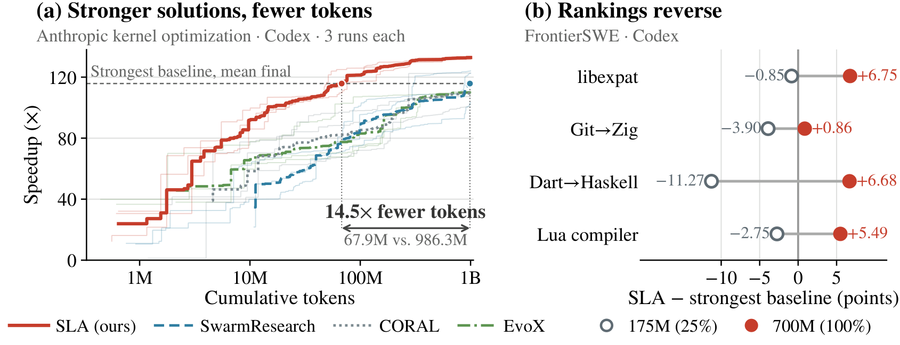
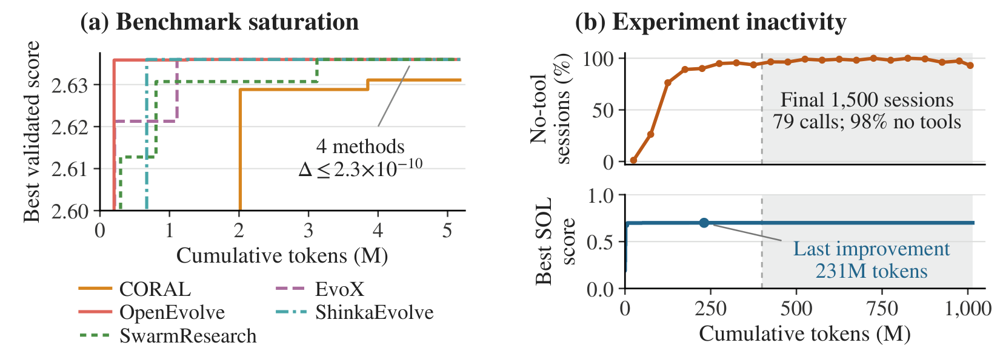
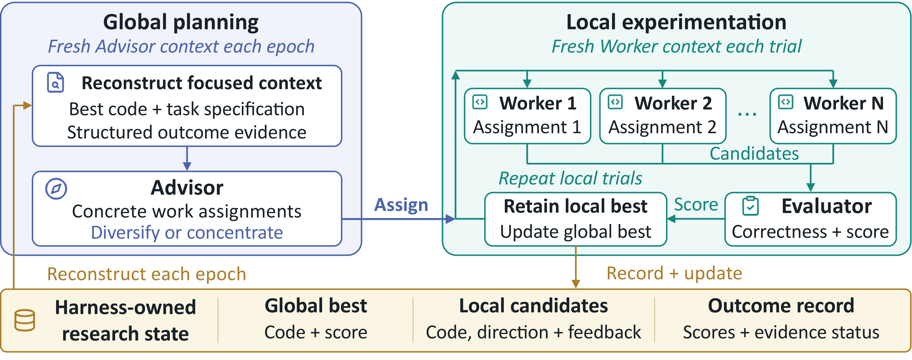
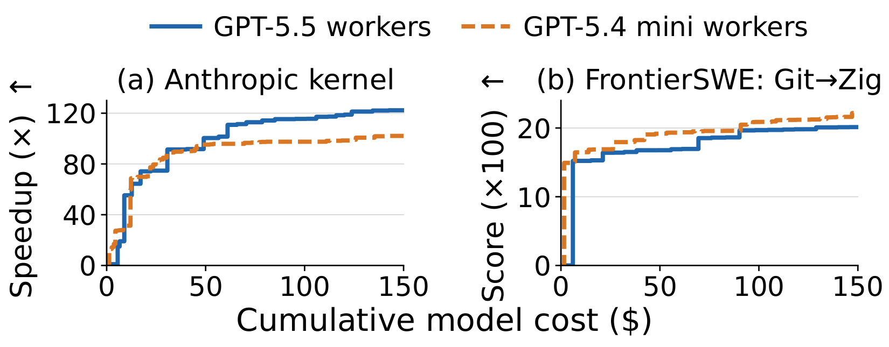
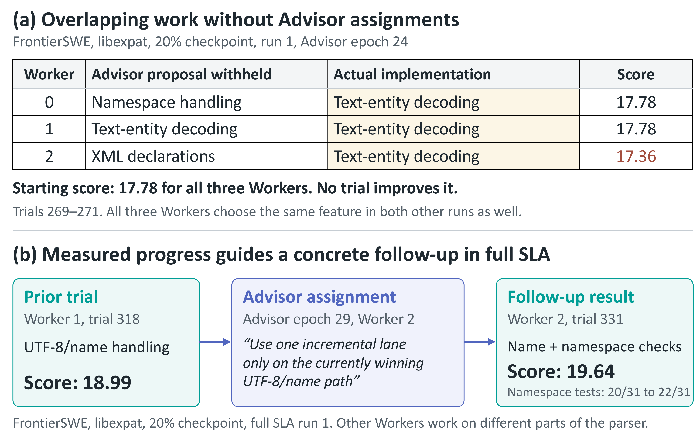

# 无状态语言智能体 (SLA)：长程自动化研究的规模化扩展深度精读综述

> **论文标题**：Stateless Language Agents: Scaling Long-Horizon Automated Research  
> **论文链接**：[arXiv:2610.07625](https://arxiv.org/abs/2610.07625) | **开源仓库**：[GitHub - Alex-q-z/stateless-language-agents](https://github.com/Alex-q-z/stateless-language-agents)  
> **作者团队**：Qizheng Zhang$^*$、Changxiu Ji$^*$、Isaac Sun$^*$、Yuetai Li、Shubhangi Upasani、Sherry Ruan、Boyuan Ma、Fenglu Hong、Vamsidhar Kamanuru、Yoonho Lee、Yuzhen Mao、Genghan Zhang、Rulin Shao、Qiuyang Mang、Andy Dimnaku、Changran Hu、Radha Poovendran、Kunle Olukotun  
> **所属机构**：Stanford University、CMU、University of Washington、SambaNova Systems, Inc.、UC Berkeley  
> **原版论文 PDF**：[`Stateless_Language_Agents.pdf`](./Stateless_Language_Agents.pdf)  
> **原文解析 Markdown（配插图）**：[`2610.07625_Stateless_Language_Agents_Scaling_Long-Horizon_Automated_Research_原文解析.md`](./2610.07625_StatelessLanguageAgents_原文解析.md)

---

## 📌 导读与核心摘要 (Executive Summary)

### 一句话概括
针对长程自动化研究（Long-Horizon AutoResearch）中多智能体系统因会话历史无限膨胀导致的**重复造轮子、过早停滞空转、高 Token 损耗**三大顽疾，斯坦福大学等机构提出了 **无状态语言智能体 (Stateless Language Agents, SLA)** 范式——核心准则为 **“有状态的搜索，无状态的智能体” (Stateful Search with Stateless Agents)**：将持久化研究状态（候选解、评测结果、方向脉络）彻底收归外部 Harness 持有，每次调用均由 Harness 动态重构精炼、角色隔离的新鲜上下文（Context），并由极低开销的 **Advisor**（全局证据汇总与实验派发）协同并行 **Workers**（隔离沙箱局部试错）。在高达 **10 亿 (1B) Token** 预算的内核优化、大型软件工程迁移与密码学算法设计基准上，SLA 全面超越 EvoX、CORAL 与 SwarmResearch，在 Anthropic SIMD 内核优化上以 **93.1%（Codex）/ 84.4%（Claude Code）更少的 Token** 追平最强基线，且在全预算下包揽所有任务第一。

---

### 直觉类比与范式对比

| 评测维度 | 传统长程有状态多智能体 (CORAL / SwarmResearch) | **无状态语言智能体 SLA (本文方案)** |
| :--- | :--- | :--- |
| **核心哲学** | **有状态的智能体**：Agent 长期持有自身对话会话（Session），通过 Compaction 或心跳提示延续生命 | **有状态的搜索，无状态的智能体**：所有 Agent 每次调用均为全新零历史会话，研究状态完全由 Harness 托管 |
| **上下文来源** | 被动累积的对话历史 + 共享笔记/文件（随运行时间推移不断膨胀、污染注意力） | **Harness 显式工程化重构 (Context Reconstruction)**：按角色按需供给（Advisor 看全局摘要，Worker 看局部反馈） |
| **并行协同方式** | 依赖 Agent 自发阅读共享日志/声明“领地”（存在读取延迟与并发竞态，极易撞车） | **证据驱动的显式派发 (Evidence-Driven Assignment)**：Advisor 统筹全局方向，向并行 Worker 分配互异实验 |
| **停滞与重启机制** | 重启往往恢复原会话，导致模型在原有对话惯性下继续“宣布已最优”并拒绝调用工具 | 无历史包袱，每次调用从客观证据出发重新评估；方向受阻时 Harness 自动将其重置回当前全局最优基线 |
| **协调开销** | 极高（SwarmResearch 的 Shepherd 占 **8.39%~10.70%** Token，**6.14%~7.35%** 成本） | 极低（SLA Advisor 仅占 **0.24%~0.51%** Token，**1.20%~2.29%** 成本） |
| **异构模型解耦** | 难以彻底解耦（协调者与执行者往往共享长会话依赖） | 天然解耦：可固定强模型做 Advisor，按任务性价比自由切换轻量模型（如 GPT-5.4 mini）做 Worker |

*图 1：SLA 在长程自动化研究中的持续演进能力。(a) 在 Anthropic VLIW SIMD 内核优化任务（1B Token 预算，Codex + GPT-5.5）中，SLA 的三条独立运行曲线全部击败所有 9 条基线运行曲线，并以 14.5× 更少的 Token（减少 93.1%）达到最强基线终点水平；(b) 在 FrontierSWE 四项长程软件工程任务上，SLA 在 25% 预算（175M）时暂居下风，但在 100% 预算（700M）时实现全面反超。*

---

## 一、研究背景与长程 AutoResearch 的两大深层病灶

### 1.1 现有评测的“短视陷阱”：饱和基准与非 Token 预算
近年来，从 FunSearch、AlphaEvolve 到基于编码智能体（Coding Agents，如 OpenAI Codex、Claude Code）的 CORAL、SwarmResearch，自动化研究（AutoResearch）在有明确可计算目标的领域取得了显著进展。但论文一针见血地指出，现有评估存在两个结构性盲区：

1. **预算度量失真**：传统评测常以“迭代轮次（Iterations）”、“模型调用次数”或“墙上时钟时间（Wall-clock Time）”作为预算标尺。这混淆了模型推理延迟、评测器运行耗时以及多智能体并发度的差异。为此，本文确立了以**累积输入与输出 Token 总量（Cumulative Tokens）**作为严格可控、可复现的统一扩展轴（Scaling Axis），并将预算推至 **200M ~ 1B Tokens** 量级。
2. **基准过早饱和（Early Saturation）**：以 AlphaEvolve 普及的 26-圆填充（26-Circle Packing）为例（图 2(a)），四种方法在短短 **0.67M Tokens** 时已有两种逼近最优解 $10^{-3}$ 以内，到 **5M Tokens** 时四者差距已缩小至 $2.3 \times 10^{-10}$。饱和基准只能测出谁“跑得快”，完全测不出当算力预算扩大 100 倍时，系统能否持续将推理算力转化为研究进展。

*图 2：长程自动化研究需要有余量（Headroom）的基准与持续的实验产出。(a) 26-Circle Packing 在 5M Tokens 内即彻底饱和；(b) CORAL 在 GPU 内核优化任务上，最后一次有效改进发生在 231M Tokens，此后直到 1B Tokens 结束，最后 1,500 个会话中有 98% 未执行任何工具调用，在反复“宣布当前解已最优”中空耗算力。*

### 1.2 长程运行暴露的两大核心挑战
当运行视界拉长到数亿乃至十亿 Token 时，传统有状态智能体框架暴露出两大致命问题：

1. **如何在保留经验的同时控制上下文（Retaining Experience while Controlling Context）**：
   早期尝试过的代码、评测报错或看似微小的特征，在几十轮之后可能会重新变得关键（例如本文附录分析的 CORAL Lua 案例中，第 89 次尝试的 `string.format` 特性在被新分支淘汰 33 轮后，于第 149 次尝试被重新拾起并刷新最高分）。但如果把所有历史直接塞进不断增长的对话上下文中，不仅导致 Token 呈平方级暴涨，更会引发**上下文退化（Context Degradation）**与**过早停滞（Premature Stopping）**——在长对话后期，智能体极易陷入“我已经尽力了/当前解已最优”的自我说服循环，即便系统强制重启（Resume Session），智能体依然从那个“决定放弃”的对话上下文中醒来，继续拒绝调用工具（图 2(b)）。
2. **如何将累积证据转化为高效的并行探索（Turning Accumulated Evidence into Productive Exploration）**：
   “记录了历史发现”并不自动等价于“知道下一步该试什么”。在多智能体并行探索时，若缺少全局协调，多个 Agent 极易基于同一个父节点重复实现完全相同的特性（即**并发撞车 / Duplicated Work**），即便引入了类似“公告板认领笔记（Focus Notes）”的机制，由于 Agent 读取日志的时机异步，依然无法阻止工作重叠。

---

## 二、SLA 核心范式：Stateful Search with Stateless Agents

针对上述两大病灶，作者提出了 **Stateless Language Agents (SLA)** 架构，其第一性原理在于将 **Agent 的“状态 (State)”** 与 **单次调用的“上下文 (Context)”** 彻底剥离：

> **核心定义**：
> - **状态（State）** 是跨调用持久存在的客观研究资产（包括候选代码快照、评测得分、按探索方向归类的实验历史、失败诊断等），**完全由外部 Harness 拥有与维护**。
> - **上下文（Context）** 仅指智能体在单次调用（Invocation）窗口内所看到的输入信息。**所有 Agent（包括协调者 Advisor 与执行者 Worker）均是严格无状态的**——单次调用结束后，会话立即销毁，不向下一轮传递任何对话记忆。

*图 3：SLA 框架全景图。Harness 持有完整研究状态，并在每个 Epoch 为 Advisor 重建全局证据摘要，在每次 Trial 为各 Worker 重建隔离的局部上下文；Advisor 将全局证据转化为互补的实验指令，各 Worker 在 Linux Landlock 沙箱中独立迭代。*

### 2.1 双轮驱动的核心机制

1. **Harness 控制的上下文重构 (Harness-Controlled Context Reconstruction)**：
   上下文不再是对话历史的被动副产物，而成为系统设计者可精确调控的一等公民：
   - **Advisor 上下文（面向全局决策）**：每个 Epoch 开始时，Harness 从完整时间线日志中自动聚合生成结构化的**证据摘要（Evidence Summary）**，内容涵盖：任务规范、当前全局最优代码与得分、按探索方向（Search Direction）分组的近期尝试与结果、各 Worker 当前状态、近期进度趋势以及任务特定诊断。关键设计在于：**摘要严格区分“经过实测未带来提升（Measured Non-improvements）”与“代码实现/运行时/正确性报错导致的无效失败（Inconclusive Failures）”**，防止 Advisor 将一次写错语法的尝试误判为“该技术方向已走通死胡同”。
   - **Worker 上下文（面向聚焦实验）**：每次 Trial 开始时，Worker 仅接收：任务规范、Advisor 分配给自己的具体实验任务（Assignment）、自己保留的局部候选代码（Retained Candidate），以及紧凑的局部反馈（上一轮 Trial 的状态、实测分数与正确性诊断）。Worker **无法读取**其他 Worker 的工作区，也无法访问完整历史时间线。其他方向的有效发现，只能经由 Advisor 提炼后通过新的 Assignment 间接传递。

2. **证据驱动的任务派发与局部基线保护 (Evidence-Driven Work Assignment)**：
   - **无历史包袱的全局重规划**：因为 Advisor 自身也是无状态的，每个 Epoch 它都会基于最新的客观证据重新审视局势，而不是顺着自己上一轮的推理惯性往下滑。它既可以将并行 Workers 分散到不同方向做广度探索，也可以集中多个 Workers 对同一性能瓶颈尝试不同解法。
   - **局部基线（Local Candidate）与重置机制**：默认配置下，每个 Advisor Epoch 包含 $W=3$ 个并行 Worker，每个 Worker 连续执行 3 个局部 Trial。Harness 会保留每个 Worker 局部候选解的渐进式改进——**即便该局部解暂时落后于全局最优解**，从而给周期较长的架构性重构留出“成熟时间”。当 Advisor 决定让某个 Worker 转向新方向时，Harness 会自动将该 Worker 的工作区重置为当前的**全局最优解（Global Best）**，并将其新方向上首次成功通过评测的版本设为新的局部基线。

### 2.2 工程级硬隔离与防作弊实现 (Implementation & Sandboxing)
论文在系统工程层面严格贯彻“强制无状态（Enforced Statelessness）”而非仅仅在 Prompt 里“请求无状态”：
- **底层进程与文件系统隔离**：Workers 作为非特权进程运行在 **Linux Landlock** 文件系统沙箱下，物理阻断其访问其他 Worker 目录或历史产物；同时限制网络访问（禁用 Web Search）。
- **会话清理与子智能体禁用**：在每轮 Trial 之间强制清空编码智能体（Codex / Claude Code）的本地持久化 Session 与临时文件；在使用 Codex 时显式关闭其内置的多智能体（Native Subagents）特性，确保没有任何隐蔽的“有状态嵌套”。
- **评测器物理隔离**：所有候选代码的评测均在 Worker 环境之外（本地隔离环境或远程 Modal 容器）运行，评测脚本与隐藏测试用例对 Worker 完全不可见且不可修改，防止模型修改评测代码“刷分（Reward Hacking）”。
- **可复现检查点（Checkpointing）**：Harness 持久化保存所有候选快照、评测输出与事件日志，不仅支持断点续传，更使本文能够以**完全相同的共享检查点（Shared Checkpoints）**开展极其严谨的消融实验。

---

## 三、核心实验对比与“评测视界反转效应”

作者在三大类、共计 8 个具有充足优化余量的高难度长程任务上，使用 **OpenAI Codex (GPT-5.5)** 与 **Claude Code (Claude Opus 4.8)** 全面对比了 SLA 与三大前沿基线：**EvoX**（进化策略与候选解协同进化）、**CORAL**（多岛屿有状态 Agent + 心跳反思 + 共享笔记）、**SwarmResearch**（Shepherd 统筹 + 继承父对话的 Explorer/Optimizer）。为保证公平，所有方法使用相同的种子代码、模型、Reasoning Effort (High) 与外部统一 Token 计数器。

### 3.1 核心战绩总览

| 任务类别 | 具体基准任务 (总预算) | 最强基线全预算成绩 | **SLA 全预算成绩** | **SLA 相对优势** | 追平最强基线所需 Token 缩减 |
| :--- | :--- | :---: | :---: | :---: | :---: |
| **VLIW SIMD 内核优化** | Anthropic Kernel · Codex (1B, 3次均值) | 1275.7 ± 133.9 Cycles (Swarm) | **1112.0 ± 8.9 Cycles** | **-12.8% Cycles** | **-93.1%** (67.9M vs 986.3M) |
| **VLIW SIMD 内核优化** | Anthropic Kernel · Claude Code (1B) | 1130 Cycles (CORAL) | **1039 Cycles** | **-8.1% Cycles** | **-84.4%** (138.5M vs 888.3M) |
| **大型软件工程迁移** | FrontierSWE: libexpat $\to$ x86-64 (700M) | 24.58 (Swarm) | **31.33** | **+6.75 分** | **-36.8%** (354.1M vs 559.9M) |
| **大型软件工程迁移** | FrontierSWE: Git $\to$ Zig (700M) | 27.98 (Swarm) | **28.84** | **+0.86 分** | **-9.6%** (630.2M vs 697.3M) |
| **大型软件工程迁移** | FrontierSWE: Dart $\to$ Haskell (700M) | 38.59 (Swarm) | **45.27** | **+6.68 分** | **-61.5%** (263.6M vs 684.1M) |
| **大型软件工程迁移** | FrontierSWE: Lua Native Compiler (700M) | 90.66 (CORAL) | **96.15** | **+5.49 分** | **-48.0%** (354.6M vs 682.3M) |
| **GPU 内核优化** | SOL-ExecBench #1 Attention Bwd (500M) | 0.710 SOL (EvoX) | **0.763 SOL** | **+7.5%** | +231.2% (152.7M vs 46.1M) |
| **GPU 内核优化** | SOL-ExecBench #58 MoE Sort (500M) | 0.804 SOL (EvoX) | **0.862 SOL** | **+7.2%** | **-95.9%** (14.5M vs 354.1M) |
| **GPU 内核优化** | SOL-ExecBench #210 Fused RMSNorm (500M) | 0.386 SOL (EvoX) | **0.393 SOL** | **+1.8%** | **-26.4%** (208.3M vs 283.0M) |
| **前沿算法设计** | FrontierCS: Structured-LWE (200M) | 58.0 (Swarm) | **59.5** | **+2.6%** | **-13.9%** (169.6M vs 197.0M) |

### 3.2 关键实验洞察

1. **极高的稳定性与跨运行统治力**：
   在 Anthropic VLIW SIMD 内核优化（Codex）的三次独立重复实验中，**SLA 最差的一次运行（1122 Cycles）依然击败了所有基线共 9 次运行中的最好成绩（1191 Cycles）**，且方差极小（$\pm 8.9$ vs SwarmResearch $\pm 133.9$、CORAL $\pm 134.2$）。这证明无状态架构大幅消除了长会话随机跑偏带来的高方差。
2. **评测视界反转效应 (Horizon-Dependent Ranking Reversal)**：
   在 FrontierSWE 的全部四个任务上，如果评测在 **25% 预算（175M Tokens）** 时提前终止，SLA **全部落后于** SwarmResearch 或 CORAL（如 Dart $\to$ Haskell 落后 11.27 分）；但随着预算推进到 **100%（700M Tokens）**，SLA **在四个任务上实现 100% 逆转登顶**（平均领先最强基线 4.95 分）。这强有力地证明：**短视的评测视界会系统性误判长程搜索架构与组件的真实价值**。
3. **底层硬件原语瓶颈的客观边界**：
   在 SOL-ExecBench #210（Fused Residual Add + RMSNorm）上，所有方法在 25% 到 100% 预算间提升均不超过 0.02。论文分析指出，所有方法产出的最优内核均基于 Triton 编写，而行级归约（Row-wise Reduction）在 Triton 中缺乏对 Warp 级原语的直接控制，限制了进一步逼近硬件极限的可能。

---

## 四、消融实验、缩放规律与协调经济学

### 4.1 共享检查点消融：三大设计缺一不可且存在“复利效应”
为了精准剥离随机性、单独验证各组件贡献，作者从 SLA 运行至总预算 10% 和 20% 时的**同一共享检查点（Shared Checkpoints）**出发，分别续跑 100M Tokens（每组 3 次独立重复）：
- **移除 Advisor 上下文重构**（不提供 Harness 摘要，改让 Advisor 通过只读接口翻阅原始时间线，限 32 次调用/32 万字符）：进展损失 **23.3% ~ 72.2%**。
- **移除 Worker 上下文隔离**（允许 Worker 只读查看完整历史记录与其他 Worker 的当前代码）：进展损失 **14.8% ~ 74.8%**。
- **移除 Advisor 任务派发**（Advisor 仍运行并可重置基线，但不再向 Worker 下达具体实验指令，改由 Worker 自主探索）：进展损失 **10.5% ~ 84.2%**（在 libexpat 10% 检查点上损失高达 84.2%）。

更重要的是，当作者将 **“移除 Worker 上下文隔离”** 在 Anthropic 内核任务上跑满完整的 **1B Tokens** 时，其最终成绩跌至 **1336 Cycles**，比完整 SLA（1112.0 Cycles）足足恶化了 **224 Cycles**——而在 100M 续跑切片中，这一差距仅仅是 5~11 Cycles！这揭示了一个关键规律：**上下文污染与注意力分散的代价会在长程搜索中产生“复利式放大（Compounding Cost）”**。

### 4.2 协调经济学：不到 0.6% 的 Token 撬动全局协同

| 任务 (预算) | 方法 | Cached Input (%) | Uncached Input (%) | Output (%) | 协调者 Token 占比 $\downarrow$ | 协调者美元成本占比 $\downarrow$ |
| :--- | :--- | :---: | :---: | :---: | :---: | :---: |
| Anthropic Kernel (1B) | SwarmResearch (Shepherd) | 94.67% | 4.36% | 0.97% | 8.39% | 6.14% |
| Anthropic Kernel (1B) | **SLA (Advisor)** | 93.11% | 5.59% | 1.30% | **0.24%** | **1.20%** |
| FrontierSWE libexpat (700M) | SwarmResearch (Shepherd) | 94.69% | 4.36% | 0.95% | 10.70% | 7.35% |
| FrontierSWE libexpat (700M) | **SLA (Advisor)** | 90.15% | 8.61% | 1.24% | **0.51%** | **2.29%** |

SwarmResearch 的 Shepherd 由于维持长会话，每次调用平均需要读取高达 **99K** 输入 Token（新会话仅约 8K），导致其占用了约 8.4%–10.7% 的总 Token；而 SLA 的无状态 Advisor 每次仅读取 Harness 提炼的结构化摘要，**Token 占比仅为 0.24%–0.51%**（即使考虑到无状态重构导致 Prompt Cache 复用率略低，按 GPT-5.5 定价折算的美元成本占比也仅 **1.20%–2.29%**）。换言之，SLA 将 **99% 以上的 Token 预算真正花在了刀刃（Worker 实验）上**。

### 4.3 并发宽度（Worker 数量）与异构模型选型

*图 4：等美元成本下的 Worker 模型选型对比（固定 GPT-5.5 Advisor 与 3 个 Workers）。(a) 在 Anthropic 内核优化上，强模型 GPT-5.5 Worker 表现更优；(b) 在 FrontierSWE Git$\to$Zig 任务上，在 100 美元预算下，更便宜的 GPT-5.4 mini Worker 凭借更高的并发试错吞吐反超 GPT-5.5 Worker（20.88 vs. 19.68）。*

- **并发宽度 $W \in \{1, 3, 7, 15\}$ 的时间-质量权衡**：
  从 $W=1$ 扩增到 $W=15$，墙上时钟耗时骤降 **$6.6\times \sim 7.3\times$**（例如 Anthropic 内核从 98.1 小时缩短至 14.8 小时）。有趣的是，在 Anthropic 内核任务 25% 预算时，$W=7$ 和 $W=15$ 曾分别落后 $W=1$ 达 337 和 174 Cycles，但到 100% 预算时，所有宽度（$1, 3, 7, 15$）最终收敛到 **1107–1113 Cycles** 极窄区间内。在 FrontierSWE 上，最优宽度因任务而异（Lua 偏爱深度 $W=1$，Git/libexpat 偏爱 $W=7$，Dart 偏爱 $W=3$），而默认配置 **$W=3$** 在所有任务上都紧贴最优值，同时带来 $2.5\times \sim 2.7\times$ 加速。
- **每个 Epoch 的局部 Trial 数**：在 $\{1, 3, 5\}$ 敏感性测试中，默认的 **3 次局部 Trial** 在 4 个检查点设置中取得 3 次最佳均值，兼具稳定性与探索深度。
- **异构模型解耦**：由于协调与执行分离，系统可以用强推理模型（GPT-5.5）担任 Advisor，而在吞吐敏感型代码迁移任务（如 Git$\to$Zig）上换用高性价比模型（GPT-5.4 mini）担任 Worker，在 \$100 预算下实现反超（图 4(b)）。

---

## 五、Trace 显微镜：为什么有状态多智能体会“撞车”而 SLA 能“接力”？

论文附录提供了极具说服力的真实运行轨迹（Trace）对比，揭示了“有状态共享日志”与“无状态显式派发”在微观行为上的本质差异：

1. **CORAL 的双生撞车困境（libexpat 任务）**：
   在运行至第 2.8 小时左右，Agent A 和 Agent B 先后拉取了同一父节点（Attempt 97）。两分钟内，两者独立编写了几乎一模一样的属性去重代码（连错误码和辅助函数命名都高度一致），双双拿到 8.74 分——第二次提交对全局最优零贡献。随后两者都意识到需要处理保留命名空间前缀检查，Agent B 甚至专门发了一条 **Focus Note（聚焦声明）** 占坑：“希望队友看到我在做这个以免重复”。然而 Agent A 在该声明发布前已经列取过笔记，于是继续独立提交了相同修复（Attempt 104, 9.79 分），3 分钟后 Agent B 提交了几乎重复的实现（Attempt 107, 9.79 分）。更糟的是，CORAL 仅将新提交与各自父节点比较，因此将两次无效重复工作都标记为了“有效改进”。
2. **SLA 消融与完整版的鲜明对比（libexpat 任务）**：
   
   *图 5：libexpat 消融轨迹显微镜。(a) 移除 Advisor 任务派发后，三个 Workers 在第 269–271 次 Trial 不约而同地去实现相同的 XML 文本实体解码（`&amp;` $\to$ `&`），全部无功而返；(b) 完整 SLA 中，Worker 1 在 Trial 318 通过改进 UTF-8/XML 名称解析将分数推至 18.99 后，Advisor 在下一 Epoch 立即指派 Worker 2 在此基础上继续深化命名空间名称校验，成功将通过的命名空间测试从 20/31 提升至 22/31，分数跃升至 19.64（Trial 331）。*

---

## 六、深度启示与工程实战借鉴

1. **Harness 工程的核心原则：State in Harness, Context as a View**
   本论文为长程 Agent 系统（包括多智能体编排与自动化研发框架）提供了一条极其清晰的架构铁律：**不要让 Agent 的对话历史充当系统的数据库**。数据库（State）必须结构化地留在外部 Harness 中；每次唤醒 Agent 看到的 Context，本质上是 Harness 对当前状态执行的一次 **SQL 视图查询（Role-Specific View）**。这不仅彻底免疫了长对话注意力退化与 Context Compaction 信息失真，也让断点恢复、状态回滚与消融对比变得像操作 Git Commit 一样确定。
2. **对“原生子智能体（Native Subagents）”与 Swarm 编排的反思**
   论文特别指出：当下主流 Coding Agent（如 Claude Code、Codex）虽已支持原生子智能体隔离，但其顶层协调者（Orchestrator）依然是**长期有状态**的。当任务跨越数百小时与数亿 Token 时，顶层协调者自身的会话依然会膨胀、僵化甚至停止探索。将其也改造成定期从客观汇总视图重启的无状态 Advisor，是突破超长程天花板的关键一步。
3. **对强化学习后训练（Post-Training）与 Agent 安全的深远影响**
   - **RL Episode 天然切分**：传统长程 Agent 动辄上亿 Token 的轨迹根本无法直接用于端到端强化学习训练。而在 SLA 范式下，长程搜索被自然拆解为成千上万个**上下文有界、起止明确、自带客观评测奖励**的短周期 Worker Trial 与 Advisor Epoch，可直接作为 RL 训练样本，大幅降低模型对超长上下文窗口的依赖。
   - **安全审计与防注入**：因为没有任何对话记忆能跨调用存活，提示词注入或局部生成的错误计划无法在 Agent 会话中“潜伏”并跨代传播；人类审计员只需检查 Harness 托管的结构化研究状态即可随时介入、回滚。当然，**隔离且不可篡改的外部评测器（Protected Evaluator）** 依然是防止模型 Reward Hacking 的最后防线。
4. **局限性与未竟之问**
   - **实验成本约束**：由于单次长程运行花费高达数百至数千美元，除 Anthropic Kernel（Codex）与检查点消融外，其余主实验均只运行了 1 次，缺乏多种子方差统计。
   - **快速客观评测前提**：本文所有任务均具备自动化、快速、客观的可执行评测器（Executable Evaluators）；对于缺乏即时标量指标的**开放式科学发现**（如论文 `arXiv:2610.08927` Station 所探讨的领域）或评测耗时极长的湿实验，如何构造 Harness 的证据摘要仍是开放课题。
   - **Advisor 的扩展瓶颈**：尽管 Advisor 仅占不到 0.6% 的 Token，但随着 Worker 规模继续扩大（如 $W=15$ 甚至更大），单一无状态 Advisor 的决策质量与信息吞吐可能成为新瓶颈；作者提出未来可探索**分片式无状态多 Advisor**（各自仅负责部分研究状态分片，无需合并对话）。
