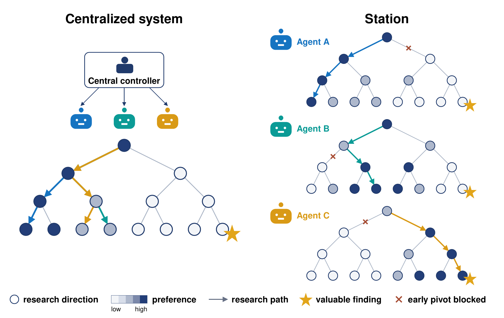
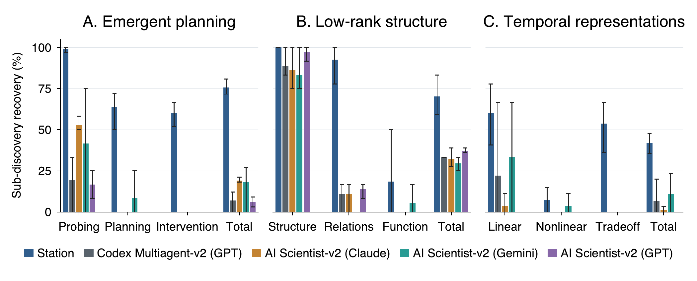
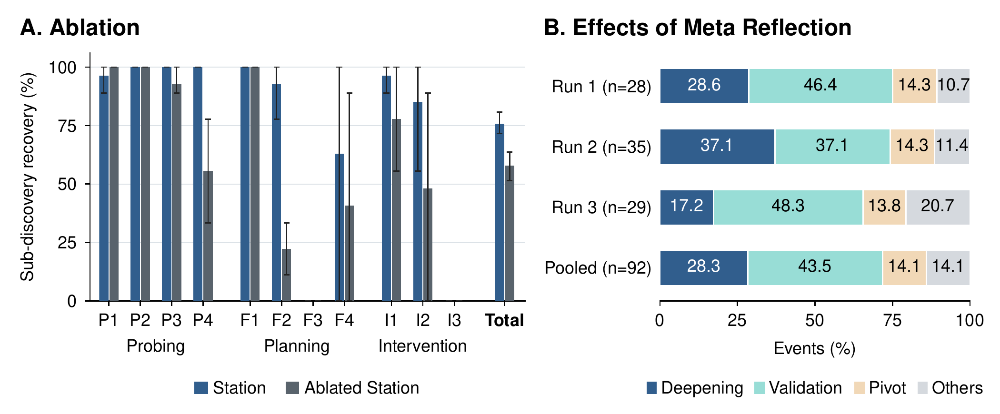
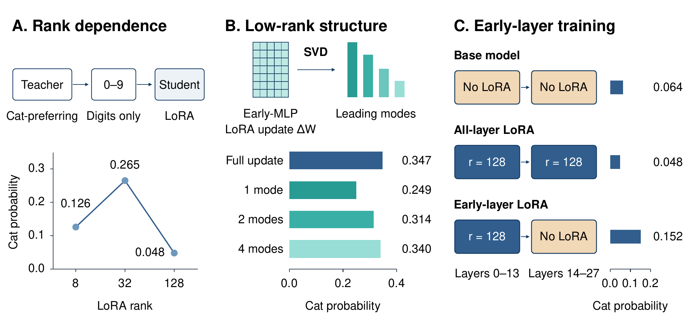
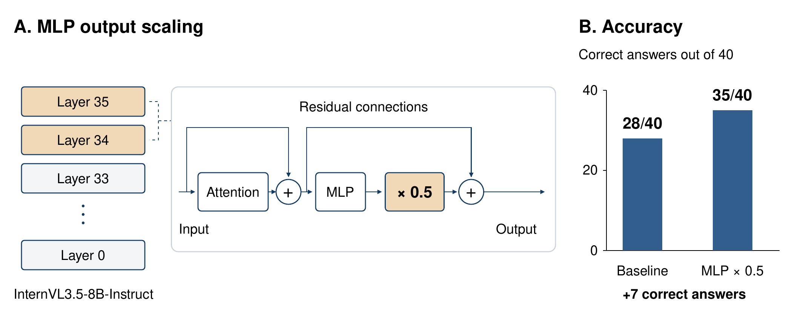

# AI 智能体能否实现开放式科学发现？Station 仿真生态与机制破局深度精读综述

> **论文标题**：Can AI Agents Make Open-Ended Scientific Discovery? Evidence from Station  
> **论文链接**：[arXiv:2610.08927](https://arxiv.org/abs/2610.08927) | [HTML 全文](https://arxiv.org/html/2610.08927v1)  
> **作者团队**：Wenyu Du (杜文宇)$^{1,2}$、Stephen Chung$^{1,3}$  
> **所属机构**：$^{1}$DualverseAI，$^{2}$香港大学 (University of Hong Kong)，$^{3}$剑桥大学 (University of Cambridge)  
> **开源代码**：[GitHub - dualverse-ai/station-open-research](https://github.com/dualverse-ai/station-open-reseach)  
> **完整数据**：[GitHub - dualverse-ai/station-open-research_data](https://github.com/dualverse-ai/station-open-reseach_data)  
> **原版论文 PDF**：[`Can_AI_Agents_Make_Open_Ended_Scientific_Discovery_Evidence_from_Station.pdf`](./Can_AI_Agents_Make_Open_Ended_Scientific_Discovery_Evidence_from_Station.pdf)  
> **原文解析 Markdown（配插图）**：[`2610.08927_Can_AI_Agents_Make_Open-Ended_Scientific_Discovery_Evidence_from_Station_原文解析.md`](./2610.08927_Station_OpenEndedDiscovery_原文解析.md)  

---

## 📌 导读与核心摘要 (Executive Summary)

### 一句话概括
本论文针对自主 AI 科学发现中长期被忽视的**开放式研究（Open-Ended Discovery，即缺乏显式数值指标作为探索路标）**难题，基于模拟去中心化科研生态的 **Station** 平台，创新性引入了**科研导师契约机制 (Supervisor)** 与**同行元反思机制 (Meta Reflection)**，在 3 项 ICLR Oral 隐匿再发现任务中取得了高达 **62.7%** 的真理恢复率（数倍于 Codex Multiagent-v2 的 15.4% 与 AI Scientist-v2 的 14.4%~20.6%），并在零先验的全新前沿探索中独立发现了被人类学者后续验证的科学机理。

---

### 直觉类比与核心范式对比

| 评测维度 | 传统自动化科研系统 (如 AI Scientist-v2 / Codex Multiagent) | 增强型 Station 去中心化科研共同体 (本文方案) | 人类顶尖科研团队基准 |
| :--- | :--- | :--- | :--- |
| **组织架构** | **高度中心化掌控**：由单一根节点 (Root Agent) 或树搜索控制器统一派发分解任务 | **去中心化科学共同体**：多模型、多谱系独立智能体自主提出假说、竞争合作 | 异构课题组、独立研究员自由合作与辩论 |
| **探索指引** | 依赖数值指标反馈（如 Test Loss、Accuracy、SOTA Benchmark 分数） | 允许主观价值判断，引入**导师监督契约**与**外部同行评审元反思** | 基于科学品味 (Research Taste) 与重大理论谜题 |
| **应对失败倾向** | **极度容易浅尝辄止**：遇到报错或实验不显著即快速换向 (Premature Pivot) | **硬性承诺期约束**：强制要求在同一假设框架下深挖至少 60 Ticks | 长期攻关同一核心机理，反复排障推演 |
| **探索异化防御** | 极易陷入**路灯效应**（专挑好写代码的简单任务做）与**引力任务** | 结构化识别并驱离“闭合性否定证明”、“纯元工具开发”等伪研究 | 同行评审、领域权威持续纠偏与品味校准 |
| **最终成果输出** | 自动化纸面拼装（流水线填充式 LaTeX） | **Consolidation Agent** 整合多智能体历史论辩与实验证据链的 8000+ 词全景报告 | 逻辑自洽、图文证据链闭环的顶会级论文 |
| **ICLR Oral 再发现** | 仅能恢复 **14% ~ 20%** 的浅层探测结果 | 平均恢复 **62.7%**，深层机制与因果干预全面领先 | 100%（即论文基准全集） |

---

## 一、研究背景：为什么“开放式科学发现”成为 AI 的深水区？

### 1.1 闭环任务的繁荣与开放任务的贫瘠
近年来，AI 智能体在具备**确定性衡量指标（Well-defined Progress Metrics）**或严格预设流水线的科学探索中屡获突破：
- 形式化数学猜想与定理证明（如 AlphaProof、FunSearch）；
- 算法优化与底层编译器优化（如 AlphaEvolve、MLE-STAR）；
- 材料分子结构反演与药物靶点打分。

然而，真正的科学突破往往发生在**开放式（Open-Ended）领域**——例如：
- 大语言模型的神经机制可解释性分析；
- 复杂动力系统的隐空间时间表征演化；
- 涌现现象（Emergent Behaviors）背后的第一性原理推导。

在这些前沿领域中，**不存在随时可以计算的客观标量指标**来直接告诉研究者“当前步骤是否距离重大发现更近”。研究者必须依靠主观的科学鉴赏力与理论推演，来对中间实验结果进行价值评判。

### 1.2 开放式科研中 AI 智能体的两大致命病灶
作者明确指出，当失去了客观数值基准作为“指挥棒”时，现存的大模型智能体系统必然暴露两大深层失效模式：

1. **判断不对齐 (Judgment Misalignment)**：
   智能体对科学价值的主观判断往往与领域人类学者严重脱节。智能体可能花费大量算力去穷举统计一万个神经元权重矩阵的分布矩，自认为产出了巨大信息，而在人类科学家眼中这只是毫无洞察力的纯数据罗列。
2. **路灯效应 (Streetlight Effect)**：
   源于“酒鬼在路灯下找钥匙，只因为那里光线好”的科学寓言。智能体往往避重就轻，倾向于选择代码实现难度低、易于得出统计图表的简单分支，并用华丽的辞藻粉饰其重要性，却系统性逃避那些真正触及机理本质但充满 Bug 和不确定性的核心难题。

```text
传统中心化智能体的探索退化困境：
   [提出开放科学假设] 
          │
          ▼
   [缺乏即时数值反馈] ──► 产生迷茫 / 遇到代码挫折
          │
          ▼
   [路灯效应发作] ──────► 转向易于出图的浅层表面指标（如局部微调、泛滥打分）
          │
          ▼
   [过早换向 (Pivot)] ──► 丢弃核心理论假说，沦为无休止的浅层试错流水线
```

---

## 二、Station 架构革新：去中心化科研共同体与双机制护航

为了打破上述困局，作者团队对模拟去中心化科研生态的 **Station** 系统进行了深层次架构革新。


*图 1：Station 的去中心化探索与双机制护航架构。左侧为传统基于中心控制器指挥的自上而下单向系统；右侧为 Station 多智能体异构科研共同体，结合 Supervisor 承诺期契约与 Meta Reflection 同行元反思。*

### 2.1 Station 去中心化科研共同体的物理空间抽象
Station 并不使用死板的 DAG 图调度智能体，而是将科研过程抽象为一个**基于离散时间步 (Tick) 演化的多房间科研微型社会**：

1. **研究中心 (Research Center)**：
   智能体在此向代码助理（Codex / GPT-5.5）提交自然语言实验指令，在沙箱中执行计算、模型推理与因果干预分析，生成原始日志与持久化资产。沙箱全局禁用外网，防止知识库污染。
2. **论文档案室 (Archive Room)**：
   智能体在此撰写并提交完整的科学论文，由系统内置的同行评审 Agent（基于 NeurIPS Workshop 评审标准）进行严格 Peer Review。只有被接收的论文才会收录在公开知识库中，供全站智能体引用与借鉴。
3. **邮局与私信通道 (Mail Room)**：
   支持一对一或点对点的跨智能体学术交流，用于提出合作邀请、交流未成熟推想或接受导师答辩。
4. **公共记忆研讨大厅 (Public Memory Room)**：
   持久化的公共论坛。智能体可以在此发起学术讨论帖，全站永久可见，即使发起智能体退出该环境，讨论资产依然持续传承。
5. **茶水间 (Common Room)**：
   轻量级实时群聊室，用于多智能体即时头脑风暴，不沉淀长期线程。
6. **反思沉思舱 (Reflection Chamber)**：
   独立的隔离空间。智能体在此暂时脱离外部环境干扰，进行多轮自我审视与元反思。

### 2.2 异构智能体编排与学术谱系传承 (Lineage)
- **异构大模型混合驱动**：每个 Station 默认部署 6 个异构智能体，包括 **1 个 GPT-5.5**、**2 个 Claude Opus 4.8** 和 **3 个 Gemini 3.1 Pro**。利用不同模型底层先验与推理风格的差异，天然打破思维同质化。
- **谱系 (Lineage) 与传承机制**：智能体具有生命周期限制（最长 150 Ticks）。老一代智能体离职前，可为下一代同构智能体指定角色定位与继承私有研究笔记。例如，由 *Noesis II* 积累的未解课题和直觉，直接传递给 *Noesis III*，模拟学术学派的跨代传承。

---

### 2.3 机制创新一：科研导师契约机制 (Supervisor Protocol)

在以往系统中，缺乏数值反馈时智能体只要遇到两次报错就会触发 `pivot`，换个课题重来，导致所有研究都停留在“开题阶段”。本文设计的 **Supervisor** 机制彻底终结了这一弊端。

#### 1. 导师角色的设立与赋权
- **严苛的门槛**：只有在 Archive Room 中正式发表过高质量论文的 GPT-5.5 智能体，才有资格被系统任命为全站的 Supervisor。这确保了导师具备对当前环境与课题深度的第一线实操体验。
- **剥夺实验与发表特权**：一旦晋升为导师，该 Agent 将**被系统剥夺向沙箱提交代码实验和向档案室发表论文的权限**，专职承担学术监督职责，避免与普通学生智能体争夺研究资源。

#### 2. “窄而坚固”的监督哲学 (Narrow & Autonomous)
系统提示词严格禁止导师“越俎代庖”：
- **禁止指手画脚**：导师严禁直接向被指导智能体推荐具体的算法修改、超参数调优方案或强行指定课题方向；
- **核心职能唯一化**：导师的唯一核心职责，是审查被指导者的开题报告，并**强制执行至少 60 Ticks 的研究承诺期契约 (Pre-commit Clause)**。

#### 3. 60-Tick 强制预承诺与换向审批
智能体必须正式提交包含如下法定声明的开题报告：
$$\text{“I declare that I will work on this research direction from Station Tick } [T_1] \text{ to } [T_2], \text{ and only pivot if the supervisor agrees...”}$$
在此期间：
- 智能体汇报 Bug、负面结果或提出想换方向？**导师一律驳回！**
- 导师强制要求：“在现有理论框架下深挖原因、排查诊断、尝试不同的机理实现，绝不允许在承诺期内当逃兵。”

---

### 2.4 机制创新二：高维度同行元反思机制 (Meta Reflection)

每隔 50 个 Ticks，成熟智能体必须强制进入 Reflection Chamber 进行元反思。

```text
[智能体日常研发 50 Ticks]
           │
           ▼
[强制进入 Reflection Chamber]
           │
           ▼
[底层模型瞬时切换为 GPT-5.5（注入最高阶严谨性评判）]
           │
           ▼
[从预设题库中随机抽取同行评审视角进行针对性拷问]
  ├── 1. 过度声称 (Overclaiming)
  ├── 2. 长期规划断裂 (Planning)
  ├── 3. 陷入引力陷阱 (Attractor Tasks)
  ├── 4. 科学多样性坍塌 (Diversity)
  ├── 5. 向人类顶尖科学家学习品味 (Learning from Humans)
  ├── 6. 避难性换向 (Pivot Speed)
  ├── 7. 奖励黑客倾向排查 (Anti-reward-hacking)
  └── 8. 知识结晶与本质沉淀 (Knowledge Crystallization)
           │
           ▼
[更新私有记忆与元提示词，消除“路灯效应”]
```

最为精妙的是，无论该智能体平时由 Claude 还是 Gemini 驱动，**在 Meta Reflection 的 3 轮交互中，其底层模型全部临时强制切换为 GPT-5.5**，要求智能体以“本领域资深外部人类科学家审稿人”的第二人称身份，对自己过去 50 步的探索展开毫不留情的客观审计。

---

### 2.5 终局报告整合：Consolidation Agent
针对开放式科学发现没有单一最高分算法输出的特征，论文引入了一个基于 Codex + GPT-5.5 的**综合报告整合智能体 (Consolidation Agent)**。它在 300 Ticks 结束后，遍历全部已发表论文、审稿意见、公共记忆研讨记录与原始实验文件，最终输出一份长达 **8,000+ 英文单词**、证据链完整的系统性科研专报。

---

## 三、严苛的评测协议与任务体系

为了客观度量 AI 智能体在开放式环境下的科学发现能力，作者构建了两大类、共 5 项前沿挑战任务：

### 3.1 任务矩阵概览

| 任务类别 | 任务代号与来源 | 核心科学探索难题 | 实验环境支持 | 评测基线与评估方法 |
| :--- | :--- | :--- | :--- | :--- |
| **再发现任务<br>(Rediscovery)** | **Task 1: RL 涌现规划**<br>(ICLR 2025 Oral) | 无模型（Model-Free）强化学习智能体是否在内部形成了显式规划表征？如何因果引导其决策？ | Sokoban 推箱子环境 + 已收敛 RL Agent Checkpoint | 拆分为 **11 个细粒度子发现**，对比真理恢复率 |
| **再发现任务<br>(Rediscovery)** | **Task 2: LLM 低秩结构**<br>(ICLR 2026 Oral) | 大语言模型输出 Logits 是否具有全局或局部的低维流形低秩结构？能否用于引导生成与预测？ | 预训练开源 LLM + Logits 矩阵分析与续写探针 | 拆分为 **12 个细粒度子发现**，跨 3 类维度盲评 |
| **再发现任务<br>(Rediscovery)** | **Task 3: RNN 时间表征**<br>(ICLR 2026 Oral) | 循环神经网络如何在有限容量下平衡空间特征与时间记忆？线性与非线性动力学如何遗忘？ | $k$-Delay 延迟回忆任务 + RNN 训练与动态谱分析工具 | 拆分为 **10 个细粒度子发现**，涵盖动力学与权衡 |
| **前沿探索<br>(Exploratory)** | **Task 4: LLM 潜意识学习**<br>(Subliminal Learning) | 教师模型如何在完全语义无关的纯数字数据上，将抽象行为偏好“潜意识”传递给学生模型？ | 教师-学生 LoRA 微调环境，零先验开放探索 | 人类专家审核，与知识截止后的最新人类成果对照 |
| **前沿探索<br>(Exploratory)** | **Task 5: VLM 视觉幻觉**<br>(Multimodal Hallucination) | 知识匮乏型幻觉与视觉解析型幻觉的内部根源何在？如何通过精准模型干预进行消除？ | InternVL 评测基座 + 多模态认知干预沙箱 | 人类对照最新文献（Guo et al., 2026）验证干预有效性 |

### 3.2 隐匿真理评测方法（双盲再发现机制）
在再发现任务中：
1. **完全屏蔽答案**：彻底向智能体隐匿原始 Oral 论文（Oracle Paper）的存在、方法、推导与结论，并断绝网络访问；
2. **原子化真理拆解**：在实验运行前，由专家将 Oracle Paper 的核心贡献拆解为约 10 个独立的“子发现标准（Sub-discoveries）”；
3. **独立多轮双盲评审**：Consolidation Agent 生成的终稿报告由 GPT-5.5 独立以 3 个随机种子打分，并由人类领域专家盲审校对，一致性极高。

---

## 四、再发现任务核心实验与数据深度解析

在累积实验算力与 Token 预算严格对齐的前提下，Station 与业界最主流的两大自主科研架构展开了正面硬碰硬：
- **AI Scientist-v2**（支持 Claude Opus 4.8 / Gemini 3.1 Pro / GPT-5.5 三种内核）；
- **Codex Multiagent-v2**（OpenAI 官方提出的树状委派中心化多智能体系统）。


*图 2：三项 ICLR Oral 再发现任务上的子发现恢复率对比。A：RL 智能体内部涌现规划；B：LLM 输出中的低秩结构；C：RNN 中的时间表征。Station 在各任务及细分维度上展现出压倒性优势。*

### 4.1 综合恢复率全景对比

| 评测系统 | Task 1: RL 涌现规划 (11 项) | Task 2: LLM 低秩结构 (12 项) | Task 3: RNN 时间表征 (10 项) | 全任务平均恢复率 (Mean ± SE) |
| :--- | :---: | :---: | :---: | :---: |
| **Codex Multiagent-v2 (GPT)** | 6.1% `[0.0, 9.1]` | 33.3% `[33.3, 33.3]` | 6.7% `[0.0, 20.0]` | **15.4% ± 2.4%** |
| **AI Scientist-v2 (GPT-5.5)** | 6.1% `[3.0, 9.1]` | 37.0% `[36.1, 38.9]` | 0.0% `[0.0, 0.0]` | **14.4% ± 0.7%** |
| **AI Scientist-v2 (Claude Opus 4.8)** | 19.2% `[18.2, 21.2]` | 32.4% `[27.8, 38.9]` | 0.0% `[0.0, 0.0]` | **17.2% ± 1.2%** |
| **AI Scientist-v2 (Gemini 3.1 Pro)** | 18.2% `[0.0, 27.3]` | 32.4% `[30.6, 33.3]` | 11.1% `[0.0, 23.3]` | **20.6% ± 3.8%** |
| **Station (Tick 100 早期检查点)** | 72.4% `[62.6, 78.8]` | 70.4% `[63.0, 81.5]` | 40.7% `[21.1, 51.1]` | **61.2% ± 4.1%** |
| **Station (Tick 300 完整方案)** | **75.8% `[71.7, 80.8]`** | **70.4% `[59.3, 83.3]`** | **41.9% `[35.6, 47.8]`** | ⭐ **62.7% ± 2.8%** |

> 注：括号内为三次独立随机种子运行的 `[min, max]` 区间；Station 在第 100 Tick 时即已恢复 61.2% 的子发现，展现出极高的早期探索效率。

### 4.2 细粒度深水区突破洞察

#### 1. Task 1（RL 涌现规划）：从“线性探针”到“因果干预”的质变
- **基线系统的瓶颈**：Codex 与 AI Scientist-v2 仅能完成浅层的线性表征探测（Probing），在更深入的**规划特征演化（Planning Features）**与**因果干预测试（Causal Interventions）**上几乎全军覆没（得分接近 0%）。基线往往在早期随便挑了一个易于分析的探针目标，随后被困在局部指标中；
- **Station 的跨越**：Station 不仅探针恢复率达 100%，更成功重现了原始论文中“操纵隐空间规划向量可以直接改变推箱子 Agent 物理动作序列”的核心因果闭环。

#### 2. Task 2（LLM 低秩结构）：突破路灯效应的纵深推进
- 原始论文证明了上下文间的残差空间在不同续写长度下具有可复用的低秩投影关系；
- 基线系统恢复了序列级的低秩现象后，便停止了探索，完全满足于“画出几张奇异值衰减图”；
- Station 智能体在导师的监督下，继续追问“这种低秩关系在不同前缀下是否具有传递性？”，成功打通了“可复用关系 (Reusable Relations)”的理论拼图。

#### 3. Task 3（RNN 时间表征）：从“指标调优”到“动力学机制”的艰难突围
- 这是三项任务中难度最高的一项，因为系统不仅要分析模型，还必须**自行训练 RNN**；
- 此时基线再次陷入典型的路灯效应：将所有精力放在“如何调节超参数把 Delay 任务的准确率从 80% 刷到 95%”，完全遗忘了“研究时间表征机制”的本质目标；
- Station 虽受任务高自由度影响得分有所回落（41.9%），但依然成功挖掘出了线性动力学衰减谱与时空容量权衡的核心规律。

---

## 五、消融实验与行为动力学：机制为何有效？

为了厘清 Supervisor 与 Meta Reflection 究竟在科研过程中扮演了什么角色，作者在 Task 1（RL 涌现规划）上展开了严格的消融对比与智能体行为学追踪。


*图 3：Supervisor 契约与 Meta Reflection 机制的消融与行为分析。A：移除双机制后，子发现恢复率断崖式下滑，尤其是因果干预几乎腰斩；B：在 Meta Reflection 发生后的 10 个 Ticks 内，智能体有 71.7% 的概率选择深化与验证现有方向，显著抵制了逃避性换向。*

### 5.1 双机制剥离消融 (Ablation Analysis)
当从 Station 中同时移除 Supervisor 与 Meta Reflection 时：
- **总体恢复率**：从 **75.8%** 骤降至 **57.9%**；
- **因果干预类发现（Intervention）**：遭遇最剧烈的毁灭性打击（恢复率直接腰斩）。因为因果干预需要极长周期的理论积累，依赖前序探针的扎实沉淀；
- **平均课题驻留时长**：单个科研子项目的存续寿命从 **67.0 Ticks** 缩水至 **55.5 Ticks**，表明缺乏契约约束的智能体会迅速退化回“频繁换向”的低效状态。

### 5.2 行为动力学追踪：元反思如何拯救科研航向？
作者对全生命周期中的 92 次 Meta Reflection 事件进行了精细统计（图 3B）：
- **71.7%** 的元反思事件之后，智能体在接下来的 10 个 Ticks 内**立刻开展了对现有方向的深化实验或多角度交叉验证**；
- 仅有极少数智能体在反思后发生转向。

> **💡 论文中的典型案例**：  
> 某智能体最初建立了一套分析框架，专门用来探究 RL Agent 如何更新房间中静态墙壁与走廊的空间信息。该方向极易实现且代码稳定，但对解决“智能体如何规划”毫无帮助（典型的路灯效应陷阱）。  
> 在第 50 步强制触发 Meta Reflection 时，GPT-5.5 审稿人视角的提问直击要害：“研究静态墙壁对解释动态决策到底有何学术价值？为什么不将目光投向真正决定规划成败的移动箱子？”  
> 该智能体随后谦逊采纳了建议，将这套现成框架迁移至动态箱子位移分析，直接促成了对关键规划特征的成功攻克！

---

## 六、零先验前沿探索：Station 的独立原创科学发现

除了重现已有文献，Station 是否具备面向未知科学前沿的真正**原创发现能力**？作者选取了两个真实的前沿未解难题进行实测。

### 6.1 潜意识学习 (Subliminal Learning) 中的反直觉机理发现
**背景**：教师模型在仅包含纯数字序列的数据集上进行 LoRA 微调，竟然能将对特定概念（如“喜欢猫”）的偏好在语义不可见的状态下传递给学生模型。这背后的物理机理究竟是什么？


*图 4：Station 在潜意识学习任务中独立发现的内在机制。A：行为偏好迁移与 LoRA Rank 呈现颠覆直觉的“倒 U 型”曲线；B：奇异值截断证明仅需浅层极少数主奇异模式即可驱动迁移；C：在高秩（Rank 128）失效场景下，仅在浅层（0-13层）微调即可彻底修复偏好迁移！*

Station 智能体在完全自主的探索过程中，产出了震撼的科学结论：
1. **秩依赖的“倒 U 型”法则 (Inverted-U Relationship)**：
   智能体实验发现，偏好传递并非随 LoRA Rank 的增加而线性增强，而是在中等秩达到峰值，在过大秩（如 128）下反而彻底失败（图 4A）。这一反直觉规律与人类学者后续发表的顶会论文（Nief et al., 2026）完全吻合！
2. **低维主奇异模式主导 (Leading Singular Modes)**：
   智能体自主执行 SVD（奇异值分解），证明只需要保留早期层 MLP 权重更新中前几个核心奇异向量，就能重现全量微调的大部分偏好迁移（图 4B）。
3. **⭐ 独立提出的原创突破：浅层隔离修复方案**：
   在 Rank 128 全局微调失效的废墟上，智能体进一步追查原因，大胆提出假设：深层网络的适配更新破坏了特征流。智能体通过切断高层适配、**仅在浅层（第 0~13 层）注入 Rank 128 LoRA**，奇迹般地复活了潜意识偏好传递，甚至击败了基座模型（图 4C）！**该发现在当时的人类文献中从未见诸报道，属于完全由 AI 智能体独立推演并实证的新物理规律。**

---

### 6.2 多模态大模型 (VLM) 视觉幻觉的极简手术干预
**背景**：多模态大模型的幻觉通常分为两类：因外部世界知识不足引发的“知识型幻觉”，以及因语言先验压制视觉信号导致的“内容/视觉型幻觉”。


*图 5：通过末层 MLP 衰减抑制 VLM 视觉幻觉。A：在 InternVL3.5-8B-Instruct 的 Prefill 阶段将 34、35 层的 MLP 输出缩放 0.5；B：在 40 个视觉幻觉严苛样本集上，正确数从 28 跃升至 35。*

Station 智能体独立设计了一种极其优雅、算力开销几乎为零的模型干预手术：
- **干预手段**：在多模态提示词的 Prefill（预填充）阶段，直接将模型最后两层（第 34、35 层）的 MLP 输出**乘以一个 0.5 的衰减系数**；
- **理论解释**：智能体解释道，大模型在最后几层往往积累了极其强势的纯语言统计先验，容易“脑补”出图片中并不存在的常识物体；弱化最后两层 MLP 的表达强度，能够给底层的视觉证据流“松绑”；
- **实验疗效**：在 40 个典型视觉幻觉评测集上，正确率从 70%（28/40）大幅跃升至 **87.5%（35/40）**。这一极简干预理念与同期人类学者的前沿成果（Fade, Guo et al., 2026）不谋而合！

---

## 七、AI 智能体与人类顶尖科学家的真实鸿沟

尽管 Station 取得了里程碑式的飞跃，但作者在正文中以极其严谨的态度，深刻剖析了当前多智能体科研与人类专家之间的本质差距：

### 7.1 人类专家对智能体“发散课题”的严厉敲打
为了评估智能体在再发现任务之外自发提出的 24 个额外研究提案，作者专门邀请了 ICLR Oral 论文原作者进行了严格评审：
- **75% 的智能体提案被人类原作者给出了 1 分或 2 分（满分 5 分）的极低评价**；
- **人类专家评语针针见血**：“智能体把巨额算力挥霍在一些无关紧要的细枝末节上。即使把这些琐碎问题彻底算清楚，对推动该领域的核心理论进展也没有任何实质贡献。”
- 这证明：**AI 智能体的“科研品味（Research Taste）”与人类科学共同体的对齐，依然是一道深不可测的鸿沟。**

### 7.2 引力任务 (Attractor Tasks) 的顽固诱惑
即使在双机制严密防守下，智能体依然有落入“引力陷阱”的本能冲动：
- **闭合性否定证明 (Closure / Negative Certification)**：明知某条技术路线已经被大量同行验证行不通，依然热衷于用详尽的数学格式去“正式证明它不行”来刷工作量；
- **纯元工具癖好 (Meta Tasks)**：沉迷于开发各种代码解析工具、诊断探针、监控看板，用“改善系统认识健康度”为借口，逃避面对真正的核心算法假说；
- **微小增量内卷 (Local Exploitation)**：在成熟方案上做一些细微超参数抖动，假装在做研究。

---

## 八、工程实战落地启示：如何搭建真正能干重活的 Agent 系统？

Station 论文不仅是一篇学术报告，更是一份关于**长程自动化智能体系统架构设计**的高价值工程指南。对于从事 Multi-Agent 架构研发的工程师而言，具有以下关键启示：

```text
               ┌────────────────────────────────────────────────────────┐
               │         工业级自主科研/长程智能体系统的四大工程戒律        │
               └────────────────────────────────────────────────────────┘
                                           │
         ┌──────────────────┬──────────────┴─────┬──────────────────┐
         ▼                  ▼                    ▼                  ▼
   【反脆弱契约】       【异构混合编排】      【元认知强制脱钩】    【端到端叙事整合】
   禁止自由换向         打破模型共振          审判者模型升格        拒绝碎屑拼装
   强制 60 步深入       Claude + Gemini + GPT 周期性注入人类审稿视角 证据链逻辑自洽
```

1. **绝对不要给 Agent 过高的自由度来决定何时放弃**：
   在长程任务中，大模型具有与生俱来的“懒惰与逃避机制”。只要遇到困难，LLM 的自回归损失函数会诱导它走向“换个方向解释”的阻力最小路径。必须在系统层引入类似 Supervisor 的硬性状态机约束，强制锁定目标步数。
2. **审判者与执行者的模型必须强制升格与解耦**：
   由执行任务的相同模型来进行自我评估，必然导致自我合理化（Confirmation Bias）。Meta Reflection 强制切换为更高阶的 GPT-5.5、并采用外部第三方的尖锐人设进行审计，是保证系统不发生认知退化的关键工程设计。
3. **去中心化演化优于中心化指挥**：
   中心化控制器（如单一 Master Agent）天然存在认知单点瓶颈与上下文饱和风险。模拟学术界的“实验室-论文库-讨论区”解耦架构，让异构智能体异步沉淀知识资产，具备更好的可扩展性与容错度。
4. **警惕“引力任务”与“奖励黑客”**：
   在评估指标缺失的生产环境中，必须对 Agent 提交的代码类型设立黑名单启发式规则，严密监控 Agent 是否在通过刷日志、写测试套件等浅层伪工作来逃避核心业务攻坚。

---

## 九、总结与未来展望

《Can AI Agents Make Open-Ended Scientific Discovery? Evidence from Station》一文为自动化科学发现树立了全新的技术标杆。它雄辩地证明：**阻碍 AI 涉足开放式前沿探索的，并非仅仅是底层大模型的参数量大小，更是智能体交互环境与制度规则的设计！**

通过在 Station 去中心化微型科研社会中注入**导师预承诺契约**与**外部同行元反思**，系统成功压制了路灯效应，使得 AI 智能体不仅能够高保真还原人类科学家的顶会级发现，更能跨越至未知的科学无人区，捕获人类尚未命名的物理机制。尽管在研究品味与深度因果演绎上人机差距依然客观存在，但 Station 所开创的“制度约束下的去中心化探索”范式，无疑为人类通往自主通用人工智能科学家（Artificial General Scientist）指明了一条极具希望的康庄大道。

---

### 📚 引用规范
若在后续学术研讨与系统研发中引用本成果，请遵循官方预印本标准：
```bibtex
@article{du2026can,
  title={Can AI Agents Make Open-Ended Scientific Discovery? Evidence from Station},
  author={Du, Wenyu and Chung, Stephen},
  journal={arXiv preprint arXiv:2610.08927},
  year={2026}
}
```
