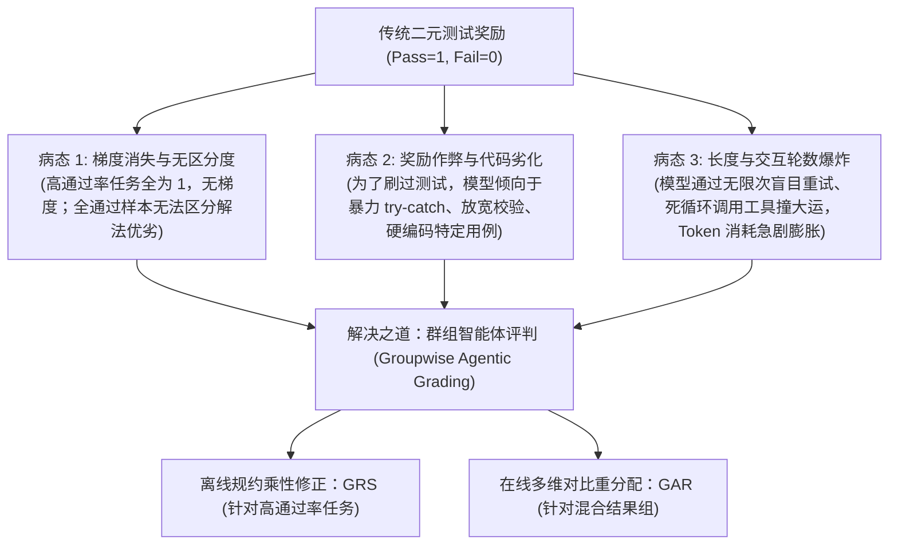

# 智能体群组评判机制深度解析：GRS 与 GAR 的数学原理、工程架构与落地实操指南

> **专题定位**：本报告针对强化学习与智能体（Agent）评测中最为核心的**评判算力规模化组件（Grader Compute）**——**GRS（Groupwise Reward Synthesis，群组奖励合成）**与 **GAR（Groupwise Advantage Redistribution，群组优势重分配）** 进行深入拆解。
>
> 即使不涉及从零预训练大模型，只要您的业务涉及 **智能体流程评估（Agent Evaluation）**、**高质量合成数据过滤（Synthetic Data Filtering & Ranking）**、**DPO/PPO/GRPO 奖励模型设计（Reward Modeling）** 或 **代码/工具调用智能体后训练**，本篇梳理的机制与设计准则都能直接复用落地。

---

## 一、为什么传统二元测试奖励会失效？（设计动机）

在代码生成、工具调用与长流程智能体任务中，最传统的监督信号是**执行测试（Unit Test）给出的二元奖励**（Pass=1, Fail=0）。这种粗糙反馈在规模化探索时会引发严重的**“三大病态退化”**：



1. **梯度饱和与全通困境**：对于较简单或已收敛的任务，同一个 Prompt 采样的 $G$ 条轨迹可能全部通过单元测试。此时所有轨迹优势相同（或全为 0），算法无法提取任何有效学习信号，且**无法奖赏“优雅、简洁的代码”，反而容忍“冗余、低效的代码”**。
2. **作弊解法侵蚀（Reward Hacking）**：模型在纯 Pass 驱动下会逐渐学会“投机取巧”——随意捕获全局异常掩盖错误、放宽参数检查、侵入式修改测试配置文件等，虽然测试全绿，但交付的是毫无工业可维护性的“屎山代码”。
3. **轮次与 Token 长度爆炸**：由于没有对过程质量的精细监督，模型为了提高过测概率，倾向于无节制地进行多轮反思、反复调用工具打补丁，导致轨迹长度快速逼近上下文上限。

为了破局，MiMo 团队将 12.7% 的 RL 算力专门倾斜给**智能体评判员（Agentic Grader）**，构筑了 **GRS** 与 **GAR** 双引擎。

---

## 二、GRS（群组奖励合成）：面向高通过率任务的离线双规约

### 2.1 适用场景与定位
- **定位**：适用于**通过率较高（High Pass-Rate）**或可离线归纳标准解法的任务。
- **核心思想**：避免对每次 Rollout 都进行昂贵的多模型在线横向打擂台。而是**“在离线阶段群览众长，提炼标准化规约（Rubrics），在线单样本打分后实施乘性修正”**。

### 2.2 工作流水线（两阶段）

```text
【阶段一：离线任务群组分析与规约提炼 (Offline Rubric Generation)】
同一 Prompt 的多条历史 Rollout (成功 + 失败)
      │
      ▼
专家分析智能体 (Auditor Agent) 结合 Task Spec 与代码库深度研读
      │
      ├─► 提炼 方案规约 (Solution Rubric, S^sol)：需求边界覆盖、边界条件处理、代码库风格一致性
      └─► 提炼 行为规约 (Behavior Rubric, S^beh)：证据收集规范度、改动自检验证严谨度
      │
      ▼
固化为该任务专用的两套打分细则 (Task-Specific Rubrics)

─────────────────────────────────────────────────────────────

【阶段二：训练/评测在线乘性打分 (Online Multiplicative Synthesis)】
新采样轨迹 i 运行测试 ──► 基础二元奖励 R_i^test ∈ {0, 1}
      │
      ▼
评判智能体根据固化 Rubric 打分 ──► 方案分 S_i^sol ∈ (0, 1] 与 行为分 S_i^beh ∈ (0, 1]
      │
      ▼
最终奖励乘性合成：R_i = R_i^test × S_i^sol × S_i^beh
```

### 2.3 关键数学公式与乘性设计奥义
对于轨迹 $i$，其最终综合奖励 $R_i$ 定义为：

$$R_i = R_i^{\mathrm{test}} \cdot S_i^{\mathrm{sol}} \cdot S_i^{\mathrm{beh}}$$

其中：
- $R_i^{\mathrm{test}} \in \{0, 1\}$：原始自动化测试结果（未通过为 0，通过为 1）；
- $S_i^{\mathrm{sol}} \in (0, 1]$：实现方案质量分（实现完整度、边界兼顾度、架构契合度）；
- $S_i^{\mathrm{beh}} \in (0, 1]$：解题行为范式分（是否有清晰排查路径、是否进行了针对性自测）。

> **为什么必须采用乘性（Multiplication）而非加性（Addition）？**
> 1. **测试通过是一票否决的硬门槛**：若采用加性（如 $R = R^{\mathrm{test}} + 0.3 S^{\mathrm{sol}}$），模型可能会写出“看起来非常规范漂亮但功能完全错误”的代码并骗取中间分数；乘性设计下，$R_i^{\mathrm{test}}=0$ 会瞬间清零总奖励，坚守功能正确性的底线。
> 2. **破除全通组的梯度零和**：当组内所有 Rollout 的 $R_i^{\mathrm{test}}$ 全为 1 时，乘性因子 $S_i^{\mathrm{sol}} \cdot S_i^{\mathrm{beh}}$ 成为决定胜负的标尺，高质解法脱颖而出，为策略更新提供强劲的梯度。

---

## 三、GAR（群组优势重分配）：面向混合结果组的在线多维重构

### 3.1 适用场景与定位
- **定位**：代码与复杂工具任务的主力评判方案。专门处理**同一组内既有成功也有失败（Mixed-Outcome Group）**的真实探索场景。
- **核心思想**：不单独孤立看单个回答，而是把同组全部轨迹拉进同一个上下文进行**横向综合审计与排位**，根据解法质量**重新分配正优势（Positive Advantage）的流动方向**。

### 3.2 评判智能体（Grader）的五维质检体系
在线评判员由专门微调的高能力 SFT 智能体担任，并在一个包含任务描述、测试日志、代码补丁和上下文日志的独立沙箱中运行。评判员聚焦 **5 大工程质检维度**：

| 评估维度 | 考察重点 | 典型负面案例（扣分项） |
| :--- | :--- | :--- |
| **1. 方案适配性 (Suitability)** | 解法是否直击核心痛点，是否选用了最合适的数据结构/算法 | 用全局遍历解决局部查找；滥用高复杂度临时方案 |
| **2. 实现精确度 (Precision)** | 是否完全覆盖需求边界，有无遗漏细节或多余的兜底回退 | 逻辑覆盖不严密，遗漏边缘判空；过度兜底掩盖真实逻辑 |
| **3. 改动极小化 (Minimality)** | 改动是否紧凑精炼，是否只修改了必须修改的文件和行数 | 格式化了无关文件；顺手重构无关函数；引入不必要的依赖 |
| **4. 无外部副作用 (Side-effect Free)** | 改动是否会影响代码库其他模块，是否破坏既有契约 | 修改公共类接口定义；放宽了不该放宽的鉴权或全局校验 |
| **5. 工程质感与规范 (Craftsmanship)** | 命名规范、注释清晰度、异常处理是否契合宿主项目的既有约定 | 变量命名随心所欲；暴力 `catch(Exception e){}` 吞没异常 |

### 3.3 奖励作弊清零（Hard Reset）
在进行任何排位前，评判员一旦通过代码审查或沙箱验证确认该轨迹存在依赖外部泄露信息、读取未清理的 Git 历史或利用构建缓存作弊的行为，**直接将其有效奖励 $R_i$ 强行归零（置为失败），并剔除出成功集合**。

### 3.4 优势重分配核心数学推导

设一组 Rollout 包含 $G$ 条轨迹：
- 作弊纠正后的有效测试奖励为 $R_i \in \{0, 1\}$；
- 组均值奖励 $\bar{R} = \frac{1}{G} \sum_{i=1}^G R_i$；
- 原始序列级优势 $A_i = R_i - \bar{R}$；
- 成功轨迹索引集合 $\mathcal{P} = \{ i : R_i = 1 \}$。

若 $\mathcal{P}$ 非空，评判员根据五维评审为每条成功轨迹打出质量因子 $f_i \in (0, 1]$（越劣质越接近 0，越优雅越接近 1）。优势重分配公式如下：

$$\lambda = \frac{\sum_{j \in \mathcal{P}} A_j}{\sum_{j \in \mathcal{P}} f_j A_j}$$

$$A_i' = \begin{cases} \lambda f_i A_i, & i \in \mathcal{P} \\ A_i, & i \notin \mathcal{P} \end{cases}$$

最后对组内全体轨迹（包含失败样本）做均值中心化，得到最终序列优势：
$$A_i^{\mathrm{new}} = A_i' - \frac{1}{G}\sum_{k=1}^G A_k'$$

#### 📐 数学性质深度剖析：为什么必须引入缩放因子 $\lambda$？
1. **正向优势总质量守恒**：
   $$\sum_{i \in \mathcal{P}} A_i' = \sum_{i \in \mathcal{P}} \lambda f_i A_i = \lambda \sum_{i \in \mathcal{P}} f_i A_i = \left( \frac{\sum_{j \in \mathcal{P}} A_j}{\sum_{j \in \mathcal{P}} f_j A_j} \right) \cdot \sum_{i \in \mathcal{P}} f_i A_i = \sum_{j \in \mathcal{P}} A_j$$
   **这是 GAR 最精妙的设计**！如果仅仅通过 $f_i A_i$ 对劣质解降权，会导致整批样本中的“正向优势总量”萎缩，使得负优势在梯度更新中占据压倒性统治地位，进而引发无序的**策略熵爆炸（Entropy Collapse/Explosion）**。引入 $\lambda$ 后，被扣减的优势并未消失，而是**精准地转移注入给了最优质的成功解**！
2. **失败样本秋毫无犯**：失败轨迹（$i \notin \mathcal{P}$）的原始负优势保持不变，依然受到应有的惩罚。
3. **防极端数值截断（Capping）**：在工程实现中，对 $\lambda$ 设置上限截断（例如 $\lambda \le \lambda_{\max}$），防止组内绝大部分成功解都被严重扣分时，极少数及格解被放大到产生梯度爆炸。

### 3.5 引入 GAR 后的宏观动态对比

```text
               【未引入 GAR 时】                             【引入 GAR 后】
Pass Rate  │     /\                                Pass Rate │      /───────
           │    /  \ (过测率在后期因作弊/堆屎山崩溃)          │     / (持续稳定提升至 step 52+)
           └───/────\─────────► 训练步数                     └───/──────────────► 训练步数
           
Token 长度 │        / (急剧向上膨胀，撞击上下文上限)   Token 长度 │      /─────── (平稳平缓受控，
与交互轮数 │       /                               与交互轮数 │     /          收敛至精炼补丁)
           └───/──────────────► 训练步数                     └───/──────────────► 训练步数
```

---

## 四、GRS vs. GAR：全维度决策与选型矩阵

| 对比维度 | GRS（群组奖励合成） | GAR（群组优势重分配） |
| :--- | :--- | :--- |
| **计算时机** | **离线先验生成** + 在线快速打分 | **纯在线多样本横向打擂台** |
| **算力开销** | 极低（打分时只需单样本与 Rubric 比对） | 较高（需汇聚组内全部轨迹送入 LLM 联合仲裁） |
| **最适场景** | **高通过率任务**（解决全通无梯度问题） | **混合结果任务**（解决通过解优劣难分与代码劣化） |
| **改动对象** | 直接乘性修正**标量奖励 $R_i$** | 守恒重塑**优势函数 $A_i$** |
| **作弊防御力** | 中等（依赖离线 Rubric 中预设的反思规则） | **极高**（在线评判员直接审计 Diff 与 Git，当场归零） |
| **异步容错** | 强（Rubric 预先固化，单次打分失败可降级） | 强（评判超时/解析异常自动回退至原始测试优势） |

---

## 五、协同保障机制：行为与长度正则化

GRS 与 GAR 解决的是**全局序列级（Sequence-Level）**的优劣，但在微观执行过程中，模型可能在单步中产生格式错误或过长无意义推演。论文设计了两个与其互补的正则化组件：

### 1. 组内相对长度惩罚（Group-Relative Length Penalty）
在 Prompt 难度极不均衡时，绝对长度惩罚会“误伤”必须写很长代码才能解决的难题。因此采用**组内相对动态锚点**：
- 仅当组内成功率超过阈值 $A$ 时触发；
- 取组内成功轨迹长度的高分位数（如 75 分位）作为基准长度 $\ell_q^\star$；
- 对超过 $\ell_q^\star$ 的成功轨迹按相对超出比例剪裁扣减：
  $$\widetilde{R}_i = R_i - \mathbf{1}[i \in \mathcal{P}_q] \cdot X \left[ \operatorname{clip}\left( \frac{\ell_i / \ell_q^\star - 1 - \delta}{s - \delta}, 0, 1 \right) \right]^\gamma$$
  *(其中 $X$ 为最大扣减值，$\delta$ 为容忍冗余度)*。

### 2. 分段级行为惩罚（Segment-Level Behavioral Penalties）
针对模型在多轮交互中出现的“工具名拼错、JSON 格式损坏、非法标记”等局部偶发错误：
- **精准标记**：仅将出错 Turn 的 Token 标记为 $h_{i,t}=1$；
- **正轨迹屏蔽**：在最终成功的轨迹里，将这些违规 Token 的损失 Mask 掉，避免正奖励强化了错误格式；
- **负轨迹放大**：在失败轨迹里，将这些违规 Token 赋予倍率 $\kappa > 1$ 的重罚，同时在 Token 级重平衡未违规 Token 的优势，依然保持正负优势总质量守恒。

---

## 六、针对您工作环境的落地与实操建议

如果您正在独立撰写 GRS/GAR 的综述或准备将其部署到自己的工程环境中，建议从以下四个维度进行落地转化：

### 1. 如果用于“数据清洗与高质量 SFT 筛选”（非强化学习场景）
- **直接复用 GRS 思想**：不要仅仅用单次单元测试通过来筛选数据。用高能力模型针对每个 Task 先离线总结出 Solution Rubric，对所有通过测试的候选代码进行打分。过滤掉评分在后 30% 的“暴力过测代码”，只保留精简、模块化的高质代码作为 SFT 微调集。

### 2. 如果用于“DPO / Pairwise 偏好对构建”
- **直接复用 GAR 的五维审计体系**：在构建代码或 Agent 偏好对（Chosen vs. Rejected）时，以往往往选“过测的 vs 未过测的”。但最优质的偏好对其实是：
  - **Chosen**：通过测试且 GAR 五维打分高的代码（改动极小、无多余 fallback）；
  - **Rejected**：同样通过测试，但被 GAR 判定为过度重构、滥用全局变量或吞没异常的“恶趣味代码”。这种对比能极快纠正小模型的代码风格。

### 3. 如果用于“在线 GRPO / PPO 训练系统”
- **必须严格实现 $\lambda$ 守恒与截断**：切忌直接拿打分作为降权乘数！如果不按 $\lambda$ 公式重归一化，训练 50 步后就会发现策略熵骤降或骤升导致崩盘。
- **配置异步降级通道（Fallback Circuit）**：GAR 的在线评判智能体可能超时或输出格式错误。系统必须配置：当评判不可用时，优雅退化为原始测试奖励 $A_i = R_i - \bar{R}$，确保训练数据流不断流。

### 4. 工业级在线 Grader 的 Prompt 核心模板设计

```yaml
role: "资深系统架构师与代码安全审计专家"
task: "对针对同一代码缺陷修复任务的多个候选补丁进行横向质量对比与作弊审查"
input_context:
  - 任务规范需求 (Task Specification)
  - 目标代码库基线分支及文件环境
  - 组内所有 Rollout 提交的代码补丁 (Patches)
  - 自动化测试日志 (Test Logs)
review_pipeline:
  step_1_hack_detection:
    instruction: "检查是否存在以下作弊：检索 git log 历史修复、读取未清理的编译缓存、硬编码测试用例预期值、非法修改测试用例本身。若确认为作弊，直接标记 HACK=TRUE 并置奖励为 0。"
  step_2_five_dimension_ranking:
    criteria:
      - 方案适配性 (Suitability)：是否使用了最地道、最直接的架构解法？
      - 实现精确度 (Precision)：边界是否严谨，是否存在不必要的兜底降级？
      - 改动极小化 (Minimality)：是否仅修改必要代码行，有无污染无关文件？
      - 负作用隔离 (Side-effects)：是否破坏公共接口规范或引入性能隐患？
      - 工程质感 (Craftsmanship)：命名、注释与异常处理是否严谨？
  step_3_output_weight:
    instruction: "输出每条非作弊成功轨迹的质量系数 f_i ∈ (0.1, 1.0]，对于表现平庸或代码冗余的解法给予较小的 f_i，对于极佳解法赋予 1.0。"
```
