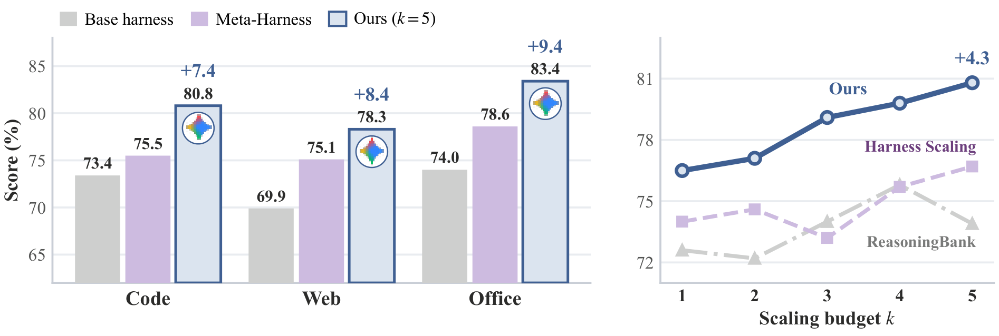
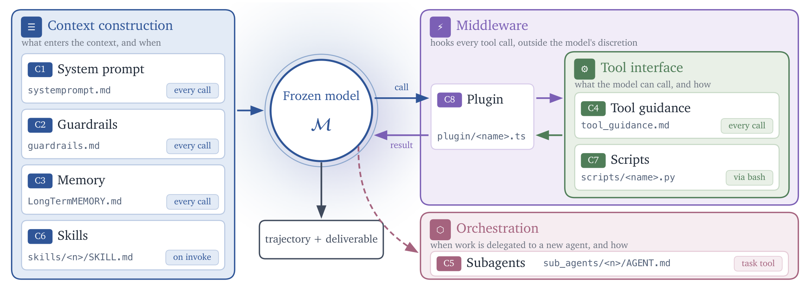
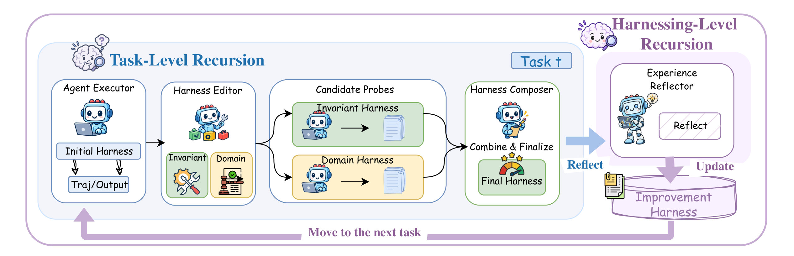
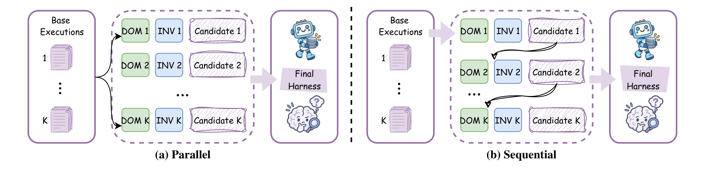
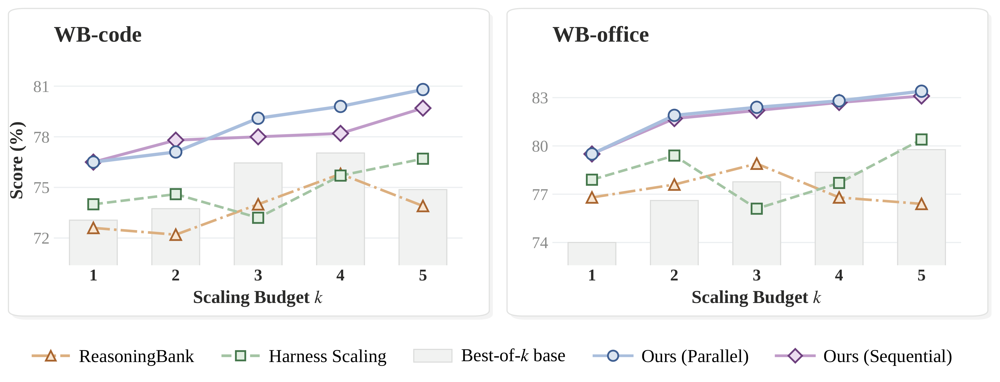
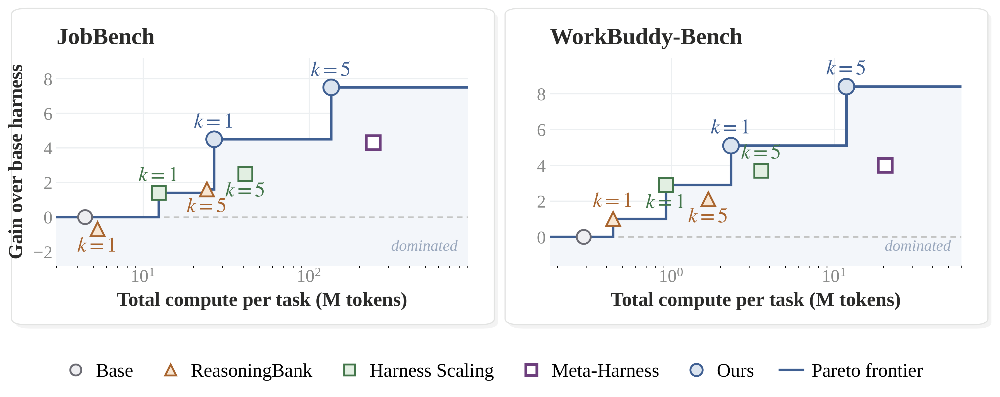
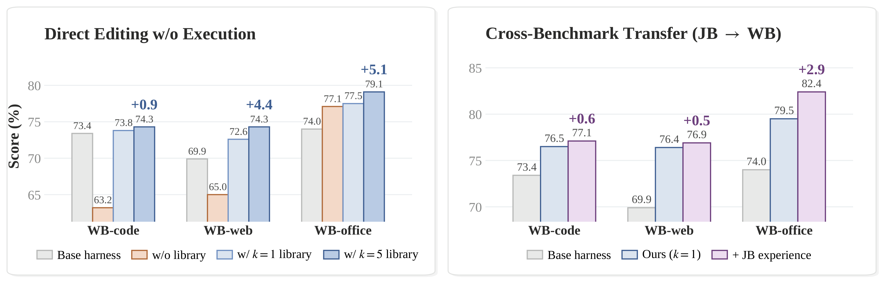
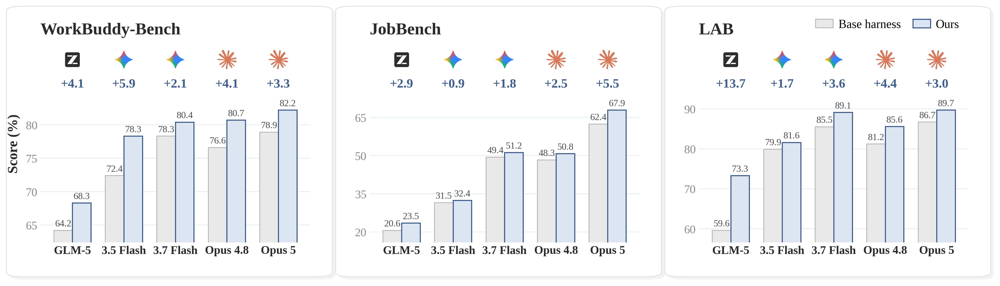
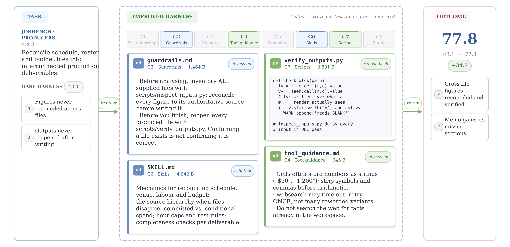
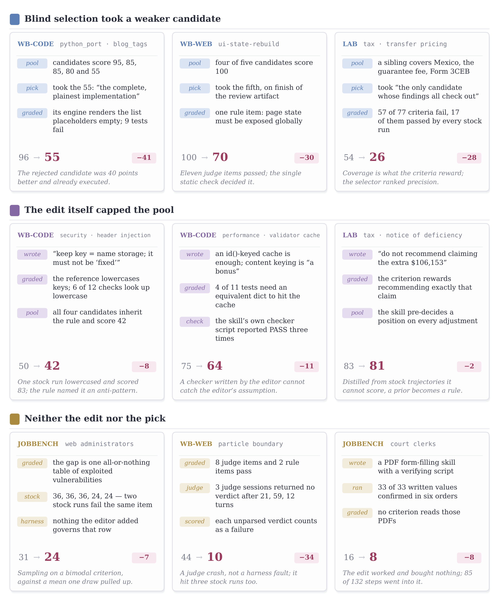

# 深度精读综述：Harness² — 面向开放世界的二阶递归智能体脚手架优化

> **论文信息：** *Harness²: Recursive Agent Harnessing for an Open World*（arXiv: `2610.14224v1` · 2026-10-12）  
> **作者团队：** Ruiyao Xu（西北大学）、Yanfei Chen, Zhongying CuiZhu, Bhavana Dalvi Mishra, Yifei Ming, Han Yu, Rujun Han, Chen-Yu Lee, Tomas Pfister（Google Cloud AI Research）  
> **配套交付物：** [英文无损原文解析](./2610.14224_Harness2_原文解析.md) · [全文如实中文翻译](./2610.14224_Harness2_中文翻译.md) · [官方论文 PDF](./Harness2_Recursive_Agent_Harnessing_for_an_Open_World.pdf) · [高清配图目录](./配图/)

---

## 一、导读与核心摘要（Executive Summary）

### 1.1 一句话核心洞察

**Harness²** 提出了一种**二阶递归脚手架优化（Recursive Agent Harnessing）**范式：在冻结基础模型权重的前提下，通过**任务级递归**（无真值条件下的对比式 *Propose–Probe–Compose*）精炼当前任务的**执行脚手架 $\mathcal{H}$**，并通过**脚手架优化级递归**将轨迹级归因经验沉淀进**改进脚手架 $\mathcal{R}_t$**，从而让系统在开放世界任务流中既能解决眼前任务，又能持续提升“未来如何改进脚手架”的能力。

### 1.2 学术直觉与第一性原理动机（Research Taste）

在 $\text{Agent} = \text{Model} + \text{Harness}$ 的工程范式下，现有自动脚手架优化（Auto-Harness / RSI）陷入了一个根本性的**二元张力（Fundamental Tension）**：

1. **反馈真空张力（Verification Vacuum）**：在离线基准（如 Meta-Harness、AHE）中，系统依赖单元测试或标量奖励来筛选候选脚手架；但在开放世界部署流中，新任务往往没有 Ground-Truth 验证器（Verifier），甚至连延迟标签都不存在。此时如果盲目根据单次成功/失败信号修改脚手架，极易把随机噪声当成因果规律。
2. **特化与泛化张力（Specialization vs. Transferability）**：为了解决当前高复杂度任务（例如某个具体法律案件或跨表财务核对），执行脚手架 $\mathcal{H}_t^\star$ 往往会写入高度特化的工作区映射与领域细节。如果像传统在线进化那样直接把 $\mathcal{H}_{t-1}^\star$ 原封不动继承给第 $t$ 个任务，前一任务的特化规则会变成下一任务的错误锚点（Wrong Anchors），导致任务分布轻微偏移时性能断崖式下跌。

**作者的第一性原理破局点在于将“被改进的对象”与“改进的机制”解耦，并做二阶升维**：
- **一阶（Execution Harness $\mathcal{H}$）** 必须保持**任务流上的无状态复位（每任务从 $\mathcal{H}_0$ 起步）**，通过在同一任务、相同模型条件下进行受控的 **Propose–Probe–Compose** 实验，用**行为对比（Behavioral Contrast）**替代缺失的正确性标签——虽然不能证明输出绝对正确，但能清晰揭示某项修改是否消除了轨迹中的具体故障模式。
- **二阶（Improvement Harness $\mathcal{R}_t$）** 才是跨任务演化的真正载体。被传递下去的不是上一任务的“成品脚手架”，而是**“哪些改动在何种轨迹情境下解决了什么问题”的归因经验（`EXPERIENCE.md`）+ 可按需复制适配的完整组件库**。这使系统从“靠经验执行任务”进化为“靠经验改进脚手架”。

### 1.3 核心范式对比表

| 维度 | 离线搜索 (Meta-Harness) | 纯记忆检索 (ReasoningBank) | 单任务测试时演化 (Harness Scaling) | **Harness² (本文)** |
| :--- | :--- | :--- | :--- | :--- |
| **优化对象** | 完整执行脚手架 $\mathcal{H}$ | 上下文推理记忆 | 单任务执行脚手架 $\mathcal{H}$ | **执行脚手架 $\mathcal{H}$ + 改进脚手架 $\mathcal{R}_t$** |
| **运行阶段** | 离线训练集搜索后冻结部署 | 在线流式（固定脚手架） | 在线单任务独立演化（无跨任务状态） | **在线单遍任务流（一阶复位、二阶累积）** |
| **外部真值标签** | 需要（训练/开发集评分） | 不需要（依赖自评判） | 不需要 | **不需要（依赖行为对比与盲选）** |
| **跨任务经验传递** | 搜索期间积累，部署后冻结 | 仅传递文本策略条目 | 无（每任务归零） | **传递可执行组件树 + 严格归因经验** |
| **测试时缩放机制** | 无（部署后单次执行） | Best-of-$k$ 采样 | 线性多轮盲改 | **并行聚合 ($\textsc{Compose}_j$) / 顺序精炼 ($\Phi^{(r)}$)** |

### 1.4 关键实验数据看板

- **单步改进（$k=1$）全线正收益**：在 **WorkBuddy-Bench**、**JobBench**、**LAB** 三大专业基准测试与四种模型—脚手架配置（Gemini 3.5 Flash / GLM-5 × OpenCode / Codex）下全部超越各自 Base Harness，最高单步提升达 **+11.5 分**（WorkBuddy-Bench, GLM-5 + OpenCode）、**+4.5 分**（JobBench, Gemini + OpenCode）与 **+11.8 个百分点**（LAB Partial, GLM-5 + OpenCode）。
- **任务级递归缩放（$k=5$）**：在单步基础上进一步追加 **+2.9 至 +3.9 分**（WorkBuddy-Bench）、**+3.0 至 +4.2 分**（JobBench）与 **+2.6 至 +6.7 个百分点**（LAB Partial），且全面处于算力—性能帕累托前沿。
- **“弱模型 + 强脚手架”反超强模型**：单步改进后的 GLM-5 在 WorkBuddy-Bench 上达到 **75.7**（OpenCode）和 **75.3**（Codex），直接反超使用原厂脚手架的 Gemini 3.5 Flash（**72.4** 和 **74.5**）。
- **无额外探测的跨任务/跨基准迁移**：在 $k=5$ 下积累的经验库，即使在后续任务上**不做任何探测（Zero-Probe Direct Refinement）**，仍能在 Code/Web/Office 上分别带来 **+0.9 / +4.4 / +5.1 分**的净增益；从 JobBench 迁移到 WorkBuddy-Bench 也能带来 **+0.6 / +0.5 / +2.9 分**的提升。

---

## 二、研究背景与痛点剖析：为什么现有开放世界进化会失效？

在深入 Harness² 架构之前，论文通过大量对比实验揭示了现有两条主流技术路线在开放世界中的反直觉失效模式：

1. **纯文本记忆检索的脆弱性（以 ReasoningBank 为代表）**：
   ReasoningBank 保持执行脚手架 $\mathcal{H}$ 不变，仅在任务前检索过往成功/失败轨迹提炼出的文本策略注入 Prompt。实验显示（表 1、表 2），这种做法在编程和长程结构化任务上极易产生负迁移——例如在 Codex + GLM-5 的 WorkBuddy-Code 上从 `56.8` 暴跌至 `50.2`（**-6.6 分**），在 Gemini + Codex 的 JobBench 上从 `33.9` 降至 `30.2`。原因在于：**文本层面的泛泛建议无法改变工具循环的硬约束、无法封装确定性校验脚本，反而会稀释有限的注意力上下文。**
2. **无对比、无作用域的盲目在线重写（以 Harness Scaling 为代表）**：
   Harness Scaling 在测试时直接让单个通用编辑器根据单次失败轨迹重写整个组件树，且没有行为对比和经验库支撑。在 12 组「基准—配置」测试中，Harness Scaling 有 **7 组低于 Base Harness**（例如 Codex + GLM-5 在 JobBench 上从 `23.6` 跌至 `17.5`），且随着迭代预算 $k$ 从 2 增至 3 时在 WB-Code 和 WB-Office 上双双出现性能倒退（图 5）。
3. **没有经验库支撑的“裸改”直接破坏性能**：
   图 7（左）给出了一个极其震撼的对照实验：如果去掉参照执行、探测对比和经验库，仅凭改进器对基础脚手架进行直接修改（Direct Refinement），Gemini 3.5 Flash 在 WB-Code 上会从 `73.4` 骤降至 `63.2`（**-10.2 分**），在 WB-Web 上从 `69.9` 降至 `65.0`。这证明：**在缺乏行为对比证据和历史归因经验的约束下，即便是 Claude Opus 4.8 级别的编辑器也会因为“过度猜测和臆造规则”而破坏原本正常的运行脚手架。**

---

## 三、核心方法与数学/架构深度拆解

### 3.1 八大可编辑脚手架组件表面（$K=8$ Editable Surface）

Harness² 扩展了 AHE 的文件级脚手架分解，将运行时脚手架 $\mathcal{H}=(c^1,\ldots,c^8)$ 暴露为 8 个正交的可编辑文件，涵盖四个运行时维度（见图 2 与表 5）：

1. **上下文构建（Context Construction）**：
   - `[C1] System prompt`（`systemprompt.md`，每轮常驻）：顶层角色与全局规程；
   - `[C2] Guardrails`（`guardrails.md`，每轮常驻）：无论任务或工具如何都必须遵守的硬性约束；
   - `[C3] Memory`（`LongTermMEMORY.md`，每轮常驻）：跨任务持久化的通用领域事实；
   - `[C6] Skills`（`skills/<n>/SKILL.md` 及随附脚本，按需由 `skill` 工具加载）：**零闲置开销**的专家规程，仅当常驻文本中的触发句被命中时才进入上下文。
2. **工具接口（Tool Interface）**：
   - `[C4] Tool guidance`（`tool_descriptions/tool_guidance.md`，每轮常驻）：规范现有工具何时及如何调用；
   - `[C7] Scripts`（`scripts/<name>.py`，通过 bash 运行）：将容易出错的重复性统计、格式转换或文件校验封装为**确定性 Python 脚本**，替代脆弱的逐 token 推理。
3. **编排（Orchestration）**：
   - `[C5] Subagents`（`sub_agents/<n>/AGENT.md`，通过 `task` 工具调用）：**唯一能够增加独立推理上下文窗口的组件**，防止主控上下文被海量检索内容污染。
4. **中间件控制（Middleware Control）**：
   - `[C8] Plugin`（`plugin/<name>.ts`，挂载在工具循环内部）：脱离模型自由裁量的代码级拦截钩子（Hook），用于**强制执行**行为（如连续多步未写文件时在工具返回结果中注入硬性警告）。

> **设计哲学洞察**：在 Prompt 1 中，作者明确规定了**故障到最廉价有效组件的映射梯队**：普通排序 $\to$ 常驻指导；机械重复 $\to$ `scripts/*.py`；特定触发场景 $\to$ 按需 `SKILL.md`；只有在“明确文字规则被反复无视”的铁证下，才允许动用 `plugin/*.ts` 钩子。

### 3.2 任务级递归（Task-Level Recursion）

#### 1. 对比式改进算子 $\Phi$（Propose–Probe–Compose）

在无真值反馈下，单步改进算子定义为：

$$
(\mathcal{H}', e', \xi) = \Phi(q_t, \mathcal{H}, \mathcal{E}; \mathcal{R}_t)
$$

其中 $q_t$ 为当前任务，$\mathcal{H}$ 为当前执行脚手架，$\mathcal{E}$ 为当前任务局部的执行与改进历史，$\mathcal{R}_t$ 为在整个任务期间保持冻结的改进脚手架；输出为后继脚手架 $\mathcal{H}'$、其执行记录 $e'=(\tau', y')$ 以及完整步骤记录 $\xi$。

- **Propose（双作用域正交提案）**：先在 $\mathcal{H}$ 上采样参考执行 $e^0 \sim \mathcal{A}(q_t; \mathcal{M}, \mathcal{H})$，随后并行派出两个受严格边界约束的编辑器：
  - **不变编辑器（INV）**：只负责“智能体如何工作”（工具报错回退、循环控制、产物重开校验），严禁写入专业领域规则；
  - **领域编辑器（DOM）**：只负责“从业者懂什么”（分析动作、产物契约、数值核对、专业规范），严禁诊断命令行报错或编写脚本钩子。
- **Probe（受控行为对比）**：在**完全匹配的基础模型与容器环境**下分别运行 INV 与 DOM 候选脚手架。将候选轨迹 $\tau$ 和交付物 $y$ 与参考执行 $e^0$ 对照，产生**行为对比（Behavioral Contrast）**。论文特意强调：行为对比用于**验证编辑是否缓解了轨迹中观测到的特定缺陷或引入了回归**，而不能替代任务正确性验证（因为存在采样随机性与共享模型偏见）。
- **Compose（证据锚定组合）**：组合器读取 $e^0$、两个候选脚手架的 Diff 及其探测轨迹，做出选择性决策（合并互补编辑、修改冲突、单采其一或 `KEEP_BASE`）。所有决策必须以 `kept|revised|dropped -> <edit> -> <trajectory moment>` 的形式锚定到具体轨迹时刻。

#### 2. 并行递归与顺序递归（Parallel vs. Sequential Scaling）

给定测试时探索预算 $k \in \mathbb{Z}^+$，Harness² 提供两种可扩展的递归形态：

- **并行递归（Parallel Recursion，宽度扩展）**：先采样 $k$ 次基础执行构成参考集 $\mathcal{B}$（用于识别“$k$ 次中重复出现的真实缺陷”，过滤单次采样的 $1/k$ 随机噪声），再独立提出并探测 $k$ 个 INV 候选和 $k$ 个 DOM 候选组成候选池 $\mathcal{P}$。随后并行启动 $k$ 个独立的组合会话：
  $$\mathcal{H}'_j = \textsc{Compose}_j(q_t, \mathcal{H}, \mathcal{B}, \mathcal{P}; \mathcal{R}_t), \qquad j=1,\ldots,k$$
  每个组合会话都能看到完整的 $\mathcal{B}$ 与 $\mathcal{P}$，独立合成一个后继脚手架 $\mathcal{H}'_j$ 并执行，从而实现“基于可执行脚手架与行为证据的群体递归聚合”。
- **顺序递归（Sequential Recursion，深度扩展）**：从 $\mathcal{H}^{(0)}=\mathcal{H}_0$ 出发，串联 $k$ 个对比步骤：
  $$(\mathcal{H}^{(r)}, e^{(r)}, \xi^{(r)}) = \Phi(q_t, \mathcal{H}^{(r-1)}, \mathcal{E}^{(r-1)}; \mathcal{R}_t), \qquad r=1,\ldots,k$$
  其中第 $r-1$ 步检查点的运行轨迹 $e^{(r-1)}$ 成为第 $r$ 步的 **on-policy evidence**，使编辑器可以跨轮次保留有效改动、修正副作用，甚至回滚到早期检查点。
- **匿名盲选（Terminal Aggregator）**：当 $k > 1$ 时，所有候选交付物（连同基础运行结果一起）被匿名化并打乱顺序交给选择器。选择器**看不到来源脚手架、看不到轨迹、也无权修改产物**，仅依据任务请求与 `context/source/` 原材料按六级优先级（交付完整性 $\to$ 格式契约 $\to$ 事实忠实度 $\to$ 内部自洽 $\to$ 下游可用性 $\to$ 收尾完整度）选出最终交付物及其对应的 $\mathcal{H}_t^\star$。

### 3.3 脚手架优化级递归（Harnessing-Level Recursion）

任务交付后，二阶更新算子利用完整改进记录 $\mathcal{D}_t$ 更新改进脚手架 $\mathcal{R}_t$：

$$
\mathcal{R}_{t+1} = \textsc{Update}(\mathcal{R}_t, \mathcal{H}_t^\star, \mathcal{D}_t)
$$

这一阶段的核心工程智慧在于**反归因谬误（Anti-Attribution Fallacy）**：
- 选择器仅凭交付物质量选出了 $\mathcal{H}_t^\star$，但**输出被选中不等于该脚手架里的每一项编辑都起了正作用**（Prompt 6 原话：*“An edit inside the adopted candidate may have contributed nothing to why it was adopted”*）。
- 因此，经验反思器（Reflector）必须先将每个候选的组件 Diff 与实际轨迹变化逐一对照，给出 `helped`、`hurt`、`no observed effect` 或 `confounded` 四个严格裁决之一。
- 只有当存在明确、未混淆（unconfounded）的执行对比时，才允许生成一条包含 `cue`（适用情境模式）、`lesson`（可检查的操作指令，明确点出目标组件名）、`evidence` 和 `confidence` 的 `EXPERIENCE.md` 条目；否则宁缺毋滥，直接输出 `NO_ENTRY`。
- 下一任务 $q_{t+1}$ 启动时，执行脚手架重新归零为 $\mathcal{H}_0$，避免前一任务的私有事实（Workspace Facts）污染新任务；而 $\mathcal{R}_{t+1}$ 中的组件实体与经验索引则按需供 Propose 阶段“复制并重验证后适配”。

---

## 四、实验验证、消融分析与反直觉发现

### 4.1 预算缩放曲线与帕累托前沿

从图 5 可以清晰看出：
- 在 WB-Code 和 WB-Office 上，随着 $k$ 从 1 增至 5，Harness² 的并行与顺序递归均呈现**单调上升**；而 Harness Scaling 在 $k=2 \to 3$ 处发生回退，ReasoningBank 持续震荡。
- 更关键的是，**Harness² 在 $k=2$ 时即已超越所有基线在 $k=5$ 时的得分**。并行递归在 $k=5$ 时整体优于顺序递归（WB-Code 达 `80.8`，WB-Office 达 `83.4`），因为并行池提供了更丰富的跨作用域组合样本且可并发执行；但在 $k=2$ 的 WB-Code 上，顺序递归的 on-policy 纠偏能力曾短暂领先。

图 6 统计了提交最终交付物前的**总 Token 消耗（含执行与改进阶段）**：无论是 $k=1$ 还是 $k=5$，Harness² 都稳居经验帕累托前沿。相比之下，离线搜索的 Meta-Harness 消耗了比 $k=5$ 的 Harness² 更高的总算力，却取得了更低的分数。

### 4.2 消融实验与组件贡献拆解

| 消融配置 (表 3, $k=1$) | WorkBuddy Avg. | JobBench | 关键结论 |
| :--- | :---: | :---: | :--- |
| **Harness² (完整)** | **77.5** | **36.0** | 三大机制缺一不可 |
| w/o library（关闭经验库读写） | 74.4 (-3.1) | 34.2 (-1.8) | 跨任务经验积累带来显著在线增益 |
| w/o scoping（取消 INV/DOM 分工） | 74.6 (-2.9) | 32.3 (-3.7) | **在长程复杂任务 JobBench 上，双作用域分工贡献最大** |
| w/o composition（探测后直接单选） | 75.9 (-1.6) | 34.1 (-1.9) | 融合互补修改显著优于二选一 |

在附录表 6 的组件级消融中（移除已改进脚手架中的特定组件并重测）：**移除 Skills** 在 Code 和 Web 上损失最大（分别掉 `3.6` 和 `6.9` 分）；**移除 Scripts** 在 Office 上损失最大（掉 `7.4` 分）；而移除常驻 Prompt 组仅损失 `1.5` 分。这用量化证据印证了 Harness² 的核心主张：**按需加载的专家技能（Skills）与确定性脚本（Scripts）才是提升复杂任务上限的主力，而非堆砌冗长的常驻提示词。**

### 4.3 经验库复用、跨模型迁移与同模型自改进

- **高预算探索反哺未来**：图 7（左）表明，当不使用探测直接精炼基础脚手架时，$k=0$（无库）会严重破坏性能（Code `73.4 -> 63.2`）；$k=1$ 的库可恢复基准；而 **$k=5$ 积累的库无需任何探测即可直接提升性能**（Code +0.9, Web +4.4, Office +5.1）。
- **适配远多于照搬**：图 10 的代码行级溯源显示，虽然 JobBench 上 `47%` 的修改文件来自经验库，但仅有 `2%–10%` 的文件保留了一半以上原始行——编辑器真正做的是**借鉴模式并针对当前工作区重新验证与适配**。
- **跨模型可迁移性 & 同模型自举**：图 12 证明为 Gemini 3.5 Flash 精炼的脚手架原封不动迁移给 GLM-5、Gemini 3.7 Flash 和 Claude Opus 4.8 均带来正收益（GLM-5 在 Code 上暴涨 **+17.3 分**）。同时，图 8 证明当由 GLM-5、Gemini 3.5 Flash 或 Claude Opus 5 **自己同时担任执行器和编辑器**时，全部五个模型在全部三个基准上均实现正提升（GLM-5 在 LAB 上 +13.7 分），打破了“脚手架优化必须依赖更强教师模型”的迷思。

### 4.4 工具可靠性与调用次数的解耦

表 7 揭示了一个重要的工程洞察：Harness² 在三个基准上**全面降低了工具调用错误率**（JobBench 从 `14.4%` 降至 `9.1%`，WorkBuddy-Bench 从 `0.8%` 降至 `0.5%`），但工具调用次数在 WorkBuddy-Bench 上**减少 11.0%**，在 JobBench 和 LAB 上却分别**增加 19.7% 和 21.2%**。这说明脚手架精炼并不是一味压缩步数，而是该省则省（消除无效报错），该深入核验时则主动增加关键核对步骤（如打开生成文件校验、交叉核对数据源）。

---

## 五、典型案例与工程细节还原

### 5.1 Prompt 工程中的四大核心契约

从附录 F 公开的 6 个完整 Prompt 中，我们可以提炼出极具实战价值的 Agent Harness 设计规范：

1. **Workspace Fact vs. Procedure 严格分层（Prompt 1）**：编辑器被要求将耗时探索才发现的具体工作区事实（如文件主键映射、缺失条目）明确标注为 `"in this workspace, ..."` 写入当前脚手架，省去执行器重探索的成本；而领域通用规程则必须抽象为可跨任务复用的形式，避免把当前案件的私有事实写进 `LongTermMEMORY.md` 误导未来任务。
2. **空输出一票否决（Prompt 3）**：在缺乏评分器时，最致命的回归是“无产物输出（Empty Run）”。Composer 被硬性要求：任何曾关联过空输出的编辑默认视为 `UNSAFE`，除非其余证据压倒性地支持它，且必须显式说明理由。
3. **形状契约高于文采（Prompt 5）**：盲选聚合器将 `CONFORMANCE` 排在第二位（仅次于交付存在性），明确指出“擅自增加列、重命名表头、在表格里留公式占位符而非计算出的具体数值，都是**偏离（DEVIATIONS）而非改进**”，直接堵死了 LLM 常见的“过度发挥导致下游解析器崩溃”的漏洞。
4. **证据隔离与防注入（Prompt 1–6）**：所有轨迹、任务和产物均被声明为“数据而非指令”，严禁执行候选脚本；工作目录在移交前经过守卫校验，确保任何评分细则或分数绝不泄露进上下文。

### 5.2 真实进化案例全景

- **案例 1（JobBench 跨文件核对，`43.1 -> 77.8`）**：基线运行并非不懂业务，而是从未跨源文件核对数据且写完文件后不重开校验。INV 编辑器加入流程护栏与校验脚本；DOM 编辑器注入日程/场地/预算对账技能；Composer 合并了全部 4 处编辑，一举消除遗漏章节与数字矛盾。
- **案例 2（WorkBuddy-Code 伪调用纠正，`60.0 -> 100.0`，图 15）**：模型在纯文本里输出工具调用格式而不真正触发工具；仅修改 `[C4] tool_guidance.md` 禁止伪调用即获满分。
- **案例 3（LAB 法律红线修订文档读取，`44.4 -> 94.5`，图 18）**：直接按纯文本读取 `.docx` 会丢失 Word 的 Track-Changes 修订层（只看到被接受的文本）；通过新增一个按 XML 解析插入/删除为正文字符标记的 Skill 及对应 Guardrail，精准解决法律审阅痛点。
- **案例 4（JobBench 全 8 组件协同，Claude Opus 5 自举，`72.0 -> 100.0`，图 19）**：面对预算耗尽仍未落盘的问题，脚手架同时写入了防空转插件（连续固定次数调用无产物即追加警告）、独立上下文子智能体（返回可引用表格）以及持久化领域记忆，展示了 8 组件协同的上限。

同时，论文在图 14 中坦诚剖析了 **9 个失败回归案例**，归纳出三大脆弱点：(1) **盲选偏差**（选择器偏爱看似工整但覆盖面更窄的答案，导致 WB-Code 从 95 跌至 55）；(2) **错误前提在候选间传播**（如死板的字面键名要求导致 2–11 分损失）；(3) **执行随机性与不可见标准错配**。

---

## 六、局限性与对 Agent Harness 工程的落地启示

### 6.1 局限性与适用边界

1. **测试时算力成本**：尽管并行递归可以通过并发降低端到端延迟，但 $k$ 个参考执行 + $2k$ 个候选探测 + $k$ 个组合运行决定了其总 Token 消耗是基础运行的数倍，更适合高价值、高复杂度或可异步执行的专业任务，而非对延迟和成本极度敏感的轻量级对话。
2. **共享模型偏见的上限**：当执行器与编辑器共享同一类系统性盲区，且该盲区在行为轨迹中不表现为显式报错或明显矛盾时，无真值的行为对比可能无法发现问题，甚至会在候选间放大同一错误假设。
3. **经验库膨胀管理**：当前采用扁平的文件夹 + 索引 + `EXPERIENCE.md` 结构，随着任务流拉长，如何自动合并重叠技能、淘汰过时经验以及精准检索，仍留待后续工程化解决。

### 6.2 可落地的工程实践建议

1. **把“脚手架组件”按激活成本分层设计**：不要把所有规则都塞进 `systemprompt.md`。建立 `Always-on Guardrails`（极简硬约束）+ `On-demand SKILL.md`（带触发句的零闲置开销专家规程）+ `scripts/*.py`（确定性校验与解析）+ `plugin/*.ts`（防空转/防提前退出的硬钩子）的四层架构，是性价比最高的脚手架工程实践。
2. **用“行为对比 + Trajectory-Grounded Diff”替代盲目反思**：在做线上 Agent 自进化时，不要直接问 LLM“上次为什么失败、怎么改 Prompt”，而应要求编辑器**必须引用具体轨迹时刻**，并在受控条件下做一次对照探测；对于“空输出”或“单次偶发错误（$1/k$）”保持高度克制。
3. **跨任务只沉淀“模式与组件”，不沉淀“私有事实”**：构建团队级 Agent 经验库时，严格区分当前工作区的私有映射与通用领域规程，要求每次复用库组件时必须对照新任务上下文重新核验参数与路径，避免跨任务错误锚定。
