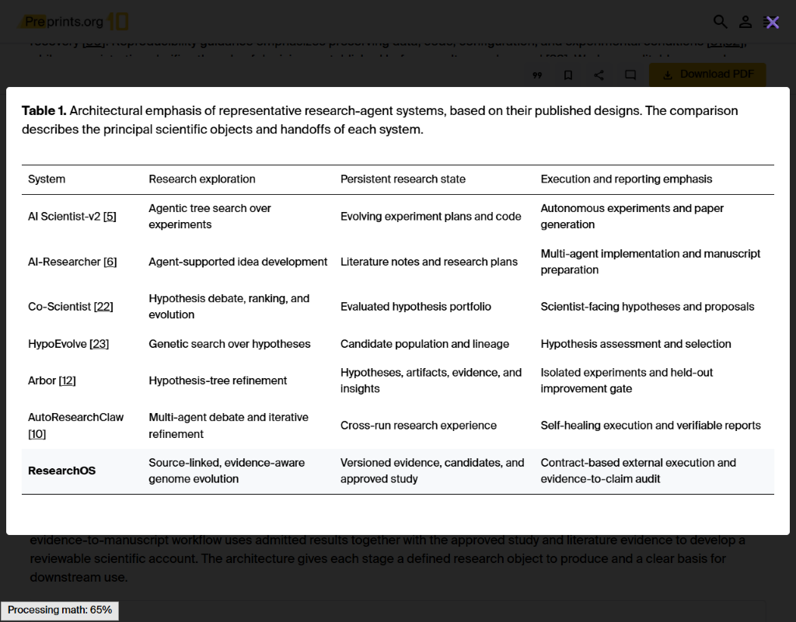
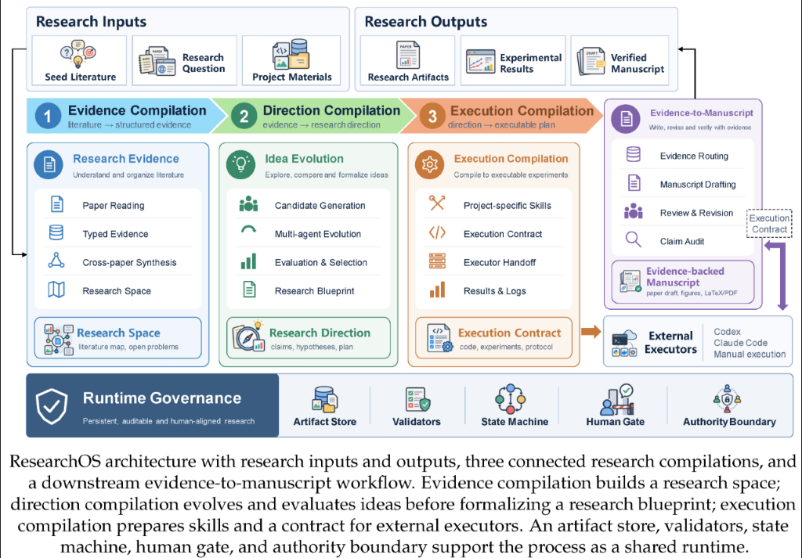
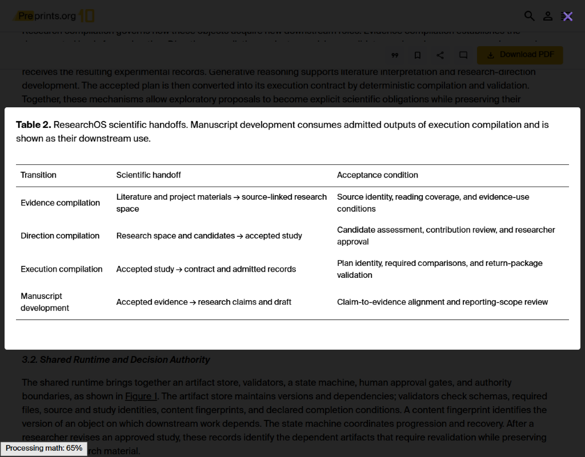
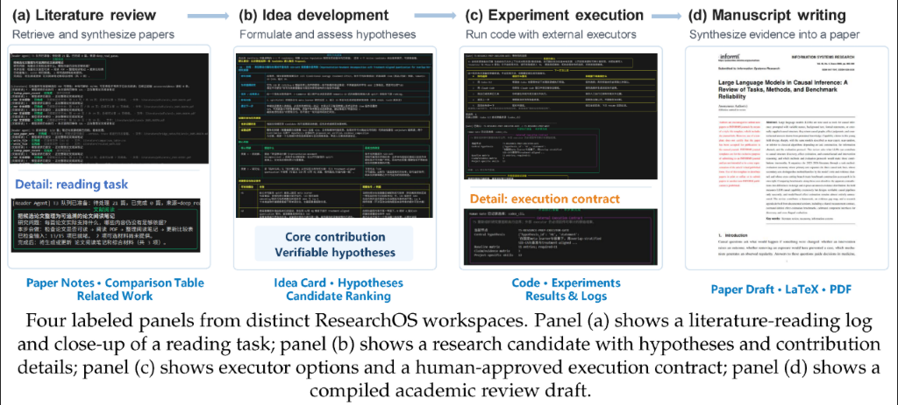
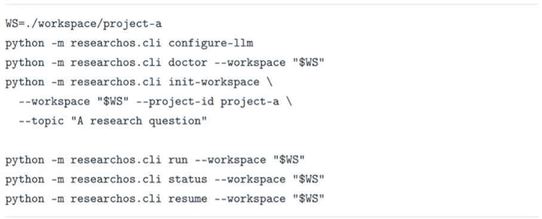
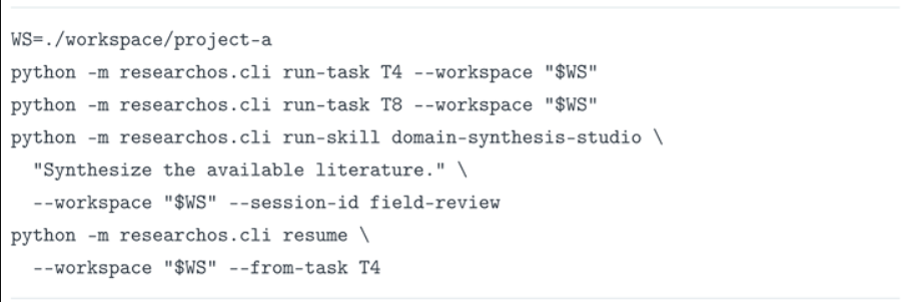

# ResearchOS：用“证据权限编译”管住科研幻觉与 Skill 边界
## —— Preprints 202610.2216 全景深度精读与系统工程剖析

> **论文原题**：*ResearchOS: Research Compilation for Multi-Agent Scientific Discovery*  
> **作者团队**：Mengkun Liang, Chenhao Xu, Tianyu Zhu, Guannan Liu, Junjie Wu\*（*通讯作者*）  
> **预印本编号**：`preprints202610.2216.v1` ｜ **DOI**：[`10.20944/preprints202610.2216.v1`](https://doi.org/10.20944/preprints202610.2216.v1)  
> **发布日期**：2026 年 10 月 22 日（Version 1） ｜ **原文链接**：https://www.preprints.org/manuscript/202610.2216  
> **配套资产**：[英文全量原文解析](./2610.2216_ResearchOS_原文解析.md) ｜ [全文如实中文翻译](./2610.2216_ResearchOS_中文翻译.md) ｜ [全套 6 张高清图表资产](./配图/)

---

## 📌 导读与核心摘要（Executive Summary）

### 一句话核心洞察
> **多智能体科研之所以容易“一本正经地胡说八道”，是因为各阶段之间只有松散的文本传话，没有编译器级别的类型检查与权限边界！**  
> **ResearchOS** 提出**“研究编译（Research Compilation）”**范式，将文献笔记、研究构想、实验计划、执行 Skill 与论文主张全部建模为**带内容指纹（Content Fingerprints）与验收条件的持久化研究对象**：先用**证据权限（Evidence Permission）**卡死“读了多少才能主张多少”，再用**11 字段构想基因组（Idea Genome）**做多智能体 Pareto 演化，最后将获批方案确定性编译为不可越权的**执行契约（Execution Contract）与项目 Skill**，并通过**六件套准入校验**与**主张审计（Claim Audit）**确保论文里写的每一句话都有据可查。

---

### 学术直觉与第一性原理推导（Research Taste）
ResearchOS 体现了一个极其敏锐的系统级 Research Taste：**为什么现有的自动化科研多智能体（如 AI Scientist、Agent Laboratory）在长程协作中不可避免地会出现“语义漂移”与“无据幻觉”？** 作者没有将其归咎于单个 LLM 的推理能力不足，而是从**编程语言编译理论（Compilation Theory）与科学哲学（Scientific Commitments）**的交叉视角做出了本质诊断：

1. **核心病灶：科研信息在不同阶段的“科学模态（Scientific Modality）”截然不同**  
   一项科学研究的信息流会经历四次模态跃迁：**文献源证据（Documented Evidence） $\to$ 探索性候选（Conjectural Candidates） $\to$ 获批实验承诺（Experimental Commitments） $\to$ 论文主张（Manuscript Claims）**。
   - 在“构想探索期”，Agent 可以基于部分阅读提出猜测性机制（低约束、高自由度）；
   - 一旦进入“实验执行期”，研究计划中的假设、必需基线与评估指标就变成了**不可擅自修改的科学契约**（高约束、强确定性）；
   - 到了“论文撰写期”，每一条科学主张的成立域（Scope）严格受限于**实际返回的观测条件**。
2. **为什么“自由自然语言交接”必然导致越权与幻觉？**  
   当不同角色的 Agent 仅通过无类型的自然语言文档或共享目录交接时，下游 Agent 无法分辨一段文本究竟是“仅读了摘要的猜想”还是“经过全文精读验证的事实”，也无法阻止执行器为了跑通代码而隐式删改必需基线（等同于在软件工程中跳过类型检查直接运行未校验的指针转换）。
3. **直觉跃迁：将多智能体科研协作抽象为“研究编译（Research Compilation）”**  
   正如编译器通过词法/语法分析、中间表示（IR）与类型检查将高级语义降维为受控的机器指令，ResearchOS 将科研协作重构为三级编译：**证据编译（构建带阅读覆盖度与证据权限的 IR） $\to$ 方向编译（在 11 维 Idea Genome 上做有约束的多目标演化与形式化） $\to$ 执行编译（将获批蓝图确定性降维为绑定内容指纹的 Execution Contract 与项目 Skill，并对返回产物做准入校验与主张审计）**。这一抽象使“科研自由探索”与“科学严谨性”在系统架构层面实现了正交解耦。

---

### 与代表性科研智能体系统的架构对比（表 1 解读）


*表 1：ResearchOS 与现有代表性科研智能体系统（The AI Scientist / AI Scientist-v2 / Agent Laboratory / Co-Scientist / Arbor / AutoResearchClaw 等）在科学对象、保留状态与阶段交接接口上的对比。*

| 对比维度 | 传统端到端科研 Agent<br>*(如 AI Scientist-v2 / Agent Laboratory)* | 假设树/演化搜索系统<br>*(如 Arbor / Co-Scientist / HypoEvolve)* | **ResearchOS（本文系统）** |
| :--- | :--- | :--- | :--- |
| **信息传递介质** | 自由自然语言对话 / 文件夹文本 | 假设树节点或演化文本池 | **6 类强类型、带版本与内容指纹的持久化研究对象** |
| **文献证据治理** | 简单摘要或 RAG 检索片段，无权限区分 | 依托初始文献背景或人工输入 | **阅读覆盖度追踪 + 事实/解释分离 + 证据权限门控** |
| **构想演化机制** | 单次生成或简单反思循环 | 树搜索或文本遗传变异 | **11 字段 Idea Genome + 诊断引导变异 + Pareto 家族多样性选择** |
| **实验执行约束** | Coding Agent 自由发挥，易偏离原定协议 | 依赖外部脚本或树节点状态 | **确定性编译为“执行契约 + 项目专属 Skill”，越权即退回人工门控** |
| **写作防幻觉机制** | 写完后再做通用审稿式检查 | 汇总树上洞察生成报告 | **六件套准入校验 $\to$ `result_to_claim` 映射 $\to$ 逐句主张审计** |

---

## 一、系统总览：三大编译管线与共享运行时治理


*图 1：ResearchOS 整体架构。上方为输入与输出；中间自左向右为三大研究编译管线（① 证据编译 $\to$ ② 方向编译 $\to$ ③ 执行编译）以及下游的证据到论文工作流；底部为贯穿全流程的共享运行时治理层（Runtime Governance）。*

### 1.1 六类强类型研究对象（Research Objects）
ResearchOS 将科研信息的生命周期拆解为六种边界清晰的对象，避免“未验证猜想”与“已证实结论”混为一谈：
1. **阅读笔记（Reading Note）**：记录某篇论文实际阅读过的范围（全文 / 指定页码 / 摘要）及结构化拆解。
2. **研究空间（Research Space）**：跨论文综合后形成的领域图谱、方法对比表与开放科学问题集合。
3. **研究候选（Research Candidate）**：在演化搜索中不断变异、交叉的“构想基因组 + 评估档案”。
4. **已接受研究计划（Accepted Research Plan）**：经过研究者批准的正式研究蓝图、主张注册表与实验协议。
5. **执行契约（Execution Contract）**：由计划确定性编译而来的、独立于具体编程工具的硬性执行规范。
6. **论文主张（Manuscript Claim）**：文稿中的每一条科学陈述，必须显式绑定文献锚点或准入的实验观测。

### 1.2 四大核心阶段交接与验收条件（表 2 解读）


*表 2：ResearchOS 三大编译阶段与下游论文撰写的交接定义及验收条件。*

### 1.3 共享运行时（Shared Runtime）与四方权限边界
如图 1 底部所示，共享运行时由**产物存储（Artifact Store）**、**校验器（Validators）**、**状态机（State Machine）**、**人工审批门控（Human Gate）**与**权限边界（Authority Boundary）**五部分组成，并严格划定了四类参与者的权力范围：
- **LLM 智能体（生成与解释权）**：负责读论文、提出/评估研究候选、撰写科学解释；**但无权修改 ID、指纹与准入规则**。
- **确定性控制器（调度与门禁权）**：负责候选 ID 分配、演化代际调度、Pareto 选择、Schema 与哈希校验；**保证过程可重入、可审计**。
- **外部执行器（实现与排障权）**：如 Codex CLI、Claude Code，在契约允许的路径和规范内写代码、修依赖、跑实验；**无权删改必需基线或指标**。
- **人类研究者（最高审批权）**：在 Human Gate 处选择研究方向、批准研究蓝图、授权实验资源，并审批任何涉及科学承诺变更的请求。

---

## 二、管线一：证据编译（Evidence Compilation）与“证据权限”

为什么两篇研究同一问题的论文会得出相反结论？往往是因为评估条件、隐含假设或某个未考察的机制不同。证据编译的目的，就是把零散文献炼成**可复用、防幻觉的研究空间**。

### 2.1 阅读覆盖度追踪与“事实 vs. 解释”剥离
对于阅读队列中的每篇论文，ResearchOS 不仅记录“文件是否存在”，还精确记录**阅读覆盖度（Reading Coverage）**——明确区分：
- **全文精读（Full-text examination）**
- **指定章节/页码阅读（Specified sections or page ranges）**
- **仅摘要检视（Abstract-level inspection）**

同时，结构化阅读笔记强制保留页码、章节、图/表锚点，并将**已报道的客观观测事实（Reported Observations）**与**作者提出的解释及理论论证（Proposed Explanations）**分开存储。这样，当下游需要对比两项研究的实测差异时，不会把原作者的“主观猜想”误当成“实测数据”。

### 2.2 核心防幻觉机制：证据权限（Evidence Permission）与猜想隔离
ResearchOS 为每一条源链接材料打上**证据权限（Evidence Permission）**标签：
- **局部阅读可用，但禁止越权引用**：如果智能体只读了某篇论文的 Abstract 得知“方法 X 提升了精度”，该信息获得的权限仅限于**“提出探索方法 X 的研究动机”**；如果后续智能体想主张**“方法 X 之所以提升是因为机制 Y”**，系统检查到缺乏实验细节与适用条件的阅读权限，就会阻止该强主张直接成立。
- **猜想降级为 `Conjecture`**：智能体通过类比或大模型先验知识想出的点子，只能以**猜想（Conjecture）**身份进入研究空间，同时显式挂上“尚未满足的证据需求”。这既保护了科研创造力，又防止了把脑补当事实。

---

## 三、管线二：方向编译（Direction Compilation）与多智能体演化

在建好的研究空间上，ResearchOS 通过**证据扎根的多智能体演化搜索（Algorithm 1）**，将开放问题演化为结构化、高质量且互补的研究方向组合。

### 3.1 11 字段“构想基因组（Idea Genome）”
为了让每次变异和交叉都“改得明明白白”，ResearchOS 不演化整段散文，而是把每个研究候选编码为包含 **11 个科学基因**的结构体：

| 类别 | 基因字段（11 个核心字段） | 作用与溯源约束 |
| :--- | :--- | :--- |
| **立项基石** | `1. research problem`（研究问题）<br>`2. opportunity`（研究机遇）<br>`3. challenged assumption`（受挑战假设） | 绑定研究空间中的开放问题或文献分歧来源 |
| **核心机理** | `4. central thesis`（核心论点）<br>`5. mechanism`（作用机制）<br>`6. design or artifact`（系统设计或产物） | 阐述“为什么有效”以及具体的技术实现载体 |
| **科学增量** | `7. contribution`（预期贡献） | 明确相对现有工作的增量价值 |
| **验证闭环** | `8. provisional hypotheses`（暂定假设）<br>`9. validation logic`（验证逻辑）<br>`10. boundary conditions`（边界条件）<br>`11. risks`（潜在风险） | 规定用什么对比基线、什么指标能把本机制与竞争性解释区分开 |

### 3.2 评估隔离、诊断引导变异与兼容性交叉
1. **评估与生成绝对隔离**：评估器智能体（Evaluators）在**看不到先前生成对话历史**的独立上下文中审阅候选档案，打出三个 $[1, 5]$ 区间的核心分数：
   $$\mathbf{f}(c) = \left(f_{\text{value}}(c),\; f_{\text{mechanism}}(c),\; f_{\text{contribution}}(c)\right) \tag{1}$$
   分别衡量**研究价值、机制完整性、贡献独特性**，同时单独记录证据校准度、验证可行性等诊断信息，并指出**最关键的薄弱基因（Bottleneck）**。
2. **诊断引导变异（Diagnosis-Guided Mutation）**：不盲目重写，而是针对评估器指出的瓶颈基因做定点手术（例如：原提案只写了“新方法更好”，变异规划要求保留核心设计不变，专门补强 `mechanism` 与能够区分竞争解释的 `validation logic` 消融实验）。
3. **兼容性感知交叉（Compatibility-Aware Crossover）**：交叉前先做问题–机制–验证的科学兼容性审查，通过后生成**基因供体映射（Gene-Donor Map）**，把父代 A 的解释机制与父代 B 的判别性实验设计合法地重组在一起。
4. **反作弊门禁**：子代在进入种群前，控制器会检查其修改记录，直接拦截**装饰性改写（Cosmetic Changes）**、**偏离受保护科学内容**或**无科学目的的复杂性叠加**；通过检查后，**父代与子代必须放在同一评审标准下联合重评估**，避免上下文漂移带来的打分不公（[36]）。

### 3.3 Pareto 分层 + 家族多样性选择（附录 A 细节）
在 $P_g \cup C_g$ 上，系统依据三维目标的支配关系（公式 2：$a \succ b$）划分 Pareto 层。为了防止整个种群坍缩到同一个热门点子上，ResearchOS 在三个核心字段上计算**轻量级词元集合重叠度（Jaccard 均值）**：

$$s(a, b) = \frac{1}{3} \sum_{k \in K} \frac{|T_k(a) \cap T_k(b)|}{|T_k(a) \cup T_k(b)|}, \qquad K = \{\text{problem}, \text{mechanism}, \text{contribution}\} \tag{A1}$$

通过全连接分组划分“候选家族”，并在每层内按**核心平均分 $\to$ 相对父代增益 $\to$ 最小结构距离 $\to$ Wildcard/High-upside 标志**的字典序优先级筛选，每家族默认软上限 2 个（必要时可保留 1 个高潜力 Wildcard 例外）。此外，系统还将**种群生存（用于继续演化）**与**组合呈现（精简展示不同权衡给研究者挑选）**解耦。

### 3.4 贡献审查与研究形式化（Study Formalization）
当研究者选中某个候选方向后，还不能直接写代码，必须先过两道关：
1. **贡献审查**：包括**碰撞评估（Collision Assessment）**（查清和邻近论文有无实质重叠）与**贡献距离评估（Contribution-Distance Assessment）**。
2. **研究形式化**：产出**研究蓝图（Research Blueprint）**、**前瞻性主张注册表（Claim Registry）**与**实验计划**，并显式定义**终止/证伪准则（Kill Criteria）**——即提前写死“出现什么观测结果就证明我们的假设错了”。经独立一致性检查与人工签字批准后，才进入执行阶段。

---

## 四、管线三：执行编译、六件套准入与主张审计

### 4.1 确定性编译：从“研究计划”到“执行契约 + 项目 Skill”
`research-reboost` 编译器将获批的研究包**确定性地**转化为**执行契约（Execution Contract）**，绑定输入 ID 与内容指纹，随后特化为一套**项目专属 Skill**：
- **什么是 Skill？** 在 ResearchOS 中，Skill 是包含领域指导、允许操作、允许路径、输入/输出 Schema 与完成条件的受限任务规范；
- **硬性权限边界**：外部编程智能体（Codex CLI / Claude Code）在**资源准备门控**获得研究者授权后，可以在契约范围内自主修软件依赖、调试 Bug；但**如果它想删掉一个必需基线或修改评估协议，契约校验会直接拦截，并退回人工研究决策流程**（连同原始计划一起供研究者审阅）。

### 4.2 六件套准入校验与三份写作交接文件（附录 B）
外部执行器跑完实验后，必须按规范交回**六件套**：
1. **研究报告**（Research Report）
2. **结构化结果包**（Result Pack）
3. **执行状态记录**（Status File，支持显式标记部分执行或 Dry Run）
4. **运行清单**（Run Manifest，绑定原始观测、配置、日志与图表）
5. **写作交接事实**（Writing-Handoff Facts）
6. **校验回执**（Validation Receipt）

ResearchOS 逐项核验研究身份、返回状态、证据引用、路径权限与文件哈希；一旦不通过即返回**类型化拒绝通知**要求补正。校验通过后，运行时生成 `drafts/t5_t8_handoff.json`、`drafts/experiment_evidence_pack.json` 与 `drafts/result_to_claim.json`，把实验结果精确映射到最初注册的每一条假设上。

### 4.3 对齐矩阵与最终主张审计（Claim Audit）
写作阶段先构建**对齐矩阵（Alignment Matrix）**与共享故事线，再由章节级智能体协同起草可修订的 LaTeX 与 PDF。交付前的**主张审计**会逐句比对：论文中报道的每一个数字是否与记录输出一致？每一个结论是否都绑定了其对应的实验条件？任何存在“未解决证据需求”的句子都会被标出交由研究者复核。

---

## 五、系统实现、真实界面与 CLI 工作区实战（第 7 章 & 附录 C）


*图 2：ResearchOS 真实界面展示。(a) 文献综述任务中的阅读覆盖度与源链接笔记；(b) 构想演化中的候选档案（因果推断语义 ID 研究案例）；(c) 实验执行前的人工资源审批门控与受限契约；(d) 基于累积证据编译出的《因果推断中的 LLM》LaTeX/PDF 综述草稿。*

在 Python 开源实现中，ResearchOS 将整条研究编译链条映射为清晰的 CLI 任务标识（`T1` 立项 $\to$ `T2–T3` 检索阅读 $\to$ `T3.5` 研究空间综合 $\to$ `T4` 方向演化 $\to$ `T4.5` 审查与形式化 $\to$ `T5` 执行编译 $\to$ `T8` 论文撰写 $\to$ `T9` 终稿组装）。借助持久化工作区（`$WS`），开发者可以随时暂停、恢复，甚至通过 `resume --from-task T4` 回到早期科学决策点重新分支，系统会自动识别受影响的下游产物并触发重新校验。

| CLI 初始化与状态恢复（Listing 1） | 任务调用与科学重入（Listing 2） |
| :---: | :---: |
|  |  |

---

## 六、双篇联动：Bayesian-Agent × ResearchOS 如何共同管住 Skill 进化与幻觉？

把 **Bayesian-Agent (`arXiv:2606.08348`)** 与 **ResearchOS (`Preprints 202610.2216`)** 结合起来看，两者恰好解决了一个完整 Agent Harness 系统的**“纵横双维治理难题”**：

```text
┌─────────────────────────────────────────────────────────────────────────────┐
│        “显式贝叶斯后验” × “证据权限编译” 联合治理闭环                      │
├─────────────────────────────────────────────────────────────────────────────┤
│  1. 横向防越权与防幻觉（ResearchOS 负责“能做什么、能说什么”）：                │
│     • 证据权限编译：阅读覆盖度决定可主张范围，未核实想法强制隔离为 Conjecture； │
│     • 执行契约编译：将规范固化为带哈希指纹的 Skill 契约，拦截擅自删改基线行为； │
│     • 六件套准入与主张审计：无合法验证回执的实验日志不得进入下游报告。          │
│                                                                             │
│  2. 纵向防过拟合与稳进化（Bayesian-Agent 负责“Skill 该不该改、怎么改”）：      │
│     • 仅摄入上述合法准入的外部验证轨迹 y_t ∈ {0,1} 与失效模式 r_t；            │
│     • 用 Beta-Bernoulli 后验收缩过滤单次偶然失败噪音（拒绝单次反思改写规则）；  │
│     • 审计账本与模型护栏分离，仅在重复失效 (F_k(r) ≥ 2) 时打靶向 Patch，      │
│       在持续失败 (β_k ≥ 4 ∧ s_k < 0.45) 时发出 Retire 重构信号。             │
└─────────────────────────────────────────────────────────────────────────────┘
```

### 局限性与工程落地启示
- **ResearchOS 的当前局限**：作为一篇以系统架构与工程实现为核心的预印本，论文重点展示了架构设计、算法流程与系统真实运行界面轨迹（图 2），**尚未提供大规模端到端自动化基准的定量对比分数表**；其有效性主要建立在显式契约校验、内容指纹与人工门控的工程确定性之上。
- **对自建 Agent Harness 的直接启发**：
  1. **给 Skill 加上“权限边界”**：不要只给 Agent 写一段自然语言 `SKILL.md`，要把“允许修改的路径、不可动摇的验收条件、必须产出的文件 Schema”作为确定性契约写进 Harness 校验器里；
  2. **把“事实账本”和“推理上下文”拆开**：无论是 ResearchOS 的 `Artifact Store` 还是 Bayesian-Agent 的 `Belief Registry`，都证明了**可靠性不能靠 LLM 自己记笔记，而要靠外部确定性状态机 + 可审计账本**。
