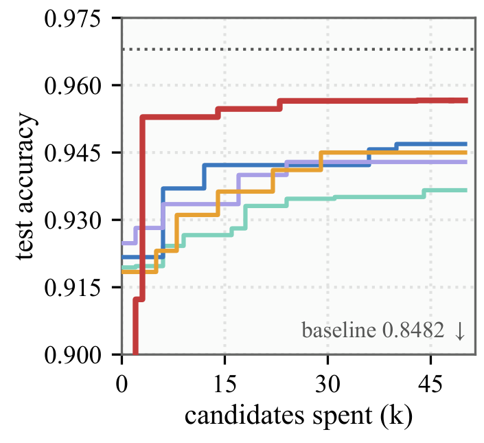
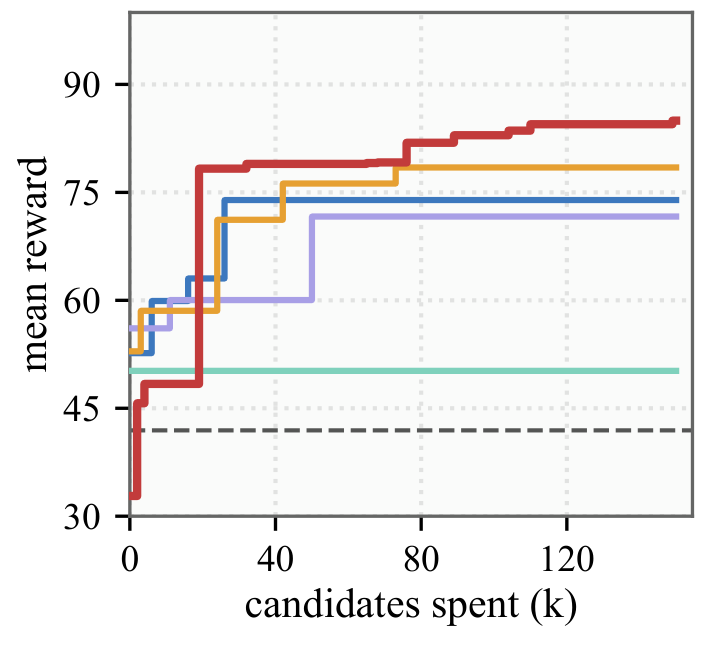
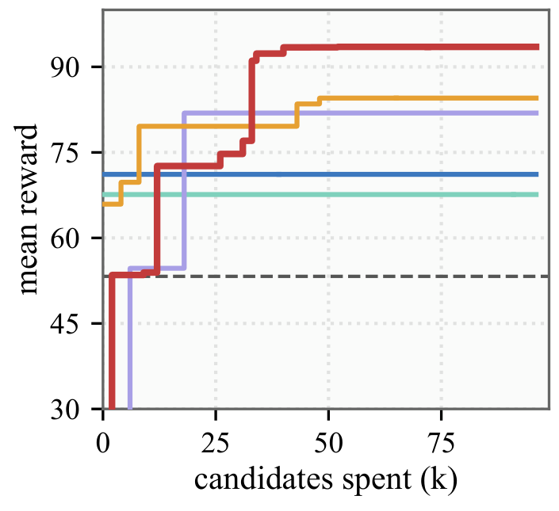
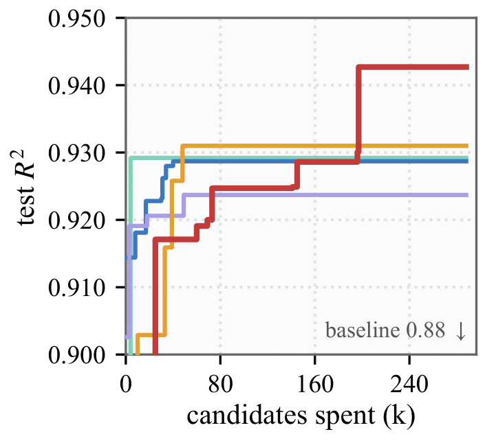
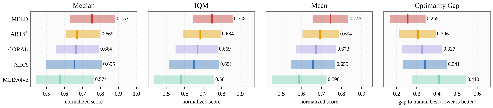

# MELD：基于分层协调与递归自进化的多智能体科学发现深度精读综述

> **论文标题**：MELD: Recursive Self-Improvement via Hierarchical Coordination for Multi-Agent Scientific Discovery  
> **论文链接**：[arXiv:2610.24454](https://arxiv.org/abs/2610.24454) | **开源代码**：[GitHub - sizhe-tang/MELD-RSI](https://github.com/sizhe-tang/MELD-RSI)  
> **作者团队**：Sizhe Tang, Zuyuan Zhang, Zeyu Fang, Tian Lan（乔治华盛顿大学 George Washington University）  
> **发布日期**：2026 年 10 月  
> **原版论文 PDF**：[`MELD_Recursive_Self_Improvement.pdf`](./MELD_Recursive_Self_Improvement.pdf)  
> **原文解析 Markdown（配插图）**：[`2610.24454_MELD_Recursive_Self-Improvement_via_Hierarchical_Coordination_for_Multi-Agent_Scientific_Discovery_原文解析.md`](./2610.24454_MELD_原文解析.md)  

---

## 📌 导读与核心摘要 (Executive Summary)

### 一句话概括
**MELD** 针对多智能体科学发现中的**耦合学习问题 (Coupled Learning Problem)**，提出了一种统一的**分层测试时训练 (Hierarchical Test-Time Training, TTT)** 框架：在单次未知任务的探索过程中，令团队级**协调器 (Coordinator)** 与多个携带私有 LoRA 适配器的**科学家智能体 (Scientists)** 在同一个**平滑最优点预算目标 (Smooth Best-of-Budget Objective)** 下通过**交替匹配快照组 (Matched-Snapshot Groups)** 进行 GRPO-RLOO 参数协同进化，使仅使用 **4B 开源小模型 (`Qwen3-4B-Instruct-2507`)** 作为研究大脑的 MELD 在 22 项 MLGym 与 MLE-bench 基准任务中夺得 **20 项第一**，全面超越基于闭源前沿模型（`Claude Haiku 4.5`）的多智能体系统。

---

### 直觉类比与核心范式对比

如果把一次科学发现比作一支科研团队攻克未解难题：

| 对比维度 | 独立并行探索 (CORAL / AIRA / MLEvolve) | 单体测试时训练 (ARTS$^{*}$ / TTT-Discover) | **MELD 分层协同递归自进化 (本文方案)** |
| :--- | :--- | :--- | :--- |
| **组织与分工机制** | 多个冻结的闭源大模型各自为战，通过共享记忆或树图松散交互 | 单一研究智能体不断在搜索树上扩展节点并蒸馏回自身权重 | **团队级 Coordinator（决定去哪/做什么）+ 个体级 Scientists（决定怎么做）** |
| **参数适应方式** | **无参数更新**：仅在推理期靠 Prompt 和上下文记忆调整 | **单层单模型适配**：仅更新一个共享的提议模型或科学家模型 | **双层交替参数适配**：1 个协调器 LoRA $\phi$ + $N$ 个**私有**科学家 LoRA $\theta_i$ |
| **耦合学习闭环** | 任务分配与模型能力分离，分配策略不会随个体能力演化而升级 | 无团队级多分支组合调度，难以避免探索同质化 | **双向递归自进化 (RSI)**：协调器分配决定科学家学到什么经验；科学家进化后的产出反过来重塑协调器下一轮的组合分配 |
| **核心优势与代价** | 依赖强闭源模型（如 Haiku 4.5）的先验能力，后期容易停滞 | 能针对单任务微调，但受限于单智能体视角与共享梯度均值坍塌 | 仅用 **4B 轻量底座 + 66M LoRA** 即可在序贯控制与复杂科研上反超闭源强模型 |

---

### 全文核心数据速览

- **基准覆盖**：12 项 **MLGym** 任务（表格、视觉、NLP、博弈论、序贯控制）+ 10 项 **MLE-bench** 竞赛（Kaggle 真实赛题），全部采用隔离环境的**私有评估器 (Private Evaluators)**。
- **榜单统治力**：在 22 项任务中取得 **20 项最优三随机种子均值**（仅 CIFAR-10 落后 AIRA $0.003$，Spaceship Titanic 落后 CORAL/MLEvolve $0.0046$）。
- **MLGym 聚合指标 (RLiable)**：
  - **IQM（四分位均值）**：`0.748`（对比最强基线 $\text{ARTS}^{*}$ 的 `0.684`，提升 $+0.064$）
  - **Median（中位数）**：`0.753`（vs. `0.669`）
  - **Optimality Gap（最优性差距）**：从 `0.306` 降至 `0.255`（相对缩减约 **17%**）
- **序贯控制与科学赛题大幅领先**：MountainCar 达 `93.51`（vs. $\text{ARTS}^{*}$ `84.53`），Breakout 达 `84.97`（vs. `78.46`），HMS Brain KL 散度降至 `0.5404`（vs. MLEvolve `0.7286`）。
- **核心算力配置**：冻结底座 `Qwen3-4B-Instruct-2507`，每份 LoRA 仅 **66M** 参数（$r=32, \alpha=64$），$N=3$ 个研究单元，$G=8$ 个快照分支（每组 24 个候选），所有系统共用冻结的 `Claude Haiku 4.5` 作为代码执行器 (Executor) 与格式裁判 (Judge)。

---

## 一、研究动机：多智能体科学发现中的“耦合学习难题”

在有限的评估预算 $T$ 下，自动化科学发现本质上是一个**固定预算纯探索 (Fixed-Budget Pure Exploration)** 问题：系统需要在互相竞争的假说分支之间合理分配计算与评估次数，使最终产出的最优合法方案效用最大化：

$$
J_T(\Pi;\mathcal{P}) = \mathbb{E}_{\Pi}\!\left[ \max_{c\in\{c_0\}\cup\mathcal{C}^{\mathrm{val}}_T(\Pi)} s(c) \right], \qquad \mathfrak{R}_T = s^\star - J_T(\Pi;\mathcal{P})
$$

其中 $s(c) = \sigma(z_m(q_m(c))) \in [0,1]$ 是经任务特定标准化与方向校准后的归一化效用。

然而，当研究团队由多个具备**测试时训练 (Test-Time Training, TTT)** 能力的智能体组成时，一个根本性的**耦合学习问题 (Coupled Learning Problem)** 浮出水面：
1. **分配即经验 (Assignments Shape Experience)**：在传统调度问题中，任务分配只影响当轮探索收益；但在可学习的智能体团队中，给哪个科学家分配哪条研究谱系（Parent Branch）和指令（Directive），直接决定了该科学家能采样到什么样的成功/失败轨迹，进而决定了它下一轮权重更新的方向。
2. **现有方法的割裂**：
   - **单智能体 TTT**（如 `TTT-Discover`、`ARTS`）：只更新单一提议/科学家策略，缺乏团队层面的组合调度。
   - **冻结多智能体编排**（如 `CORAL`、`AIRA`、`MLEvolve`）：依赖强闭源大模型的固定权重与外部共享记忆，无法在任务现场将探索经验内化为模型参数。
   - **跨任务 MARL 编排**（如 `Agent Q-Mix`、`Conductor`）：需要在训练集分布上预训练协调器，无法在面对**全新未知单任务 (Unseen Task)** 时让协调策略与研究员能力在现场同步共进化。

MELD 要解决的核心问题是：**如何在单次未知科学发现任务的执行流中，同时学习团队级协调策略与个体级研究策略，构建真正的任务内递归自进化 (Task-Local RSI) 闭环？**

---

## 二、核心架构与数学推导

### 2.1 分层策略分解与“共享底座 + 私有 LoRA”设计

在每个探索回合 $t$，系统维护一棵共享的**派生树 (Derivation Tree)** $\mathcal{G}_t=(V_t,E_t)$（根节点为初始基线 $c_0$），当前状态为 $\mathcal{S}_t=(\mathcal{P},\mathcal{G}_t,b_t)$。MELD 将联合策略 $\pi_\Theta$ 分解为两个层级：

$$
\pi_\Theta(Z_t,U_t\mid\mathcal S_t) = \pi^{\mathrm{coord}}_\phi(Z_t\mid\mathcal S_t)\prod_{i\in\mathcal I_t}\pi^{\mathrm{sci}}_{\theta_i}(u_t^i\mid\mathcal S_t,z_t^i), \qquad \Theta=(\phi,\theta_{1:N})
$$

1. **团队级协调器 (Coordinator, 参数 $\phi$)**：
   - 观察共享发现状态 $\mathcal S_t$（包括从树中检索出的最多 16 个父节点候选列表，且同一家族最多选 2 个以防过早坍塌），**以单次结构化 JSON 补全**的形式联合生成整个任务组合 $Z_t=\{z_t^i\}_{i\in\mathcal I_t}$。
   - 每条指派 $z_t^i=(p_t^i, d_t^i)$ 包含父节点 $p_t^i$ 以及受 Schema 约束的自然语言**研究指令 $d_t^i$**（明确研究问题、父节点瓶颈与约束条件）。
   - **关键设计**：因为 $Z_t$ 是在同一轮自回归生成中联合产出的，协调器可以在分派给各个科学家之前就显式统筹分支间的互补性与差异化（决定 **Where & What**）。
2. **个体级科学家 (Scientists, 私有参数 $\theta_1,\dots,\theta_N$)**：
   - 收到各自指派 $(\mathcal S_t, z_t^i)$ 后，科学家 $i$ 独立采样可验证假说与执行计划 $u_t^i=(h_t^i, e_t^i)$（决定 **How**）。
   - **参数隔离与共享底座**：所有角色共享同一冻结的 `Qwen3-4B-Instruct-2507` 主干，每个角色挂接独立的 LoRA 适配器（$r=32, \alpha=64$，约 66M 参数）。所有科学家从完全相同的初始权重出发（$\theta_{1,0}=\dots=\theta_{N,0}$），任务开始时重置。私有 LoRA 使得不同科学家能够保留由各自指派经验塑形的**任务内特化能力 (Task-Local Specialization)**。
3. **冻结执行器 (Frozen Executor)**：
   - 科学家只输出高层次假说与执行计划，具体的代码修改、环境运行与验证由共享且冻结的 `Claude Haiku 4.5` 执行器 $c_t^i=\operatorname{Exec}(c_{p_t^i};h_t^i,e_t^i)$ 完成。这种解耦将参数适配精准收敛到“科学决策与假说生成”层面。

---

### 2.2 共享平滑最优点目标：用 Log-Sum-Exp + 哨兵槽位解决信用分配

科学发现只关心整个预算期内的**最优解** $\max_{v\in V} s_v$，但这带来两个强化学习难题：
- 仅比较相对于父节点的局部提升，会错误奖励“虽然比差父节点好、但远不如当前全局最优解”的平庸分支；
- 若只用 $\max$ 函数，非最优但接近前沿（Near-Frontier）的优质候选将获得零梯度。

为此，MELD 定义了一个带**哨兵槽位填充 (Sentinel Padding)** 的平滑势能函数 $\Phi_{\tau,K}(\mathcal S)$：

$$
\Phi_{\tau,K}(\mathcal S) = \tau\log\!\Big(\frac{1}{K+1}\Big[\sum_{v\in V}e^{s_v/\tau}+(K+1-|V|)\,e^{s_{\min}/\tau}\Big]\Big), \qquad J_{\tau,K}(\Theta)=\mathbb E_{\Pi_\Theta}\big[\Phi_{\tau,K}(\mathcal S_{\mathrm{end}})\big]
$$

**这一设计的精妙之处在于**：
1. **分母恒定**：$K$ 是总评估预算，树中每增加一个有效节点，就恰好替换掉一个 $s_{\min}=0$ 的哨兵槽位，分母始终为 $K+1$。这保证了每轮的势能增量 $r_t^\Phi = \Phi_{\tau,K}(\mathcal S_{t+1}) - \Phi_{\tau,K}(\mathcal S_t)$ 严格可加且满足伸缩求和（Telescoping）：$\sum_t r_t^\Phi = \Phi_{\tau,K}(\mathcal S_{\mathrm{end}}) - \Phi_{\tau,K}(\mathcal S_0)$。
2. **单调前沿导向**：由于势能增量在已实现效用上严格递增且呈指数加权（$\tau=0.05$），它既能将主要信用集中到突破当前前沿的候选上，又不会完全扼杀次优探索分支的梯度信号。
3. **单轮视野近似 (One-Round Horizon)**：为避免等到预算耗尽才进行昂贵的蒙特卡洛回传，MELD 以单轮势能增量 $r^\Phi(a)$ 作为局部即时奖励，让协调器与科学家共享同一个团队级局部目标 $J_\beta^{\mathrm{loc}}(\mathcal S)$。

---

### 2.3 交替匹配快照组与 GRPO-RLOO 更新

由于派生树和策略权重都在不断变化，直接跨轮次比较奖励会产生严重的非平稳偏差。MELD 采用**匹配快照组 (Matched-Snapshot Groups)** 结合 **GRPO + Leave-One-Out (RLOO)** 基线来稳定更新：

每次更新冻结当前树快照 $\mathcal S$、父节点候选列表和旧策略 $\Theta_{\mathrm{old}}$，并行采样 $G=8$ 个独立分叉（Forks），每个分叉运行 $N=3$ 个研究单元（共 24 次评估）：
- **Coordinator Group（协调器更新组）**：每个分叉 $g$ 从协调器独立采样一套完整指派组合 $Z^{(g)}\sim\pi^{\mathrm{coord}}_{\phi_{\mathrm{old}}}(\cdot\mid\mathcal S)$，交由当前科学家执行。
- **Scientist Group（科学家更新组）**：**固定同一套指派组合 $Z$** 跨所有 $G$ 个分叉，每个科学家 $i$ 在各个分叉中独立采样自己的假说计划 $u_i^{(g)}\sim\pi^{\mathrm{sci}}_{\theta_{i,\mathrm{old}}}(\cdot\mid\mathcal S, z^i)$ 并联合执行。

每个分叉 $g$ 获得势能增量 $r_g^\Phi = \Phi_{\tau,K}(\mathcal S\oplus X^{(g)}) - \Phi_{\tau,K}(\mathcal S)$，并计算无偏留一法优势：

$$
\widehat A_g = r_g^\Phi - \frac{1}{G-1}\sum_{g'\neq g} r_{g'}^\Phi
$$

随后通过 Token 级非对称裁剪 PPO-GRPO 目标函数（裁剪区间 $[0.8, 1.28]$，对任务初始策略 $\pi_\beta^{\mathrm{ref}}$ 施加 $\beta_{\mathrm{KL}}=0.01$ 的 KL 惩罚）对当前激活的模块（$\phi$ 或并行更新所有私有 $\theta_i$）执行 1 步 AdamW 更新，最后将所有合法节点合入派生树、扣除预算，并**严格交替切换下一组的更新对象**（Coordinator $\leftrightarrow$ Scientists）。

---

## 三、理论分析深度剖析

MELD 不仅在工程上闭环，还在第 5 节给出了极其扎实的理论支撑，回答了四个关键问题：

### 3.1 目标一致性：两个层级是否真的在优化同一件事？（Proposition 5.2）
作者证明了：
1. 平滑目标 $J_{\tau,K}(\Theta)$ 与真实最优预算目标 $J_T(\Pi_\Theta;\mathcal P)$ 的差距严格有界：
   $$J_T(\Pi_\Theta;\mathcal P) - \tau\log(K+1) \le J_{\tau,K}(\Theta) \le J_T(\Pi_\Theta;\mathcal P)$$
2. 在冻结执行器与评估器的正则性假设下，不论是协调器块 $\phi$ 还是科学家块 $\theta_i$，其精确策略梯度都由相同的团队剩余回报 $R_{t:\mathrm{end}}^\Phi$ 加权；而留一法优势估计器 $\widehat A_g$ 在当前快照上是局部目标梯度 $\nabla_\beta J_\beta^{\mathrm{loc}}(\mathcal S)$ 的**无偏估计**（单轮视野与全轨迹回报的差异则被归入后续定理中的偏差项 $\delta$）。

### 3.2 协调的数学价值：联合分配为何优于独立并行？（Theorem 5.3）
将协调器的联合分布 $\pi(Z\mid\mathcal S)$ 与具有**完全相同边缘分布**的独立并行分布 $\pi^{\mathrm{par}}=\prod_i q_i$ 进行对比（固定个体能力 $H_i$ 与预算）：
- **最优点上限**：联合分配相对于独立并行的最优值期望增益等于 $\int_{B(\mathcal S)}^1 (\prod_i H_i(y) - H_\pi(y))\,dy$，最高可达 **Meilijson–Nadás 耦合上界** $\mathrm{MN}(H)$。直觉上，如果 $N$ 个方向中只有 1 个能带来高收益 $s_{\mathrm{hi}}$，独立并行会因碰撞重复而损失期望，而协调器通过联合置换分配可获得 $(s_{\mathrm{hi}}-B(\mathcal S))(1-1/N)^N$ 的纯协调增益。
- **负相关性与平滑奖励**：由于 $\psi(\Delta\mathcal A) = \tau\log(1+\Delta\mathcal A/\mathcal A(\mathcal S))$ 是严格凹函数，当各单元产出呈**负关联 (Negative Association)**（即不同科学家负责互补或互斥的探索方向，避免同时踩空或同时重复）时，期望训练奖励严格高于独立并行。

### 3.3 私有适配的必要性：为什么不能所有科学家共享一个 LoRA？（Proposition 5.4）
设所有科学家从同一初始权重 $W_0$ 出发，记第 $i$ 个科学家基于其指派 $z^i$ 的期望奖励梯度投影为 $\Gamma_i = (\nabla_{W_i}\bar r^\Phi)V_0^\top$，平均梯度为 $\bar\Gamma$，梯度分散度为 $\mathcal D(Z;\mathcal S) = N^{-2}\sum_{i<j}\|\Gamma_i-\Gamma_j\|_F^2$。
作者证明了一步人口梯度更新后，期望奖励的一阶增量（除以 $N$）为：
- **共享单一 LoRA 适配器**：$\eta\gamma^2 \|\bar\Gamma\|_F^2$（仅能沿平均梯度方向移动，抹平了不同指派间的特化信号）；
- **私有 LoRA 适配器（MELD）**：$\eta\gamma^2 \big(\|\bar\Gamma\|_F^2 + \mathcal D(Z;\mathcal S)\big)$，完整保留了**分散度红利 $\mathcal D(Z;\mathcal S)$**！

这揭示了 MELD 递归自进化的本质：**协调器通过制造差异化的研究指派 $Z$ 来放大梯度分散度 $\mathcal D(Z;\mathcal S)$，从而驱动私有科学家走向差异化特化。**

### 3.4 有限预算发现遗憾的几何收敛界（Theorem 5.6）
在 $L$-光滑与 Polyak–Łojasiewicz (PL) 曲率假设下，经过 $C$ 个「协调器–科学家」交替周期（共 $M=2C$ 次块更新）后，适配模型的期望发现遗憾满足：

$$
\mathfrak R_T\big(\Pi_{\Theta^{(M)}}\big) \le \varepsilon_{\mathrm{cov}} + \tau\log(K+1) + q^{C}\big(F^{\star}-F(\Theta^{(0)})\big) + \frac{5L\eta\sigma^2+8\delta^2}{\mu}
$$

其中收敛率 $q=1-\eta\mu/4 < 1$。代理目标的优化差距随交替周期数 $C$ **以几何级数衰减**（且收敛速度与科学家数量 $N$ 无关，因为 $N$ 个科学家作为一个并行块同步更新），最终收敛到由策略类覆盖误差 $\varepsilon_{\mathrm{cov}}$、平滑误差 $\tau\log(K+1)$、组内估计方差 $\sigma^2$ 与单轮截断偏差 $\delta^2$ 决定的误差下界。

---

## 四、关键实验对比与消融分析

### 4.1 22 项基准任务全景对比：4B 小模型反超闭源强模型

实验在 12 项 **MLGym** 任务和 10 项 **MLE-bench** 任务上进行，所有对比方法（CORAL、AIRA、MLEvolve、$\text{ARTS}^{*}$、MELD）均运行在完全一致的沙盒框架、私有评估器与冻结执行器（`Claude Haiku 4.5`）下，控制相同的**已评分候选预算 (Scored-Candidate Budget)**。

1. **全面领跑**：MELD 在 **22 项任务中的 20 项**取得了最高的三随机种子平均分。仅在 CIFAR-10（`0.960` vs AIRA `0.963`）和 Spaceship Titanic（`0.8310` vs CORAL/MLEvolve `0.8356`）上以极微弱差距屈居第二。
2. **RL 序贯控制与高难度科学竞赛优势显著**：
   - **MLGym 序贯控制**：MountainCar 达到 `93.51`（领先最强基线 $\text{ARTS}^{*}$ `8.98` 分）、Breakout `84.97`（领先 `6.51` 分）、MetaMaze `81.19`（领先 `5.78` 分）。
   - **MLE-bench 复杂赛题**：在分子势能预测 CHAMPS 上将 log-MAE 从基线水平 `1.2247` 大幅压低至 `1.1592`；在脑电图分类 HMS Brain 上将 KL 散度从 `0.7286` 降至 `0.5404`；在 RSNA 脑肿瘤检测上将 AUC 从 `0.6709` 提升至 `0.7129`（甚至超越了 `0.621` 的人类参照基线）。

### 4.2 训练动态曲线与聚合性能 (RLiable)

|  |  |  |  |
| :---: | :---: | :---: | :---: |
| **(a) Fashion-MNIST** | **(b) Breakout** | **(c) MountainCar** | **(d) House Prices** |

从上述四条代表性任务的**历史最优得分演化曲线**可以观察到两种关键模式：
- **早期领跑与持续爬坡**：在 Fashion-MNIST 上 MELD 早期即建立优势；而在 Breakout 和 MountainCar 上，MELD 在搜索中后期反超了早期领先的冻结强模型基线。
- **突破平台期效应**：在 Breakout 和 House Prices 上，当所有基线模型都陷入局部平台期停滞不前时，MELD 仍能持续发现更优解——在 House Prices 上甚至是在消耗超过三分之二预算后才反超 $\text{ARTS}^{*}$。这直接印证了**参数级协同自适应**突破了纯上下文提示的探索天花板。

在 12 项 MLGym 任务的归一化聚合统计（以 Baseline=0、Human Best=1 进行裁剪）中，MELD 在全部四项 RLiable 指标上均位列第一：
- **Median**：`0.753`（vs. $\text{ARTS}^{*}$ `0.669`）
- **IQM（四分位均值）**：`0.748`（vs. $\text{ARTS}^{*}$ `0.684`）
- **Mean**：`0.745`（vs. $\text{ARTS}^{*}$ `0.694`）
- **Optimality Gap**：`0.255`（vs. $\text{ARTS}^{*}$ `0.306`，缩小约 **17%**）

### 4.3 消融实验：双层协同与多单元的必要性

作者在 Iterated Prisoner's Dilemma (PD) 和 Colonel Blotto (CB) 上进行了严格的**单周期后置生成评估 (Post-Cycle Evaluation)**：所有变体均从同一初始快照出发，经过 2 个 24-候选适应组（总计 48 次评估）后，在一个全新保留的 24-候选评估批 $b_{\mathrm{post}}$ 上测量中位数与高分阈值命中数（Hits / 24）。

| 实验变体 | PD 中位数 ($b_{\mathrm{pre}} \rightarrow b_{\mathrm{post}}$) | PD 阈值命中数 ($\ge 2.62$) | CB 中位数 ($b_{\mathrm{pre}} \rightarrow b_{\mathrm{post}}$) | CB 阈值命中数 ($\ge 0.245$) |
| :--- | :---: | :---: | :---: | :---: |
| **Full MELD（双层联合更新）** | $2.35 \rightarrow \mathbf{2.57}$ | $2 \rightarrow \mathbf{10}$ | $0.000 \rightarrow \mathbf{0.010}$ | $2 \rightarrow \mathbf{6}$ |
| **Coordinator-only（仅更新协调器）** | $2.35 \rightarrow 2.44$ | $2 \rightarrow 5$ | $0.000 \rightarrow 0.004$ | $2 \rightarrow 3$ |
| **Scientist-only（仅更新科学家）** | $2.35 \rightarrow 2.48$ | $2 \rightarrow 6$ | $0.000 \rightarrow 0.006$ | $2 \rightarrow 4$ |
| **Frozen（双层均冻结）** | $2.35 \rightarrow 2.37$ | $2 \rightarrow 3$ | $0.000 \rightarrow 0.002$ | $2 \rightarrow 2$ |

结论非常清晰：
1. **协同放大效应**：单独更新协调器或单独更新科学家只能带来有限提升（PD 命中数从 2 升至 5 或 6），而双层协同的 Full MELD 将高分命中数直接拉升至 **10 / 24**，证明两个层级的更新存在明显的正向交互。
2. **多单元必要性**：在 CHAMPS 任务上将研究单元数从 $N=3$ 缩减为 $N=1$（保持相同总预算）时，log-MAE 从 `1.1592` 退化至 `1.1899`，几乎损失了相对于 $\text{ARTS}^{*}$ 的一半领先优势，验证了多单元并行探索与私有适配的实效。

---

## 五、工程实战避坑与深度启示

结合本工作区已研读的多篇前沿文献，MELD 为多智能体系统的工程设计与测试时进化提供了以下关键启示：

1. **“小脑决策 + 强脑执行”的非对称算力解耦**
   - 很多人误以为测试时训练 (TTT) 必须微调昂贵的旗舰大模型。MELD 证明了：**只要将代码编写与沙盒排错外包给冻结的通用强执行器（Claude Haiku 4.5），仅用 4B 底座 + 66M LoRA 来承载“选题协调与假说规划”的高层策略，就能通过几轮轻量级 GRPO 更新打出远超纯冻结闭源团队的效果。** 这极大地降低了本地化、低成本部署自适应科研智能体的硬件门槛（4 张 A100 即可在约 9 小时内完成单任务全流程）。
2. **警惕“同质化梯度坍塌”：私有 LoRA 是多智能体多样性的压舱石**
   - 与我们在 [`2604.18005_Diversity_Collapse_in_Multi-Agent_LLM_Systems_Structural_Coupling_and_Collective_Failure_in_Open-Ended_Idea_Generation`](../2604.18005_Diversity_Collapse_in_Multi-Agent_LLM_Systems_Structural_Coupling_and_Collective_Failure_in_Open-Ended_Idea_Generation/2604.18005_DiversityCollapse_中文综述.md) 中看到的“结构耦合导致多智能体多样性坍塌”相呼应，MELD 从一阶梯度层面证明了：若所有科学家共享同一个适配器，梯度分散度 $\mathcal D(Z;\mathcal S)$ 会被平均掉；只有为每个单元保留私有适配器，才能让协调器的差异化分工真正沉淀为智能体行为的长期特化。
3. **平稳性边界与防过拟合防线（对照 `Audit the Scaffold`）**
   - 参照 [`2609.34924_Audit_the_Scaffold_Not_the_Checkpoint_A_Stationarity_Dichotomy_for_Recursive_Self-Improvement_in_Agentic_Coding`](../2609.34924_Audit_the_Scaffold_Not_the_Checkpoint_A_Stationarity_Dichotomy_for_Recursive_Self-Improvement_in_Agentic_Coding/2609.34924_AuditTheScaffold_中文综述.md) 提出的递归自进化平稳性警示：MELD 之所以能稳定收敛而不发生模式崩溃，很大程度上归功于其**严格的工程护栏**：
     - 每个任务开始时重置所有 LoRA 适配器（防止跨任务负迁移与灾难性遗忘）；
     - 协调器选父节点时从最多 16 个检索节点中挑选，且**限制同一家族最多 2 个节点**，强制维持派生树分支多样性；
     - 采用**匹配快照组 + 留一法基线 (RLOO)**，消除了树增长带来的非平稳基线漂移；
     - 保留对任务初始策略 $\pi_\beta^{\mathrm{ref}}$ 的 KL 正则约束（$\beta_{\mathrm{KL}}=0.01$）。
4. **当前局限与未来演进方向**
   - **单轮信用分配短视**：目前奖励 $r^\Phi$ 仅衡量当前轮次的势能增量，尚未引入跨轮次的长程价值函数（Critic）来捕捉“当下铺垫、未来爆发”的延迟回报。
   - **任务内局部性**：当前所有适配器在任务结束时即丢弃，未能像 Meta-Learning 或跨任务经验库那样实现跨任务知识迁移。未来将 MELD 的分层在线适配与 [`2610.08927_Station`](../2610.08927_Can_AI_Agents_Make_Open-Ended_Scientific_Discovery_Evidence_from_Station/2610.08927_Station_OpenEndedDiscovery_中文综述.md) 的开放式长期科研记忆相结合，将是极具潜力的下一步方向。
