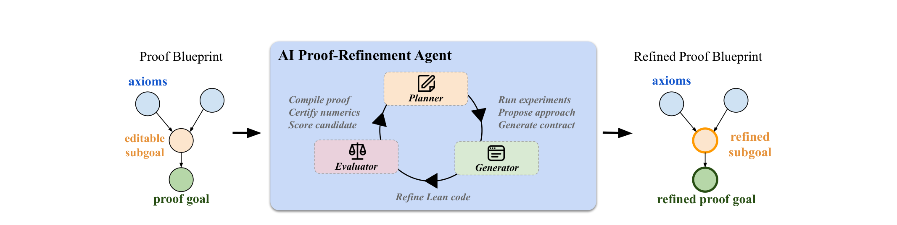
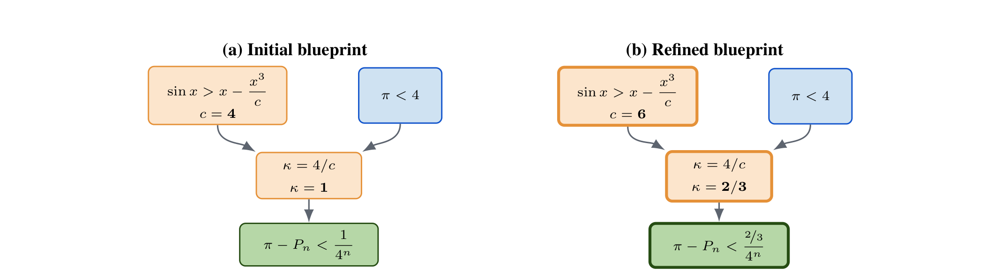
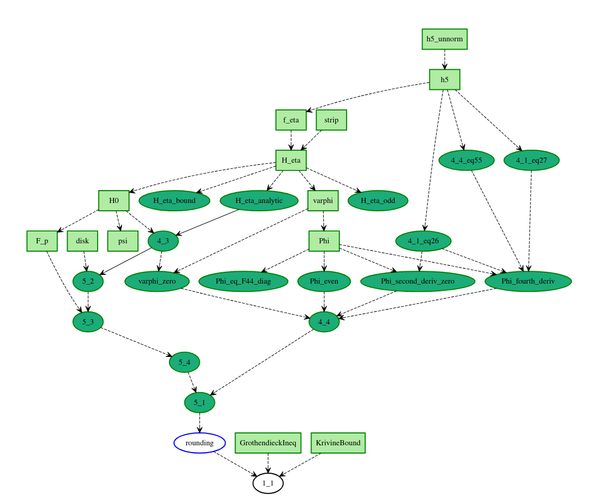
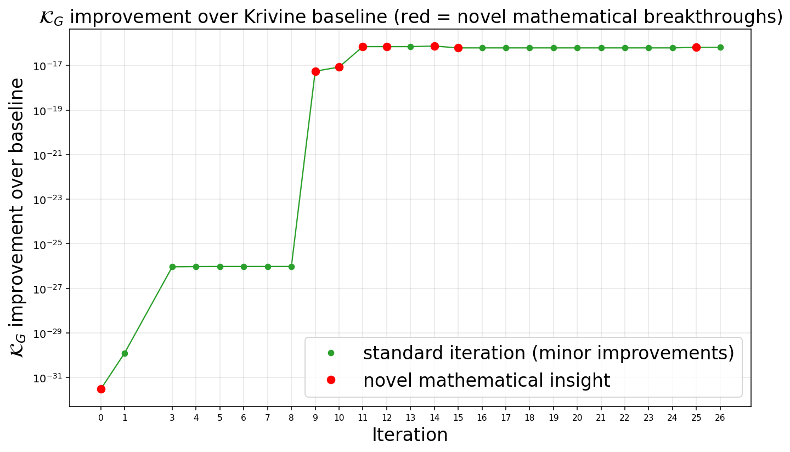
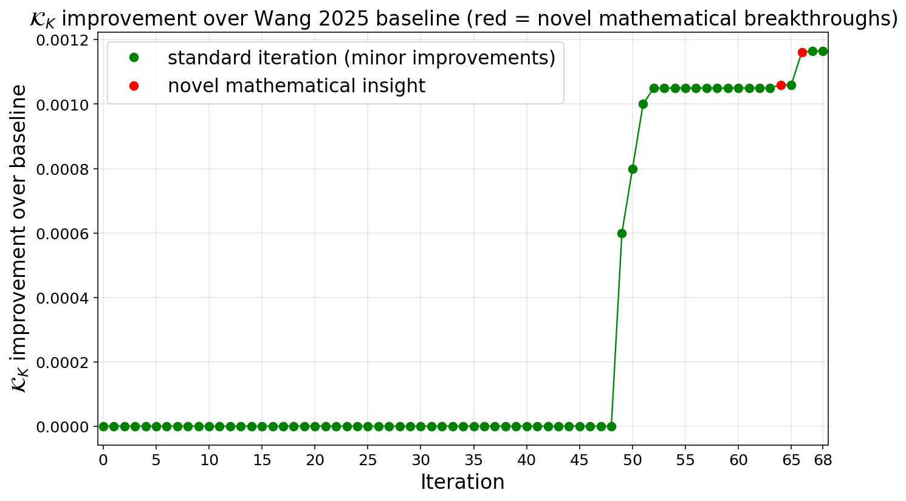
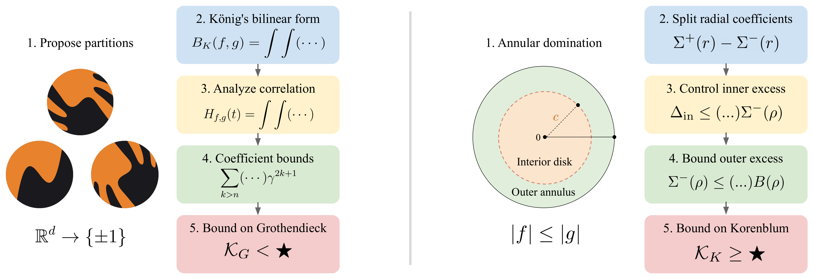

# 论文精读综述：基于可解释 AI 引导 Lean 证明精炼改进分析常数

> **论文标题**：Improving Analytic Constants via Interpretable AI-Guided Lean Proof Refinement  
> **论文编号**：`arXiv:2611.10961v1`（2026 年 11 月 7 日，NeurIPS 2026）  
> **作者团队**：Rahul Saha*、Alan Li*、Anton Xue、Swarat Chaudhuri、Adam Klivans（UT Austin）；Pravesh K. Kothari（Princeton）；Raghu Meka（UCLA）  
> **开源代码**：[`alan2326/proof-refinement`](https://github.com/alan2326/proof-refinement)  
> **一句话概括**：本文提出以**局部形式化 Lean 蓝图（Partially Formalized Lean Blueprint）**作为人类可解释的中间表示，驱动 **Planner–Generator–Evaluator** 三智能体闭环与 **Arb** 认证区间算术协同工作，在不破坏原证明宏观结构的前提下，自动收紧中间引理的“证明松弛（Proof Slack）”，首次给出了 Grothendieck 常数超越 Krivine 1977 界限的显式数值改进，并刷新了 Korenblum 常数的下界。

---

## 一、Executive Summary（执行摘要）

### 1.1 直觉类比：为何“局部蓝图精炼”优于“从头盲搜”？

| 维度 | 传统端到端 AI 证明生成 | 本文：局部形式化 Lean 蓝图 + 智能体精炼 |
| :--- | :--- | :--- |
| **类比场景** | 拆掉整栋摩天大楼，让 AI 从零重新画图纸并施工 | 保留大楼承重主干图纸（DAG），只让 AI 对几根冗余过粗的钢筋节点做局部结构优化 |
| **人类可解释性** | 容易产生“数学垃圾（Mathematical Slop）”，动机晦涩、难以审查 | 依赖图拓扑不变，人类只需审查被修改的局部引理及其向上传播的数值链条 |
| **形式化成本** | 需将几十页前置数学背景全部在 Lean/Mathlib 中从零形式化，工程量巨大 | 稳定背景事实允许以 `axiom` 锚定，仅将逻辑推导与核心数值瓶颈暴露为可编辑节点 |
| **数值可信度** | LLM 极易在复杂积分、级数截断和三角不等式估计中产生幻觉 | **Lean 4** 负责符号逻辑验证，**Arb** 负责严格区间算术认证，双引擎零幻觉门禁 |

### 1.2 全文核心突破与量化战绩

| 目标常数 | 经典基准（Baseline） | 本文最新认证界限（Certified Bound） | 关键瓶颈突破与工程规模 |
| :--- | :--- | :--- | :--- |
| **Grothendieck 常数 ($\mathcal{K}_G$)** | Krivine (1977)：$\kappa_{\mathrm{Kri}} = \frac{\pi}{2\log(1+\sqrt{2})} \approx 1.78221$ Braverman et al. (2011) 隐式存在性改进（本文显式提取基准为 $\kappa_{\mathrm{Kri}} - 9.56 \times 10^{-33}$） | **$\mathcal{K}_G \leq \frac{\pi}{2\log(1+\sqrt{2})} - 10^{-17}$** *（首次超越 Krivine 1977 界限的显式数值改进）* | Lemma 5.4 余项常数 $C_r$ 从 $\sim 10^{15}$ 暴降至 **$C_r \leq 2/7 \approx 0.286$**（缩减约 **$10^{15}$ 倍**）；共运行 34 个 Sprint，产生 27 个被接受的候选证明 |
| **Korenblum 常数 ($\mathcal{K}_K$)** | Wang (2025)：$0.3554 \leq \mathcal{K}_K < 0.6778994$ | **$\mathcal{K}_K \geq 0.356565$** *（绝对增益 $+0.001165$）* | 提出逐模态核（Mode-Adaptive Kernel）取代两段式径向包络；共运行 102 个 Sprint，69 个独立接受候选，Evaluator 累计执行 Lean 编译核验 173 分钟 |
| **等预算消融实验（Ablations）** | 移除局部形式化蓝图（No Partial Formalization） | **零改进**（即便在 Korenblum 上写了 5,646 行 Lean 代码） | 完整框架在 Grothendieck 上实现 $400{,}000\times$ 缩减，在 Korenblum 上实现 $+1.2\times 10^{-4}$ 增益，显著碾压 Basic Agent（$250\times$）与 No Agent（$14\times$） |

> [!NOTE]
> 论文摘要脚注补充：自投稿以来，两个常数在后续研究中均已被进一步刷新——$\mathcal{K}_G$ 目前最佳上界已推进至 $1.7799$，$\mathcal{K}_K$ 下界已由 Wikström (2026) 通过不同方法推进至 $0.4263$。但这并不削弱本文作为**可解释 AI 引导证明精炼范式**的开创性价值。

---

## 二、动机与问题定义

### 2.1 AI 数学发现的“数学垃圾”困境
近年来，前沿大模型在研究级数学领域取得了显著进展，但随之而来的是对**“数学垃圾（Mathematical Slop）”**的担忧——结果或许正确，但论证缺乏动机、结构晦涩，人类数学家极难理解与信任。在 First Proof 评测中，即便最强的系统也有约三分之一的回答在阐述清晰度（Exposition）上获得负面评价。

### 2.2 分析常数优化：天然的“证明松弛”试验场
理论计算机科学、量子信息与复分析中的大量核心定理，最终都归结为对某个**分析常数（Analytic Constant）**的定量界定。现有文献中的经典证明往往呈现出**有向无环图（DAG）**式的依赖链条，并在中间引理中为了证明简便而留下了大量宽松的估计（即**证明松弛，Proof Slack**）。
- 只要收紧局部中间引理的数值界限，改进就会顺着依赖图自动传播到最终定理；
- 宏观证明骨架无需推倒重来，天然兼顾了**自动化探索**与**人类可解释性**。

### 2.3 三大核心挑战
1. **保持可解释性（Interpretability）**：AI 的修改必须保持原论证的数学结构，而非生成一个黑盒替代证明。
2. **严格联合验证（Rigorous Verification）**：分析常数的证明既包含符号逻辑推导，又包含大量超越函数积分与级数数值估计，二者均须绝对严谨。
3. **有效中间反馈（Meaningful Guidance）**：如何在不要求“把整篇论文前置知识 100% 形式化”的前提下，为 AI 提供局部可优化的目标与可靠信号？

---

## 三、核心架构与方法论

*图 1：AI 引导证明精炼框架（对应原文 Figure 1）。人类构建的证明蓝图暴露出可编辑子目标，由 Planner–Generator–Evaluator 三智能体闭环迭代精炼，最终在不改变宏观依赖图的前提下输出收紧后的认证蓝图。*

### 3.1 热身直觉：阿基米德内接多边形逼近 $\pi$

为了直观展示“蓝图不变、局部收紧”的机制，作者构造了一个极简的阿基米德逼近 $\pi$ 示例：设单位圆内接正 $2^{n+2}$ 边形的半周长为 $P_n = 2^{n+2}\sin(\frac{\pi}{2^{n+2}})$，目标是寻找最小的 $\kappa$ 使得对所有 $n \geq 0$ 满足：
$$0 < \pi - P_n < \frac{\kappa}{4^n}$$

蓝图仅依赖两个中间估计：$\sin x > x - \frac{x^3}{c}$ 与 $\pi < 4$，由此推导出 $\kappa = 4/c$。
- **初始状态**：取 $c=4$，得到 $\kappa=1$；
- **精炼步骤**：AI 将正弦下界替换为更紧的泰勒截断 $\sin x > x - x^3/6$，即 $c$ 从 $4$ 提升至 $6$，最终界限自动从 $\kappa=1$ 收紧为 $\kappa=2/3$，而整个蓝图的 DAG 拓扑完全保持不变。

*图 2：阿基米德逼近 $\pi$ 的蓝图精炼对比（对应原文 Figure 3）。左为初始蓝图（$c=4 \implies \kappa=1$），右为精炼后蓝图（$c=6 \implies \kappa=2/3$），依赖图结构完全一致。*

### 3.2 局部形式化 Lean 蓝图（Partially Formalized Lean Blueprint）

形式化地，设 $T(b)$ 为由数值界限 $b$ 参数化的目标定理（如 $\mathcal{K} \leq b$）。**局部形式化 Lean 蓝图**是一个有向无环图 $G=(V,E)$ 及其对应的 Lean 4 形式化实现 $P$，包含三类节点：
1. **背景事实节点（Background Facts）**：在 Lean 中直接证明，或作为显式公理（`axiom`）引入（避免陷入与当前瓶颈无关的 Mathlib 基础设施补全泥潭）。
2. **逻辑推导节点（Logical Deductions）**：连接背景事实与最终定理的符号推理，由 **Lean 4 内核**进行机械化严格检查。
3. **数值估计节点（Numerical Estimates）**：与外部 **Arb** 区间算术库配对，为 Lean 中的数值引理提供经过严格误差传播认证的证书（Certificates）。

*图 3：Grothendieck 常数的证明依赖图（对应原文 Figure 4 左侧），展示了各中间引理如何层层汇聚并最终决定 $\mathcal{K}_G \leq \kappa$。*

### 3.3 神经符号双引擎：Lean 4 + Arb 认证区间算术

Lean 4 擅长符号与类型论验证，但并非为大规模高精度区间算术（特别是复平面围道积分、特殊函数与高斯矩估计）而设计。为此，系统将繁重的数值界定任务卸载（Offload）给 **Arb** 区间算术库（Johansson, 2017）：
- Lean 负责检查“如果这些数值估计成立，则最终常数界限必然成立”的逻辑链条；
- Arb 负责对每一个区间分块（Cell）给出经过舍入误差控制、数学上绝对严格的数值上下界；
- 二者结合，既突破了 Lean 原生数值计算的性能瓶颈，又彻底杜绝了非形式化数值脚本常见的浮点精度与截断误差漏洞。

### 3.4 三智能体契约式工作流（Planner–Generator–Evaluator）

整个智能体编排框架基于 **Claude Code** 实现，由三个职责分离、制衡协作的智能体组成：

1. **Planner（规划器，Claude Opus 4.7）**：
   - 结合自然语言数学推理、轻量数值实验与 Lean 库检索，定位当前蓝图中松弛最严重的瓶颈节点；
   - 输出一份**契约（Contract）**：明确拟议精炼的数学思路、允许使用的前提假设以及 Generator 必须履行的形式化义务。
2. **Generator（生成器，Claude Opus 4.7）**：
   - 严格按照契约修改 Lean 代码、引入辅助定义或更紧的不等式，调用 Lean 编译器与 Arb 脚本进行测试和报错修复，直到产出候选证明或记录阻塞原因（Blocked）。
3. **Evaluator（评估器，Claude Sonnet 4.6）**：
   - **契约合规审查**：检查修改是否越界（例如是否擅自修改了蓝图依赖或引入了未授权公理）；
   - **Lean 编译与公理审计（Axiom Audit）**：确保候选证明通过 Lean 类型检查且仅依赖白名单公理；
   - **独立数值复核**：重新运行 Arb 认证脚本核验所有数值界限。只有全部通过，候选精炼才会被正式接纳。

---

## 四、两大经典数学常数的突破与发现的数学洞见

*图 4：精炼迭代过程中的界限改进幅度（左：Grothendieck $\mathcal{K}_G$；右：Korenblum $\mathcal{K}_K$，对应原文 Figure 5）。红色标记点表示经领域专家评审认定为具有“数学趣味性（Interesting）”的新策略突破。*

*图 5：Grothendieck 常数（左）与 Korenblum 常数（右）的高层证明流水线（对应原文 Figure 6）。*

### 4.1 案例一：Grothendieck 常数 ($\mathcal{K}_G$)

#### 问题背景与核心瓶颈
实 Grothendieck 常数 $\mathcal{K}_G$ 度量了整数二次规划（IQP）与其半定规划（SDP）松弛之间的最坏近似比。Krivine (1977) 曾猜想 $\mathcal{K}_G = \kappa_{\mathrm{Kri}} := \frac{\pi}{2\log(1+\sqrt{2})} \approx 1.78221$。2011 年 Braverman、Makarychev、Makarychev 与 Naor 证明了 $\mathcal{K}_G < \kappa_{\mathrm{Kri}}$，但未给出显式数值差距。

从 Braverman 等人的论证中提取出的基准显式界限仅为 $\mathcal{K}_G \leq \kappa_{\mathrm{Kri}} - 9.56\times 10^{-33}$。其核心瓶颈在于 **Lemma 5.4**：设 $F_p := (1-p)H_0 + pH_\eta$（其中 $H_0(z)=\arcsin z$），需对 $z \in r\mathbb{D}$ 界定二阶逆展开余项常数 $C_r$：
$$\left| F_p^{-1}(z) - \sin z - p\bigl(z - H_\eta(\sin z)\bigr)\cos z \right| \leq C_r p^2$$
基准证明中 $C_r \approx 8.20 \times 10^{14}$（约 $10^{15}$ 量级），且 $C_r$ 的缩小会直接转化为 $\mathcal{K}_G$ 上界差距的成比例放大。

#### AI 发现的五项结构性数学洞见（最终将 $C_r$ 降至 $\le 2/7 \approx 0.286$）
1. **精确反函数恒等式取代粗糙 Cauchy 估计**：
   令 $u(p,z)=F_p^{-1}(z)$，$\mathcal{D}_p(w)=\partial_w F_p(w)$，$\mathcal{C}_p(w)=\partial_w^2 F_p(w)$。智能体不再使用极易放大的 Cauchy 导数上界，而是通过隐函数求导推导出逐点精确恒等式：
   $$u_{zz}(p,z) = -\frac{\mathcal{C}_p(u)}{\mathcal{D}_p(u)^3}, \qquad u_{pp}(p,z) = \frac{2\Phi(u)\Phi'(u)\mathcal{D}_p(u) - \mathcal{C}_p(u)\Phi(u)^2}{\mathcal{D}_p(u)^3}$$
2. **联合上确界（Joint Suprema）与合并分子相消（Merged-Numerator Interference）**：
   传统证明将分子分母拆开分别取上界/下界，丢失了相位相关性。智能体直接认证联合商 $J_{\mathrm{merge}} = \sup \frac{|2\Phi\Phi'\mathcal{D}_p - \mathcal{C}_p\Phi^2|}{|\mathcal{D}_p|^3}$，并在每个区间单元 $Q$ 上巧妙取区间形式与范数形式的最小值 $B(Q) = \min\{B_{\mathrm{int}}(Q), B_{\mathrm{norm}}(Q)\}$，在保持相消优势的同时规避了大区间上的区间依赖膨胀（Interval Dependency Blow-up）。
3. **无截断（Truncation-Free）积分表示**：
   早期的 Oracle 使用了有限项级数截断来计算扰动核 $H_\eta$，缺少严格尾部误差界（详见第六节“截断自审计”）。智能体改用 Price 定理的二维高斯积分表示，直接在被积函数差值层面 $\Phi(w) = \iint_{\mathbb{R}^2} (\mathcal{I}_\eta - \mathcal{I}_0)\,dx\,dy$ 构建控制函数（Majorant），不仅消除了截断漏洞，还将 Arb 的运行时间从**频繁超时缩短至数秒**。
4. **各向异性高斯矩与仿射分母下界**：
   显式对角化正定二次型计算各向异性高斯矩；利用 $\mathcal{D}_p(w) = H_0'(w) + p\Phi'(w)$ 对 $p$ 的仿射性，结合闭式 $H_0'(w) = (1-w^2)^{-1/2}$ 给出更紧的分母下界 $|\mathcal{D}_p(w)| \geq |H_0'(w)| - p_{\max}|\Phi'(w)|$。
5. **泰勒填充（Taylor Pads）、角点自适应细分与围道对称性**：
   利用 $H_\eta(\overline{z}) = \overline{H_\eta(z)}$ 与奇对称性将认证计算量减半（仅需认证一个象限），并优先细分围道角点附近的瓶颈单元。

### 4.2 案例二：Korenblum 常数 ($\mathcal{K}_K$)

#### 问题背景与核心瓶颈
对 Bergman 空间 $A^2(\mathbb{D})$ 中的全纯函数 $f, g$，Korenblum 常数 $\mathcal{K}_K$ 是使得“外环 $c < |z| < 1$ 上 $|f(z)| \leq |g(z)|$ 蕴含全局范数 $\|f\|_{A^2} \leq \|g\|_{A^2}$”成立的最大半径 $c$ 的上确界。Wang (2025) 证明了 $0.3554 \leq \mathcal{K}_K < 0.6778994$，其证明瓶颈在于控制内盘超额项 $\Delta_{\mathrm{in}}(c)$。

#### AI 发现的逐模态核（Mode-Adaptive Kernel）
Wang 原证明先对平移级数使用凸割线估计，再简化为两段式径向核（分别覆盖 $c < \rho < \sqrt{4/3}\,c$ 与 $\sqrt{4/3}\,c < \rho < 1$），丢失了高阶模态信息。智能体直接利用圆周 Plancherel 恒等式与边界条件逐系数展开：
$$\Delta_{\mathrm{in}}(c) \leq \sum_{j\in N_2} \eta_j \frac{j}{j+1} c^{2j+2} \leq H(c,\rho)\,\Sigma^-(\rho), \qquad H(c,\rho) := \sup_{j \geq 1} \frac{j}{j+1}\frac{c^{2j+2}}{\rho^{2j}}$$
这种**逐模态自适应核**在有理数窗口内具有显式闭式解（形式证明使用了 $j=1,\dots,10$ 个模态），一举将 $\mathcal{K}_K$ 下界从 $0.356401$ 推升至 **$0.356565$**。

---

## 五、关键实验对比、稳定性与消融分析

### 5.1 主运行统计与独立重启稳定性

在附录的运行记录（Appendix E）中，作者披露了完整的工作负载与多次独立重启的稳定性测试：
- **Grothendieck 5 次独立重启（从基准 $C_r \approx 8.20 \times 10^{14}$ 出发）**：5 次独立运行均自发重新发现了 $C_r$ 的三部分分解结构，平均带来 **$7.3 \pm 2.3$ 个数量级**的缩减（范围 $4.7$ 至 $10.5$ 个数量级），34 次迭代中有 28 次被 Evaluator 接受（6 次因缺乏区间算术支撑而被拒）。
- **Korenblum 主运行**：历经 102 个 Sprint，其中 86 个进入 Evaluator 评审（85 次通过、1 次拒绝），共产生 69 个独立接受候选（V0 至 V68），Evaluator 累计执行了 213 次运行（204 次通过），仅 Lean 编译、类型检查与公理扫描即耗时 **173 分钟**。

### 5.2 等预算消融实验（Matched-Budget Ablations）

为了剥离“强基座模型”与“框架结构”各自的作用，作者从两个任务的中间检查点（Grothendieck：$C_r=1$；Korenblum：$c=0.35646$）重启，在**相同基座模型、相同运行时间与输出 Token 预算**下对比了四种配置：

| 实验配置 | 消融模块 | Grothendieck ($C_r \downarrow$) | 缩减倍数 | Korenblum ($c \uparrow$) | 绝对增益 |
| :--- | :--- | :---: | :---: | :---: | :---: |
| **起点检查点 (Checkpoint)** | -- | $1$ | -- | $0.35646$ | -- |
| **完整框架 (Full Framework)** | 无（基准） | **$2.5 \times 10^{-6}$** | **$400{,}000\times$** | **$0.35658$** | **$+1.2 \times 10^{-4}$** |
| **基础智能体 (Basic Agent)** | 弱化 Agent（无工具，仅保留编译器/评估反馈循环） | $4.0 \times 10^{-3}$ | $250\times$ | $0.35648$ | $+2.0 \times 10^{-5}$ |
| **无智能体 (No Agent)** | 移除 Agent 循环（独立 One-shot 采样取最优） | $7.1 \times 10^{-2}$ | $14\times$ | *无有效改进* | -- |
| **无局部形式化 (No Partial Form.)** | 移除蓝图骨架（仅保留最终界限公理，保留完整 Agent） | *无有效改进* | -- | *无有效改进* | -- |

**核心结论**：
1. **局部形式化蓝图是不可或缺的锚点**：移除蓝图后，即使智能体拥有全部工具并在 Korenblum 上生成了 **5,646 行全部通过检查的 Lean 代码**，也因为缺乏可局部锐化的中间引理，只能把预算耗费在试图重建前置理论上，最终**零改进**。
2. **工具使用与多轮交互决定上限**：Basic Agent 虽然也能在末尾提出关键结构调整，但每次编译失败都消耗一整次模型调用，最终与 Full Framework 相差 **1,600 倍**（Grothendieck）。

---

## 六、工程实战避坑与深度启示

1. **上下文形态的黄金折中：“无草图”与“全草图”皆不可取**
   - **无草图（No Sketch）**：直接把原论文丢给模型让其推理，预算全浪费在无效的问题分解上；
   - **全草图（Full Sketch）**：把整套复杂证明架构一次性塞入上下文，模型极易“跑偏”去证明非瓶颈的背景引理，或在修复无关紧要的细节中死锁；
   - **局部形式化蓝图**：只暴露可编辑瓶颈与下游传播接口，稳定背景以公理封装，是长程数学 Agent 最健康的上下文组织形态。

2. **数学表达的“锋利度” $\neq$ 形式化“可认证性”**
   - 论文在 Appendix C.10 中指出一个极易被忽视的工程陷阱：代数上最精确的相消公式（如合并分子的 $u_{pp}$），在粗糙的区间网格上反而可能因为区间依赖（Dependency Problem）而给出比粗糙三角不等式更宽的包络！
   - 因此，精炼过程不能只看公式在纸面上的优美程度，必须以**在当前 Oracle 分辨率下实际认证出的包络**作为唯一度量，必要时采用 `min(区间界, 范数界)` 的混合策略。

3. **框架的“自审计”时刻：警惕可信边界内的截断漏洞**
   - 2026 年 5 月 3 日，该框架自己在运行中发现：此前使用的数值 Oracle 均依赖于有限项级数截断，而未对尾部余项进行严格界定！发现问题后，团队立即对所有历史候选进行了无截断重审计（Re-audit），并重构了基于积分表示的新 Oracle。这表明，**即便在 Lean 形式化护航下，外部数值 Oracle 与公理边界的审计依然是决定科学发现可信度的生命线**。

4. **人类在环（Human-in-the-Loop）的防越界门禁**
   - 在 Sprint 13 中，Planner 曾敏锐地发现只要将 Cauchy 解析圆盘半径从 $(1-r)/2$ 扩大到 $(1-r)\cdot 9/10$，就能让 $n$ 阶导数界呈 $1.5^n$ 指数级缩小。但由于这需要新增一条超出当前蓝图公理范围的更宽解析性公理，Harness 拦截了该越界修改并将其提交给人类专家审阅（本轮未批准，因此最终结果不依赖该假设）。这种**“AI 提议边界扩展 + 人类把关公理信任域”**的机制，为未来人机协同科研提供了极佳的安全范式。
