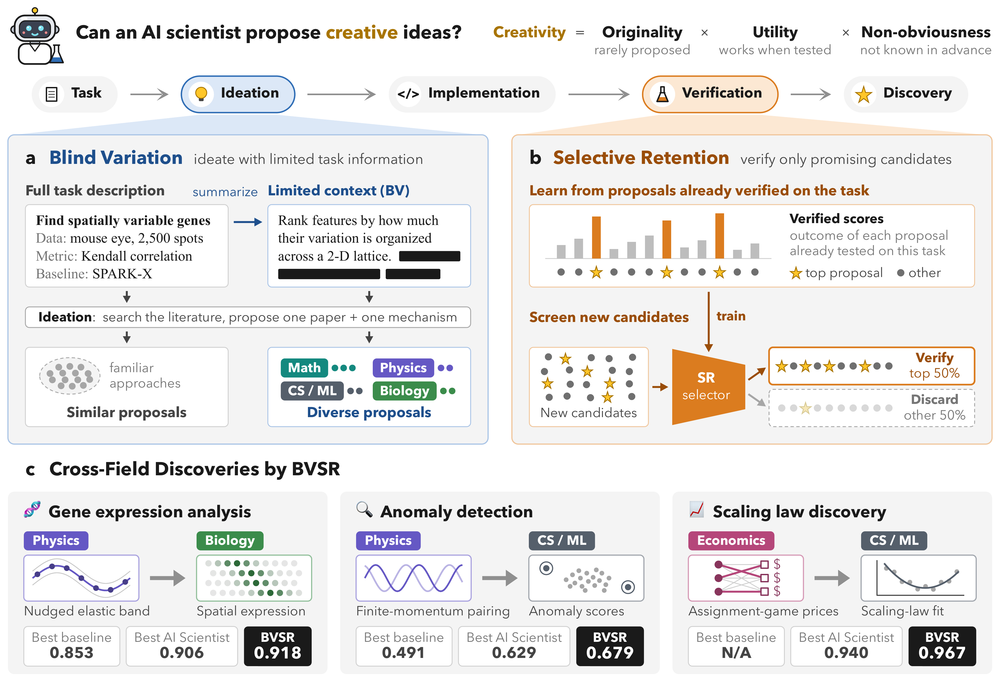
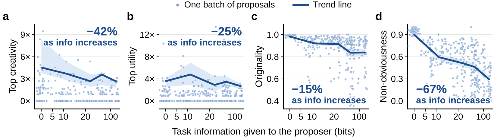
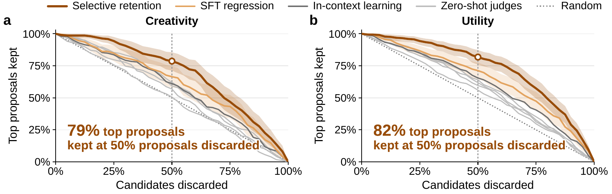
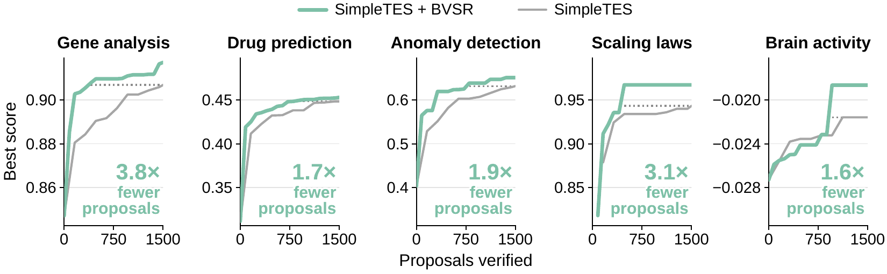
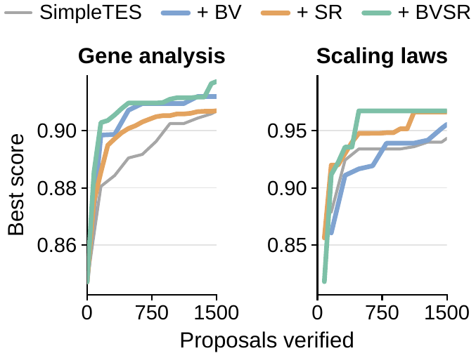
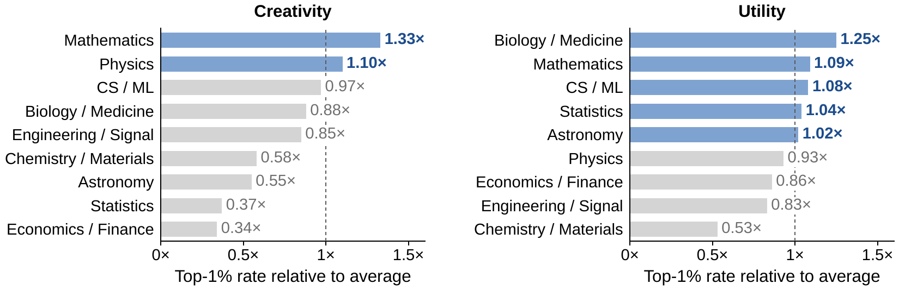

# 《盲化变异，选择性保留：提升 AI 科学家的创意生成能力》深度精读综述

> **论文标题**：*Blind Variation, Selective Retention: Improving Creative Idea Generation in AI Scientists*  
> **作者与机构**：Guowei Xu\*, Jiaru Zou\*, Mete Erdogan, Haotian Ye, Pan Lu, James Zou（Stanford University，\*共同第一作者）  
> **arXiv 链接**：[arXiv:2611.12184v1](https://arxiv.org/abs/2611.12184)（2026 年 11 月 9 日）  
> **相关资产**：[官网主页](https://zou-group.github.io/BVSR/) · [GitHub 仓库](https://github.com/zou-group/BVSR) · [Hugging Face 合集](https://huggingface.co/collections/Xkev/bvsr) · [原文 PDF](./2611.12184_BVSR.pdf) · [原文结构化解析](./2611.12184_BVSR_原文解析.md) · [全文如实中文翻译](./2611.12184_BVSR_中文翻译.md)

---

## 一、核心痛点与设计哲学：信息在科学发现中的双重悖论

当前主流的 AI 科学家（AI Scientists）工作流通常遵循一个直觉假设：**“给模型提供越详尽的任务背景信息，它就越能提出高质量的解决方案。”** 然而，斯坦福大学 James Zou 与 Pan Lu 团队在本篇论文中用坚实的理论与大规模实证指出了这一直觉的致命盲区——**信息诱导锚定效应（Information-Induced Anchoring）**。

当我们在创意生成（Ideation）阶段向大模型灌输大量领域细节与任务描述时，模型会被强烈锚定在训练语料中最常见、最“安全”的常规套路上，导致不同独立采样轨迹之间发生严重的**同质化坍塌（Homogenization）**，难以跳出局部最优去寻找真正跨学科、非显而易见的高价值机制。

受心理学家 Donald T. Campbell 提出的创造力认知理论——**盲化变异与选择性保留（Blind Variation and Selective Retention, BVSR）**——的启发，作者提出了一个优雅的**信息解耦设计原则**：

> **在发现的不同阶段对信息采取截然相反的使用策略**：
> 1. **探索期（盲化变异, BV）——刻意限制任务信息**：剥离过多的领域锚定线索，强迫生成器在更广阔的跨学科概念空间中“盲目”探索非显而易见的机制；
> 2. **筛选期（选择性保留, SR）——充分榨取任务经验**：利用同一任务上历史已验证“提案—结果”对训练在线经验排序器（Pairwise Ranker），在昂贵的实验/仿真执行之前安全地淘汰低质候选（弃置后 50%），把算力留给最具潜力的提案。

*图 1：盲化变异（BV）与选择性保留（SR）全景框架。(a) 在创意生成阶段限制任务信息可鼓励更具创造性的提案；(b) 选择性保留在保留绝大多数顶尖提案的同时，大幅削减需要昂贵实证验证的候选数量；(c) BVSR 发现的最佳程序从数学、物理、博弈论等多元领域移植核心机制，在生物学与机器学习等任务上超越现有最强 AI 科学家基线。*

---

## 二、问题形式化：创意的三维量化与 $\mathcal{V}$-可用信息度量

为了科学地评估“什么是好创意”以及“到底给了模型多少信息”，论文给出了两套严谨的量化工具：

### 1. 创意的三元乘积定义（Creativity = Originality × Utility × Non-obviousness）
沿用心理学自 1950 年代以来的经典定义，一个候选提案 $c$ 的创造力被形式化为三个维度的乘积：
$$\text{Creativity}(c) \;=\; (1 - p(c)) \cdot u(c) \cdot (1 - v(c))$$
- **独创性（Originality, $1-p$）**：衡量生成稀有度（Generative Rarity）。设 $p(c) = \Pr_{c'}[c' \equiv c]$ 为同一上下文 $I$ 和提示词下独立再次生成相同底层机制的概率。由于在样本量 $n$ 较大时 $1-p$ 易趋近于 1，作者采用对数尺度归一化定义：
  $$o(c) = 1 - \frac{\log |g(c)|}{\log n}$$
  其中 $|g(c)|$ 是由 LLM 语义聚类得到的与 $c$ 等价的提案簇大小。
- **效用（Utility, $u$）**：真实代码在任务评估器上运行得到的归一化相对提升：
  $$u(c) = \max\!\left(\frac{s_T(c) - s_T^{\mathrm{base}}}{s_T^{\mathrm{best}} - s_T^{\mathrm{base}}},\, 0\right)$$
- **非显而易见性（Non-obviousness, $1-v$）**：在提案提出时，从已有文献和任务描述 $S$ 出发，其有效性在多大程度上**无法**被事先预料。由评审模型读取任务描述、参考论文与提案后给出先验可预期度 $v(c) \in [0, 1]$。

### 2. 任务信息量的量化：$\mathcal{V}$-可用信息（$\mathcal{V}$-Usable Information）
不同任务文本的长度和冗余度各异，不能用字符数衡量信息量。作者采用 Xu 等人提出的 $\mathcal{V}$-可用信息（互信息的模型依赖类比），用基准任务描述 $S$ 在给定上下文 $I$ 前后的条件 $\mathcal{V}$-熵差值来度量（单位：bits）：
$$\mathrm{info}(I) = H_{\mathcal{V}}(S) - H_{\mathcal{V}}(S \mid I)$$
工程上，为避免大型 MoE 模型对数似然随计算环境波动的问题，作者使用三个稳定的开源稠密小模型（`Qwen3-8B`、`Gemma-3-4B-it`、`Llama-3.1-8B-Instruct`）计算 $\log_2 P_M(S \mid I) - \log_2 P_M(S)$ 的均值（在 10 个模型构成的测试集上相关性中位数达 $r=0.91$，均值相关性高达 $r=0.99$）。

---

## 三、阶段一：盲化变异（Blind Variation）的理论与实证

### 1. 理论机制：信息-探索权衡（Proposition 3.1）
作者在附录 C.1 中构建了一个简洁而深刻的 **Gumbel-Max 共享信号生成模型**：
假设存在 $K$ 个语义创意类 $\mathcal{Z} = \{z_1, \dots, z_K\}$，每个类具有任务关联度 $a_i$。在信息量 $b = \mathrm{info}(I)$ 下，生成器按以下方式采样：
$$Z_t(b) = \arg\max_i \left\{ \lambda(b) a_i + \varepsilon_{t,i} \right\}, \quad \varepsilon_{t,i} \stackrel{\text{i.i.d.}}{\sim} \mathrm{Gumbel}, \quad \lambda'(b) \ge 0$$
其诱导概率分布为 $\pi_b(z_i) \propto \exp(\lambda(b) a_i)$。作者严格证明了：
1. **信息增加 $\Rightarrow$ 概率分布优超集中（Majorization）**：排序 $a_1 \ge \dots \ge a_K$ 后，对任意前缀 $r < K$，累计概率 $S_r(\lambda) = \sum_{i=1}^r \pi_b(z_i)$ 满足 $\frac{dS_r}{d\lambda} \ge 0$。
2. **分布集中 $\Rightarrow$ 期望经验熵与独创性单调不增**：批量提案的平均对数独创性等于经验分布的归一化香农熵 $\frac{H(\widehat{\pi})}{\log n}$，其期望可写为凹函数 $-x\log x$ 的 Bernstein 多项式之和（具有 Schur-凹性）。因此 $\frac{d}{db}\mathbb{E}[o(c)] \le 0$。
3. **固定预算下最优效用退化**：当高收益创意与共享任务信号弱相关（即 $u_1 \le \dots \le u_K$ 与 $a_1 \ge \dots \ge a_K$ 逆序）时，给定生成预算 $n$，最优提案的期望效用同样满足 $\frac{d}{db}\mathbb{E}[M_n(b)] \le 0$。

### 2. 大规模实证：跨越 5 大模型与 12 项科学任务
作者使用 Claude Opus 5 将完整任务描述 $S$ 压缩为不同信息量级别的上下文 $I$，在 4 大科学领域的 12 个任务（生物学 4 项、天体动力学 2 项、机器学习 4 项、神经科学 2 项）上，用 **DeepSeek-V4-Flash、DeepSeek-V4-Pro、GLM-5.3-Flash、GLM-5.2、Kimi-K3**（均开启推理并配备 OpenAlex 文献检索工具）各生成 112 个提案。

*图 2：任务信息量对提案创造力的影响。当信息量从 0 增至 140 bits 时，进入各基准 Top-1% 的高创造力提案比例（a）与高效用提案比例（b）总体呈下降趋势，而平均独创性（c）与平均非显而易见性（d）则出现大幅下滑。*

与现有基于提示词工程（Prompting）的创意基线对比（见表 1），**BV（有限信息）在所有四个维度上全面夺冠**：

| 方法 | Creativity ($\uparrow$) | Utility ($\uparrow$) | Originality ($\uparrow$) | Non-obviousness ($\uparrow$) |
| :--- | :---: | :---: | :---: | :---: |
| **BV (Limited Information)** | **$0.530 \pm 0.043$** | **$0.571 \pm 0.041$** | **$0.955 \pm 0.002$** | **$0.713 \pm 0.012$** |
| BV (Full Information) | $0.462 \pm 0.045$ | $0.524 \pm 0.043$ | $0.926 \pm 0.004$ | $0.609 \pm 0.015$ |
| Analogical Reasoning | $0.429 \pm 0.049$ | $0.508 \pm 0.050$ | $0.914 \pm 0.007$ | $0.492 \pm 0.037$ |
| Cross-Domain | $0.369 \pm 0.052$ | $0.531 \pm 0.045$ | $0.871 \pm 0.012$ | $0.263 \pm 0.020$ |
| No-Domain | $0.117 \pm 0.025$ | $0.530 \pm 0.050$ | $0.598 \pm 0.020$ | $0.104 \pm 0.015$ |

> [!IMPORTANT]
> **关键消融洞察**：同样使用 BV 的机制移植 Prompt，仅仅将“有限信息”换成“完整信息（Full Information）”，Creativity 就从 `0.530` 骤降至 `0.462`，Non-obviousness 从 `0.713` 降至 `0.609`。这直接证明了**增益的核心来源是“限制信息”本身，而非 Prompt 措辞技巧**。

---

## 四、阶段二：选择性保留（Selective Retention）——在线经验排序器

盲化变异带来了大量异质且跨界的新奇点子，但也必然伴随更高的“不可行”或“跑不通”风险。如果把所有候选都送去跑 GPU 训练或湿实验，验证成本将无法承受。因此需要第二阶段：**选择性保留（SR）**。

### 1. 为什么不用 Prompt 裁判，也不用 MSE 回归微调？
- **Prompt 裁判（Pointwise / Setwise / Listwise / Tournament）及 ICL 的局限**：未经任务实证反馈微调的通用 LLM 裁判，面对非显而易见的跨界代码时，往往缺乏对该特定任务真实成败边界的“物理直觉（Taste）”。实验表明，即便给 ICL 裁判看 4 个相似已验证案例，其保留 Top 提案的能力仍不比零样本强。
- **核心理论洞察（Proposition 4.1 & 4.2）**：筛选器的目标**不是**精准预测所有候选的绝对得分或排定第一名（$\Delta_{\mathrm{best}} = u(c_{(n)}) - u(c_{(n-1)})$ 往往极小，极难分辨），而是**把顶尖提案安全地留在“弃置线（Discard Boundary）”之上**。由于弃置边界处的效用差距 $\Delta_{\mathrm{SR}}(d) = u(c_{(m+1)}) - u(c_{(m)})$ 通常远大于冠亚军之差 $\Delta_{\mathrm{best}}$，跨边界筛选天然比选出唯一最佳更容易、更准确。

### 2. 方法设计：Top-vs-Rest 成对排序损失
作者选用 `Qwen3.5-9B-Base` 加上一个零初始化的标量线性打分头 $s = f_\theta(S, x)$（注意：此时 SR 接收**完整任务描述 $S$** 与候选完整代码 $x$）。
在训练阶段，从同一任务过往运行日志中取出效用排名前 5% 的集合 $\mathcal{T}$，并从其余 95% 中均匀采样集合 $\mathcal{B}$，直接优化 RankNet 风格的成对 Logistic 排序损失：
$$\mathcal{L}_{\mathrm{SR}} = \sum_{i \in \mathcal{T}} \sum_{j \in \mathcal{B}} \log\!\left(1 + \exp\big[-(s_i - s_j)\big]\right)$$

*图 3：不同弃置率下 Top 提案的保留比例。在 50% 弃置率下，SR 成功保留了 79% 的 Top-5% 创意提案与 82% 的 Top-5% 效用提案，显著领先于 MSE 回归微调（SFT）以及所有基于 Prompt 的 LLM 裁判（包括 6 轮瑞士轮锦标赛与样本内学习 ICL）。*

---

## 五、端到端集成效果与跨学科“神来之笔”案例

将 BV 与 SR 结合并嵌入现有的端到端发现工作流 **SimpleTES**（使用 Kimi-K3，4 条并行搜索轨迹，每轮 40 个提案，共 10 轮）后，在 5 项高难度科学任务上均取得了**更高上限 + 更低验证成本**的双赢结果：

*图 4：将 BVSR 集成至 SimpleTES 后在 5 项任务上的最佳得分曲线。BVSR 不仅在全部 5 项任务上刷新了最终得分上限，而且达到原版 SimpleTES 最终得分（虚线）所需的实证验证步数大幅减少。*

### 三个极具启发性的跨学科“机制移植”案例（Table 2）

| 任务 | SimpleTES + BVSR | 原版 SimpleTES | 最强领域基线 | 移植的核心外部机制 |
| :--- | :---: | :---: | :---: | :--- |
| **空间可变基因检测 (SVG)** | **0.918** | 0.906 | 0.853 (SPARK-X) | 过渡态理论中的**微动弹性带方法 (NEB)** |
| **无监督异常检测** | **0.679** | 0.629 | 0.491 (Isolation Forest) | 凝聚态物理中的 **FFLO 有限动量超导配对态** |
| **Scaling Law 发现** | **0.967** ($R^2$) | 0.940 | N/A | 博弈论中的 **Shapley-Shubik 分配博弈对偶价格** |

1. **微动弹性带（NEB）做空间基因检测**：将组织切片图上基因表达场向均匀场演化的热流轨迹视为反应路径，计算垂直于路径的鲁棒能量梯度分量——纯噪声的热流路径本身就是最小能量路径（法向力为零），而真实空间模式会弯曲路径从而产生显著法向力。
2. **FFLO 有限动量配对做异常检测**：将“边缘尾部证据”和“几何协方差/GMM 证据”视为费米面失配的两种电子自旋态，不采用简单平均，而是沿两者分歧最大的方向施加振荡调制进行配对，并在近邻图上松弛恢复配对信号。无需训练神经网络即达 `0.679`。
3. **分配博弈对偶价格做 Scaling Law 发现**：在 $(\log \text{lr}, \log \text{batch size})$ 网格上求解一个固定的熵正则化最优分配线性规划，将得到的竞争性对偶价格场作为重塑损失盆地的固定曲面，仅拟合 2 个参数即达到 $0.967$ 的留出 $R^2$。

### 消融实验、灵感来源分布与人类双盲验证
- **互补性消融（图 5）**：在基因表达分析与 Scaling Law 发现上的消融表明，**BV 主要负责拉高最终发现上限（Ceiling），SR 主要负责成倍加速收敛（Speedup）**，两者叠加效果严格优于任一单组件。
- **跨学科灵感图谱（图 6）**：对 20,000 个提案按参考论文所属学科统计发现，**数学（Mathematics）**在 Top-1% 创意中贡献度最高（归一化比例 `1.33`），**生物医学（1.25）与数学（1.09）**则在 Top-1% 效用中领先。
- **PhD 专家双盲验证**：5 位博士研究者对 150 对语义等价判定达成高一致性（同组 84% 认同、异组 73% 认同不同）；在去除方法标识并统一样式改写后，专家盲评非显而易见性（1–5 分）与自动指标 $1-\hat{v}$ 相关性达 $r=0.56$，且 BV 得分显著高于类比推理基线（`3.64` vs `2.97`, $p=0.0006$）。

| 消融实验 | 灵感学科分布 |
| :---: | :---: |
|  |  |

---

## 六、横向对比与工程启示：如何设计下一代 AI 科学家？

将 BVSR 放回本工作空间已研读的前沿谱系中，可以清晰地看到一条演进脉络：
- 与 `Lehman & Stanley (2011)` 的**新颖性搜索（Novelty Search）**及 `arXiv:2604.18005`（**Diversity Collapse**）一脉相承：过度暴露目标与上下文会诱发搜索坍塌；BV 给出了一种极其轻量、无需修改模型权重的“信息节食（Information Diet）”方案来对抗同质化。
- 与 `arXiv:2610.08927`（**The Station**）及 `arXiv:2611.14514`（**Contrastive Discovery**）形成互补：后者强调在开放世界与竞争性假说空间中进行系统级探索与贝叶斯更新，而 BVSR 则聚焦于单次提案周期内**“生成端去锚定 + 筛选端经验化”**的微观信息流控制。

**对工程实践的三条核心启示**：
1. **不要把完整 PRD/Benchmark 规格直接喂给 Ideation Agent**：在构思阶段，用高层次抽象上下文（10–30 bits 级别，例如只描述数学结构或抽象目标）替代领域术语堆砌，能显著激发跨学科机制移植。
2. **用“Pairwise Top-vs-Rest”替代“Score Regression”和“Prompt Judge”**：当你的验证成本昂贵（如耗时数小时的仿真或训练）且积累了历史日志时，训练一个轻量级（如 9B）成对排序头去卡住“50% 弃置线”，性价比远高于反复调优复杂的 LLM-as-a-Judge Prompt。
3. **强制“Single Mechanism Transplant”**：BV 的 Prompt（Prompt D.1 / D.2）明确要求“只找一篇真实论文、只移植一个核心机制、禁止堆砌多个技巧”，这种结构化约束防止了大模型通过“缝合怪”来刷指标，迫使机制本身必须具备真正的数学或物理迁移力。
