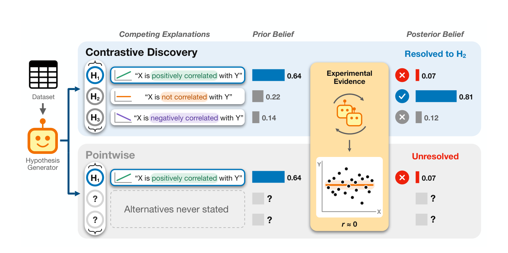
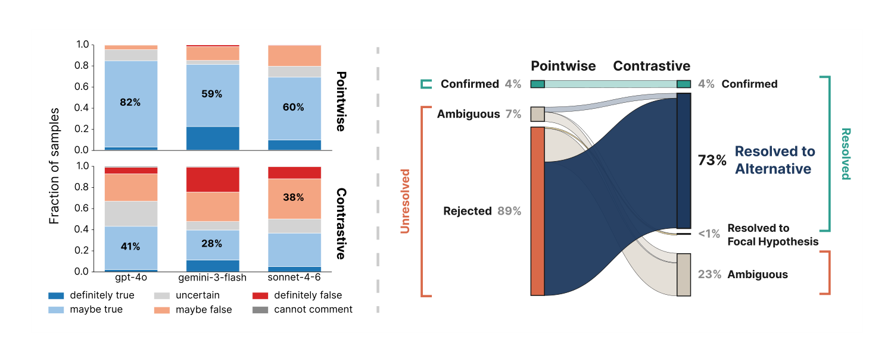
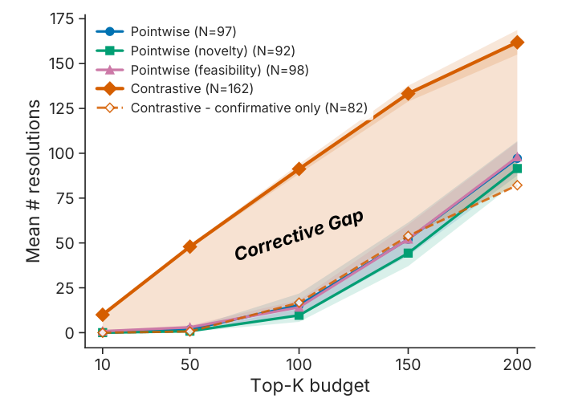
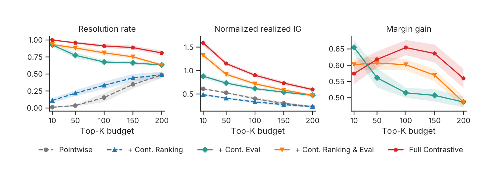

# Contrastive Discovery：基于竞争性解释对比集的开放式科学发现深度精读综述

> **论文信息**：*CONTRASTIVE Discovery: Open-Ended Scientific Discovery over Competing Explanations*  
> **作者**：Ziang Liu\*, James J. Kim\*, Yijia Dai, Jennifer J. Sun（Department of Computer Science, Cornell University）  
> **发表/预印**：NeurIPS 2026（40th Conference on Neural Information Processing Systems）| `arXiv:2611.14514v1`（2026年11月10日）  
> **核心代码与项目主页**：[codiscovery.ai/contrastive-discovery](https://codiscovery.ai/contrastive-discovery)  
> **归档资产**：[📄 原文结构化解析（英文全量）](./2611.14514_ContrastiveDiscovery_原文解析.md) · [🇨🇳 原文如实中文翻译](./2611.14514_ContrastiveDiscovery_中文翻译.md) · [📑 原版 55 页 PDF](./Contrastive_Discovery.pdf) · [🖼️ 全文配图资产](./配图/)

---

## 一、核心痛点：单点假设的“认知死胡同”与先验坍缩

在当前的自动化科学发现（Autonomous Scientific Discovery）浪潮中，以 **AutoDiscovery**、**AI Scientist**、**AI Co-Scientist** 为代表的 LLM 智能体系统通常遵循**“单点假设发现（Pointwise Discovery）”**范式：每一步只提出一个焦点假设 $h$，设计并运行实验收集证据 $e$，然后将其与隐式的补集 $\neg h$ 进行对比，通过新颖性/可行性打分或贝叶斯惊奇度（Bayesian Surprise）来更新对 $h$ 的信念。

这种单点表征存在一个根本性的**认识论瓶颈（Epistemic Bottleneck）**：**确认（Confirmation）与拒绝（Rejection）的信息量是不对称的**。
- 当证据支持 $h$ 时，智能体学到了一个成立的科学结论；
- 但当证据**拒绝（Reject）** $h$ 时，智能体仅仅知道“$h$ 不太可能为真”，却**无法从同一份证据中得知究竟哪一个竞争性替代解释（Competing Alternative）获得了支持**。例如，在抵押贷款数据中推翻了“信用记录差的个体户面临更高的拒贷率”这一假设，并不告诉我们他们的拒贷率是“更低”还是“没有差异”。

更糟糕的是，作者在实证中发现了自由生成单点假设的**先验坍缩（Prior Collapse）**现象：
- LLM 倾向于提出自己认为“或许为真（maybe true）”的看似合理的单点假设（`gpt-4o` 上高达 **82%**，跨模型至少 **59%**）；
- 由于先验起点已经偏高，向上确认的信念变化空间（Headroom）极为有限，而向下推翻的空间很大，导致按贝叶斯惊奇度排名最高的 Top-50 候选假设中，**89% 都是被拒绝的假设（Rejections）**，仅 **4%** 被确认！
- 在固定实验预算（$N=200$ 次验证）下，单点发现将大量实验预算浪费在“只证伪、不破局”的死胡同里。

  

<em>图 1：对比集（Contrast Set）将“单点拒绝”转化为“问题解决”。面对相关性为 r ≈ 0 的同一份实验证据，Pointwise 仅将 H1 信念从 0.64 降至 0.07 并陷入“未解决（Unresolved）”的死胡同；Contrastive Discovery 则在互斥穷举的竞争性解释集 {H1, H2, H3} 上进行信念重分配，使 H2（无相关性）信念跃升至 0.81，直接完成问题裁决（Resolved to H2）。</em>

---

## 二、核心方法：Contrastive Discovery 形式化框架

受科学哲学中**对比性科学解释（Contrastive Scientific Explanation, van Fraassen / Lipton）**启发，作者提出 **CONTRASTIVE Discovery**：**不改变智能体脚手架（如 MCTS 搜索、代码执行、审稿与修订循环），仅将智能体每一步提出与评分的“知识单元”从单个假设 $h_t$ 替换为“一个科学问题及其互斥且穷举的竞争性解释对比集（Contrast Set）”**。

### 1. 对比集构造（MECE Contrast Set）
在每一步 $t$，智能体提出一个局部科学问题，并构造对比集：
$$C_t = \{h_{t,1}, \dots, h_{t,M}\}$$
其中每个 $h_{t,m}$ 都是该问题的一个合理竞争解释，且满足 **MECE（Mutually Exclusive and Collectively Exhaustive，互斥且穷举）**原则：在问题范围内，任意两个解释不能同时成立，且所有解释共同覆盖实验设计所要区分的主要结果空间（通常偏好 $M=3$ 或 $M=4$，最多 $M \le 5$）。

在工程提示词中（详见论文 Appendix P.1），作者为生成器定义了 **8 种标准划分维度（Named Partitioning Dimensions）** 与硬性约束：
1. `SIGN` ($M=3$)：$\{\text{正效应}, \text{无效应}, \text{负效应}\}$；
2. `PRESENCE_WITH_DIRECTION` ($M=3$)：$\{\text{效应不存在}, \text{正向存在}, \text{负向存在}\}$；
3. `SUBGROUP_MODERATED` ($M=4$)：$\{\text{仅在 A 中存在}, \text{仅在 B 中存在}, \text{两者均存在}, \text{两者均不存在}\}$；
4. `MECHANISM_DISCRIMINATING` ($M=3/4$)：严格使用观测性语言（控制变量 $C$ 后关联保持、减弱、消失或无效应，严禁无因果识别依据的中介/因果措辞）；
5. `FUNCTIONAL_FORM` ($M=3/4$)：线性正/负、非线性或阈值、无效应；
6. `COARSE_ORDER` ($M=3/4$)：粗粒度序关系（禁止全排列组合爆炸）；
7. `VARIANCE_DIFFERENCE` ($M=3$)：二阶矩/异方差差异；
8. `FEATURE_DOMINANCE` ($M=3/4$)：多特征贡献主导性分解。

并且强制要求实验计划（`experiment_plan.deliverables`）必须预先声明**机械化的单元映射规则（Cell-Mapping Criterion）**（例如：“95% CI 完全大于 0 $\to C_1$；包含 0 $\to C_2$；完全小于 0 $\to C_3$”），同时保持每条 Cell 文本为独立可证伪的自然语言陈述（不含 $C_1/C_2$ 编号，以便后续随机打乱顺序消除位置偏置）。

### 2. 对比集信念诱发（Constant-Sum Belief Elicitation）
由于开放式数据分析难以对所有分析手工编写似然函数 $p(e_t \mid h_{t,m})$，作者采用独立于发现智能体的信念诱发器（Belief Elicitor LLM）执行**定和分配任务（Constant-Sum Allocation）**：
- 在看到证据 $e_t$ 前后，分别要求诱发器将 **100 个概率点**分配到 $C_t$ 的 $M$ 个解释上；
- 为抑制随机方差，每次调用采样 $n=5$ 次有效分配，做 $\varepsilon = 10^{-6}$ 下界平滑并归一化后求均值，得到先验分布 $p_t^{\text{prior}} \in \Delta^{M-1}$ 与后验分布 $p_t^{\text{post}} \in \Delta^{M-1}$；
- 为消除 LLM 的列表位置偏置（Positional Bias），每次诱发均**独立随机打乱解释顺序**，并在计算指标前还原回规范索引（Appendix D 验证此举使先验成对 TVD 从 0.077 降至 0.042，降低 $1.83\times$）。

### 3. 熵缩放贝叶斯惊奇度评分（Contrastive Belief Shift $\kappa_t$）
使用后验相对于先验的 KL 散度（即 Itti & Baldi 的贝叶斯惊奇度）衡量已实现的信息增益（bits），并除以 $M$ 个单元的最大熵 $\log_2 M$ 进行基数归一化：
$$\kappa_t = \frac{D_{\text{KL}}\left(p_t^{\text{post}} \;\middle\|\; p_t^{\text{prior}}\right)}{\log_2 M} = \frac{\sum_{m=1}^M p_{t,m}^{\text{post}} \log_2 \frac{p_{t,m}^{\text{post}}}{p_{t,m}^{\text{prior}}}}{\log_2 M}$$
- 当证据将信念集中到先验认为极不可能的解释上时，$\kappa_t$ 可以大于 1；
- 因此，在用于 MCTS 搜索节点奖励时进行截断：$r_t = \min(\kappa_t, 1) \in [0, 1]$，而信息增益统计分析则保留未截断的 $\kappa_t$。

### 4. 四类发现结果与双向裁决机制
设先验与后验领先解释分别为 $m_t^{\star,\text{prior}} = \arg\max_m p_{t,m}^{\text{prior}}$ 与 $m_t^{\star,\text{post}} = \arg\max_m p_{t,m}^{\text{post}}$：
- **已解决（Resolved）**：当 $\max_m p_{t,m}^{\text{post}} \ge \tau_{\text{support}}$（默认 $\tau_{\text{support}} = 0.80$）时，问题被裁决：
  - **确认性解决（Confirmative）**：$m_t^{\star,\text{post}} = m_t^{\star,\text{prior}}$，证据巩固了先验领先解释；
  - **修正性解决（Corrective）**：$m_t^{\star,\text{post}} \ne m_t^{\star,\text{prior}}$，证据推翻了先验领先解释，并将信念集中到另一个具体替代解释上；
- **未解决（Unresolved）**：没有任何解释达到 $\tau_{\text{support}}$；
- **排除（Ruled Out）**：若某解释满足 $p_{t,m}^{\text{post}} < \tau_{\text{reject}}$（默认 $\tau_{\text{reject}} = 0.10$），则标记为被排除（在 $M=3$ 且问题已解决时，其余两项平均仅剩 $\le 0.10$，几乎必然同步排除至少一项竞争解释）。
- **单点发现即 $M=2$ 的特例**：单点发现等价于二元对比集 $C_t^{\text{point}} = \{h_t, \neg h_t\}$。因为 $\neg h_t$ 将所有替代可能坍缩为一个无结构黑盒，所以当 $h_t$ 被削弱时只能记录“拒绝”，无法识别哪个具体解释胜出。

---

## 三、核心实验与关键发现

作者基于 **AutoDiscovery** 脚手架（`gpt-4o-2024-08-06` 作为发现智能体与独立信念诱发器，MCTS 预算 $N=200$ 次实验验证），在 **6 个跨领域表格数据集**上进行了系统评估：
- **科学领域**：Materials Project（68,805 行，28 列，无机晶体材料）、SDSS Galaxy DR19（50,000 行，28 列，天体星系）；
- **社会与工程领域**：BLADE Mortgage（2,380 行，13 列，房贷歧视）、BLADE Conversation（7,975 行，70 列，在线学术辩论）、DiscoveryBench Requirements Engineering（276 行，202 列，ML 系统需求工程）、DiscoveryBench NLS Raw（12,686 行，61 列，劳动经济学纵向调查）。

### 1. 发现一：作为事后“评估透镜”，对比集从同一份证据中挽救了 73% 的单点拒绝

  

<em>图 2：左图展示了“先验坍缩”——在三种不同模型诱发器下，单点提案均高度集中在“maybe true”区间（gpt-4o 高达 82%），而对比集解释覆盖更广的先验信念谱；右图显示在单点惊奇度排名前 50 的候选中，89% 被单点评估拒绝，但用事后对比集在完全相同的证据上重估，直接将 73% 的候选解决为具体的替代解释（未运行任何新实验）。</em>

### 2. 发现二：引导搜索时，解决的问题数提升 67%，且增量几乎全部来自“修正性解决”

  

<em>图 3：不同 Top-K 预算下的平均已解决科学问题数。单点基线（无论是惊奇度、新颖性还是可行性引导）全部聚在一起（K=200 时约 92–98 个）；Contrastive Discovery 在 K=200 时平均解决 161.9 个问题（+67%）。仅看确认性解决（虚线，82.2 个）甚至略低于单点基线，证明全部增益来自于阴影部分的“修正性差距（Corrective Gap）”——即单点方法只能记录为拒绝、但对比集成功纠偏并解决的问题。</em>

- **决定性单元率（Decisive-Unit Rate）**：无论单点确认/拒绝还是对比集解决/排除，在 $K=200$ 时 Contrastive 达到 **0.91**（Pointwise 为 **0.82**），在全部 6 个数据集上均更高；
- **去重后依然稳健（Appendix F）**：经过基于 `text-embedding-3-large` + 聚类 + 10 票 LLM 语义去重后（强制同对比集内互斥项不合并），Contrastive 在 $K=200$ 时仍解决 **141.9** 个去重问题，对比 Pointwise 的 **87.4** 个（**+62%**）。

### 3. 发现三：消融实验证实增益主要源于“在显式替代集上评估证据”

  

<em>图 4：五种变体在解决率（左）、归一化已实现信息增益（中）和领先优势增益 Margin Gain（右）上的对比。</em>

消融实验揭示了三个机制层面的洞见：
1. **对比评估（+Cont. Eval）带来最大跃迁**：在 $K=50$ 时，单点评估的解决率最高仅 **0.22**，而一旦引入对比集评估，解决率跃升至 **0.77–0.96**；
2. **排序器–评估器失配（Ranker–Evaluator Mismatch）**：仅用 $\kappa_t$ 排序但仍用单点评估器（`+Cont. Ranking`），信息增益反而下降——因为排序器挑选了“能区分竞争解释”的证据，单点评估器却又把它坍缩回单一假设；
3. **发现期原生构造（Full Contrastive）最优**：在实验前就构造好对比集，会反向塑造研究问题、分析计划和代码收集到的证据质量，从而在几乎所有 $K$ 值下全面领先事后伴侣集（Post-hoc Companion）。

### 4. 发现四：盲评专家、代码审计与跨模型家族的一致性验证

| 验证维度 | 核心实验设计与规模 | 关键定量结果 |
| :--- | :--- | :--- |
| **盲评人类专家（Table 1 / App. I）** | 38 位 MS/PhD 学者盲评 60 个跨数据集问题（仅看问题、候选解释与统计证据，每题中位数 8 人评分） | • Contrastive 已解决的 51 题中，专家多数票同意率为 **78.4% (40/51)**； • 在单点基线**拒绝并停止**的 22 题中，专家在 **81.8% (18/22)** 的题目上选择了 Contrastive 识别的替代解释； • 80% 评分认为对比集结构良好，15% 标记可能遗漏解释。 |
| **机械保真度审计（App. J）** | 14 个无分析师文本的纯数字测试 + 3,015 份分析摘要数值核对 + 331 个原始数据统计重算 | • 纯数字（系数+CI）即能正确排序全部 11/11 例；反转证据符号后 14/14 裁决随之反转； • **99.7%** 的摘要数字可在代码 stdout 中精确找到； • 直接从原始数据重算统计量，**96.1% (318/331)** 与智能体代码输出一致。 |
| **跨模型家族一致性（App. A）** | 用 `gpt-4o`、`gemini-3-flash`、`claude-sonnet-4-6` 重诱发 180 个对比集 | 三大模型家族在看证据前对领先解释的一致率仅为 **55.0%**，看证据后跃升至 **88.9%**（$p = 1.2 \times 10^{-13}$），证明裁决由证据而非单一模型偏置驱动。 |
| **不完整对比集与弃权机制（App. K）** | 从 163 个正确解决的三元对比集中人为删去正确答案 | 未加弃权项时，53.4% 会错误解决（其中 50.9% 误判为“无效应”）；加入弃权选项（“以上均不匹配证据”）后，错误解决率骤降至 **0.6%**，且完整集上 0 次误触发。 |
| **独立评分、成本与阈值鲁棒性（App. E / L）** | 1) 保留对比集但逐项用单点打分器独立评分； 2) 等 Token / 等美元预算截断； 3) $\tau_{\text{support}} \in [0.60, 0.90]$ 匹配阈值扫描 | 1) 逐项独立打分解决 **157.8** vs 联合打分 **161.9**（领先项一致率 89.3%），说明可无缝嫁接现有单点打分器； 2) 等 Token 下 **148.3 vs 87.7**，等美元下 **145.8 vs 92.2**； 3) 所有匹配阈值下（54/54 单元格）均显著领先，主实验 $\tau=0.80$ 对应的匹配 $\gamma=0.695$ 甚至比基线 $\gamma=0.625$ 更严格。 |

---

## 四、深入机制洞察与局限性剖析

### 1. MCTS 遗传性（Heritability）与探索广度的权衡
- **MCTS 分数遗传性（Appendix H）**：单点惊奇度在 MCTS 中的父子（Lag-1）得分相关性几乎为零（$\rho = +0.031, q = 0.79$），意味着 UCT 树搜索几乎退化为均匀随机选父节点；而 Contrastive 在原始熵减/惊奇度上展现出显著的 Lag-1 遗传性（$\rho = +0.131, q = 0.046$）并随深度单调衰减，说明结构化对比集为树搜索提供了更连贯的局部探索信号。
- **探索广度 vs. 兄弟节点锚定（Appendix M）**：由于对比集要求针对同一局部问题构造完整划分，同一父节点下的兄弟节点更容易锚定在相似变量集上（例如在 202 列的 Requirements Engineering 上，Contrastive 的渐近列覆盖率 $\alpha = 0.411$ 低于 Pointwise 的 $0.513$，而兄弟节点 Jaccard 相似度 $\bar{J}_{\text{sib}} = 0.135$ 显著高于非兄弟节点 $0.080$）。这是“深挖局部歧义”与“广撒网”之间的自然权衡。

### 2. 核心局限与工程落地警示
1. **观测数据相关性 $\ne$ 因果结论**：所有实验均在表格型观测数据集上进行，即使使用了 `MECHANISM_DISCRIMINATING` 模板，其“解决”也仅代表统计证据上的局部裁决，不能直接等同于因果发现或实验室验证。
2. **MECE 构造缺陷集中在两类模式（Appendix C）**：跨提供商审稿（Claude Sonnet）显示 87.0% 原始通过率（91.4% 设计加权），主要失败模式为：（a）重复生成两个等价的“零效应/残差”陈述；（b）机制类问题在无额外识别假设时天然不互斥。不过缺陷主要导致信念分裂而“错失发现”（通过率低 24 个百分点），而非“凭空捏造发现”。
3. **端到端恢复已知论文结论仍具挑战（Appendix N）**：在 DiscoveryBench 10 道无树搜索的原始问题上，Contrastive 仅匹配 1/10（Pointwise 为 0/10），主因在于开放式智能体往往自主选择了与原论文不同的预测变量、子群或建模规范——这也提醒我们在实际科研工作流中，**问题框定（Question Framing）与人类专家对齐**依然不可或缺。

---

## 五、对智能体研发的启发

1. **轻量级脚手架升级**：无需推翻现有基于假设-实验-验证的 Agent 架构，只需将生成器输出改为“**问题 + 3~4 个 MECE 竞争假设 + 预声明机械映射规则**”，即可立即消除“只证伪不结论”的浪费。
2. **必须配置“弃权逃生舱”**：在真实开放探索中，LLM 生成的对比集可能遗漏真正起作用的解释。工程实现中强烈建议默认加入“以上替代解释均不匹配证据”的弃权选项（Abstention Cell），可将不完整对比集导致的错判率从 53.4% 压低至 0.6%。
3. **消除 LLM 评估位置偏置的标准操作**：任何涉及多选项定和概率分配（100-point allocation）的 LLM 裁判流程，都应标配**随机打乱选项顺序 + 多次采样均值**（$n=5$ 即可将后验单次掉样漂移压低至 0.005）。
