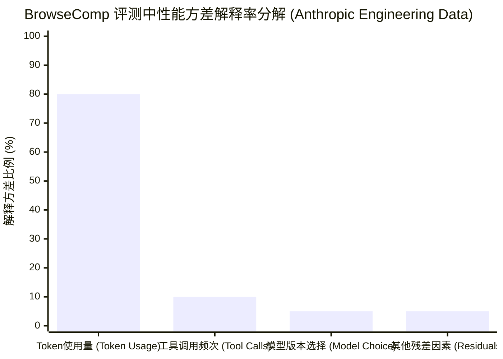
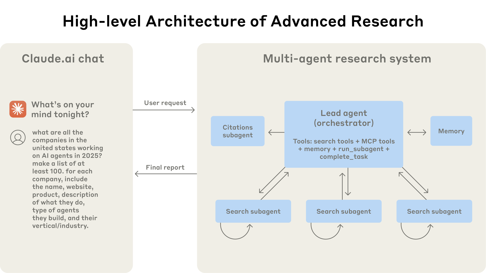
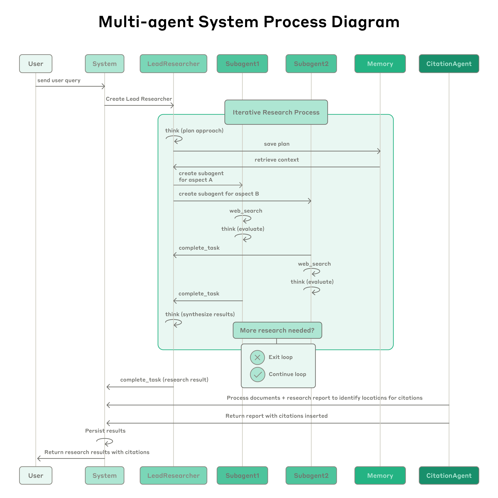
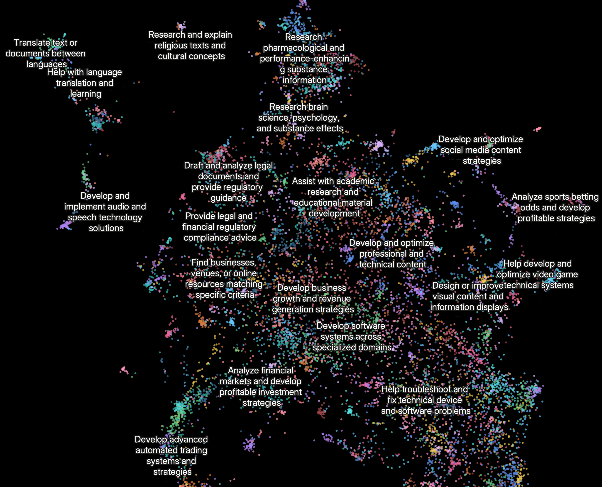

# Anthropic 多智能体研究系统架构与工程实战：中文全译与深度精读
> **英文原题**：How we built our multi-agent research system  
> **作者团队**：Jeremy Hadfield, Barry Zhang, Kenneth Lien, Florian Scholz, Jeremy Fox, Daniel Ford（Anthropic Engineering Team）  
> **发布日期**：2025年6月13日  
> **原文链接**：[https://www.anthropic.com/research/multi-agent-research-system](https://www.anthropic.com/research/multi-agent-research-system)  
> **核心标签**：`Multi-Agent Systems` `Orchestrator-Worker` `Context Engineering` `Tool Use` `Evaluations` `Reliability Engineering`

---

## 📌 架构师核心导读：三分钟读懂（Executive Summary）

Anthropic 官方工程博客首次披露了驱动 Claude 深度研究功能（Research feature）底层的工业级多智能体系统架构。这是一篇兼具系统设计顶层哲学与深水区工程实践的里程碑之作。

### 1. 核心洞见对比：传统模式 vs. Anthropic 多智能体研究系统

| 维度 | 单智能体 / 传统静态 RAG | Anthropic 编排-工作者多智能体系统 | 架构增益与收益本质 |
| :--- | :--- | :--- | :--- |
| **检索机制** | 静态单轮切块匹配（Top-K Embedding 检索） | **多轮动态自适应探索**：主智能体按需派生并发子智能体，根据中间线索灵活调整路径 | 彻底摆脱静态检索的信息孤岛，具备动态回溯与交叉求证能力 |
| **上下文管理** | 共享单上下文窗口；中间检索日志迅速导致上下文污染（Context Pollution） | **上下文强隔离（Context Isolation）**：子智能体在独立上下文中消化脏数据，仅提炼核心 Token 回传 | 保护主编排者注意力聚焦，避免上下文爆炸与路径依赖崩塌 |
| **复杂查询性能** | 串行线性搜索耗时漫长，广度搜索在标普500董事会等任务中容易放弃或报错 | **广度优先查询性能提升 90.2%**（Claude Opus 4 主控 + Sonnet 4 子智能体 vs. 单 Opus 4） | 并发吞吐翻倍，耗时降低高达 90% |
| **扩展定律本质** | 认为模型智力决定一切，单轮生硬挤压单上下文容量 | **Token 消耗解释了 80% 的性能方差**；多智能体本质是通过多上下文并行“充分燃烧 Token”换取高精度 | 验证了将计算分散在独立上下文、扩充并行推理容量的扩展定律 |
| **协同通信模式** | 集中式串行传话，信息在长链路转述中衰减失真 | **工件系统（Artifact System）与文件系统解耦**：子智能体直写外部文件，仅向主控传递轻量引用 | 终结“传话游戏”（Game of Telephone）失真，大幅缩减上下文拷贝开销 |
| **生产级容错** | 智能体报错即全盘崩溃重来，成本极高 | **状态持久化快照（Checkpoints）+ 智能自适应恢复 + 彩虹部署（Rainbow Deployments）** | 生产级长程任务无感恢复，渐进式发布杜绝在途会话中断 |

---

### 2. 核心实验与工程数据快览

1. **90.2% 性能飞跃**：在 Anthropic 内部研究基准测试中，Opus 4（编排主控）+ Sonnet 4（并发子智能体）组合相比单智能体 Opus 4，在复杂信息检索与深度综述任务中胜率提升 **90.2%**。
2. **80% 方差由 Token 消耗量解释**：在衡量困难信息搜寻能力的 BrowseComp 评测中，三项因素解释了 95% 的表现方差，其中 **仅 Token 消耗量单独解释了 80% 的方差**，工具调用与模型选择合占 15%。
3. **15 倍 Token 经济学门槛**：单智能体通常消耗普通对话交互约 4 倍 Token，而多智能体系统消耗普通对话交互约 **15 倍 Token**。多智能体系统必须部署在经济价值能够覆盖推理算力成本的高杠杆场景。
4. **40% 任务时长缩减**：借助专设的“工具测试智能体”持续调试和重写 MCP 工具描述，使后续智能体的人类任务完成时间缩短 **40%**。
5. **90% 耗时大幅缩减**：通过“主编排者并发拉起 3~5 个子智能体”结合“每个子智能体并发执行 3+ 个工具调用”的双层并行化，将原本数小时的复杂研究压缩至数分钟。

---

## 📖 原文完整全译（中英对照与逐段精修）

---

### 序言与背景 (Introduction)

#### 【原文】
Claude now has Research capabilities that allow it to search across the web, Google Workspace, and any integrations to accomplish complex tasks.

The journey of this multi-agent system from prototype to production taught us critical lessons about system architecture, tool design, and prompt engineering. A multi-agent system consists of multiple agents (LLMs autonomously using tools in a loop) working together. Our Research feature involves an agent that plans a research process based on user queries, and then uses tools to create parallel agents that search for information simultaneously. Systems with multiple agents introduce new challenges in agent coordination, evaluation, and reliability.

This post breaks down the principles that worked for us—we hope you'll find them useful to apply when building your own multi-agent systems.

#### 【中文翻译】
Claude 现已具备**深度研究（Research）能力**，允许它跨越互联网、Google Workspace 以及任意已集成的外部系统进行协同检索，以达成极其复杂的探索性目标。

从初期原型到最终生产落地的整个演进历程中，这套多智能体系统为我们带来了关于系统架构、工具设计以及提示词工程的诸多深刻教训。所谓**多智能体系统（Multi-Agent System）**，是指多个智能体（即在大模型驱动下、于闭环中自主调用工具的实例）协同工作的系统。在我们的 Research 功能中，包含一个负责根据用户意图规划调研流程的主智能体（Lead Agent），该主智能体继而调用专用工具派生出多个并发的子智能体（Subagents）同步搜寻信息。多智能体系统的引入，在智能体协同调度、评测体系和系统可靠性方面带来了全新的挑战。

本文系统拆解了在我们的实践中行之有效的核心准则——我们由衷希望这些经验能够为您在构建自己的多智能体系统时提供切实的参考。

---

### 01 多智能体系统的优势与底层逻辑 (Benefits of a multi-agent system)

#### 【原文】
Research work involves open-ended problems where it’s very difficult to predict the required steps in advance. You can’t hardcode a fixed path for exploring complex topics, as the process is inherently dynamic and path-dependent. When people conduct research, they tend to continuously update their approach based on discoveries, following leads that emerge during investigation.

This unpredictability makes AI agents particularly well-suited for research tasks. Research demands the flexibility to pivot or explore tangential connections as the investigation unfolds. The model must operate autonomously for many turns, making decisions about which directions to pursue based on intermediate findings. A linear, one-shot pipeline cannot handle these tasks.

The essence of search is compression: distilling insights from a vast corpus. Subagents facilitate compression by operating in parallel with their own context windows, exploring different aspects of the question simultaneously before condensing the most important tokens for the lead research agent. Each subagent also provides separation of concerns—distinct tools, prompts, and exploration trajectories—which reduces path dependency and enables thorough, independent investigations.

Once intelligence reaches a threshold, multi-agent systems become a vital way to scale performance. For instance, although individual humans have become more intelligent in the last 100,000 years, human societies have become exponentially more capable in the information age because of our collective intelligence and ability to coordinate. Even generally-intelligent agents face limits when operating as individuals; groups of agents can accomplish far more.

Our internal evaluations show that multi-agent research systems excel especially for breadth-first queries that involve pursuing multiple independent directions simultaneously. We found that a multi-agent system with Claude Opus 4 as the lead agent and Claude Sonnet 4 subagents outperformed single-agent Claude Opus 4 by 90.2% on our internal research eval. For example, when asked to identify all the board members of the companies in the Information Technology S&P 500, the multi-agent system found the correct answers by decomposing this into tasks for subagents, while the single agent system failed to find the answer with slow, sequential searches.

Multi-agent systems work mainly because they help spend enough tokens to solve the problem. In our analysis, three factors explained 95% of the performance variance in the BrowseComp evaluation (which tests the ability of browsing agents to locate hard-to-find information). We found that token usage by itself explains 80% of the variance, with the number of tool calls and the model choice as the two other explanatory factors. This finding validates our architecture that distributes work across agents with separate context windows to add more capacity for parallel reasoning. The latest Claude models act as large efficiency multipliers on token use, as upgrading to Claude Sonnet 4 is a larger performance gain than doubling the token budget on Claude Sonnet 3.7. Multi-agent architectures effectively scale token usage for tasks that exceed the limits of single agents.

There is a downside: in practice, these architectures burn through tokens fast. In our data, agents typically use about 4× more tokens than chat interactions, and multi-agent systems use about 15× more tokens than chats. For economic viability, multi-agent systems require tasks where the value of the task is high enough to pay for the increased performance. Further, some domains that require all agents to share the same context or involve many dependencies between agents are not a good fit for multi-agent systems today. For instance, most coding tasks involve fewer truly parallelizable tasks than research, and LLM agents are not yet great at coordinating and delegating to other agents in real time. We’ve found that multi-agent systems excel at valuable tasks that involve heavy parallelization, information that exceeds single context windows, and interfacing with numerous complex tools.

#### 【中文翻译】
**研究型工作本质上由开放式问题构成，人们几乎无法提前预测完成任务所需的具体步骤**。面对复杂主题的探索，你无法预先硬编码一条固定的执行路径，因为整个调研过程天生具备高度动态性与强烈的**路径依赖性（Path-dependent）**。人类在开展研究时，往往会根据调查中新浮现的线索持续修正自己的研究方法，并沿着新的线索不断下潜追踪。

这种不可预测性恰恰使 AI 智能体天然契合研究型任务。深度研究要求系统具备在探索过程中随时转向或深挖发散性分支的灵活性。模型必须在长达数十个回合的多轮交互中自主运行，并基于中间阶段的发现自主决断后续探索方向。任何线性的、单次的流水线式系统（Linear, one-shot pipeline）在面对这类任务时均无能为力。

**搜索的本质是“信息压缩”：从浩瀚的信息语料中提炼出结构化的洞见**。子智能体正是实现高效压缩的核心利器——它们凭借各自独立的上下文窗口（Context Windows）并发运转，在同步探索不同切面的同时，将筛选出的最关键 Token 提炼浓缩并回传给主研究智能体。每一个子智能体同时实现了**关注点分离（Separation of Concerns）**：它们拥有独立的工具集、提示词引导和探索轨迹，这不仅破除了单一推理链条的路径依赖，而且赋予了系统开展全面且相互独立深水区调研的能力。

**当模型智力跨过某个阈值后，多智能体系统将成为扩展整体性能不可或缺的杠杆**。这恰如过去 10 万年间人类个体的生物学智商提升有限，但人类社会在信息时代所展现出的综合能力却呈指数级暴增——其根本原因在于集体智慧与社会化协同。哪怕是通用型高智商智能体，在单打独斗时也存在算力与上下文上限；而智能体集群所能达成的成就将远超个体。

我们的内部评测数据表明：**多智能体研究系统在“广度优先型查询（Breadth-first queries）”上表现尤为卓越**，即需要同时在多个彼此独立的方向上并进的场景。我们发现，采用 **Claude Opus 4 作为主控智能体、Claude Sonnet 4 作为子智能体** 的多智能体系统，在我们内部的研究评测基准上，**相较于单智能体 Claude Opus 4 胜率提升了整整 90.2%**！例如，当要求系统列出标准普尔 500 指数信息技术板块下所有企业的董事会成员名单时，多智能体系统通过将其拆解为多个子智能体的并行子任务，精准找齐了全部正确答案；而单智能体系统由于深陷缓慢的串行搜索链条，最终无法完成检索。

**多智能体系统之所以能够创造奇迹，核心在于它能够帮助系统“充分消耗足够多的 Token 来解决问题”**。在我们的归因分析中，三大因素共同解释了 **BrowseComp 评测基准中 95% 的性能方差**（该基准专门测试网页浏览型智能体定位隐蔽深层信息的能力）：我们发现，**仅 Token 消耗量这一项指标本身就解释了 80% 的方差**，另外两个解释性因素则是工具调用频次（Tool Calls）和底模选择（Model Choice）。这一关键事实有力地论证了我们的系统架构——通过将繁重的工作拆分给拥有独立上下文窗口的多个智能体，为系统引入了更高的并行推理容量（Capacity for Parallel Reasoning）。而最前沿的 Claude 系列模型更是成为了 Token 消耗的高倍率放大器：将模型升级至 Claude Sonnet 4 所带来的性能跃迁，甚至大幅超过直接将 Claude Sonnet 3.7 的 Token 预算增加一倍所带来的收益。对于那些早已超出单智能体承载极限的硬核任务，多智能体架构是行之有效的 Token 规模化扩展路径。

**然而硬币皆有反面：在工程实践中，这种架构消耗 Token 的速度惊人**。我们的统计数据显示，单个智能体通常会消耗约为普通对话交互 4 倍的 Token，而**多智能体系统所消耗的 Token 更是高达普通对话交互的 15 倍左右**！因此，出于商业可行性与投资回报率的考量，多智能体系统必须应用于那些“任务本身的交付价值足以覆盖性能跃升成本”的高杠杆业务中。此外，有些任务要求所有智能体必须时刻共享完全相同的上下文，或者智能体之间存在极高密度的相互依赖，这类场景在当下并不适合采用多智能体。例如，大多数代码编写任务中真正可完全并行的切片远少于文献研究，且目前的 LLM 智能体在实时动态协作与即时授权方面仍有欠缺。我们总结出，**多智能体系统目前最擅长应对的任务特征包括：高度可并行化、信息规模远超单一上下文窗口容量、以及需要深度调用大量复杂的外部工具集**。

---

### 02 Research 系统的架构概览 (Architecture overview for Research)

#### 【原文】
Our Research system uses a multi-agent architecture with an orchestrator-worker pattern, where a lead agent coordinates the process while delegating to specialized subagents that operate in parallel.

When a user submits a query, the lead agent analyzes it, develops a strategy, and spawns subagents to explore different aspects simultaneously. As shown in the diagram above, the subagents act as intelligent filters by iteratively using search tools to gather information, in this case on AI agent companies in 2025, and then returning a list of companies to the lead agent so it can compile a final answer.

Traditional approaches using Retrieval Augmented Generation (RAG) use static retrieval. That is, they fetch some set of chunks that are most similar to an input query and use these chunks to generate a response. In contrast, our architecture uses a multi-step search that dynamically finds relevant information, adapts to new findings, and analyzes results to formulate high-quality answers.

#### 【中文翻译】
我们的深度研究系统采用了典型的**“编排者-工作者”（Orchestrator-Worker）多智能体架构**：由一个处于枢纽位置的主智能体统筹全局流程，同时将具体的探索工作分发给并发运行的专业子智能体。

  
   
  <em>图 1：运转中的多智能体架构图：用户查询首先输入至主智能体（Lead Agent），由其制定策略并派生专业子智能体（Subagents）并行检索信息；子智能体提炼出浓缩的结果集回传给主智能体，由其最终综合生成最终答复。</em>

当用户提交一个查询时，主智能体会先对意图进行深度剖析，拟定调研策略，并派生出子智能体同时去挖掘不同维度的线索。正如上图所示，子智能体充当着**“智能过滤器”（Intelligent Filters）**的角色：它们通过在循环中反复调用搜索工具搜集信息（在上图案例中为针对 2025 年 AI Agent 初创公司的全网调查），在各自的上下文中去粗取精，最终仅将精简后的企业清单回传给主智能体，由主智能体整合撰写出最终报告。

相比之下，传统的检索增强生成（RAG）采用的是静态检索模式：即根据用户输入的查询与语料库进行向量相似度匹配，拉取一批相似的文本块（Chunks），然后将其拼接入提示词直接生成回答。而我们的多智能体架构则采用了**多步动态搜索机制（Multi-step dynamic search）**：它能自适应地发现关联信息、根据调研过程中的最新发现灵活调整后续策略，并深度剖析中间成果，从而组织出极高水准的综合答案。

  
   
  <em>图 2：多智能体 Research 系统的完整运行工作流时序状态图：展示了当用户提出问题后，系统如何创建初始策略规划、如何派生子智能体利用专用工具搜索 Web、以及如何在迭代闭环中协同整理线索并生成最终深度研究报告。</em>

---

### 03 针对研究智能体的提示词工程与评估 (Prompt engineering and evaluations for research agents)

#### 【原文】
Multi-agent systems have key differences from single-agent systems, including a rapid growth in coordination complexity. Early agents made errors like spawning 50 subagents for simple queries, scouring the web endlessly for nonexistent sources, and distracting each other with excessive updates. Since each agent is steered by a prompt, prompt engineering was our primary lever for improving these behaviors. Below are some principles we learned for prompting agents:

1. **Think like your agents.** To iterate on prompts, you must understand their effects. To help us do this, we built simulations using our Console with the exact prompts and tools from our system, then watched agents work step-by-step. This immediately revealed failure modes: agents continuing when they already had sufficient results, using overly verbose search queries, or selecting incorrect tools. Effective prompting relies on developing an accurate mental model of the agent, which can make the most impactful changes obvious.

2. **Teach the orchestrator how to delegate.** In our system, the lead agent decomposes queries into subtasks and describes them to subagents. Each subagent needs an objective, an output format, guidance on the tools and sources to use, and clear task boundaries. Without detailed task descriptions, agents duplicate work, leave gaps, or fail to find necessary information. We started by allowing the lead agent to give simple, short instructions like 'research the semiconductor shortage,' but found these instructions often were vague enough that subagents misinterpreted the task or performed the exact same searches as other agents. For instance, one subagent explored the 2021 automotive chip crisis while 2 others duplicated work investigating current 2025 supply chains, without an effective division of labor.

3. **Scale effort to query complexity.** Agents struggle to judge appropriate effort for different tasks, so we embedded scaling rules in the prompts. Simple fact-finding requires just 1 agent with 3-10 tool calls, direct comparisons might need 2-4 subagents with 10-15 calls each, and complex research might use more than 10 subagents with clearly divided responsibilities. These explicit guidelines help the lead agent allocate resources efficiently and prevent overinvestment in simple queries, which was a common failure mode in our early versions.

4. **Tool design and selection are critical.** Agent-tool interfaces are as critical as human-computer interfaces. Using the right tool is efficient—often, it’s strictly necessary. For instance, an agent searching the web for context that only exists in Slack is doomed from the start. With MCP servers that give the model access to external tools, this problem compounds, as agents encounter unseen tools with descriptions of wildly varying quality. We gave our agents explicit heuristics: for example, examine all available tools first, match tool usage to user intent, search the web for broad external exploration, or prefer specialized tools over generic ones. Bad tool descriptions can send agents down completely wrong paths, so each tool needs a distinct purpose and a clear description.

5. **Let agents improve themselves.** We found that the Claude 4 models can be excellent prompt engineers. When given a prompt and a failure mode, they are able to diagnose why the agent is failing and suggest improvements. We even created a tool-testing agent—when given a flawed MCP tool, it attempts to use the tool and then rewrites the tool description to avoid failures. By testing the tool dozens of times, this agent found key nuances and bugs. This process for improving tool ergonomics resulted in a 40% decrease in task completion time for future agents using the new description, because they were able to avoid most mistakes.

6. **Start wide, then narrow down.** Search strategy should mirror expert human research: explore the landscape before drilling into specifics. Agents often default to overly long, specific queries that return few results. We counteracted this tendency by prompting agents to start with short, broad queries, evaluate what’s available, then progressively narrow focus.

7. **Guide the thinking process.** Extended thinking mode, which leads Claude to output additional tokens in a visible thinking process, can serve as a controllable scratchpad. The lead agent uses thinking to plan its approach, assessing which tools fit the task, determining query complexity and subagent count, and defining each subagent’s role. Our testing showed that extended thinking improved instruction-following, reasoning, and efficiency. Subagents also plan, then use interleaved thinking after tool results to evaluate quality, identify gaps, and refine their next query. This makes subagents more effective in adapting to any task.

8. **Parallel tool calling transforms speed and performance.** Complex research tasks naturally involve exploring many sources. Our early agents executed sequential searches, which was painfully slow. For speed, we introduced two kinds of parallelization: (1) the lead agent spins up 3-5 subagents in parallel rather than serially; (2) the subagents use 3+ tools in parallel. These changes cut research time by up to 90% for complex queries, allowing Research to do more work in minutes instead of hours while covering more information than other systems.

Our prompting strategy focuses on instilling good heuristics rather than rigid rules. We studied how skilled humans approach research tasks and encoded these strategies in our prompts—strategies like decomposing difficult questions into smaller tasks, carefully evaluating the quality of sources, adjusting search approaches based on new information, and recognizing when to focus on depth (investigating one topic in detail) vs. breadth (exploring many topics in parallel). We also proactively mitigated unintended side effects by setting explicit guardrails to prevent the agents from spiraling out of control. Finally, we focused on a fast iteration loop with observability and test cases.

#### 【中文翻译】
多智能体系统与单智能体系统有着本质的区别，最直观的体现就是**协同复杂度的暴增**。在系统研发早期，智能体经常出现极其低级的失误：比如面对极其简单的问题却一口气拉起 50 个子智能体；在互联网上漫无边际地搜寻根本不存在的信息源；或者子智能体之间频繁发送无关紧要的过程状态打扰彼此。因为每一个智能体的底层行为都是由提示词驱动的，所以**提示词工程成为了我们优化这些协同行为的最核心抓手**。以下是我们沉淀出的八大智能体提示词军规：

1. **像你的智能体一样思考（Think like your agents）**：要迭代出优秀的提示词，首先必须透彻理解提示词所引发的行为反应。为此，我们在开发者控制台（Console）中搭建了全真沙箱环境，装配了与线上完全一致的提示词与工具集，然后一步一步观察智能体执行任务的实时推演。这种可视化跟踪能立刻暴露各种深层缺陷：比如明明已经拿到了充分的数据却依然盲目继续搜索、使用了冗长晦涩的查询语句、或是调用了错误的工具。高效的提示词工程建立在对智能体运行心智模型的精确把握之上，这种洞察力能让最核心的改进点一目了然。

2. **教会编排者如何合理授权（Teach the orchestrator how to delegate）**：在我们的系统中，主智能体负责将大查询拆解为子任务并下发给子智能体。每个子智能体必须被赋予：清晰的业务目标、预期的输出数据格式、推荐使用的工具和数据源、以及明确的任务边界。如果缺乏精细的任务描述，子智能体之间必然会出现工作撞车、遗漏关键盲区、或者根本检索不到必要的数据。最开始，我们允许主智能体给出类似“去调研半导体短缺情况”这种简略笼统的指令，但很快发现由于任务语焉不详，子智能体会产生严重误判，或者多个智能体执行完全雷同的搜索。例如，一个子智能体跑去深挖 2021 年的车载芯片危机，另外两个子智能体则在调查 2025 年当下的供应链，完全缺乏有效的分工与协同。

3. **根据查询复杂度动态伸缩算力投入（Scale effort to query complexity）**：智能体自身很难凭空评估不同任务该投入多少精力，因此我们在提示词中内嵌了明确的**工作量缩放规则（Scaling rules）**：
   - **简单事实核查**：仅需 1 个智能体、执行 3~10 次工具调用；
   - **直接对比分析**：通常需要 2~4 个子智能体、各自执行 10~15 次工具调用；
   - **复杂深度研究**：需要派生 10 个以上分工明确的子智能体。
   这种显式的指导准则有效帮助主智能体合理分配 Token 与算力资源，杜绝了在简单问题上大动干戈的过度投入——这是早期版本中最常见的失误。

4. **工具设计与工具选型至关重要（Tool design and selection are critical）**：智能体与工具之间的接口设计（Agent-Tool Interface），其重要性丝毫不亚于人类与计算机的人机交互界面。调用正确的工具不仅是效率问题，往往是任务能否成功的绝对决定性因素。例如，让一个智能体去公网检索一段仅存在于企业内部 Slack 中的上下文，从一开始就注定失败。随着模型通过 MCP（Model Context Protocol）协议接入海量的外部工具，这个问题被进一步放大，因为智能体会接触到大量由第三方编写、描述质量参差不齐的全新工具。我们为智能体制定了明确的启发式规则：例如首先审视当前可用的全部工具列表、将工具特性与用户真实意图精准对齐、在广度探索时优先调用 Web 搜索、面对特定领域时坚持优先选择专用工具而非通用兜底工具。不合格的工具描述会将智能体彻底引向歧途，因此每个工具必须拥有清晰的定位和无可挑剔的使用说明。

5. **让智能体自我进化与修正（Let agents improve themselves）**：我们发现，前沿的 Claude 4 系列模型本身就是极其出色的“提示词工程师”。当赋予它当前的提示词模板和失败案例上下文时，它能极其敏锐地诊断出智能体受挫的根因并给出针对性的修改建议。我们甚至专门构建了一个**“工具测试智能体”（Tool-testing agent）**：每当引入一个有瑕疵的 MCP 工具时，该智能体会主动对其发起全方位尝试性调用，并在暴露问题后自动重写该工具的描述文档以规避坑点。在对工具进行数十轮严苛的自动化测试后，它能够发掘出关键的隐性边界与 Bug。得益于这套提升工具易用性的自进化流程，后续使用经过重写的工具描述的智能体，其**人类任务完成时间平均下降了整整 40%**，因为绝大多数原本低级的调用误区在源头即被消除。

6. **先广后深，渐进收敛（Start wide, then narrow down）**：智能体的搜索策略应当精准复刻人类专家的研究范式——在深潜到特定细节之前，务必先建立起对全景视野的全局认知。智能体往往天然倾向于生成过于冗长、限定条件过于苛刻的搜索词，导致检索结果空空如也。我们通过在提示词中明确规约来纠正这一倾向：强制智能体必须从简短、宽泛的关键词开始起步，先摸清整个领域有哪些基本资料，随后再逐层聚焦、收敛至深层细节。

7. **深度引导思考过程（Guide the thinking process）**：扩展思考模式（Extended Thinking Mode）通过引导 Claude 在生成最终答复前于可见的思考链中吐出额外的推演 Token，能够作为一个**天然可控的推演草稿纸（Scratchpad）**。主智能体利用思考模式规划推导路线、权衡哪款工具最适配当前需求、评估问题复杂度与所需子智能体数量、并严格定义每个子智能体的职责边界。我们的实验表明，扩展思考模式大幅提升了指令遵循度、逻辑推理严密性以及整体执行效率。同样，子智能体在每次获取到工具调用的结果后，也会借助交错式的中间思考（Interleaved thinking）审视当前信息的信度、查找盲区，并迭代精化下一次的搜索查询。这使得子智能体在应对任意突发任务时都具备极强的自适应应变能力。

8. **工具并发调用颠覆吞吐与响应速度（Parallel tool calling transforms speed and performance）**：复杂的研究工作天生需要穿梭于大量彼此独立的信息源之间。早期版本的智能体采用完全串行的搜索方式，整个过程慢到令人无法忍受。为了彻底提速，我们引入了**两级并行机制（Two kinds of parallelization）**：
   - **第一级**：主智能体以并行并发而非串行的方式，一口气拉起 3~5 个子智能体；
   - **第二级**：每个子智能体在单次决策中同时并发调用 3 个以上的工具。
   这两项并发机制的落地，使复杂查询的研究**端到端耗时降低了高达 90%**！原本需要数小时的繁重调研，如今在几分钟之内即可交付，且涵盖的信息广度远超其他同类系统。

我们的提示词工程哲学核心在于**注入优秀的“启发式策略”（Instilling good heuristics），而非束缚死板僵化的硬性规则（Rigid rules）**。我们深入研究了资深人类研究员面对未知领域的思考范式，并将这些高阶心智模型形式化注入提示词中——诸如将难题拆解为细粒度子任务、严苛评估信息源权威性、根据新线索动态修正搜索方向、以及精准识别何时该聚焦于深度（探究某特定主题的底层细节）与何时该聚焦于广度（并行铺开多个主题的泛查）。同时，我们通过构建明确的防失控安全围栏（Guardrails），积极防范意料之外的级联副作用。最后，结合极致的可观测性链路和全真测试用例，实现了超高速的开发迭代闭环。

---

### 04 针对智能体的有效评估体系 (Effective evaluation of agents)

#### 【原文】
Good evaluations are essential for building reliable AI applications, and agents are no different. However, evaluating multi-agent systems presents unique challenges. Traditional evaluations often assume that the AI follows the same steps each time: given input X, the system should follow path Y to produce output Z. But multi-agent systems don't work this way. Even with identical starting points, agents might take completely different valid paths to reach their goal. One agent might search three sources while another searches ten, or they might use different tools to find the same answer. Because we don’t always know what the right steps are, we usually can't just check if agents followed the “correct” steps we prescribed in advance. Instead, we need flexible evaluation methods that judge whether agents achieved the right outcomes while also following a reasonable process.

**Start evaluating immediately with small samples.** In early agent development, changes tend to have dramatic impacts because there is abundant low-hanging fruit. A prompt tweak might boost success rates from 30% to 80%. With effect sizes this large, you can spot changes with just a few test cases. We started with a set of about 20 queries representing real usage patterns. Testing these queries often allowed us to clearly see the impact of changes. We often hear that AI developer teams delay creating evals because they believe that only large evals with hundreds of test cases are useful. However, it’s best to start with small-scale testing right away with a few examples, rather than delaying until you can build more thorough evals.

**LLM-as-judge evaluation scales when done well.** Research outputs are difficult to evaluate programmatically, since they are free-form text and rarely have a single correct answer. LLMs are a natural fit for grading outputs. We used an LLM judge that evaluated each output against criteria in a rubric: factual accuracy (do claims match sources?), citation accuracy (do the cited sources match the claims?), completeness (are all requested aspects covered?), source quality (did it use primary sources over lower-quality secondary sources?), and tool efficiency (did it use the right tools a reasonable number of times?). We experimented with multiple judges to evaluate each component, but found that a single LLM call with a single prompt outputting scores from 0.0-1.0 and a pass-fail grade was the most consistent and aligned with human judgements. This method was especially effective when the eval test cases did have a clear answer, and we could use the LLM judge to simply check if the answer was correct (i.e. did it accurately list the pharma companies with the top 3 largest R&D budgets?). Using an LLM as a judge allowed us to scalably evaluate hundreds of outputs.

**Human evaluation catches what automation misses.** People testing agents find edge cases that evals miss. These include hallucinated answers on unusual queries, system failures, or subtle source selection biases. In our case, human testers noticed that our early agents consistently chose SEO-optimized content farms over authoritative but less highly-ranked sources like academic PDFs or personal blogs. Adding source quality heuristics to our prompts helped resolve this issue. Even in a world of automated evaluations, manual testing remains essential.

Multi-agent systems have emergent behaviors, which arise without specific programming. For instance, small changes to the lead agent can unpredictably change how subagents behave. Success requires understanding interaction patterns, not just individual agent behavior. Therefore, the best prompts for these agents are not just strict instructions, but frameworks for collaboration that define the division of labor, problem-solving approaches, and effort budgets. Getting this right relies on careful prompting and tool design, solid heuristics, observability, and tight feedback loops. See the open-source prompts in our Cookbook for example prompts from our system.

#### 【中文翻译】
完备的评估体系是构建高可靠 AI 应用的生命线，智能体领域概莫能外。然而，评测多智能体系统面临着极其独特的挑战。传统的软件与模型评估通常假设 AI 每次都会遵循雷同的执行轨迹：即给定输入 X，系统应当沿着路径 Y 运转并产出输出 Z。但多智能体系统的运作机理完全不同。**哪怕面临完全相同的起始状态，智能体也可能会选择截然不同但同样完全合法的路径抵达终点**。一个智能体可能仅翻阅了 3 个信息源便给出了结论，另一个智能体可能详尽翻阅了 10 个信息源；或者它们各自调用了完全不同的工具集，却最终找到了相同的真相。由于我们作为系统设计者往往也无法提前获知究竟哪条路径才是唯一的“最优解”，因此我们绝不能生硬地去核验智能体是否踩中了我们预先设定的“标准动作”。相反，我们需要一种兼具弹性的评估框架：**它既能评判智能体最终产出结果的正确性，又能衡量其推演过程的合理性**。

1. **从极小样本立刻开跑评估（Start evaluating immediately with small samples）**：在智能体开发的初期阶段，任何细微的代码或提示词改动往往都会引发戏剧性的性能跃迁，因为此时四处都是“低垂的果实”。一个微小的提示词调优，可能直接将任务成功率从 30% 暴拉到 80%。在如此巨大的效应量（Effect sizes）面前，你仅仅凭借极少数几个测试样例就能清晰捕捉到技术方向的优劣。我们起步时仅挑选了大约 **20 个能够代表线上真实高频场景的典型查询用例**。反复在这 20 个用例上回归测试，让我们得以清晰审视每一次改动的真实冲击。业界 AI 研发团队常犯的一个误区，是认为只有包含成百上千个用例的大型测试集才有价值，因而一再推迟评测环节的搭建。然而事实是：**必须立刻用极小规模的几个代表性用例启动评测，坚决不要把时间浪费在等待构建完美大型测试集的幻想中**。

2. **把大模型充当裁判（LLM-as-judge）做深做实以实现规模化评测**：研究报告的最终产物几乎全为自由格式的长文本，且极少存在唯一的标准答案，因此很难用确定性的代码规则做自动化断言。让前沿大模型担当裁判天然契合这类长文评估。我们设计了专门的大模型裁判，依据以下五维打分细则（Rubric）对产出进行综合裁决：
   - **事实准确性（Factual accuracy）**：报告中的每一处论点是否与引用资料严丝合缝？
   - **引用准确性（Citation accuracy）**：所附的引文链接是否真正支撑了对应的陈述？
   - **内容完整性（Completeness）**：用户最初所提出的所有问题维度是否均已被完整覆盖？
   - **信息源权威度（Source quality）**：智能体是否优先采信了一手官方权威资料，而非低质二手的营销搬运文章？
   - **工具使用效率（Tool efficiency）**：智能体是否在合理可控的调用频次内准确命中了正确的工具？
   我们曾尝试使用多个分散的模型裁判分别打分，但大量对比实验证明：**使用单次大模型 API 调用、配合一份精炼的打分提示词，直接输出 0.0~1.0 的量化得分与及格/不及格（Pass-Fail）判定，在稳定性和与人类专家判断的一致性上表现最高**。当测试集存在客观确定性真值时（例如核验其是否准确列出了全球研发预算前三强的大型药企），这种方法尤为精准高效。LLM-as-judge 让团队得以在短时间内对数百个生成结果完成规模化自动化质检。

3. **人工评测捕捉自动化系统的死角（Human evaluation catches what automation misses）**：人类工程师的实操盲测总能揭示自动化评估所遗漏的深水区边缘案例。这些暗坑包括：在极其罕见的偏僻查询上编造幻觉、系统死锁失效、以及潜在的信息源选择偏见。在我们的研发历程中，正是人类测试员率先察觉到：**早期智能体总是顽固地优先选择被搜索引擎 SEO 高度优化的营销内容农场（Content Farms），而冷落了那些权威度极高但搜索排名不显眼的学术 PDF 原文或技术专家的个人独立博客**。我们在提示词中紧急补充了针对“信息源权威度识别”的启发式规则，才彻底扭转了这一偏好。哪怕进入自动化评测高度成熟的时代，经验丰富的人工评测依然不可替代。

多智能体系统具有强烈的**涌现行为（Emergent behaviors）**——这些行为并非源于开发者的显式编程。举例来说，对主智能体提示词的一个细微调整，就可能以不可预测的方式彻底改变其下属全部子智能体的行为模式。研发的成败取决于你是否真正理解系统内的**智能体交互范式（Interaction Patterns）**，而绝非仅仅关注单兵智能体的能力。因此，撰写多智能体提示词的最高境界，不是写死僵硬的条条框框，而是**打造一套协作框架（Frameworks for Collaboration）：清晰划分劳动力分工边界、提供高阶解题心智路线、并设定合理的算力预算安全阈值**。要实现这一目标，离不开深思熟虑的提示词与工具工程、扎实的启发式设计、端到端的可观测性链路、以及极速响应的反馈闭环。读者可参考我们在 Anthropic Cookbook 中开源的提示词示例以进一步探究。

---

### 05 生产级可靠性与工程落地挑战 (Production reliability and engineering challenges)

#### 【原文】
In traditional software, a bug might break a feature, degrade performance, or cause outages. In agentic systems, minor changes cascade into large behavioral changes, which makes it remarkably difficult to write code for complex agents that must maintain state in a long-running process.

**Agents are stateful and errors compound.** Agents can run for long periods of time, maintaining state across many tool calls. This means we need to durably execute code and handle errors along the way. Without effective mitigations, minor system failures can be catastrophic for agents. When errors occur, we can't just restart from the beginning: restarts are expensive and frustrating for users. Instead, we built systems that can resume from where the agent was when the errors occurred. We also use the model’s intelligence to handle issues gracefully: for instance, letting the agent know when a tool is failing and letting it adapt works surprisingly well. We combine the adaptability of AI agents built on Claude with deterministic safeguards like retry logic and regular checkpoints.

**Debugging benefits from new approaches.** Agents make dynamic decisions and are non-deterministic between runs, even with identical prompts. This makes debugging harder. For instance, users would report agents “not finding obvious information,” but we couldn't see why. Were the agents using bad search queries? Choosing poor sources? Hitting tool failures? Adding full production tracing let us diagnose why agents failed and fix issues systematically. Beyond standard observability, we monitor agent decision patterns and interaction structures—all without monitoring the contents of individual conversations, to maintain user privacy. This high-level observability helped us diagnose root causes, discover unexpected behaviors, and fix common failures.

**Deployment needs careful coordination.** Agent systems are highly stateful webs of prompts, tools, and execution logic that run almost continuously. This means that whenever we deploy updates, agents might be anywhere in their process. We therefore need to prevent our well-meaning code changes from breaking existing agents. We can’t update every agent to the new version at the same time. Instead, we use rainbow deployments to avoid disrupting running agents, by gradually shifting traffic from old to new versions while keeping both running simultaneously.

**Synchronous execution creates bottlenecks.** Currently, our lead agents execute subagents synchronously, waiting for each set of subagents to complete before proceeding. This simplifies coordination, but creates bottlenecks in the information flow between agents. For instance, the lead agent can’t steer subagents, subagents can’t coordinate, and the entire system can be blocked while waiting for a single subagent to finish searching. Asynchronous execution would enable additional parallelism: agents working concurrently and creating new subagents when needed. But this asynchronicity adds challenges in result coordination, state consistency, and error propagation across the subagents. As models can handle longer and more complex research tasks, we expect the performance gains will justify the complexity.

#### 【中文翻译】
在传统的确定性软件工程中，一个 Bug 可能会破坏某项具体功能、导致性能下降或引发服务中断。但在智能体系统中，**微小的底层改动会引发雪崩式的宏观行为漂移**。这导致为长周期运行、且必须跨越海量上下文维持复杂状态的智能体编写代码变得极度棘手。

1. **智能体是有状态的，错误会发生指数级复利累积（Agents are stateful and errors compound）**：智能体往往会持续运转极长的时间周期，其状态跨越了数十次乃至上百次工具调用链条。这意味着底层必须具备**持久化代码执行（Durable Execution）**和全链路容错能力。如果缺乏强有力的缓解手段，传统软件中极其微小的短暂网络抖动或解析异常，对智能体来说都将是毁灭性的灾难。更致命的是，一旦中途报错，我们绝不能简单地让系统从头重新启动——重跑不仅耗费极其高昂的 Token 成本，更会让等待中的用户陷入极度崩溃。为此，我们研发了专门的**可恢复执行引擎（Resume from checkpoints）**，确保在发生意外后，系统能够精准从中断的断点无缝恢复推演。与此同时，我们充分利用模型本身的认知智力进行自愈式容错：例如，当某个底层工具发生调用失败时，直接将带有上下文的错误信息如实反馈给智能体，让其自主调整参数或更换备选方案，其效果出人意料地优秀。我们将基于 Claude 构建的自适应柔性容错能力，与确定性的工程兜底手段（如指数退避重试机制、周期性状态快照等）进行了深度的有机融合。

2. **新型调试范式：生产级全链路追踪（Production Tracing）**：由于智能体会做出完全动态的自主决策，即便使用完全相同的提示词，多次执行之间也具有非确定性，这让排障变得无比困难。例如，曾有用户反馈智能体“连近在眼前的显而易见的信息都没搜出来”，但在缺乏观测手段时，工程师根本无法复原真相：究竟是因为智能体构造了拙劣的关键词？采信了不靠谱的网页？还是触发了底层工具调用超时？**引入全链路生产环境追踪（Full production tracing）成为了系统质变的分水岭**，它使我们能够端到端回放并系统性地拔除根因。在严苛保障用户隐私（坚决不窥探任何用户私人对话具体文本内容）的前提下，我们专门对智能体的**高阶决策模式（Decision patterns）与交互拓扑结构（Interaction structures）**建立了元数据监控。这种系统级可观测性帮助我们精准定位了大量的架构暗坑，发现了许多意料之外的模型怪异行为，并快速消除了高频故障。

3. **版本部署需要极致的平滑协同：彩虹部署（Rainbow Deployments）**：智能体系统是一个由提示词、外部工具集和执行逻辑交织而成的强状态巨网，且近乎 7×24 小时不间断高负荷运转。这意味着当我们在线上发布代码更新时，千千万万个在途的智能体可能正处于其漫长探索轨迹中的任意一个未知节点。我们必须坚决避免任何“善意的代码优化”引发正在跑动中的老版本智能体状态错乱或崩溃。因此，我们严禁全局一刀切式的全量版本替换。相反，我们设计了**彩虹部署（Rainbow deployments）机制**：在发布新版本时，保持旧版本与新版本集群长时间并行运行，新发起的查询请求逐步向新版本平滑倾斜，而所有正在执行中的存量会话则完全在老版本环境中被妥善护送直至任务圆满完成。

4. **同步阻塞模式的性能天花板（Synchronous execution creates bottlenecks）**：在当前的线上生产版本中，主智能体调度子智能体时采用的是**同步等待机制（Synchronous execution）**——即主控必须原地阻塞，耐心等待派生出的一整批子智能体全部返回后，才能汇总进入下一个推理阶段。这种设计极大简化了分布式协同状态机的编写，但却在智能体之间的信息流动通道上形成了显著的性能瓶颈（落后节点拖慢全局的“掉队者效应”，Straggler Problem）。例如，在子任务探索途中，主控无法根据外界最新输入动态调整正在搜寻中的子智能体；子智能体之间也完全无法互相知会最新发现；一旦某一个子智能体在某个网页陷入漫长抓取，整个系统都将被迫停摆等待。我们正在全面向**真正的异步执行架构（Asynchronous execution）**演进：允许所有智能体随时并发独立推进，并根据需要即时创建新的下级子智能体。然而，异步架构也将在跨智能体的成果汇总对齐、分布式状态一致性保障、以及级联错误隔离扩散方面带来呈指数级上升的工程挑战。但随着前沿底座模型承载更长程、更艰巨科研任务的能力持续进化，性能所能获得的跨越式回报将彻底证明这种复杂架构的价值。

---

### 06 结语与行业应用全景 (Conclusion)

#### 【原文】
When building AI agents, the last mile often becomes most of the journey. Codebases that work on developer machines require significant engineering to become reliable production systems. The compound nature of errors in agentic systems means that minor issues for traditional software can derail agents entirely. One step failing can cause agents to explore entirely different trajectories, leading to unpredictable outcomes. For all the reasons described in this post, the gap between prototype and production is often wider than anticipated.

Despite these challenges, multi-agent systems have proven valuable for open-ended research tasks. Users have said that Claude helped them find business opportunities they hadn’t considered, navigate complex healthcare options, resolve thorny technical bugs, and save up to days of work by uncovering research connections they wouldn't have found alone. Multi-agent research systems can operate reliably at scale with careful engineering, comprehensive testing, detail-oriented prompt and tool design, robust operational practices, and tight collaboration between research, product, and engineering teams who have a strong understanding of current agent capabilities. We're already seeing these systems transform how people solve complex problems.

  
   
  <em>图 3：Clio 真实用户高频使用场景语义嵌入分布图：清晰揭示了当前用户使用 Claude 深度研究功能的最主流方向。</em>

#### 【中文翻译】
**在构建工业级 AI 智能体时，所谓“最后一公里”往往会耗费整段征程的大部分心血**。在开发者的本地机器上跑得通的 Demo 代码库，距离蜕变为一套坚不可摧的生产级高可用系统，中间隔着难以逾越的系统工程鸿沟。在智能体系统中，**错误的复利级联特性**意味着任何在传统软件中微不足道的偶发异常，都足以将智能体彻底拽离正确轨道。推演中任何单一步骤的偏航，都会诱使智能体在后续的分支中走向完全不可控的荒谬境地。正因本文所剖析的种种深层挑战，**“原型（Prototype）”与“生产（Production）”之间的鸿沟，往往比所有人最初预想的要宽阔得多**。

尽管前路布满荆棘，多智能体系统在开放式复杂研究场景中所展现出的革命性价值已被确凿证明。来自全球一线用户的反馈表明：Claude 帮助他们挖掘出了未曾设想的全新商业契机、厘清了极其繁琐复杂的医疗健康方案选择、根除了深藏于复杂系统底层的硬核技术 Bug、并通过串联起此前孤立的冷门文献线索，为他们节省了长达数天的无谓苦力劳动。

只要辅以精益求精的系统架构、全覆盖的严苛测试矩阵、针对提示词与工具接口细致入微的打磨、强健的生产运维支撑、以及研究团队、产品团队与工程团队之间基于对前沿模型能力边界深刻理解的无缝协同，**多智能体研究系统完全能够在超大规模流量下保持高度稳定可靠的运行**。我们已经无比清晰地见证着，这些系统正在从根本上重塑人类攻克极其复杂未知难题的方式。

上图为通过 Anthropic 内部隐私保护分析工具 **Clio** 绘制出的真实用户高频使用场景语义分布聚类图，其五大核心落地版图包括：
1. **跨专业领域的复杂软件系统开发与落地（10%）**
2. **专业级与高难度技术内容的开发、润色与审查（8%）**
3. **商业增长战略制定与商业变现模式探索（8%）**
4. **学术研究深度辅助与高质量教育课件开发（7%）**
5. **针对特定人物、机构组织与地理事件的深度事实背景调研与核验（5%）**

---

### 07 附录：工业级落地杂项秘籍 (Appendix)

#### 【原文】
Below are some additional miscellaneous tips for multi-agent systems.

1. **End-state evaluation of agents that mutate state over many turns.** Evaluating agents that modify persistent state across multi-turn conversations presents unique challenges. Unlike read-only research tasks, each action can change the environment for subsequent steps, creating dependencies that traditional evaluation methods struggle to handle. We found success focusing on end-state evaluation rather than turn-by-turn analysis. Instead of judging whether the agent followed a specific process, evaluate whether it achieved the correct final state. This approach acknowledges that agents may find alternative paths to the same goal while still ensuring they deliver the intended outcome. For complex workflows, break evaluation into discrete checkpoints where specific state changes should have occurred, rather than attempting to validate every intermediate step.

2. **Long-horizon conversation management.** Production agents often engage in conversations spanning hundreds of turns, requiring careful context management strategies. As conversations extend, standard context windows become insufficient, necessitating intelligent compression and memory mechanisms. We implemented patterns where agents summarize completed work phases and store essential information in external memory before proceeding to new tasks. When context limits approach, agents can spawn fresh subagents with clean contexts while maintaining continuity through careful handoffs. Further, they can retrieve stored context like the research plan from their memory rather than losing previous work when reaching the context limit. This distributed approach prevents context overflow while preserving conversation coherence across extended interactions.

3. **Subagent output to a filesystem to minimize the ‘game of telephone.’** Direct subagent outputs can bypass the main coordinator for certain types of results, improving both fidelity and performance. Rather than requiring subagents to communicate everything through the lead agent, implement artifact systems where specialized agents can create outputs that persist independently. Subagents call tools to store their work in external systems, then pass lightweight references back to the coordinator. This prevents information loss during multi-stage processing and reduces token overhead from copying large outputs through conversation history. The pattern works particularly well for structured outputs like code, reports, or data visualizations where the subagent's specialized prompt produces better results than filtering through a general coordinator.

#### 【中文翻译】
以下是我们在落地多智能体系统过程中总结出的一些额外实用工程技巧：

#### 1. 对执行多轮状态修改的智能体采用“终态评估”（End-state evaluation of agents that mutate state over many turns）
评估那些会在多轮长程交互中对外部环境产生持久化状态变更（如写文件、改库、发请求）的智能体，面临着极为独特的难题。与只读型的纯研究任务不同，这类智能体的每一步操作都会直接改变后续步骤的执行环境，从而引发传统评测方法极难处理的动态级联依赖。

**我们的成功经验是：将评测重心坚定聚焦于“终态评估”（End-state evaluation），彻底扬弃步步为营的“逐轮过程分析”（Turn-by-turn analysis）**。与其死板考核智能体是否严格遵照了某种特定流程，不如检验它最终是否在外部环境中精确达成了预期的最终状态。这种范式充分尊重了大模型智能体可能另辟蹊径探索出完全不同的合规路径去达成目标，同时又能坚守结果的正确性底线。面对极其复杂的业务流水线，**可将评估解耦为若干个关键的离散检查点（Checkpoints）**——仅断言在特定阶段是否发生了预期的状态变更，而严禁去强求校验中间每一个微小步骤的字面格式。

#### 2. 超长程对话交互与上下文管理工程（Long-horizon conversation management）
面向生产环境的智能体往往需要在跨越数百个回合的极长对话中持续作战，这使得上下文管理策略成为了系统成败的关键命脉。随着交互回合不断延伸，哪怕再大的标准上下文窗口也终将捉襟见肘，必须建立智能化的高阶压缩机制与外部记忆体系。

我们落地了极具实操价值的三层协同范式：
- **阶段性成果归档**：智能体在每完成一个既定的工作阶段后，自动生成阶段性摘要，并将核心资产持久化存入外部独立存储（External memory），随后才轻装上阵承接下一阶段的任务；
- **干净上下文子智能体接力**：每当检测到上下文使用量逼近安全警戒线时，主智能体会主动派生出**拥有完全干净上下文的新子智能体**，并通过精细的交接备忘录（Hand-offs）无缝延续执行链条；
- **按需反查外部记忆**：当逼近上下文极限时，智能体能够随时按需从外部记忆系统中重新拉回诸如最初的整体研究战略规划等全局背景，彻底避免了因强行压缩历史而丢失核心前提。
这种分布式治理架构从物理上杜绝了上下文溢出风险，同时在超长程的复杂探索中完美捍卫了逻辑推演的强连贯性。

#### 3. 子智能体成果直写文件系统以消除“传话游戏”失真（Subagent output to a filesystem to minimize the ‘game of telephone’）
允许子智能体将特定成果直接写入底层持久化系统、从而绕过中心协调者，能够极大提升交付产物的**保真度（Fidelity）与系统性能**。

在传统的多层级架构中，强制所有子智能体必须把全部大段调研细节层层汇报给主编排者，会引发严重的**“传话游戏”（Game of Telephone）效应**——在经过多层中转和主控模型的二次总结后，专业细节、精细的代码实现、复杂的排版表格往往会发生严重的损耗失真甚至虚构；同时，将成千上万字的冗长中间输出频繁拷贝进主对话历史中，会造成极其恐怖的 Token 浪费和上下文污染。

**终极解法：打造工件系统（Artifact Systems）**。
- 允许专业子智能体直接调用底层 I/O 工具，将其产出的完整成果持久化存储于独立的文件系统或外部存储服务中；
- 子智能体在执行完毕后，**仅仅向主编排者回传一个极度轻量级的引用指针（Lightweight references，如文件相对路径、工件 ID 等）**；
- 主控智能体无需在自己的上下文中背负庞大的原始文本，便能统揽全局。这一模式在处理**代码模块、深度调研报告、大型结构化图表或复杂数据可视化**等结构化交付物时表现极其惊艳，因为子智能体在其专属专业提示词下产出的成果质量，远远胜过被泛化主控重新转述过滤后的产物。

---

### 作者与致谢 (Authors & acknowledgements)

#### 【原文】
**Contributors**: Written by Jeremy Hadfield, Barry Zhang, Kenneth Lien, Florian Scholz, Jeremy Fox, and Daniel Ford.  
**Acknowledgements**: This work reflects the collective efforts of several teams across Anthropic who made the Research feature possible. Special thanks go to the Anthropic apps engineering team, whose dedication brought this complex multi-agent system to production. We're also grateful to our early users for their excellent feedback.

#### 【中文翻译】
**主要作者**：Jeremy Hadfield, Barry Zhang, Kenneth Lien, Florian Scholz, Jeremy Fox, 以及 Daniel Ford。  
**特别致谢**：本项工作凝结了 Anthropic 内部多个团队共同缔造 Research 深度研究功能的集体智慧。特别向 Anthropic 应用程序工程团队（Apps Engineering Team）致敬，正是他们全心全意的工程攻坚，才将如此复杂的多智能体系统成功护送进入工业级生产环境。我们由衷感谢所有早期核心用户所提供的宝贵反馈。

---

## 💡 架构师实战研读与技术落地启示 (Architect's Deep Dive)

本篇 Anthropic 官方工程实践博文，不仅印证了近年来学术界在多智能体系统与长程上下文领域的诸多前沿理论，更为全行业从事 Agent 研发的架构师提供了珍贵的技术对照基准：

### 1. 与前沿论文体系的深度共鸣
- **与微软长程上下文工程（arXiv:2606.10209）的呼应**：微软在长程 Agent 研究中指出的“上下文越精炼、智能体越敏捷”，与 Anthropic 本篇提出的“子智能体上下文强隔离以实现信息有效压缩”、“工件系统直写文件以消除传话游戏”在底层原理上完全一致——**Token 的有效注意力预算必须被严格保护，杜绝无意义的中间脏数据进入主控上下文**。
- **与多智能体并发控制（arXiv:2608.18092）的互补**：Anthropic 坦陈目前线上版本仍为“同步阻塞式批处理”，并指出正在向真正的异步多智能体并发演进。这与学术界呼吁的“并发控制（Concurrency Control）应成为多智能体头等公民”不谋而合。未来当异步多智能体全面铺开时，跨智能体的状态读写冲突、死锁与掉队节点治理将成为新的工业级核心赛道。
- **与推理期并行扩展定律（TIPEX, arXiv:2608.05791）的印证**：Anthropic 提出的“Token 消耗量单独解释了 80% 的 BrowseComp 性能方差”，是推理期扩展定律（Inference-time Scaling Laws）在工业界的顶级实证证据——通过多智能体派生多上下文，在物理上突破了单上下文的自注意力容量天花板，实现了多核多线程式的算力规模化扩展。

### 2. 团队落地智能体系统的五条即插即用实战建议
1. **立刻用文件系统（Artifact System）重构你的 Agent 通信**：切忌在主 Agent 与子 Agent 之间原样传回成千上万字的长篇文本；子 Agent 产出大文件一律写入本地 workspace，仅回传路径。
2. **警惕“低垂果实阶段”的评测过度设计**：早期开发阶段，拿出 20 个高频真实的黄金用例搭建自动化 LLM-as-Judge 即可，迅速建立“改提示词 -> 跑评测 -> 对比 0~1 得分”的正向敏捷反馈循环。
3. **给 Agent 配备“可控的推演草稿纸”**：对于复杂任务，务必在 Prompt 中强制开启思考推演模式（Thinking/Scratchpad），并要求智能体在工具调用后进行“交错思考（Interleaved Thinking）”，先评判工具返回内容的信度，再决定下一步动作。
4. **长任务必须内建“断点续传（Checkpoints）”**：严禁“一错全盘重来”；在外部存储或数据库中持久化记录智能体所处的阶段和已探明事实，一旦抛出异常或遇到超时，支持无缝加载断点恢复。
5. **重视工具元数据（Tool Description）的自进化**：不要凭主观臆断编写工具描述，利用前沿大模型针对边缘场景生成严苛测试，反向倒逼并优化工具的参数定义与异常提示，这能带来高达 40% 的速度与成功率提升。
