# DeepSeek Super-agent 深度精读综述：用计算机系统工程重构多任务自主智能体

> **文献信息**：*Exploring Super-agent Design: Toward More Autonomous Agent Systems*（《Super-agent 设计探索：迈向更自主的 Agent 系统》）
> **作者团队**：DeepSeek Harness 团队（Yujia Qiao 主导系统实现与撰写，Huanqi Cao 等十余位成员参与设计与评审）
> **发布日期**：2026 年 10 月 31 日（官方技术长文 + 同步开源研究原型 [`deepseek-ai/dsh-superagent-prototype`](https://github.com/deepseek-ai/dsh-superagent-prototype)）
> **本目录配套资产**：[英文原文解析](./DeepSeek_SuperAgent_原文解析.md) ｜ [全文如实中文翻译](./DeepSeek_SuperAgent_中文翻译.md) ｜ [官方原型源码库](./dsh-superagent-prototype/) ｜ [全部高清配图](./配图/)

---

## 一、导读与核心摘要（Executive Summary）

### 1.1 一句话核心洞察

**当大模型单任务执行能力已不再是稀缺资源时，限制 AI 团队生产力扩张的真正瓶颈已从“模型能力”转移至“人类注意力”；打破智能体与单一手动会话（Session）的强绑定，用操作系统的“双层调度 + 事件驱动 + 缓存局部性 + 存算分离 + 外部监工”五大系统原语接管并发与上下文同步，才能将人类从“人肉项目经理”解放为高阶决策与验收者。**

### 1.2 第一性原理与研究动机（Research Taste）

过去一年，以编程智能体（Coding Agents）为代表的单任务智能体在工具调用与长程执行上取得了长足进步，但在真实团队工程场景中却出现了一个显著的**生产力悖论**：

- **单任务上限由模型能力决定，多任务上限却由人类注意力决定**。在当前主流范式下，一个 `Session` 同时扮演了“底层上下文容器”和“前端项目管理单位”两个角色。据 DeepSeek Harness 团队内部观测，人类开发者通常同时只能有效跟进 **3 到 5 个活跃 Session**——一旦并行窗口增加，人类就必须充当不同终端之间的“人肉路由器”与“上下文搬运工”。
- **简单外接连接器（CLI / MCP / Webhook）的失效张力**：如果只是把单会话本地 Agent 接上飞书或 GitHub，表面上它能收发外部消息，但底层依然困在三个结构性矛盾中：
  1. **同步阻塞**：慢命令或长子任务会锁死 ReAct 循环，新消息进不来；
  2. **上下文污染**：多任务挤在同一个 Session 中导致推理质量退化，拆成多个 Session 又丧失跨任务连续性；
  3. **设备生命周期耦合**：本地电脑休眠或断网即任务中断，无法跨设备延续。

这篇技术报告的学术与工程品味（Research Taste）在于：**作者拒绝在“如何写更好的 Prompt 让单个模型学会多任务切换”这一脆弱路径上内卷，而是直接承认大模型的注意力与上下文边界，回归计算机体系结构几十年积累的经典系统原语**——用系统确定性来兜底模型的不确定性，用工程分层把复杂的并发隔离和权限控制锁在“笼子”里。

### 1.3 核心范式对比

| 对比维度 | 传统单 Session Agent | 单 Session + Subagent 工具 | 传统 Agent Team | **DeepSeek Super-agent** |
| :--- | :--- | :--- | :--- | :--- |
| **基本运行单元** | 手动开启的单个 Session | 主 Session 动态派生子会话 | 面向单个复杂任务的临时团队 | **常驻连续实体（跨会话保持全局上下文）** |
| **核心调度权** | 人类手动切换窗口 | 模型靠 Prompt 临场决定是否委派 | Team Lead 深度拆解并频繁协调子步骤 | **Router-Worker 物理职责分离 + 订阅直通** |
| **驱动模式** | 人类逐轮输入 Prompt（被动） | 人类输入触发 | 任务发起后内部流转 | **事件驱动（Trigger 流 + 两阶段过滤 + 推测执行）** |
| **多任务并发性** | 串行阻塞，上下文混杂 | 易因模型“觉得任务小”而退化为串行 | 聚焦单一任务内部拆解 | **多 Worker 隔离并发 + Router 异步批处理** |
| **交互双工模式** | 半双工（`run()` 期间阻塞） | 半双工或有限回调 | 同步/半同步汇报 | **全双工异步 ReAct（`start()`/`stop()` 非阻塞）** |
| **持久化与环境** | 与单台本地设备强绑定 | 依赖宿主机持续在线 | 依赖单次运行生命周期 | **存算分离 + BYOM（云端大脑 + 设备端无状态 Daemon）** |
| **异常兜底机制** | 依赖人工肉眼盯盘重启 | 人工介入或简单超时退出 | 内部重试 | **外部语义级 Watchdog（防死循环与目标漂移）** |

### 1.4 关键量化实验看板

在包含约 300 条消息（约 20 条真实工作请求 + 闲聊/追问/停工/CI 消息）的端到端并发调度基准测试中（每个方案运行 5 次取统计）：

| 方案 | 任务完成时间 P50 / P95（分钟） | 单次实验全 Session 总 Token 消耗 | 核心结论 |
| :--- | :---: | :---: | :--- |
| **Super-agent（完整版）** | **12.4 / 15.7** | 23.23M | 速度最快、尾延迟最稳，系统级隔离彻底消除长尾 |
| **Super-agent（移除直通投递）** | 12.6 / 15.5 | 31.77M（+37%） | 完成时间相近，但 Router 决策次数增 **+30%**、Token 暴涨 **+37%** |
| **单 Session + Subagent（中性 Prompt）** | 20.4 / 29.5 | 6.05M | 5 次运行 **0 次调用 Subagent**，全部在主窗口内被新消息反复打断 |
| **单 Session + Subagent（优先委派 Prompt）** | 13.8 / 29.0 | 10.82M | 4 次委派成功，1 次因模型误判“任务小”而亲自做，产生 **29 分钟紫色长尾** |

在 Router 层单独压测中：当需决策 Trigger 到达率从 **1 条/分钟**飙升至 **40 条/分钟**时，Router 平均 Batch Size 从 **1.0 升至 2.8**，单次请求耗时仅从 **2.5s 微增至 3.9s**，**每次决策的均摊推理时间反而从 6.4s 骤降至 1.6s**。

---

## 二、痛点剖析：为什么“写更好的 Prompt”救不了多任务智能体？

在传统的单 Session 架构中，开发者常试图通过精心设计的系统提示词（例如：“尽量把工作交给 Subagent，不要在主会话里自己干”）来模拟调度器。但 DeepSeek 的实验与生产实践揭示了这种做法的三大本质失效链路：

1. **模型临场判断的随机性与长尾风险**：当主 Session 既拥有沟通权又拥有工具执行权（如 `bash` / 文件编辑）时，只要模型对某条请求评估为“顺手就能改完的小任务”，它就会绕开委派机制亲自下场。一旦执行耗时超过预期或紧接着涌入新消息，整个主 Session 立即陷入上下文打断与串行泥潭——这正是消融实验中“优先委派 Prompt”依然跑出 P95 = 29.0 分钟长尾的根因。
2. **注意力的跨渠道割裂（Cross-Channel Fragmentation）**：现代软件研发天然横跨即时通讯（飞书/Slack）与异步代码平台（GitHub Issues/PR/CI）。同一个需求往往在群聊中提出方案 A，在 PR Review 中被修正为方案 B。若无统一的全局路由实体，人类必须手动将群聊背景复制进 GitHub 会话。
3. **高噪声事件流的推理账单爆炸**：接入真实团队群聊与仓库事件流后，绝大部分日常寒暄、机器人通知与中间日志都不需要智能体介入（“高噪声、低行动率”）。若每条事件都唤醒大模型做完整推理，延迟与 Token 账单都会瞬间失控。

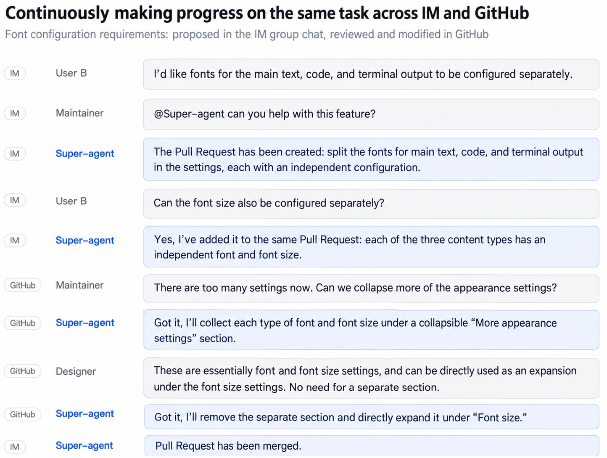

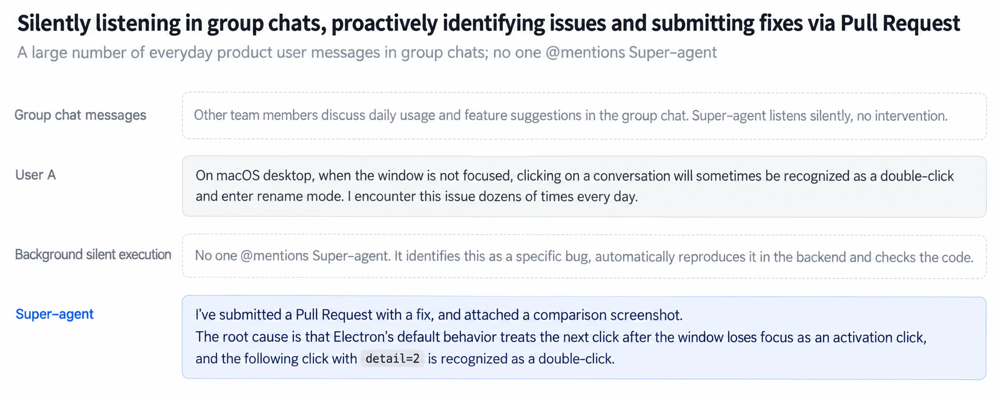

基于上述洞察，DeepSeek 为 Super-agent 确立了四大核心产品特征：**连续性（Continuity）**、**高效性（Efficiency）**、**主动性（Proactivity）**与**持久性（Persistence）**，并用下图所示的五大系统模块予以落地。

![Super-agent 系统整体架构，标号 [2] 至 [6] 对应原文第 2 至第 6 节。](配图/architecture.png)

---

## 三、五大核心系统模块与机制深度拆解

### 3.1 模块一：Router-Worker 双层架构（解耦连续性与吞吐量）

为了破解“全放一个 Session 导致阻塞污染”与“一件事开一个 Session 导致记忆割裂”之间的张力，Super-agent 将**全局连续性维护**与**高并发执行**拆分为两个物理职责严格隔离的层级：

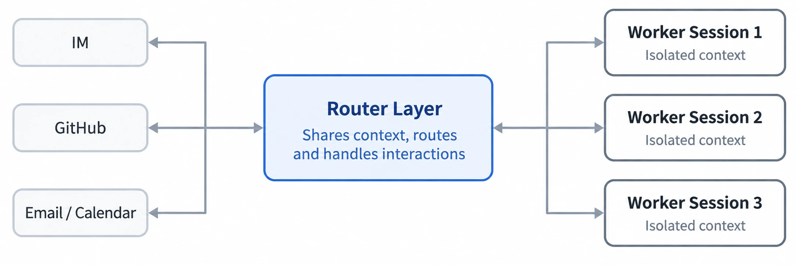

1. **Router 层（常驻定序点与统一门面）**：
   - **最小权限原则**：Router 专门负责多渠道人类交互、准入评估、工单路由与全局记忆协调。为了防止它“管不住手”亲自下场干活，系统从架构上剥夺了它的具体执行工具（甚至不配备 Bash 工具）。
   - **与传统 Agent Team 的本质差异**：传统 Agent Team 的 Team Lead 需要深度拆解单个复杂任务的子步骤、分配强耦合子任务并高频协调，推理负载极重；而 Super-agent 的 Router **只处理跨任务的路由与关系协调，绝不在内部拆解单个任务的技术实现细节**。经验表明，Router 只需轻量级模型即可获得极佳的速度与路由准确率。
   - **隐式 Prefill 批处理效应**：Router 底层是一个常驻 LLM Session。每当它正在推理时，新到达的 Trigger 会自然在队列中累积，并在下一轮 LLM 调用时作为一批输入（Long Input, Short Output）一次性注入。由于 Transformer 在 Prefill 阶段天然支持 Token 级并行计算，批次大小增加并不会线性拉长单次请求耗时，从而天然获得了抗突发流量削峰的能力。

2. **Worker 层（隔离执行沙箱）**：
   - 每个任务对应一个上下文完全隔离的 Worker Session（可配备最强推理模型与全套执行工具）。
   - **静默执行与单口对外**：Worker 内部可以使用 Subagent 甚至再嵌套 Agent Team（对 Router 透明），但 Worker 绝不直接向群聊发送冗长的工具调用日志，而是将结构化状态汇报给 Router，由 Router 依据渠道规范统一对外交互。
   - **同层无点对点通信**：多个并发 Worker 之间通常不直接发消息通信；当它们不可避免地在同一份代码或同一个 PR 中产生交集时，通过共同订阅同一个 `Thread` 来感知彼此提交的变更与评论，从而自行消解冲突。

---

### 3.2 模块二：事件驱动机制（Fast Path / Slow Path 的全面贯通）

在计算机系统中，**快路径（Fast Path）**用确定性代码处理高频常规路径，**慢路径（Slow Path）**才动用昂贵但灵活的计算资源。Super-agent 将这一经典思想贯彻到了事件生命周期的四个阶段：

#### （1）两阶段事件过滤（Event Filtering）
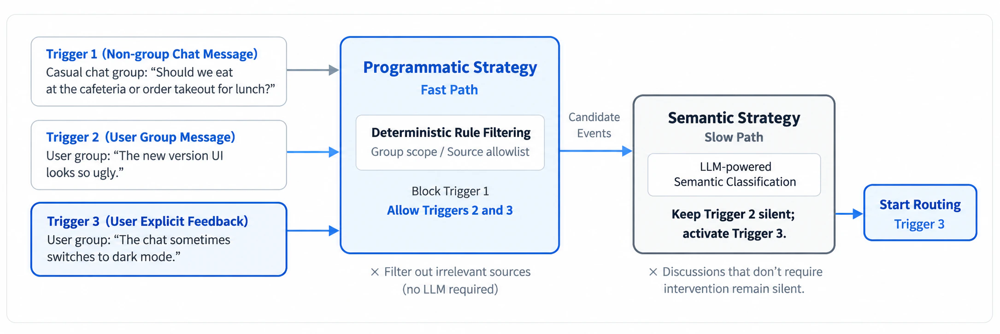
- **程序化快路径（Programmatic Policies）**：在代码层根据来源（Source）、群组作用域、人员白名单、机器人名单等确定性规则过滤绝大多数闲聊噪声。
- **语义慢路径（Semantic Policies）**：仅当事件通过准入进入候选区后，才交由 LLM 结合 Prompt 中自然语言编写的业务规则判断是否真正需要立项行动。

#### （2）Thread 抽象与订阅直通（Subscription & Direct Delivery）
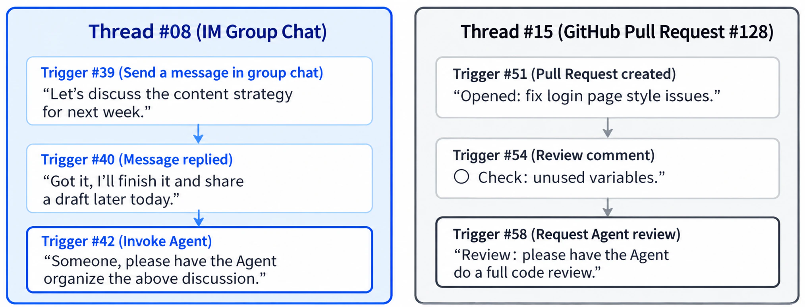
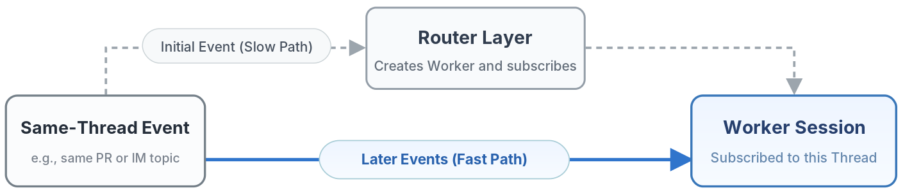
- 同一个飞书话题、邮件往来或 GitHub PR/Issue 下的连续 Trigger 构成一条 **Thread**。
- 当 Router 为首条 Trigger 创建 Worker 并建立多对多的 **Subscription（订阅）**后，后续该 Thread 内产生的所有追问、CI 报错、Review 评论都走**代码直通快路径**直接送达对应 Worker，彻底绕过 Router 的 LLM 推理（正如实验所证明，这直接为系统省去了约 30% 的 Router 决策和 37% 的总体 Cache-Read Token 消耗）。
- 若追问内容超出了当前任务范围，Worker 可显式退回（Handback）给 Router 重新评估派单。

#### （3）上下文组织：Inline & Spill 与回忆链（Chain of Recall）
面对持续涌入的事件流，作者提出了一句极其凝练的工程箴言：**“浪费上下文窗口，就是在浪费模型的智能。”**
Super-agent 把上下文窗口视作 CPU Cache，引入编译器优化中的两个原语：
- **Inline（内联）**：利用时间与空间局部性原理，把大概率立即用到的近邻信息（如前 50 个字符、IM 前后消息与引用消息、关联对象的唯一 ID）直接塞入当前窗口，消除冗余的工具调用轮次。
- **Spill（溢出）**：超出预算的长文本或低频详情截断在窗口之外，窗口内仅留摘要与可读取指针，模型按需通过工具拉取。
- **Chain of Recall（回忆链）**：为了解决 Router 长期运行后历史任务被上下文窗口挤出导致的遗忘问题，系统为 Trigger、Thread、Worker 分配全局唯一 ID，并在每个检索返回的对象中内联下一跳关联对象的 ID，形成一张**按需多跳展开的引用图**。

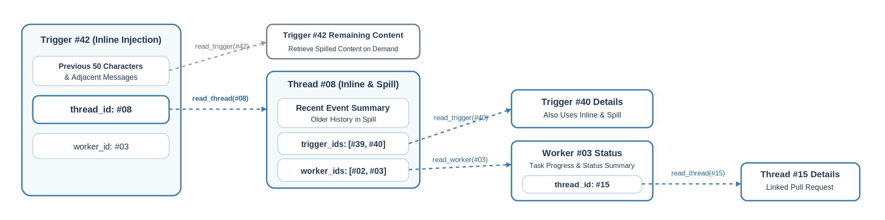

#### （4）推测执行（Speculative Execution）
借鉴 CPU 分支预测与推测执行思想：当内部群聊正在讨论某个疑难问题或可能方案时，Worker 可以依据预设的“静默复现与修复”规则，在后台悄悄尝试复现 Bug 并寻找最小修复补丁。**只有当确认复现成功且得出简洁可靠的 Fix 时才提交 PR 并通知人类；一旦中途卡住或无解，全程静默丢弃**——用廉价的后台算力换取人类体验上的“零等待”。

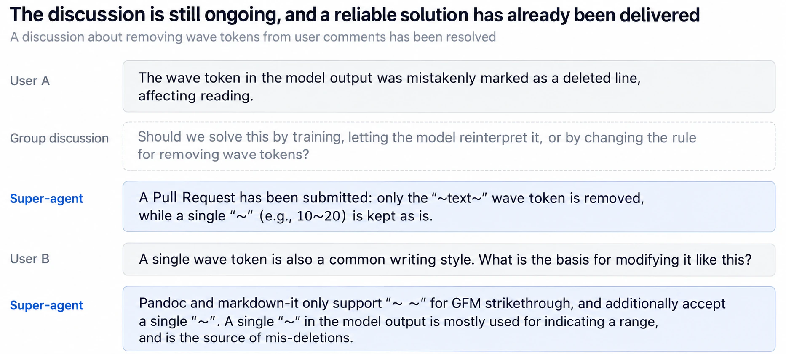

---

### 3.3 模块三：以人为中心的交互（全双工异步 ReAct + 渠道带宽适配）

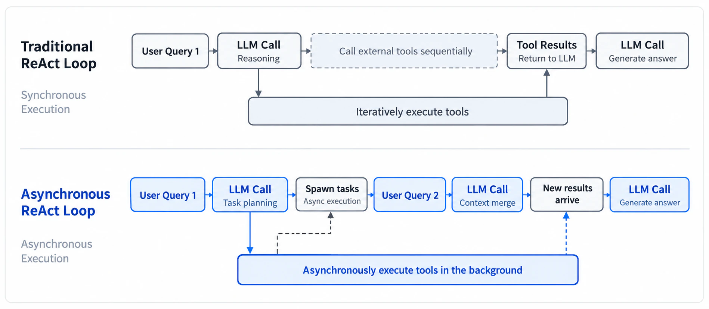

1. **全双工异步 ReAct 循环**：传统同步 `run()` 工具调用会锁死整个会话直至命令结束。Super-agent 将耗时命令与子任务改为异步的 `start()` / `stop()` 原语：模型调用 `start()` 后立即收到 `Started` 状态并释放当前步骤控制权；当后台任务结束时，结果作为一条新事件注入会话收件箱唤醒模型；模型也可随时依据新用户输入调用 `stop()` 止损。这使得智能体可以在执行长测试的同时实时响应人类插话。
2. **渠道带宽自适应**：
   - **IM 群聊（低延迟、低容忍打扰）**：强制执行“极简交付原则”——不输出推理过程、只在需拍板或验收时发声，**每条回复硬性限制不超过 100 词（100 words）**。
   - **GitHub / 邮件 / 文档（异步、高信息密度）**：输出详尽的问题根因、修改文件清单、实测验证证据与清晰结构。

---

### 3.4 模块四：计算、状态与环境两步解耦（BYOM 架构）

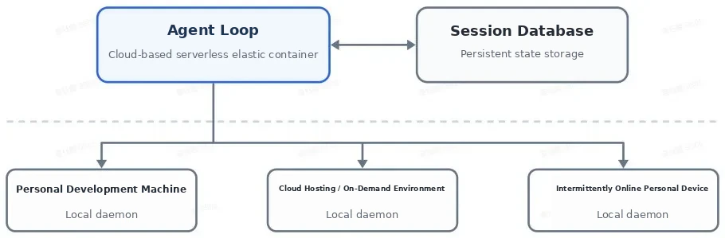

为了让 Super-agent 既能在云端 7×24 小时不间断运行，又能访问开发者本地的真实工程现场（未提交的 Git 改动、内网服务、本地私有硬件与工具链），DeepSeek 采取了两层解耦：
1. **计算与状态分离**：Agent Loop 的推理调度跑在云端无状态弹性容器中，而 Session 历史、工单、事件队列持久化在云端数据库，摆脱单台宿主机休眠或重启的影响。
2. **计算与执行环境分离（BYOM — Bring Your Own Machine）**：不同步整个笨重环境上云，而是在用户日常开发机上运行一个**无状态的轻量级执行守护进程（Daemon）**，只负责按云端指令执行命令并回传结果。相比 Anthropic 在托管云沙箱中所讲的“大脑与双手解耦”，DeepSeek 更强调连接**间歇性在线的个人日常开发机**——哪怕用户合上笔记本下班，第二天一开机，云端常驻大脑就能自动恢复未竟的本地任务。

---

### 3.5 模块五：外部 Watchdog（任务语义级而非进程级监工）

传统分布式系统的 Watchdog 只检查进程活着没有（PID / 心跳）；但 Agent 系统最致命的故障往往是**进程活着、HTTP 200 正常，但大模型陷入了死循环、工具空转或偏离了原定任务目标**。
因此，DeepSeek 在主系统外部部署了一个由定时消息触发的独立 **Watchdog Session**：
- 具备模型语义判断能力：主动巡检各 Worker 是否在取得实质进展、是否跑偏；
- 具备修复与热更新能力：发现间歇性外部故障可自动重试恢复；同时它本身也是一个配备全套工具的 Agent，人类维护者可以直接用自然语言向它询问故障诊断，甚至让它在不重启主系统的前提下**动态热修改运行中的 Prompt 与触发规则**。

---

## 四、实验验证、消融分析与反直觉发现

### 4.1 端到端消融实验：系统架构隔离 vs. 提示词工程

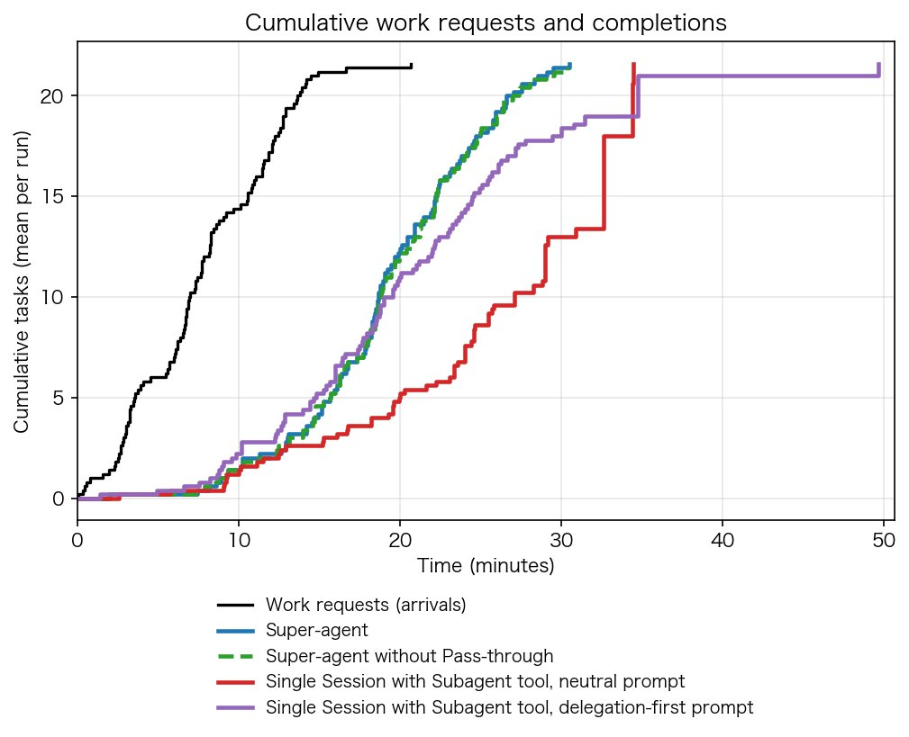

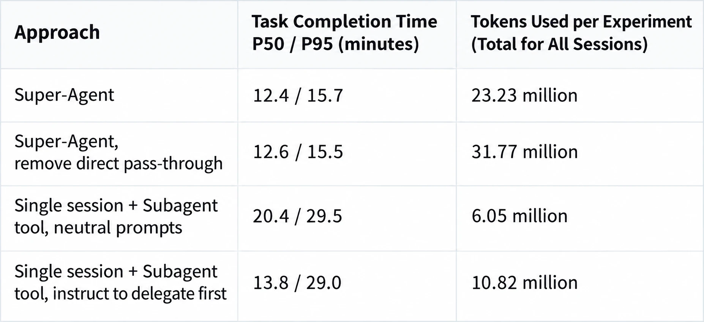

作者构造了一套剥离单任务编码方差的纯调度基准：用约 300 条群聊与 GitHub CI 混合消息流（含约 20 条真实工作请求，其余为闲聊、追问、停工指令和 CI 通知）驱动 4 种架构方案，每种重复运行 5 次。具体编码动作被替换为纯耗时的模拟工具，并将消息间隔与工作时长按原值缩放为 1/4（模型调用延迟保持真实）。

从实验曲线与对比表（图 12、图 13）中可以提炼出三个极具工程价值的洞察：

1. **为什么 Prompt 委派在并发场景下注定失效？**
   - 在 **中性 Prompt** 下，单 Session + Subagent 方案在全部 5 次运行中 **0 次调用 Subagent**（P50 = 20.4 分钟，P95 = 29.5 分钟）。模型倾向于“既然我能直接调工具，就自己做了”，结果每次新群聊消息涌入都会打断它的执行。
   - 在 **强迫优先委派 Prompt** 下，虽然 P50 改善至 13.8 分钟，但仍有 1 次运行因模型主观判定某条请求属于“小事情（small things）”而亲自下场，在累计完成曲线上拉出了那条长达 **49+ 分钟才全部收尾的紫色长尾**（P95 高达 29.0 分钟）。
   - **启示**：不能把系统并发架构的稳定性押注在模型“每次都能克制自己不去调工具”的 Prompt 自觉上；必须像 Super-agent 那样从**工具集物理隔离（Router 无执行工具）与路径隔离（Worker 只收订阅 Thread 消息）**层面根除这一风险。

2. **反直觉发现：订阅直通（Direct Pass-through）没加速任务，却省下了 37% 的全系统 Token！**
   - 对比 `Super-agent` 与 `Super-agent (remove direct pass-through)` 可以发现：两者的 P50（12.4 vs. 12.6 分钟）和 P95（15.7 vs. 15.5 分钟）几乎持平。
   - 然而，一旦撤掉订阅直通让所有后续消息重新绕回 Router，Router 的决策次数激增约 **30%**，全系统每次实验的总 Cache-Read Token 消耗从 **23.23 million 暴涨至 31.77 million（+37%）**！这意味着直通机制的核心收益是**大幅卸载全局大脑的推理负担与上下文开销**，避免“杀鸡用牛刀”。

3. **Token 与延迟的显式架构权衡**：
   - Super-agent 虽然以 **23.23M Token**（对比单 Session 中性 Prompt 的 6.05M 或优先委派的 10.82M）换取了低至 15.7 分钟的 P95 尾延迟与极致稳定性，但需要注意此处统计的是多个独立 Session 上下文带来的 **Cache-Read Tokens**。在实际工程部署中，由于各 Session 前缀高度稳定，Prefix Caching（上下文缓存命中）可以大幅摊薄这部分 Token 的真实经济成本与首字延迟。

### 4.2 Router 层压测与隐式 Prefill 批处理规律

在 Section 7.2 中，作者使用真实模型驱动 Router、Mock 模型驱动 Worker，将需决策 Trigger 到达率从 **1 条/分钟** 逐步加压至 **40 条/分钟**，得出如下压测规律：

| Trigger 到达率 | 平均批处理大小（Average Batch Size） | 单次 LLM 请求耗时 | 均摊到每次决策的推理时间 |
| :---: | :---: | :---: | :---: |
| ~1 条 / 分钟 | **1.0** | **2.5 秒** | **6.4 秒** |
| ~40 条 / 分钟 | **2.8** | **3.9 秒** | **1.6 秒** |

> [!NOTE]
> **配图勘误说明**：在本归档引用的网页英文镜像中，第 7.2 节配图 `配图/batching.png` 被镜像站点误替换为了一张训练 Batch Size 与 Loss/Accuracy 的示意图。本综述已在上表严格依据原文正文精确还原真实的 Router 压测数据，阅读时请以上述实测数据表为准。

- **反直觉的“越忙均摊越快”效应**：当到达率放大 40 倍时，单次推理请求耗时仅从 2.5s 温和上升到 3.9s（增幅 56%），而平均每批合并处理的 Trigger 达到 2.8 个，使得**均摊到每次路由决策上的耗时反而从 6.4s 骤降至 1.6s（效率提升 4 倍）**！
- 这用定量数据验证了一个重要工程原则：**不要过早对全局 Router 进行分片（Premature Sharding）**。在一般团队负载下，基于推理排队自然形成的 Prefill 并行批处理已足够消化突发峰值；过早分片反而会破坏全局上下文连续性这一核心优势。

---

## 五、从论文蓝图到真实工程：`dsh-superagent-prototype` 硬核源码剖析

随技术文章同步开源的 [`deepseek-ai/dsh-superagent-prototype`](https://github.com/deepseek-ai/dsh-superagent-prototype)（本地已完整归档于 [`dsh-superagent-prototype/`](./dsh-superagent-prototype/)）不仅是论文的伴生代码，更是一份教科书级的 **Agent Harness 工程参考架构**。阅读其 `docs/000`–`008` 设计文档与 `src/` 核心源码后，我们可以看到论文未展开的诸多生产级细节——甚至可以总结为一句洞察：**“Super-agent 的技术难点一半在并发调度，另一半在边界控制与授权可审计性。”**

### 5.1 核心哲学：把“人类注意力预算”写进系统第一定律

在 [`docs/000-philosophy.md`](./dsh-superagent-prototype/docs/000-philosophy.md) 中，团队开宗明义给出唯一准绳：

> **“Take as little human attention as possible, and give as much value as possible.”（消耗尽可能少的人类注意力，提供尽可能多的价值。）**

由此推导出 Agent 行为的五条铁律：
1. **只按请求或书面规则行动**：不请自来的主动工作必须匹配团队预先写下的规则，且新规则默认以 **仅记录模式（`observe`）** 启动，确认无误后再放开。
2. **非必要不开口**：确认接单时只回复一句具名确认；干活期间保持安静；仅当需要人拍板、可以交付可审查结果或彻底卡死时再发短消息（IM 默认一句话，硬上限 100 词）。
3. **一次只问一个具体问题**：通过结构化表单字段（`human_action`）提问，绝不把问题埋在长篇大论的报告里。
4. **按“影响范围”而非“工作量”停手**：局部修复直接做到可 Review 的 PR；一旦涉及未定夺的架构/产品设计决策，立即停止并提问，绝不自作主张。
5. **如实汇报**：草稿明确标记未完成，失败报失败，绝不绕过限制掩盖问题。

### 5.2 领域模型全景映射：11 个核心概念与被刻意否决的反模式

[`docs/001-domain.md`](./dsh-superagent-prototype/docs/001-domain.md) 与 [`src/core/model.ts`](./dsh-superagent-prototype/src/core/model.ts) 构建了一套极其克制的领域模型（Domain Model），其流转拓扑如下：

```text
Source ──(Trigger)──▶ Thread ──(Batch)──▶ Eval (Gate准入 + Assessment研判)
                        │                     │
                        │                     ├─ accept (生成 Mandate) / stop ──▶ Ticket
                        │                     └─ ignore / unavailable ──▶ 仅记录归档
                        ▼ (Subscription 扇出直通)
                      Ticket ──(Assignment)──▶ Executor (独立 Session + 独立工作目录)
                        │
                        └─(Channel)──▶ Source (回写确认/追问/PR/评审回复)
```

- **被刻意否决的 12 个反模式（Rejected Concepts）** 是这份文档中最具洞察力的部分之一，例如：
  - **不设跨渠道统一“自然人（Principal）”实体**：个人在飞书和 GitHub 的账号映射不写入硬编码领域实体，而是作为 Team Skill 文本供模型按需阅读；准入白名单严格按 Source 原生身份各自管理，消除账号绑定同步灾难。
  - **Ticket 状态绝不直接跟随 DSH Session 状态**：因为一个 Ticket 可能跨越多次重试、重启恢复、人工接管乃至切换多个 Executor，必须由领域层独立定义 Ticket 阶段（`person/delivery`、`person/answer`、`person/review`、`person/blocked`、`working/queued`、`idle`、`working`）。
  - **Executor 无权自行宣布“人类让我停下来”**：即便人在对话里说了“stop”，Executor 也不能直接以此结单或撤销授权，必须作为普通 Trigger 经过 `Eval` 判定 `stop`，确保授权生命周期的单一事实来源。
  - **策略变更（Policy Change）不粗暴强杀运行中的 Ticket**：中途强杀会留下半拉子脏代码；系统改为记录版本变更并向受影响的在途 Ticket 注入 `PolicyChanged` 通知，仅在已结束 Ticket 准备恢复（Resume）时执行强制重验（Revalidation）。

### 5.3 “重点不是自治，而是授权”：三格准入表与 Mandate 体系

在 [`docs/002-authorization.md`](./dsh-superagent-prototype/docs/002-authorization.md) 与 [`src/policy.ts`](./dsh-superagent-prototype/src/policy.ts) 中，代码对权限边界做出了极为严密的划分：

1. **三格准入表（Admission Table）**：针对每个接收作用域（如特定飞书群、GitHub Issues/PR/Comments/Default Branch CI），分别定义三类场景的准入强度：
   - 白名单成员 + 未 `@` Agent：默认 `inferred`（可作为主动触发候选）或 `ignore`；
   - 非白名单成员 + `@` 了 Agent：可设为 `explicit`（如公共支持群）、`inferred` 或 `ignore`（默认）；
   - 非白名单成员 + 未 `@` Agent：默认 `ignore`。
2. **渐进式接纳模式（Accept Mode）**：
   - `off`：所有推断类候选全部丢弃，仅响应显式请求；
   - `observe`（默认安全模式）：运行模型评估并将命中记录为 `ignore ("would accept")`，**不真实创建工单、不改代码、不发消息**，供团队空跑审计；
   - `auto`：评估命中且方向明确时，才真正立项执行。
3. **Mandate（不可变授权凭证）与 Follow-up 归属权**：
   - 每个 Ticket 在立项时都会绑定一份不可变的 `Mandate`，记录当时的 `Policy version`、授权范围（Scope）、授权强度（`explicit` / `inferred`）、命中的规则列表与原始请求人身份。
   - **Follow-up 归属机制**：在已订阅 Thread 上人类发出的后续追问，默认直接归当前 Ticket 的 Executor 决定（走代码直通，不经 Eval），只有当 Executor 显式调用 `handback` 退回（认为超出本工单范围）或 Ticket 结束时未读取该消息，才会重新释放回 `Eval` 评估是否新开 Ticket。

### 5.4 确定性工程内核：`Engine` + SQLite `Effects` Outbox 事务模式

阅读 [`src/core/engine.ts`](./dsh-superagent-prototype/src/core/engine.ts) 与 [`src/app/effects.ts`](./dsh-superagent-prototype/src/app/effects.ts) 可以看到一套工业级后端系统的影子，这是很多纯 LLM 框架极度缺失的稳定性底座：

1. **全同步事务内核 + 异步 Outbox 副作用队列**：
   - `Engine` 的所有核心状态变更方法（`receive`、`decide`、`attach`、`report`、`threadClosed` 等）全部是**同步方法**，在同一个 SQLite `repo.atomic(...)` 事务内原子修改 `Trigger`、`Thread`、`Decision`、`Ticket` 与 `Assignment` 状态。
   - 所有外部副作用（向主 Session 投递评估卡片 `assessment`、准备目录并拉起 Worker `launch`、投递输入 `delivery`、转发汇报 `relay`、发送外部渠道回复 `reply`）全部在事务内部通过 `Effects.enqueue(kind, key, payload)` **先落盘进 SQLite `effect` 表，等事务真正 Commit 之后再在 `afterCommit` 异步执行**！
   - 借助 `seq`（队列保序）与 `generation`（防覆盖并发乐观锁）字段，外加 `Later` 延迟异常（如 Worker 并发槽位已满或系统暂停时重排而不计入失败次数）与指数退避重试，系统做到了**任意时刻进程崩溃重启后，所有未发出的消息、未启动的任务、未读取的输入均可精确断点恢复，且绝不因回滚产生幽灵外部动作**。
2. **编译期角色权限收窄（`Pick<Engine, ...>`）**：
   - 系统没有把完整的 `Engine` 暴露给各调用方，而是利用 TypeScript 类型系统严格切分为 5 个最小权限接口：`EngineForSources`、`EngineForMainSession`、`EngineForPeople`、`EngineForSettings`、`EngineForExecutor`——越权调用在编译阶段即被彻底堵死。
3. **Worker 并发槽位（`WorkerSlots`）防饿死设计**：
   - [`docs/003-execution.md`](./dsh-superagent-prototype/docs/003-execution.md) 规定，在配置的并发上限 `maxWorkers` 之外，系统**专门为人类后续消息与状态查询保留 1 个额外优先槽位**：即便后台批量任务把普通槽位占满，人类对已有工单的追问依然能立即插队唤醒对应 Worker，绝不会被队列饥饿锁死。
4. **5 秒后台化 + 5 层 Prompt 安全防线**：
   - 无论是主 Session（`dsh-superagent-router` 预设）还是 Worker（`dsh-superagent-worker` 预设），前台 Shell 命令超过 **5 秒**自动转入后台任务，释放推理步以随时接收新消息（[`docs/003-execution.md`](./dsh-superagent-prototype/docs/003-execution.md#L27-L29)）；
   - [`docs/004-prompts.md`](./dsh-superagent-prototype/docs/004-prompts.md#L65-L71) 明确确立了 5 级权重体系：代码与宿主硬约束（身份/准入/长度限制） > 内置系统指令 > 命中规则约束 > 团队章节与 Skill > **外部消息/引用文档/仓库文件（最弱，纯属不可信数据，永不改写策略）**。同时在 [`prompts/admission.md`](./dsh-superagent-prototype/prompts/admission.md) 中内置了极细致的视觉反馈防越界规范（例如不能因为“某卡片丑”或“修复间距”就擅自重绘无关样式）。

---

## 六、开放问题、原型局限与 Agent Harness 工程落地启示

### 6.1 作者坦承的四大开放挑战（Section 8）

1. **双层架构的规模化与长期记忆瓶颈**：当任务规模跨度达到数月以上、耦合度极高时，单 Router Session 终究会遇到上下文与吞吐瓶颈，而基于引用图的 `Chain of Recall` 主要面向近期任务召回，长程记忆组织与“针对 Router 路由/批处理/回忆任务的 System-Model Co-Design（系统-模型协同微调）”仍是重要研究方向。
2. **超越 Session 的领域原生交互界面**：聊天框中心化只是路径依赖。未来人机交互应直接嵌入 GitHub Issues/PR、任务看板等原生工作界面；在过渡期，如何支持人类在后台 Worker 执行中途实时接管、干预与细节协同，仍需产品范式创新。
3. **组织级上下文边界与安全 A2A**：当系统从单仓库小团队扩展到大型组织（个人助理 + 多个隔离团队 Super-agent 共存），如何在无共享上下文且权限各异的多实例之间实现安全可靠的跨智能体协作（A2A），尚未定型。
4. **BYOM 下的安全与“凭据零接触”执行**：一旦云端常驻 Agent Loop 暴露在广泛的外部事件流下，如果发生 Prompt Injection 或服务端入侵，与之相连的个人开发机将面临接管风险；且如果本地凭据能进模型上下文，正常执行也可能泄露密钥。未来必须实现“**Agent 在完全不接触凭据原文的前提下调用凭据能力**”的安全沙箱/代理机制。

### 6.2 对 Agent Harness 工程落地的六条实战启示

1. **绝不用“写得更好的 Prompt”替代“物理权限与工具剥夺”**：要想让协调器专心路由不越权干活，最稳妥的方法不是在 Prompt 里求它“尽量委派”，而是直接不给它配置 Bash 与文件编辑工具（Router 无执行工具），并用架构保证结果只能通过结构化通道回流。
2. **引入“灰度观测模式（`observe`）”作为自主 Agent 的出厂默认态**：任何主动触发规则上线前，先让 Agent 只做评估判断并记下“would accept”日志而不实际动手，待人工审计准确率达标后再切换至 `auto`。
3. **将一切外部副作用关进“事务内落盘、提交后执行”的 Outbox 笼子**：多智能体系统极易因半途崩溃导致“数据库没记账、群消息已经发出”或重复建单；采用类似 `Engine + SQLite Effects` 的本地事务日志模式，是实现 7×24 小时持久可恢复的基石。
4. **把上下文窗口当作 CPU L1 Cache 经营（Inline & Spill + Chain of Recall）**：既不要把整条长线程一次性塞爆窗口，也不要只给一个空 ID 逼模型多跑 5 轮 Tool Call；默认内联邻近高概率线索 + 截断指针 + 下一跳关联 ID，才能在有限上下文下维持多跳检索精度。
5. **通过订阅直通（Fast Path）卸载中心节点推理开销**：中心协调器只负责建单与跨任务协调，一旦任务与线程绑定，后续追问、CI 报错与 Review 反馈全部由确定性代码直接推送给执行器，能立省约 30% 以上的中心推理决策与近 40% 的整体缓存读取开销。
6. **区分“进程探活”与“语义监工（Watchdog）”**：真正的长程自主系统必须引入脱离主循环的独立检查者，定期识别“工具空转死循环”与“目标漂移”，同时保留在人类自然语言指令下热修规则与提示词的后门通道。
