# 抛弃目标：纯粹通过寻求新颖性驱动演化（Novelty Search）深度精读综述

> **论文题目**：Abandoning Objectives: Evolution Through the Search for Novelty Alone  
> **论文作者**：Joel Lehman, Kenneth O. Stanley  
> **第一作者单位**：Evolutionary Complexity Research Group (EPlex), University of Central Florida  
> **发表刊物**：*Evolutionary Computation* (MIT Press), 2011, 19(2): 189–222  
> **DOI 索引**：[10.1162/EVCO_a_00025](https://doi.org/10.1162/EVCO_a_00025)  
> **论文 PDF 归档**：[`./Abandoning_Objectives_Evolution_Through_the_Search_for_Novelty_Alone.pdf`](./Abandoning_Objectives_Evolution_Through_the_Search_for_Novelty_Alone.pdf)  
> **配图资产目录**：[`./综述配图/`](./综述配图/)  
> **核心源码/Demo**：[Novelty Search C++ (EPlex Lab)](http://eplex.cs.ucf.edu/noveltysearch/)

---

### 📌 一句话全景概括
**本篇奠基之作打破了优化理论与机器学习长达半个世纪的“目标函数至上”信仰**：在包含复杂欺骗性（Deceptive）的广阔搜索空间中，传统的显式目标函数就像一只“坏掉的指南针”，不可避免地将系统引向致命的局部极值陷阱；而**彻底放弃目标函数、纯粹以行为新颖性（Novelty Metric）驱动搜索**的算法（Novelty Search），不仅不会漫无目的地迷失，反而能奇迹般地跨越垫脚石（Stepping Stones），以更低的样本评估代价、演化出更加紧凑简练的神经网络，彻底破解了硬核控制与导航问题，并奠定了现代**开放式演化（Open-Ended Evolution）**与**质量-多样性（Quality-Diversity / MAP-Elites）**的理论基石。

---

## 0. 三分钟读懂（Executive Summary）

### 0.1 核心范式对比：目标驱动 vs 新颖性驱动

| 评估维度 | 传统目标驱动搜索 (Objective-based Search) | 新颖性搜索 (Novelty Search) |
| :--- | :--- | :--- |
| **核心驱动信条** | “距离预设终点更近就是更好的” (Greedy Progress) | “做与以往所有个体都不同的事” (Behavioral Innovation) |
| **梯度引导工具** | 显式适应度函数（Fitness Function，容易退化为**坏掉的指南针**） | 行为特征空间中的 $k$ 近邻稀疏度度量（$k$-NN Novelty Metric） |
| **应对欺骗性死胡同** | ❌ **深陷陷阱**：终点墙外的局部极值具有极高适应度，演化反复撞墙 |  **平滑绕行**：死胡同一旦被访问过便不再新颖，演化被动转入新路径 |
| **对待“垫脚石”中间态** | ❌ **无情淘汰**：中间过渡解（如向后退步绕行）因适应度下降被直接抹杀 |  **主动接纳**：只要动作形态不同，任何探索性中间态都是宝贵突破口 |
| **生成网络结构规模** | ❌ **过度膨胀（Bloat）**：为越过死胡同被迫堆叠无意义的连接与神经元 |  **极其精简**：从最简拓扑平滑延伸，以极低复杂度解决任务 |
| **终极应用哲学** | 规划既定收敛（Why Greatness CAN be planned? 伪命题） | 开放式自发涌现（后来诞生经典名著《为什么伟大不能被计划》） |

---

### 0.2 全文思想演进与算法架构图解

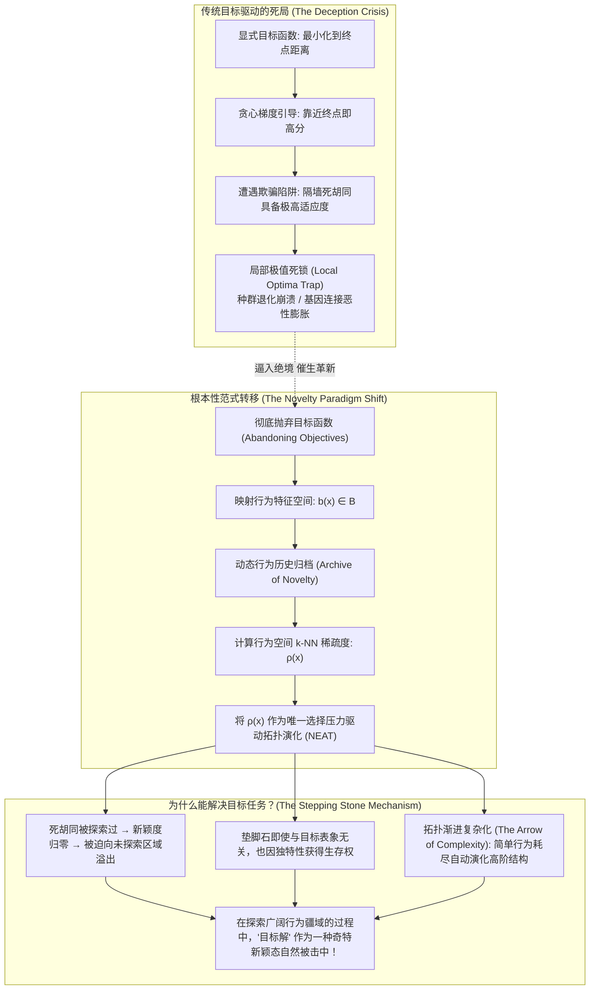

---

### 0.3 五大颠覆性量化结论对比

1. **欺骗性困难迷宫成功率**：在含有深度死胡同隔墙的困难迷宫（Hard Map）中，目标驱动搜索因适应度欺骗几乎全军覆没，**成功率仅 7.5% (3/40)**；而完全不知道终点在哪里的新颖性搜索取得了 **97.5% (39/40)** 的绝对胜利。
2. **搜索效率反超 300%**：在中等难度迷宫中，新颖性搜索平均仅消耗 **18,274 次** 评估即破解迷宫；而传统适应度搜索耗费了 **56,334 次** 评估，速度反而慢了 3 倍之多（$p < 0.001$）。
3. **基因与网络结构极度精简**：
   - 迷宫实验：传统适应度搜索解平均包含 **66.74 个神经连接**；而新颖性搜索仅需 **24.60 个神经连接**（降低 63% 冗余复杂度）；
   - 双足行走实验：传统搜索为了挣扎脱困堆积了 **272.90 个连接**，而新颖性搜索仅消耗 **87.52 个连接**（$p < 0.001$）。
4. **随机搜索（Random Search）基线对照**：随机选择在困难迷宫中成功了 4/40，证明传统目标函数在欺骗环境下甚至**弱于随机搜索**；而新颖性搜索（39/40）验证其具有高度有序、高效的行为前沿推进力。
5. **双足行走质变现象**：在 3D 动力学双足机器人实验中，传统搜索陷入了“向前倾倒”（Falling Forward，一次性获得 1~2 米虚假位移奖励）的欺骗陷阱；新颖性搜索则在 **80% 的实验批次中自主涌现出可持续的周期性振荡步态（Oscillatory Gaits）**，最远行走距离达到传统方法的两倍以上（13.7 米 vs 6.8 米）。

---

## 1. 动机与核心背景问题：目标的欺骗性与“坏掉的指南针”

### 1.1 传统优化的核心假定及其破产
自遗传算法（GA）、进化策略（ES）以及强化学习（RL）诞生以来，优化领域一直遵循一条不成文的铁律：**必须定义一个度量当前状态距离最终目标有多近的标量函数**（即适应度函数 Fitness Function 或奖励函数 Reward Function）。演化算法通过向着适应度更高的梯度方向选择个体。

然而，作者指出：**在任何复杂的非凸搜索空间中，这一假设几乎都是脆弱且自欺欺人的**。

<p align="center">
  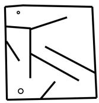
  <br>
  <em>图 1：困难欺骗性迷宫（Hard Deceptive Map）。起点位于左侧大圆，终点位于右上角小圆。在终点隔墙背后的深凹死胡同处，机器人到终点的欧氏直线距离极近（适应度极高），但该处是一堵死墙。传统目标搜索在此处产生极强的适应度吸引子，彻底死锁。</em>
</p>

### 1.2 什么是欺骗性（Deception）？
- **局部极值（Local Optima）的本质**：在现实或复杂控制任务中，通往真正目标的路径绝不是平滑单调的直线。例如在迷宫中，要想绕过阻挡在目标前面的墙壁，智能体必须**先转身远离目标、向相反方向探索**。
- **坏掉的指南针（The Broken Compass）**：显式目标函数在此时沦为一个“坏掉的指南针”。它无情惩罚那些“远离目标”的正确中间探索，奖励那些“紧贴阻隔墙、离目标直线距离最近”的死胡同个体。演化算法由此变成在死胡同内反复撞墙、互相杂交的近亲繁殖，丧失了一切真正逃逸的可能性。

### 1.3 “垫脚石”（Stepping Stones）悖论
作者 Lehman 与 Stanley 提出了著名的**演化垫脚石假说**：
> **复杂突破性创新的每一个前置阶段（垫脚石），在宏观表象上往往与最终目标毫不相干，甚至背道而驰。**

- **自然界类比**：
  - 鸟类的**羽毛**最早演化出来是为了**体温调节与保暖**，完全不是为了“飞行”；如果大自然预先设定了“以能否飞向天空”为适应度函数，拥有初代原始绒毛的爬行动物将因为“完全不能飞”而被无情灭绝！
  - 计算机技术的前置垫脚石是**真空管**，而真空管的发明源于改良白炽灯泡的物理实验，与现代信息计算没有半点直接联系。
- **目标驱动对垫脚石的扼杀**：
  在目标驱动的搜索中，如果一道垫脚石由于其暂时降低了适应度（例如为了绕出迷宫而往回跑），目标函数就会直接判定其为“劣质突变”并将其从种群中清洗出局。**因此，越是宏大而富有野心的目标，显式目标函数对垫脚石的扼杀就越是致命！**

---

## 2. 新颖性搜索（Novelty Search）核心算法与数学推导

为了彻底终结“坏掉的指南针”，作者做出了演化计算史上最具革命性的决策：**将目标函数连根拔起，完全不以“接近目标”为奖励依据，转而纯粹度量个体行为的“新颖程度”（Novelty）**。

### 2.1 行为特征空间（Behavior Space）映射
在传统的基因算法中，个体的差异往往在基因型（Genotype，如神经网络权重）中度量；而新颖性搜索强调在**表型行为空间（Behavior / Phenotype Space）**中进行度量。

令个体 $x$ 经过环境仿真交互后，提取出一个低维或特定维度的行为特征描述向量：
$$b(x) \in \mathcal{B} \subset \mathbb{R}^D$$

- **在迷宫导航任务中**：$b(x) = (x_{end}, y_{end})$，即机器人在仿真时间结束时的最终终止二维坐标；
- **在双足行走任务中**：$b(x)$ 可以是机器人的行走质心位移以及足部接地传感器序列等动态特征。

> [!NOTE]
> **关键设计原则**：行为描述向量 $b(x)$ 刻画的是“个体在环境中做了什么”，而**不包含任何关于“终点在哪”或“表现好坏”的主观评分**。

---

### 2.2 新颖性度量（Novelty Metric）核心数学公式
如何衡量一个个体 $x$ 的行为是否具有“新颖性”？作者提出了基于行为特征空间中的 **$k$ 最近邻稀疏度度量（$k$-Nearest Neighbors Sparsity）**：

$$\rho (x) = \frac {1}{k} \sum_ {i = 0} ^ {k-1} \mathrm{dist} (b(x), \mu_ {i})$$

其中：
- $\mu_i$ 表示在**当前演化种群 $\mathcal{P}$** 与**历史行为归档集 $\mathcal{A}$（Archive）**的并集 $\mathcal{P} \cup \mathcal{A}$ 中，距离个体 $x$ 的行为特征 $b(x)$ 最近的第 $i$ 个近邻个体；
- $k$ 为近邻数量超参数（在论文实验中通常设为 $k = 15$）；
- $\mathrm{dist}(\cdot, \cdot)$ 为行为空间中的距离度量函数（通常使用标准欧氏距离）：
  $$\mathrm{dist}(b(x), b(y)) = \|b(x) - b(y)\|_2$$

$$\rho(x) \text{ 越大} \iff \text{个体周围的已知行为越稀疏} \iff \text{该行为具有极高的新颖性}$$

<p align="center">
  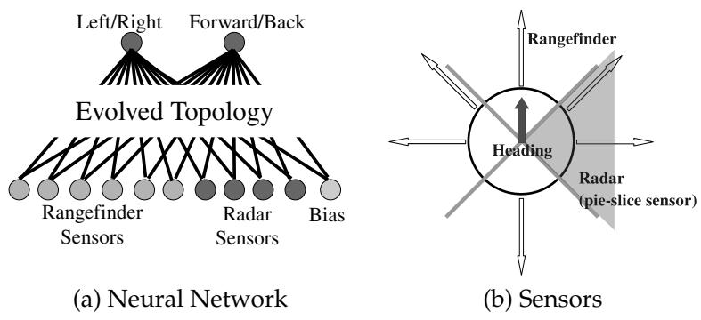
  <br>
  <em>图 2：迷宫导航机器人感知与神经网络控制器。左侧 (a) 为 NEAT 演化的拓扑可变神经网络；右侧 (b) 为机器人本体，配备 6 个测距雷达与 4 个扇区目标雷达。</em>
</p>

---

### 2.3 动态行为归档机制（Archive of Novel Behaviors）
若仅计算当前种群 $\mathcal{P}$ 内部的近邻距离，演化可能会陷入在几种常见行为之间来回翻转的“无意义摆动”（Cycling）。因此，新颖性搜索引入了**动态历史归档集 $\mathcal{A}$**，作为系统的长期演化记忆库。

#### 1. 归档准入规则
在每一代演化中，若一个个体的新颖度超过了当前动态门限 $\rho_{min}$，则将其行为 $b(x)$ 永久加入归档集：
$$b(x) \in \mathcal{A} \iff \rho(x) > \rho_{min}$$
为了防止过早漏掉稀有行为，初始阈值设定为 $\rho_{min}^{(0)}$（迷宫中设为 6.0，双足实验设为 1.0）。

#### 2. 自适应阈值动态调整（Adaptive Threshold）
为了防止归档爆炸或停滞，新颖性搜索内置了动态负反馈调节策略：
- **上调机制**：如果在连续 4 代内，被添加进归档集 $\mathcal{A}$ 的个体数量超过了设定上限（例如 4 个），说明当前进入门槛太低，系统提高阈值：
  $$\rho_{min} \leftarrow \rho_{min} \times 1.2$$
- **下调机制**：如果系统连续经历了 2,500 次评估（Evaluations）都没有任何一个个体能够达标入选归档，说明演化前沿遭遇了探索瓶颈，系统放宽门槛：
  $$\rho_{min} \leftarrow \rho_{min} \times 0.95$$

---

### 2.4 结合 NEAT：拓扑渐进复杂化（The Arrow of Complexity）
新颖性搜索必须搭配合适的基因表示法。如果使用固定维度、超参数过大的神经网络，搜索空间就会无限大。
作者选择将新颖性搜索与 **NEAT（NeuroEvolution of Augmenting Topologies）** 深度结合：

1. **从极简网络开始（Start Minimal）**：初始种群没有任何隐藏层神经元，仅包含输入节点与输出节点之间的直接连接；
2. **拓扑结构自增突变**：演化允许随机新增节点（Add Node）与新增连接（Add Link）；
3. **复杂度的演化箭头（The Arrow of Complexity）**：
   - 简单的低维行为（如直行、原地打转）只需要极简的神经网络即可实现；
   - 随着这些简单行为被探索完毕并大量填入归档集，它们的新颖度 $\rho(x)$ 迅速趋近于零；
   - **演化被迫向外扩展**：为了获得更高的新颖性，种群不得不通过增加连接和神经元来探索更复杂、更高阶的非线性控制策略！
   - **因此，系统的网络复杂度是在新颖性需求的驱动下被动增加的，绝不发生无意义的基因膨胀（Code Bloat）！**

---

## 3. 经典实验深度剖析与消融实验

为了全面验证新颖性搜索的威力，论文精心设计了两组具有代表性的硬核实验：**迷宫导航（Maze Navigation）** 与 **3D 仿生双足机器人动态平衡行走（Biped Locomotion）**。

---

### 3.1 实验一：迷宫导航（中等迷宫 vs 困难欺骗性迷宫）

#### 1. 地图设置与实验对照
- **中等迷宫（Medium Map）**：存在一定转弯和路径选择，但不存在极端的死胡同欺骗陷阱；
- **困难迷宫（Hard Map）**：在直达终点的必经路径正前方设计了一条长长的死胡同。靠近终点处的墙后具有极小的欧氏距离，形成致命的适应度局部最优“深渊”。
- **算法对比组（每组均跑 40 次独立重复实验）**：
  1. `NEAT with Novelty Search`（新颖性搜索，完全抛弃终点目标）；
  2. `Fitness-based NEAT`（传统目标驱动搜索，以机器人终点距离目标的负欧氏距离为适应度）；
  3. `Random Selection`（完全随机选择基线，验证新颖性搜索绝非盲目随机）。

<p align="center">
  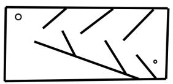
  &nbsp;&nbsp;&nbsp;&nbsp;
  
  <br>
  <em>图 3：(a) 中等迷宫；(b) 困难欺骗性迷宫。大圆为起点，小圆为目标。</em>
</p>

#### 2. 核心量化评测结果

下表汇总了三组方法在两个迷宫中的全部核心性能指标：

| 实验环境 | 算法方案 | 成功解决率 (Success Rate) | 成功所需平均评估次数 (Evaluations) | 最终解网络连接复杂度 (Connections) |
| :---: | :--- | :---: | :---: | :---: |
| **Medium Map**<br>*(中等迷宫)* | **Novelty Search** | **100% (40/40)** | **18,274 ± 20,447** | **24.60 ± 4.59** |
| | Fitness-based NEAT | 100% (40/40) | 56,334 ± 48,705 | 66.74 ± 56.70 |
| | Random Selection | 52.5% (21/40) | 127,967 ± 68,918 | 49.33 ± 18.28 |
| **Hard Map**<br>*(困难欺骗性迷宫)* | **Novelty Search** | **97.5% (39/40)** | **35,109 ± 30,236** | **33.46 ± 9.26** |
| | Fitness-based NEAT | ❌ **7.5% (3/40)** | 114,844 ± 84,409 | 48.00 ± 32.79 |
| | Random Selection | 10.0% (4/40) | 179,250 ± 62,357 | 45.75 ± 11.70 |

<p align="center">
  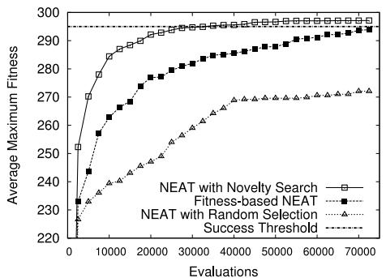
  &nbsp;
  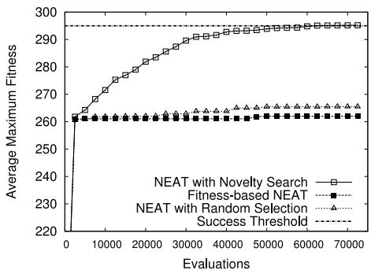
  <br>
  <em>图 4：演化评估次数与适应度变化曲线。在困难迷宫 (b) 中，目标驱动搜索完全被水平线（死胡同欺骗陷阱）截断；而新颖性搜索呈现出极其平滑且迅猛的突破上升曲线。</em>
</p>

#### 3. 轨迹分布对比：全域平铺 vs 局部聚集
通过记录演化过程中所有个体终点位置的散点图，两种范式的本质差异被展现得淋漓尽致：

<p align="center">
  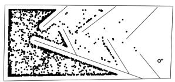
  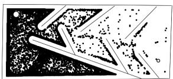
  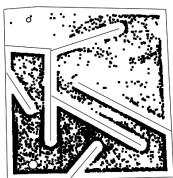
  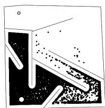
  <br>
  <em>图 5：典型运行中探索过的最终点分布。(a) 中等迷宫-新颖性；(b) 中等迷宫-目标搜索；(c) 困难迷宫-新颖性；(d) 困难迷宫-目标搜索。</em>
</p>

- **目标驱动（图 5b, 5d）**：散点呈现高度病态的**斑块聚集**。绝大多数个体密集地拥挤在距离终点最近的阻隔墙根处，反复在同一个局部死区浪费算力；
- **新颖性搜索（图 5a, 5c）**：散点如水流般**均匀、平滑地铺满整个迷宫的每一个角落**。正是这种无视目标的全面铺展，使得真正的出口自然而然被跨越！

---

### 3.2 深入消融与稳健性边界探讨

为了打消学术界对新颖性搜索的严苛质疑，作者针对算法的稳健性展开了四大维度的深度消融实验：

#### 1. 归档容量边界（Bounding the Archive Size）
- **质疑**：随着演化代数推进，归档集 $\mathcal{A}$ 无限膨胀，计算 $k$-NN 的距离时间复杂度是否会爆炸？
- **实验与结论**：作者限制归档容量上限（如仅保留固定数量），当容量满后采用随机替换或滑动窗口替换。实验证明，**即使大幅限制归档大小，新颖性搜索在困难迷宫上的成功率依然高达 95% 以上**，算法对归档容量表现出极其出色的宽容度。

#### 2. 无界开放空间的探索压力（Removing Walls / Unenclosed Map）
- **质疑**：迷宫之所以能成功，是否是因为外墙限制了行为空间的范围？如果在广袤无垠的开放空间，新颖性搜索会不会一去不复返？

<p align="center">
  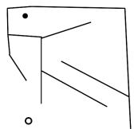
  <br>
  <em>图 6：无外墙开放式迷宫（Unenclosed Map）。机器人可以随意逃逸到无限空旷的外部空间。</em>
</p>

- **实验与结论**：在拆除外墙后，新颖性搜索的耗时确实显著增加。因为向无限延伸的外围空地狂奔是极其容易产生“廉价新颖性”（Trivial Novelty）的捷径。这揭示了一条重要规律：**新颖性搜索依赖环境或物理具身所提供的内在结构约束；在完全无约束的开阔空间中，需要引入适当的先验范围或多目标协同。**

#### 3. 行为表征维度扩张（Increasing Characterization Dimensionality）
- **实验**：不仅记录终止点 $(x, y)$，而是将机器人整条行驶轨迹采样为 $N$ 个离散时段的中间坐标点（特征维度从 2 维扩展到数十维）。

<p align="center">
  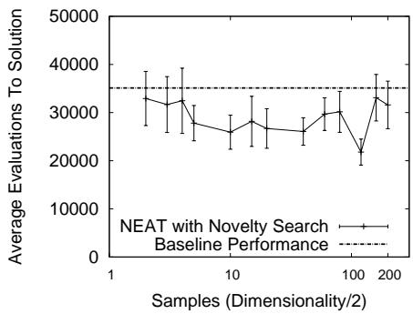
  <br>
  <em>图 7：行为特征维度扩展对评估次数的影响。随着采样点增多，维数灾难逐渐增加开销，但解题稳定性并未崩塌。</em>
</p>

#### 4. 行为混淆效应（Conflation）深度对比
- **什么是混淆（Conflation）**：如果两种完全不同的底层状态被粗暴地映射到了同一个行为特征上，算法就会误以为它们是“同一种东西”。
- **网格化粗粒度混淆 vs 适应度等高线混淆**：

<p align="center">
  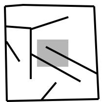
  &nbsp;&nbsp;&nbsp;&nbsp;
  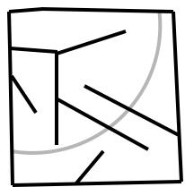
  <br>
  <em>图 8：(a) 空间网格粗粒化混淆；(b) 适应度等高线混淆（Fitness Conflation）。</em>
</p>

<p align="center">
  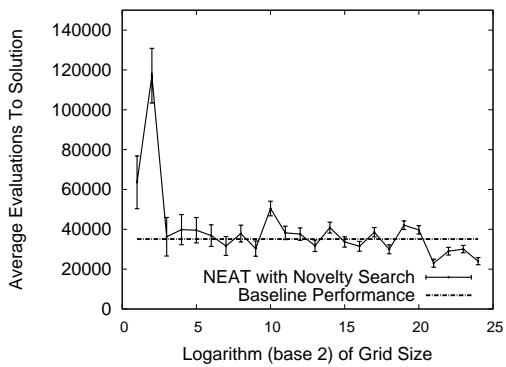
  <br>
  <em>图 9：不同粗粒度网格尺寸下的算法表现。只有在 $2 \times 2$ 这种极端残缺的分辨率下算法才失效，在一般粒度下新颖性搜索极为稳健。</em>
</p>

- **核心结论**：空间网格混淆（图 8a）只要分辨率不低于 $4 \times 4$ 网格，算法几乎不受任何负面影响（图 9）；而如果用“到终点的直线距离”作为行为表征（图 8b），由于同心圆等高线上所有点都被混淆为同一数值，演化会彻底崩溃。这证明了**几何与行为拓扑的多样性保留是算法免受欺骗的核心屏障**。

---

### 3.3 实验二：3D 仿生双足机器人动态行走（Biped Experiment）

如果说迷宫是一个人工构造的抽象验证场景，那么**逼真物理引擎下的 3D 双足机器人控制**则是机器人学界公认最容易遭受欺骗性摧毁的经典难题。

#### 1. 物理环境与具身控制架构
- **物理引擎**：基于 Open Dynamics Engine (ODE) 搭建具有真实重力、摩擦力、惯量与碰撞刚体动力学的双足人形系统；
- **机器人结构**：躯干（Torso）、左右大腿、小腿与脚掌，关节由比例力矩控制器驱动；
- **神经网络架构**：采用具有内部时间常数与反馈回路的**连续时间递归神经网络（CTRNN）**，网络输入仅为两只脚掌的离散地面接触传感器（Foot Contact Sensors）。

<p align="center">
  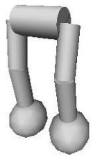
  <br>
  <em>图 10：ODE 动力学仿真环境中的 3D 双足机器人。由进化生成的 CTRNN 网络直接控制各关节力矩输出。</em>
</p>

#### 2. 双足行走中的致命欺骗性：向前扑倒（Falling Forward）
- 在传统的强化学习或演化计算中，通常以“机器人在 15 秒内质心向前移动的距离”为适应度函数；
- **然而这是一个极具欺骗性的陷阱**：机器人只需让双膝锁死、身体**直挺挺地向前扑倒在地**，其头部和躯干的质心瞬间就能向前砸出 1.5 ~ 2 米的位移！
- **陷阱后果**：贪心的适应度搜索极度青睐这种“扑倒动作”，因为只需微小的随机突变就能瞬间获得很高的早期分数；但是，一旦整个种群的基因全部收敛到“向前扑倒”，机器人在扑倒后便紧贴地面瘫痪，**演化陷入不可逆的局部极值死锁**，再也无法迈出真正的双腿交替步伐！

#### 3. 新颖性搜索的设计与战果
- **行为表征向量**：提取机器人足部在仿真周期内的周期性着地状态转换以及质心动力学特征；
- **行走距离评测（50 次独立实验）**：

| 评估指标 | 传统目标驱动搜索 (Fitness Search) | 新颖性搜索 (Novelty Search) | 统计显著性 |
| :--- | :---: | :---: | :---: |
| **平均行走距离** | $2.88 \pm 1.04$ 米 | **$4.04 \pm 2.57$ 米** | $p < 0.01$ (显著胜出) |
| **全场最优冠军步态距离** | 6.8 米 | **13.7 米** | **超 200% 翻倍碾压** |
| **成功涌现出振荡协调步态 (Oscillatory Gaits)** | 仅不到 60%（超 40% 彻底死锁在扑倒） | **高达 80%** | 产生质的跃迁 |
| **控制器平均连接数 (Complexity)** | $272.90 \pm 178.97$ 条连接 | **$87.52 \pm 48.22$ 条连接** | $p < 0.001$ (极其精炼) |

<p align="center">
  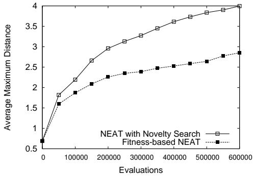
  <br>
  <em>图 11：双足机器人行走演化曲线。即便在刚开始的前几十代（本应有利于贪心目标搜索的早期），新颖性搜索不仅没有落后，反而全面领跑，并最终演化出超长距离的稳定步态。</em>
</p>

- **现象透视**：
  在开展新颖性搜索时，“向前扑倒”的行为在一开始也会被发现；但由于扑倒动作非常单一，**在发生过两三次后，它的新颖度就跌落为零，被归档彻底封死**。算法被迫去探索“单脚支撑”、“腿部前后摆动”、“动态平衡反扭”等全新动作形态，最终以 **80% 的极高概率自发涌现出了自然优美的交替振荡步态（Oscillatory Gaits）**！

---

## 4. 工程实战细节与深水区避坑总结

结合原论文 Appendix A、B 披露的核心参数与工程踩坑记录，实施新颖性搜索必须注意以下关键技术细节：

### 4.1 超参数设定基准表（对齐论文原文 Table 1 & Table 2）

```markdown
┌─────────────────────────────────┬────────────────────┬────────────────────┐
│ 超参数名称 (Hyperparameter)      │ 迷宫导航实验 (Maze) │ 双足行走实验(Biped) │
├─────────────────────────────────┼────────────────────┼────────────────────┤
│ 种群规模 (Population Size)      │ 250                │ 500                │
│ 兼容性距离系数 c1, c2, c3       │ 1.0, 1.0, 3.0      │ 1.0, 1.0, 3.0      │
│ 添加连接概率 (Prob. Add Link)   │ 0.10               │ 0.06               │
│ 添加节点概率 (Prob. Add Node)   │ 0.005              │ 0.005              │
│ CTRNN 时间常数突变概率          │ N/A                │ 0.30               │
│ 初始归档门限 (Initial Threshold)│ 6.0                │ 1.0                │
│ K 最近邻数量 (K-Nearest Neighbors)│ 15                 │ 15                 │
│ 机器人关节最大力矩 (Max Torque)  │ N/A                │ 5.0 N·m            │
│ 比例力矩常数 (Proportional Const)│ N/A                │ 9.0                │
└─────────────────────────────────┴────────────────────┴────────────────────┘
```

### 4.2 深水区四大避坑准则

1. **防范“廉价新颖性陷阱”（Trivial Novelty Trap）**：
   - 行为特征空间 $b(x)$ 绝不能随意包含“高频噪声”或“与主任务无关的微观物理量”（例如某单个轮子旋转的微秒相位角）。否则系统会疯狂刷取这些微观噪声来虚假增加新颖度，产生无意义的计算空转。
2. **$k$-d Tree 空间索引加速**：
   - 当历史归档集 $\mathcal{A}$ 累积到数千至上万个样本时，每一代对种群中所有个体执行暴力 $k$-NN 搜索将成为整个系统的性能瓶颈（$\mathcal{O}(M \cdot |\mathcal{A}| \cdot D)$）。在现代工程实现中，**必须引入基于 $k$-d Tree、Ball Tree 或近似近邻库（如 FAISS、HNSW）的索引结构**。
3. **任务终结判定机制（Task Termination）**：
   - 许多工程师容易困惑：既然算法完全没有目标函数，系统如何知道任务已经完成？
   - **正确做法**：将“环境性能监控器”（Supervisor / Evaluator）与“演化选择压力”彻底解耦。环境判定器每代独立检测个体是否触发了“到达终点”的判定事件，一旦触发立刻记录或结束演化；而在选择算子内部，个体只依据 $\rho(x)$ 进行配对繁衍。
4. **与适应度的平衡融合（Quality-Diversity 演进）**：
   - 纯粹的新颖性搜索在广袤无边的高维空间中可能探索漫无边际。后来的研究表明，可以通过**新颖性与目标分数的帕累托前沿排序（NSGA-II + Novelty）**或**局部精英网格保留（MAP-Elites）**，将“追求新颖”与“保持质量”完美融合。

---

## 5. 哲学启示、前沿演进与现代 AI 体系的呼应

### 5.1 从论文到经典著作：《为什么伟大不能被计划》
本篇论文发表后，在认知科学、计算生物学和创业投资界掀起了巨大的哲学地震。第一作者 Joel Lehman 与通讯作者 Kenneth O. Stanley 随后系统提炼其核心思想，于 2015 年出版了名著：
> **《Why Greatness Cannot Be Planned: The Myth of the Objective》**（中译名：《为什么伟大不能被计划：对目标与测度的反思》）

书中深刻指明：**人类社会的重大突破（从微波炉、抗生素的发明到现代互联网的诞生），无一例外都是在探索垫脚石的过程中被“意外发现”的；任何设定了严苛 KPI 和显式短期考核目标的科研机制，本质上都在系统性地扼杀真正的伟大！**

---

### 5.2 对当代前沿 AI 研究的深远指引

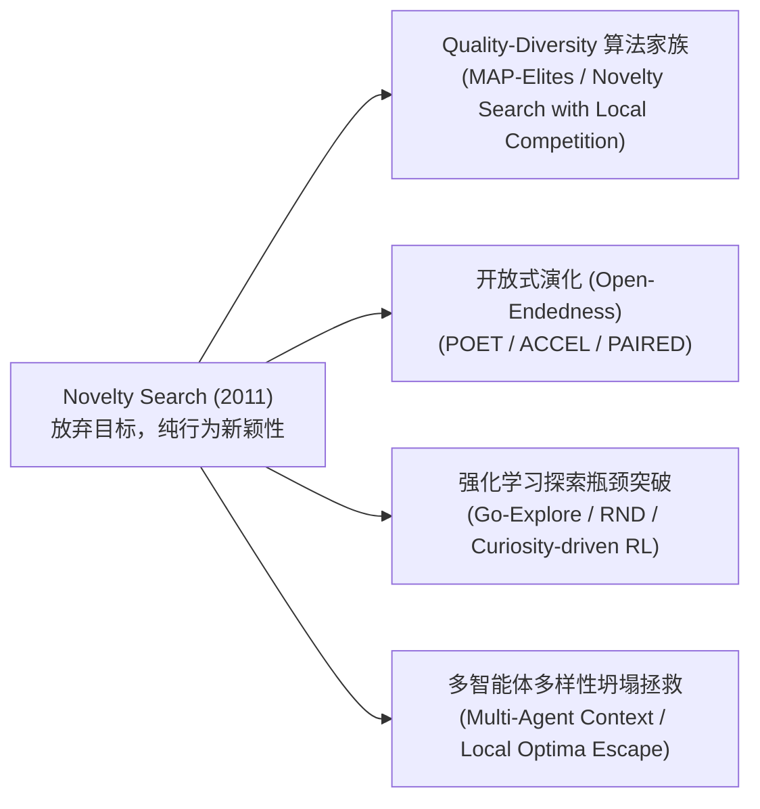

1. **奠定 Quality-Diversity（质量-多样性）算法家族**：
   - 衍生出如 **MAP-Elites（多维表型特征网格精英算法）**：在每一个离散的行为空间小格子中保留适应度最高的个体，兼顾了“广泛探索”与“局部极优”；
   - 成为深度神经演化（Deep Neuroevolution）的核心支柱。
2. **强化学习（RL）探索机制的破局：Go-Explore**：
   - 著名的 Atari 终极通关算法 **Go-Explore（Ecoffet et al., Nature 2021）**，其核心灵魂就是继承了新颖性搜索的“返回未探索行为前沿并向外扩展”的机制，彻底征服了《Montezuma's Revenge》（蒙特祖玛的复仇）等极端稀疏与欺骗性游戏。
3. **对当今 LLM Agent 多智能体与自进化系统的警示**：
   - 本工作空间收录的多篇前沿文献（如 `2604.18005 Diversity Collapse in Multi-Agent LLMs`、`2609.34924 Avoiding Local Optima in Agentic Self-Improvement`）所揭示的“多智能体结构耦合导致多样性崩塌”、“思维链陷入自欺自洽局部极值”，其本质与 Lehman 在 2011 年指出的“目标驱动欺骗性导致种群扎堆死锁”完全同构！
   - 引入显式的行为新颖性奖励、惩罚同质化的 Agent 策略交互，是解决当前大模型系统推理探索停滞的治本之策。

---

## 6. 核心参考文献与资源索引

- **[Lehman & Stanley, 2011]** Lehman, J., & Stanley, K. O. (2011). Abandoning Objectives: Evolution through the Search for Novelty Alone. *Evolutionary Computation*, 19(2), 189–222.
- **[Stanley & Miikkulainen, 2002]** Stanley, K. O., & Miikkulainen, R. (2002). Evolving neural networks through augmenting topologies. *Evolutionary Computation*, 10(2), 99–127. (NEAT 奠基之作)
- **[Stanley & Lehman, 2015]** Stanley, K. O., & Lehman, J. (2015). *Why Greatness Cannot Be Planned: The Myth of the Objective*. Springer.
- **[Mouret & Clune, 2015]** Mouret, J. B., & Clune, J. (2015). Illuminating search spaces by mapping elites. *arXiv:1504.04909*. (MAP-Elites 奠基之作)
- **[Ecoffet et al., 2021]** Ecoffet, A., Huizinga, J., Lehman, J., Stanley, K. O., & Clune, J. (2021). First return, then explore. *Nature*, 590(7847), 580–586. (Go-Explore 算法)
