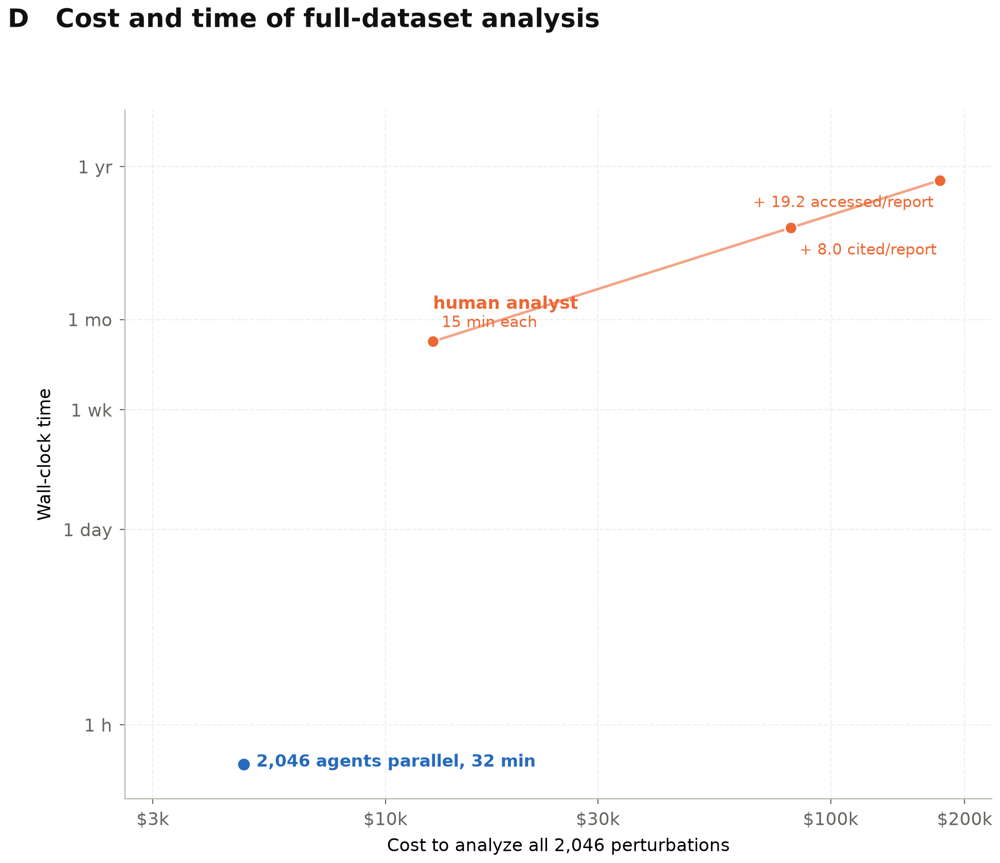
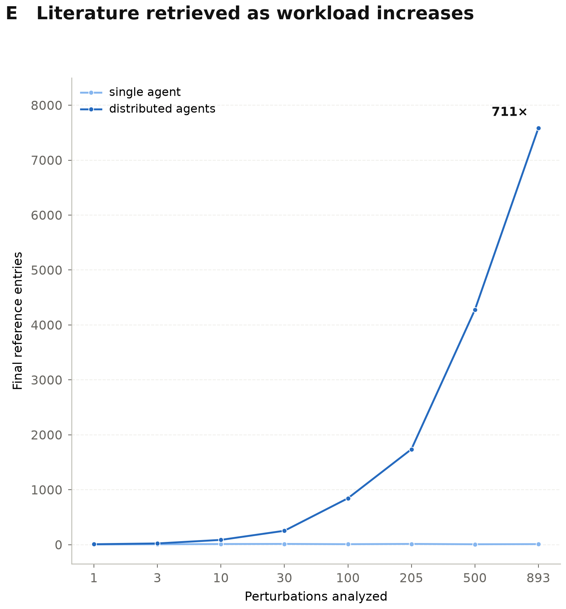
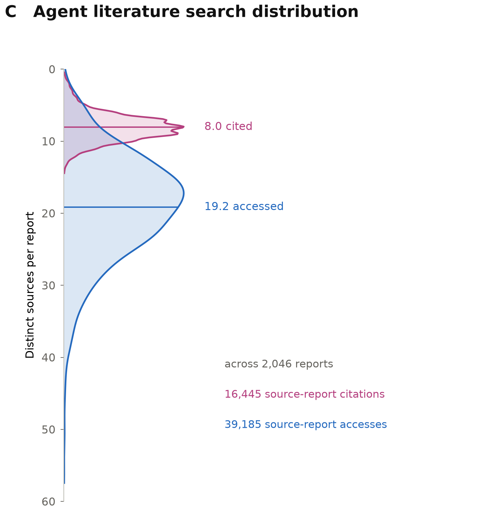
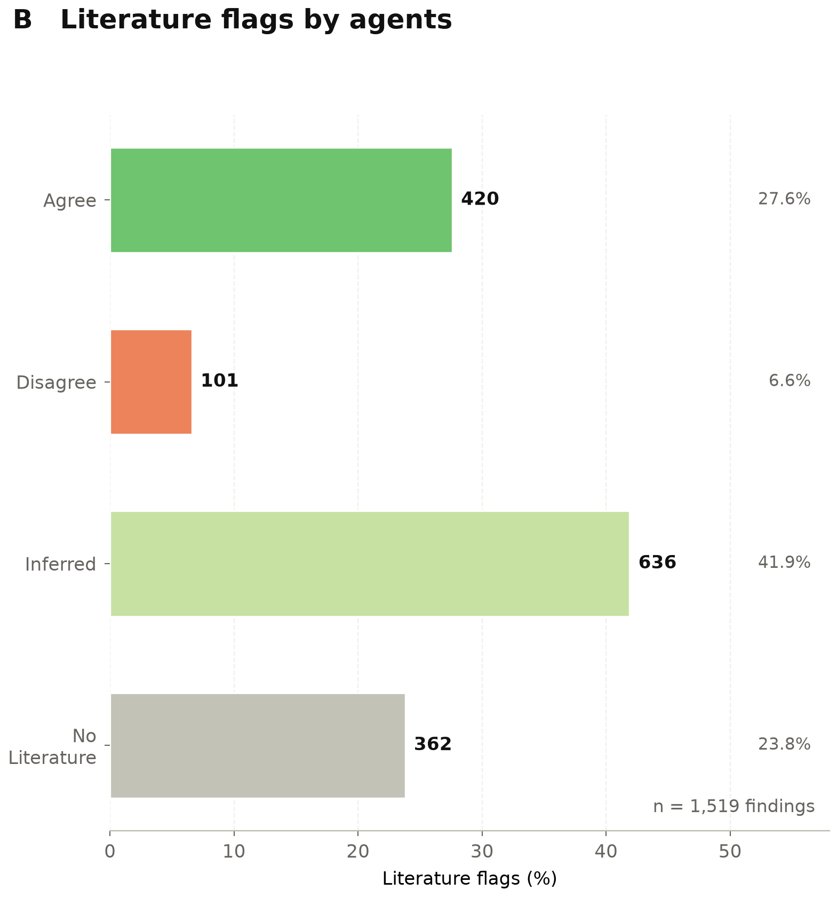
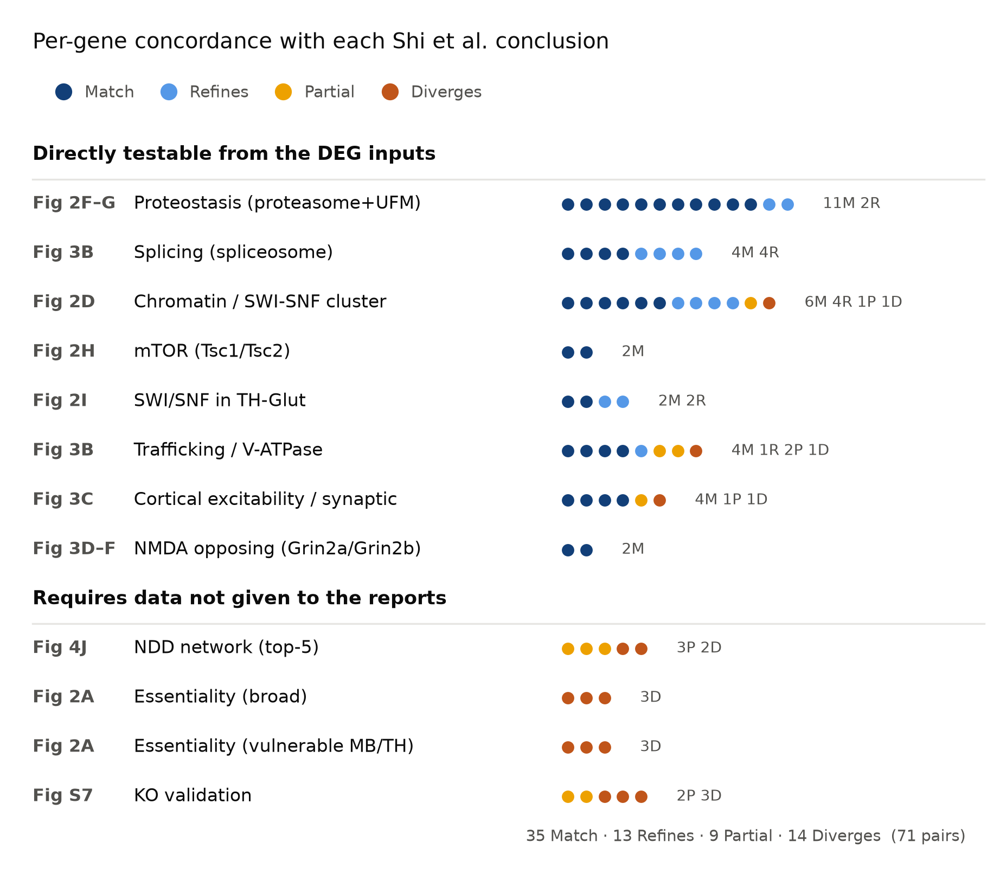
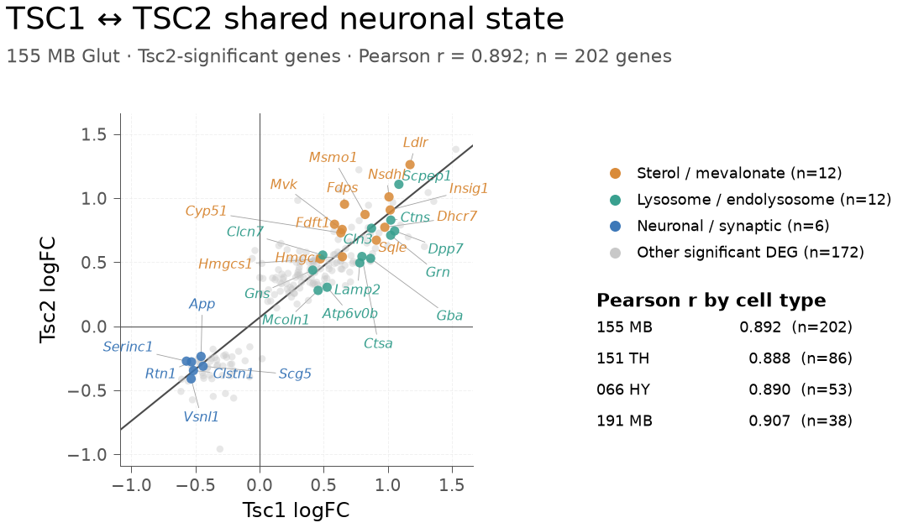
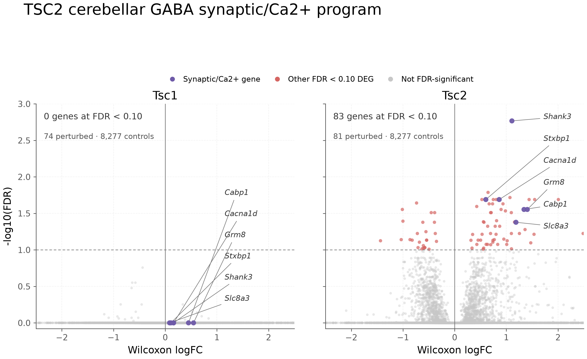
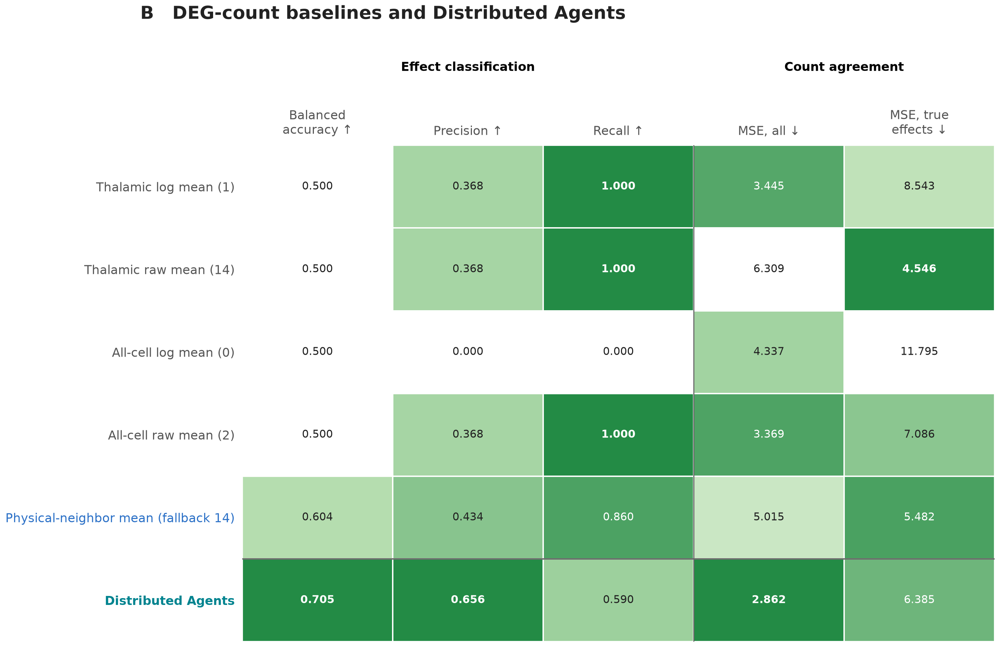
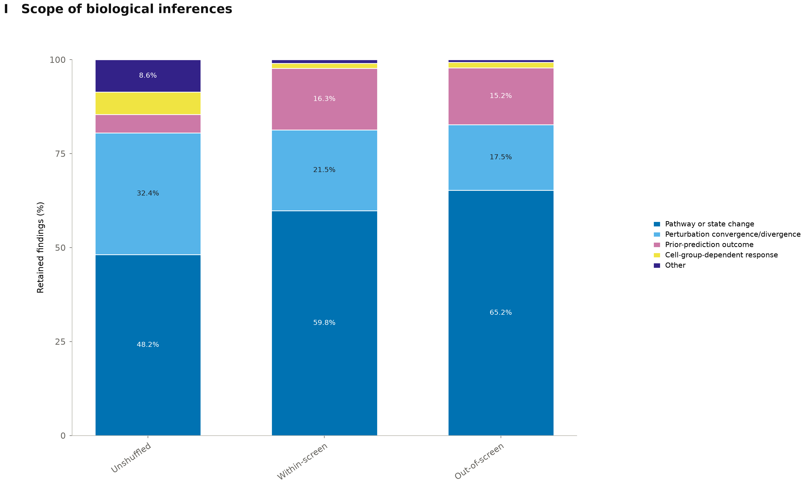
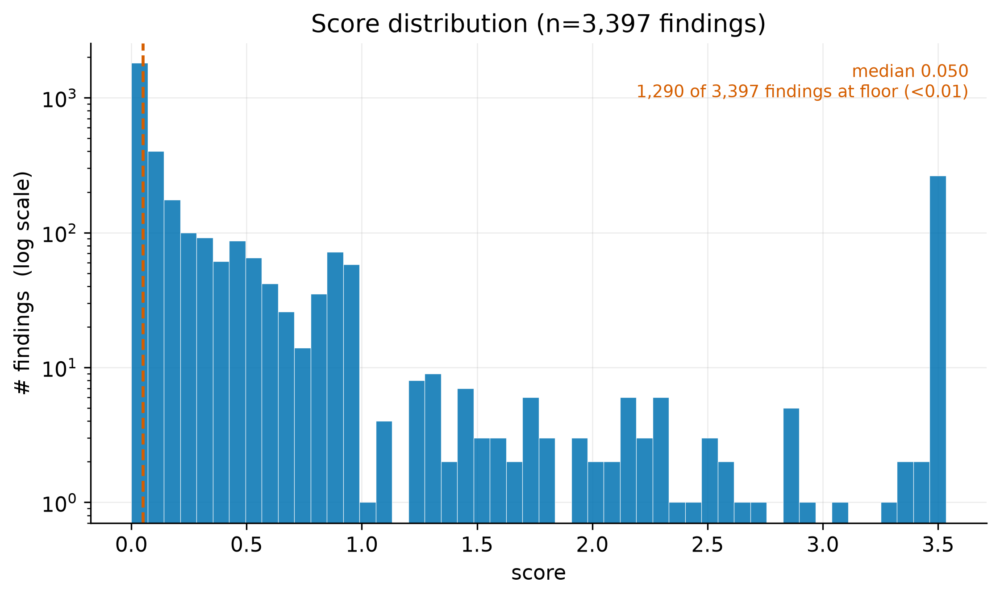

# GPT-Rosalind × Scripps × PerturbAI：分布式 AI 智能体与规模化生物学发现深度精读综述

> **核心文献与资料来源**：
> - **预印本论文**：Sun, A., Park, J. J., DeTomaso, D., ..., & Jin, X. (2026). *Distributed AI agents enable comprehensive discovery of biological insights at scale*. *bioRxiv*, `doi:10.64898/2026.10.15.759436` (2026年10月16日)
> - **OpenAI 官方博客**：*Using thousands of AI agents to uncover new leads in biological data* (2026年10月21日，[原文链接](https://openai.com/index/scaling-ai-research-for-complex-biological-data/))
> - **PerturbAI 官方公告**：*PerturbAI and OpenAI Unveil First-of-Its-Kind AI Reasoning Agents to Scale Biomedical Discovery* (2026年10月21日，[原文链接](https://perturb.ai/news/perturbai-launches-ai-reasoning-agents))
> - **官方开源代码与推理图谱**：[`jinlabneurogenomics/distributed_agent`](https://github.com/jinlabneurogenomics/distributed_agent)（已本地归档至 `notes/distributed_agent/`）
> - **公开数据集**：[`perturbai/wholebrain_crispr_atlas`](https://huggingface.co/datasets/perturbai/wholebrain_crispr_atlas)

---

## 一、研究背景与核心突破：当实验通量超越人类解读极限

近年来，高通量单细胞功能基因组学（如全脑体内 *in vivo* CRISPR Perturb-seq）已经能够在单次实验中敲除数千个基因，并测量数百万个脑细胞在不同细胞类型中的转录组响应。然而，**实验数据的生成速度已经远远超越了人类科学家的审视（examination）与解读（interpretation）速度**——如何将海量的差异表达基因（DEG）列表与数十年来分散在跨学科文献中的生物学知识连接起来，成为了科研发现的真正限速瓶颈。

2026 年 10 月，**OpenAI**、**PerturbAI** 与**斯克里普斯研究所（Scripps Research，Xin Jin 实验室）**联合发布了基于生命科学专用推理模型 **GPT-Rosalind** 的**分布式生物学推理（Distributed Biological Reasoning）**范式：

1. **千级并行、分钟级全脑图谱解析**：在全脑 *in vivo* Perturb-seq 图谱上并行部署 **1,946 个**（完整语料库涵盖 2,046 个靶点，其中留出 272 个靶点用于盲测预测）自主 AI 智能体，在 **32 分钟**内完成了对数百万小鼠脑细胞基因扰动效应的数据分析、文献交叉比对与机理解读。相比之下，同等深度的人类串行分析与文献综述预计需要**数月至一年**时间（且成本接近 \$180k，而分布式智能体仅需约 \$4.5k）。
2. **无手稿盲测复现与超越单智能体**：在不提供原论文手稿的情况下，分布式智能体不仅高度复现了原研究（Shi et al.）的既有科学结论，还在**75%（45/60）** 的盲审对比中击败单智能体基线，获得人类专家的优先选择。
3. **高价值疾病新假说**：系统在海量扰动中发掘出多个极具转化潜力的新线索，包括 **mTOR 复合体成员 *Tsc1* 与 *Tsc2* 在小脑神经元中的功能分化**，以及 **佩里综合征（Perry syndrome）致病基因 *DCTN1* 扰动与神经元胆固醇合成通路之间的潜在因果关联**。


*图 1（原论文 Fig. 2D）：全数据集（2,046 个扰动）分析的耗时（Wall-clock time）与经济成本对比。2,046 个智能体并行运行仅需 32 分钟、成本位于 \$3k–\$10k 区间；而人类分析师即便按每份报告 15 分钟、不计文献检索计算也需近 1 个月，若加入平均每份 19.2 次文献访问与 8.0 次引用的工作量，则需接近 1 年且成本接近 \$180k。*

---

## 二、系统架构深度剖析：Map-Reduce 式科研智能体流水线

通过深入剖析官方开源代码库 `notes/distributed_agent/src/distributed_agents/`，我们可以清晰还原这套系统并非简单的“并行调 API”，而是一套工程化极强的**两阶段“构建-推理”分离架构（Build-then-Query Architecture）**：

```text
[阶段一：分布式源报告构建 (distributed_agents build)]
  全脑 Perturb-seq Parquet 数据集 (10.8 GB)
        │
        ├──> 按扰动靶点 {gene_target} 切片并行派发 (1,946 ~ 2,046 个独立 GPT-Rosalind 智能体)
        │      ├── 终端工具：DuckDB / Polars / PyArrow 谓词下推直查本地 Parquet
        │      ├── 文献检索：Anchor-and-Refine 策略检索 PubMed / PMC / OpenAlex
        │      └── 强制输出：7 节叙事报告 + 6 个 JSONL 结构化账本 (Fail-closed Schema 校验)
        ▼
[全局推理图谱语料库 (Corpus Release: shi / shi_holdout)]
  • 规范化基因符号 (MGI 6.24 MRK_List1.rpt.gz) & 精确文献 DOI/PMID 映射
  • 冻结的 Findings / Claims / Evidence / References 只读账本 + 可选 Neo4j 图投影
        │
        ▼
[阶段二：自适应研究与对话层 (distributed_agents query / chat + MCP Server)]
  • 只读 Corpus MCP Server：暴露 describe / calibrate / count / query_claims /
    related_targets (随机游走) / inspect_target_set / suggest_target_analogs 等工具
  • Adaptive Query Loop：先由宿主准备覆盖度与能力清单，再执行比例式证据循环与跨靶点综合推理
```

### 1. 为什么“单智能体”在规模化科研中会失效？

OpenAI 与研究团队在固定模型与计算资源的条件下，测试了**单智能体（Single Agent）**与**分布式智能体（Distributed Agents）**在 1 至 893 个扰动负载下的表现差异。结果揭示了长上下文单智能体的致命缺陷——**注意力稀释与检索惰性（Retrieval Laziness）**：

- 随着分析靶点数量从 1 增长到 893，单个智能体为了在有限上下文与步数预算内完成任务，会急剧压缩对单个靶点的文献检索深度，最终在最大负载（893 个扰动）下**总共仅引用了 11 篇参考文献**；
- 相比之下，分布式智能体为每个靶点分配独立的上下文窗口与研究预算，最终引用文献总量随工作负载线性扩展至 **7,586 条参考文献条目（达到单智能体的 711 倍）**，在最大负载对比中引用超过 700 篇独立文献；在全量 2,046 份报告中，平均每份报告访问 **19.2 个**独立文献来源（总计 39,185 次访问）、引用 **8.0 个**独立来源（总计 16,445 次引用）。



*图 2（上：原论文 Fig. 2E；下：原论文 Fig. 2C）：分布式智能体在 893 个扰动负载下实现 711× 文献引用扩展；在全量 2,046 份报告中，平均每份报告访问 19.2 个来源并引用 8.0 个来源。*

---

## 三、核心 Prompt 工程与六账本防幻觉机制（源码级拆解）

`distributed_agent` 在 `src/distributed_agents/build/prompts/` 中定义了两份极具工程参考价值的核心契约：`base_scientist_contract.md` 与 `findings_report.md`。这套设计完美解决了科研智能体最容易出现的三大痛点：**编造统计数字、过早断言“无相关文献”、以及推理与证据脱节**。

### 1. `base_scientist_contract.md`：三段式研究与“锚定-精炼”检索

- **三段式研究循环（3-Pass Research Mode）**：强制智能体按 `1) Plan（列出 3–6 个子问题） -> 2) Retrieve（逐一检索并追踪 1–2 条二阶线索） -> 3) Synthesize（消解矛盾并撰写带引用的结论）` 执行，且仅在“继续检索不太可能改变结论”时才停止。
- **严禁依赖参数记忆（No Memory Reliance）**：明确指令智能体必须通过终端工具（DuckDB / Polars / PyArrow）直接检查本地 Parquet 文件中的样本数、Schema、差异表达与细胞类型特异性，严禁凭模型记忆作答。
- **Anchor-and-Refine 文献检索策略**：普通智能体常因查询条件过窄（同时限定基因、小鼠、脑区、CRISPRa/i、Perturb-seq）而返回零结果，随后错误地报告“无相关文献”。该契约强制采用：
  1. **宽泛生物学锚定**：先查基因功能、通路、复合物或蛋白家族；
  2. **特定上下文精炼**：拆分为多个简单查询逐步逼近实验上下文；
  3. **机制邻域检索**：若直接证据稀缺，转向检索上游调控因子、下游靶点与互作基因；
  4. **证据范围标注**：强制标注每条文献声明的支持粒度（如 `direct target + matched context` vs. `related perturbation of same pathway`）；
  5. **严格的“无文献”判定红线**：只有当靶点、模块、通路和宽泛生物学过程四个层面均检索无果时，才允许标注 `"no relevant literature found"`。

### 2. `findings_report.md`：6 个 JSONL 结构化账本与 Fail-Closed 校验

为了将非结构化的长篇科学报告转化为可机读、可检索、可跨靶点聚合的**推理图谱（Reasoning Atlas）**，契约要求每份报告末尾必须附带严格按顺序排列的 **6 个 JSONL 账本**，且构建器（`distributed_agents build`）会执行 **Fail-Closed 强校验**：

| 账本名称 | ID 标识 | 核心职责与强接地约束（Grounding Rules） |
| :--- | :--- | :--- |
| **1. `Evidence JSONL`** | `[E###]` | 记录直接来自数据集的原子级实测事实（细胞数、logFC、FDR、秩次等），严禁混入文献内容。 |
| **2. `References JSONL`** | `[R###]` | 记录检索到的文献元数据（PubMed / PMC / OpenAlex / Review / Database）及相关性说明。 |
| **3. `Biological Findings JSONL`** | `[F###]` | 核心解释层，涵盖 **12 类标准发现类型**（如 `cell_type_selectivity`、`cross_perturbation_contrast`、`literature_direction_mismatch`、`therapeutic_direction_warning` 等），**每条必须引用至少 1 个 `evidence_id`**。 |
| **4. `Literature Comparisons JSONL`** | `[C###]` | 将先验文献判断绑定到具体发现，**必须同时引用 1 个 `finding_id`、$\ge 1$ 个 `evidence_id` 和 $\ge 1$ 个 `ref_id`**。 |
| **5. `Pathways JSONL`** | — | 派生视图，**仅允许引用已存在的 `finding_id`**，严禁引入新基因或新机制。 |
| **6. `Cell Type Specificity JSONL`** | — | 派生视图，**仅允许引用已存在的 `finding_id`**，用于按脑区/细胞类型聚合发现。 |

通过这套机制，在 1,519 条带有文献比对标记的发现中，系统清晰区分出了：**Agree（一致，420 条 / 27.6%）**、**Disagree（与文献矛盾，101 条 / 6.6%）**、**Inferred（基于机制推断，636 条 / 41.9%）** 与 **No Literature（无文献覆盖，362 条 / 23.8%）**，为后续筛选“反常识新发现”提供了极高信噪比的索引。


*图 3（原论文 Fig. 2B）：智能体生成的 1,519 条发现的文献比对状态分布（Agree 27.6%、Disagree 6.6%、Inferred 41.9%、No Literature 23.8%）。*

---

## 四、关键科学发现与疾病机理洞察

在完全不接触原论文手稿（Shi et al.）的前提下，分布式智能体不仅在直接可由 DEG 输入检验的多项核心结论上高度对齐（总计 71 个基因-结论对中取得 **35 Match · 13 Refines · 9 Partial · 14 Diverges**，其中 Diverges 主要集中在未向智能体开放原始数据的必需性/敲除验证组），还发掘出了多个指向人类脑疾病的新线索：


*图 4（原论文 Fig. 1C）：智能体报告与 Shi et al. 原研究各主要结论的逐基因一致性评估。在直接可由 DEG 输入验证的 8 个模块（如 Proteostasis、Splicing、mTOR、SWI/SNF、NMDA 等）中，绝大部分呈现 Match（深蓝）或 Refines（浅蓝）。*

### 1. *Tsc1* 与 *Tsc2* 在小脑神经元中的意外分化（结节性硬化症新线索）

*Tsc1* 与 *Tsc2* 通常被视为共同抑制 mTOR 通路的复合物搭档。在全脑图谱的多个神经元群中，敲除任一基因确实产生了高度相似的转录组状态；但在负责运动协调的**小脑（Cerebellum）GABA 能神经元**中，智能体捕捉到一个关键差异：***Tsc2* 扰动显著改变了数十个神经元通讯相关基因的表达，而 *Tsc1* 扰动几乎未引起变化**。这与人类结节性硬化症（Tuberous Sclerosis Complex）临床上“小脑异常高度关联 *TSC2* 突变而非 *TSC1*”的现象高度吻合，为解释现有 mTOR 抑制剂难以缓解的认知与行为障碍指明了特定细胞群与靶基因。



*图 5（原论文 Fig. 2J 与 Fig. 2M）：*Tsc1* 与 *Tsc2* 在全脑多数神经元中共享转录组状态，但在小脑中 *Tsc2* 展现出特异性的 GABA 能神经元转录程序重编程。*

### 2. *DCTN1* 与胆固醇合成通路（佩里综合征神经退行机制新假说）

*DCTN1* 突变会导致具有类帕金森症状的罕见神经退行性疾病——**佩里综合征（Perry syndrome）**。智能体在数据中发现，扰动 *Dctn1* 显著上调了胆固醇生物合成相关基因的表达。通过跨领域文献检索，智能体将该现象与“细胞内胆固醇转运受阻会触发代偿性胆固醇合成上调”的研究联系起来，提出了一个全新的可检验假说：***DCTN1* 功能缺失是否通过破坏神经元内胆固醇运输与分布进而驱动神经退行性病变？** 该假说在盲审中被人类专家评为高度新颖且极具后续实验价值。

---

## 五、大规模评测与 BioEval 基准验证

除了定性病例发现，研究团队还在代码库 `src/bioeval/` 中构建了涵盖 8 项任务的系统化评测套件，并在 272 个留出靶点（Holdout Partition）与 60 组双盲专家对比中验证了系统性能：

1. **留出集扰动效应预测（Held-out Prediction, Fig. 3B）**：在仅提供训练分区与文献、隐去留出靶点实验结果的条件下，Distributed Agents 预测扰动是否产生显著 DEG 的平衡准确率（Balanced Accuracy）达到 **0.705**（精确率 **0.656**，全部样本 MSE **2.862**），显著优于物理互作邻域均值基线（Physical-neighbor mean，Balanced Accuracy **0.604**）和各类常数基线（**0.500**）。
2. **双盲人类专家偏好（Human Two-Choice Preference, Fig. 2I）**：在 60 组盲审对比中，人类生物学专家在 **75%（45/60）** 的情况下更偏好分布式智能体报告，仅 17%（10/60）偏好单智能体，8%（5/60）平局。
3. **跨目标关系发现优先级排序（Relational Findings Prioritization, Fig. 4D）**：系统共提取出 **3,397 条**关系发现并计算优先级评分（中位数 0.050，其中 1,290 条处于 <0.01 基线，高分长尾延伸至 3.5），为实验团队筛选高价值协同/拮抗基因对（如 *Setdb1*/*Ehmt1* 原钙粘蛋白与 HUSH 复合体调控、*Atxn1*/*Cic* 效应向量相似性等）提供了量化依据。




*图 6（上：Fig. 3B 留出集预测对比；中：Fig. 2I 盲审偏好 75% vs 17%；下：Fig. 4D 3,397 条关系发现优先级分布）。*

---

## 六、对 Multi-Agent Harness 与长程科研智能体设计的启发

从多智能体工程（Harness Engineering）视角来看，`GPT-Rosalind × DistributedAgents` 为“大模型如何真正赋能高通量科学发现”提供了三个极具示范意义的设计范式：

1. **用“Map-Reduce 分片并行”对抗长上下文退化**：面对包含数千个实体的大规模数据集，强行把所有上下文塞给单个推理模型只会导致“检索惰性”（文献引用从 7,586 暴跌至 11）。将实验按自然单元（单基因扰动）切分为数千个独立微任务，由独立智能体深度探索后再通过结构化语料库聚合，是突破推理深度瓶颈的关键。
2. **以“结构化账本 + Fail-Closed 校验”替代自由文本汇总**：单纯让数千个智能体写 Markdown 总结会导致后续无法可靠聚合、且极易放大幻觉。`findings_report.md` 强制要求 `[E###]`、`[R###]`、`[F###]` 跨账本 ID 强绑定，并在构建阶段执行 Schema 阻断式校验，这是将“AI 生成文本”转化为“可审计科学知识图谱”的核心基础设施。
3. **只读 MCP 语料库作为“全局共享工作记忆”**：阶段一产出的冻结账本通过只读 MCP Server 暴露给阶段二的 `query/chat` 智能体，既防止了后续查询污染原始实验事实，又支持跨靶点随机游走（`related_targets`）与类比推理（`suggest_target_analogs`），为多智能体协同科研树立了清晰的工程标杆。
