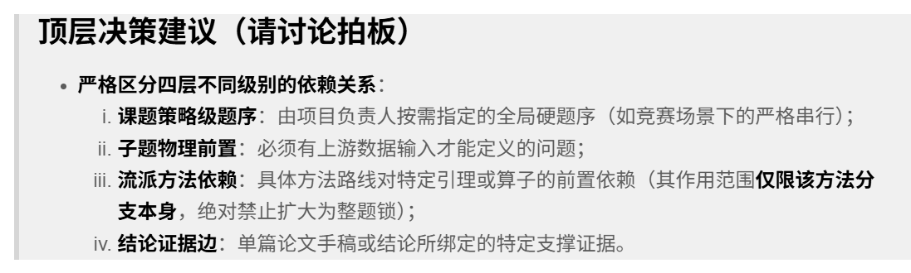

# 第六轮审阅（针对第四轮测试）

以下是针对第一篇"D:\\antigravity\\长城agent设计v6up（Gemini负责）\\docs\\round4\_audit\\01\_交顶层设计者\_原文对照与架构讨论稿\_对齐版\.md"

A1：

- Parse 0 准备阶段的必需交付物，应由“固定的一套基线脚本\+评测钩子”，转变为\*\*“与任务类型匹配的证据协议（Evidence Protocol）”\*\*：

    - **数学证明/反例任务**：声明清晰的形式命题、允许的公理体系及可复核的证书/推导格式；

    - **数值/仿真任务**：声明参考算例、允许的误差界及基准数据来源；

    - **开放探索任务**：声明可证伪的科学假设、已知观测边界与初验判定逻辑。

这里是对的，非常有道理的，我们好像一开始就是这么设计的，但这里又有了一些非常尖锐的问题了，在封闭式问题上我们关键很多取决于一个确定的评测器，其方式往往是针对问题特化的，这方面不存在“固定”“通用”的讲法了，而且测评器很多时候决定了后续“梯度”下降的方向，即探索者们努力的方向，好的工具能够引至正确的路途，但是坏的工具绝对是对整个任务是毁灭性的；station在开放式问题中表现的并不好，在这方面可能就是“梯度”不好解决了，在客观指标缺失的时候，以“taste”为“梯度”恐怕就很难搞了。所以工造司的责任就更加重要了，关于工造司的设计恐怕需要我在仔细返工和审阅了

A2：
“手写纲领和 v2\.2 规约充分肯定了前线 Agent 的自测需求：允许探索者在本地工作区扫参调试（标记为 \[Local\-Sweep\]），工造司负责提供跨分支共享的诊断探针与标准样例，伴随模型在交接文档中记录非正式试算结论（工造司规约第 29–43 行）。”
这个设计我不知道是为什么以及从哪里来的……我需要向我解释理由


A3：
“

现场按课题负责人明确要求执行 Q1 →→ Q4 的串行题序完全合规，但底座通用代码在处理子题依赖时犯了严重的逻辑泛化错误（[依赖实现代码](https://file+.vscode-resource.vscode-cdn.net/d:/antigravity/%E9%95%BF%E5%9F%8Eagent%E8%AE%BE%E8%AE%A1v6up%EF%BC%88Gemini%E8%B4%9F%E8%B4%A3%EF%BC%89/greatwall-v6up/core_python/mcp_server/control_plane_service.py#L322)）：

1. **依赖粒度过粗**：依赖条件仅支持“等待前置题产生至少一个 active L3 成果”。在真实科研中，下游往往仅依赖上游的一个**具体引理、特定算子、前处理数据或稳定接口**。上游整题未封账，不代表局部成果不可复用；上游整题产生了一个不相关的 L3，也不代表下游所需的特定事实已经成立。

2. **依赖范围错误并集锁死**：调度系统在判断子题开题时，**将同一子题下所有流派申报的前置依赖取了并集**。导致方法 A 所需的 Q1 引理，硬生生将方法 B 这样完全独立的方案一同死锁在原地。

”



至于这个我搞不清楚，在想是否添加进去之后会不会增加系统复杂度和对齐难度。


A4：拉了，关于四级分诊与同行盲审接受的证据形态在顶层和中层落实之前存在了严重的矛盾，需要顶层细化，GPT给的方案如下：

### 顶层决策建议（请讨论拍板）

- **保留四级分诊与同行盲审接受的证据形态立盲审，但彻底重构送审证据准入标准**：

    - **分诊模型（后勤）职责**：判断手稿材料是否完整、逻辑推导是否自洽、是否具有送审价值；

    - **盲审模型职责**：独立核对主张边界与证明严密性；

    - 为“形式化证明证书”、“数学解析推导手稿”、“构造性反例”、“数值仿真报告”制定平行的准入标准，不再用单一的布尔 `passed=1` 统捆全局；

    - 基础设施/沙箱崩溃记录归入工具诊断账本，严禁将其作为否定科学主张的判据。

我持保留态度，是否符合第一性尚未讨论

A5：关于评测自适应演化（RQGM）的本质与分类治理，中层实施明显不好
A6：以非同质化科研任务定义底座能力边界，这个问题确实没有设计好，我之前给出的判决是留出空间，但是在中层落实的时候由于只有这一个例子导致飞快滑向了过拟合了


以下是针对第二篇"D:\\antigravity\\长城agent设计v6up（Gemini负责）\\docs\\round4\_audit\\03\_顶层设计深度审阅\_原文溯源与决策对照\_对齐版\.md"

B1B2：[`docs/architecture/04_十三篇前沿论文深度解惑与V6Up架构融合专报.md#L258-L266`](https://file+.vscode-resource.vscode-cdn.net/d:/antigravity/%E9%95%BF%E5%9F%8Eagent%E8%AE%BE%E8%AE%A1v6up%EF%BC%88Gemini%E8%B4%9F%E8%B4%A3%EF%BC%89/docs/architecture/04_%E5%8D%81%E4%B8%89%E7%AF%87%E5%89%8D%E6%B2%BF%E8%AE%BA%E6%96%87%E6%B7%B1%E5%BA%A6%E8%A7%A3%E6%83%91%E4%B8%8EV6Up%E6%9E%B6%E6%9E%84%E8%9E%8D%E5%90%88%E4%B8%93%E6%8A%A5.md#L258-L266)关于这里几乎是需要重构了，我们需要围绕工造司做一个大范围的重构了，其多出存在矛盾和不符合第一性的地方了，就像我们的图书馆其实原来也不是很好，但是改改就进化很多了。这这份文档中stage1写的太死了，整篇文档里甚至出现了非常具体的有关于国赛b题的设计，其参考资料写的洋洋洒洒的，结果落地篇写的一坨啊…………

B4我倒是真没觉得有问题，这种情况比较少见
B5确实是灾难了…………很多门禁其实需要做减法
B6原设计我觉得没啥问题啊，不然系统直接跑出了一个非常简单的结果告诉你解题了，那咋办，没东西进行一个硬标准的话才是更大的问题吧，但具体落实到实施层面就是问题的划分，尤其是一个AIforscience过程，我们可能需要不断的提出新的问题和开出新的分支，但是此次测试没有到四级分诊和三种交叉还有过程开辟学派（就是GPT在解决双圈猜想中说的方法族谱系登记册还有在专题手册中没有说的“如果过多智能体聚拢到某一个流派，立即将其中的一部分重新定向到尚未充分探索的形式化路径上。”），导致我们现在也不知道啥情况。还有就是中央图书馆的工作没做好了，明明有些成果他就是能按照L3落座啊，不然我论文正文写啥啊。

B7：不建议这里做文章，防止增加系统复杂度，又给我搞出个什么门禁、钩子，parse0阶段大部分问题直接弹出窗口问人类或者直接让人类回答和填写和审核就能免去很多困难了
B8：这确实是一个逻辑bug
B9：逻辑bug我也没招了
B10：逻辑bug我没招了
B11：对齐bug
B12：这里应该很明确的reject就应该返工，或许reject的理由就是下一条创意，我们要尊重每一个科研人员的成果，但这里貌似又有了一些逻辑bug，在打捞和退回作为下一个科研人员的工作存在矛盾
b13：真实bug
B14：关于这些恐怕还得全量读一读`Red Queen Gödel Machine (RQGM)`了
B15：我觉得这里没啥问题，因为这里我做了两段区分，一个是显示的看板，一个是隐式的谱系知识库，但貌似在关于谱系知识库做的就不咋地了，这里可以回望一下当时Claude给我的回答，非常惊艳，很具有工程和学术taste:
"

你绕晕是正常的，因为我们之前把好几样东西混在一起叫“状态”“账本”“看板”。我把它重新理了一遍，\*\*核心只有一句话：真相只存一份，每个角色读的都是从真相里切出来的“视图”。\*\*按这个思路，东西其实很少。


---


## 一、系统里只有 3 份“真相”，外加 2 个“视图”


|类型|名称|是什么（打比方）|谁写|能不能改|
|---|---|---|---|---|
|**真相 ①**|**观测账（Obs）**|实验仪器打出来的原始读数小票|工造司的评测器自动写|只增不改（只能标作废）|
|**真相 ②**|**谱系 DAG**|每个门派自己的**实验记录本**，一页 = 一个探索者的一生|伴随助手在探索者退场时写一页|只增不改|
|**真相 ③**|**中央图书馆**|公开藏书楼|图书馆员 / 审稿人|只增，可撤回|
|视图 ①|**谱系状态看板**|记录本的“最新一页摘要”|伴随助手从 DAG 合成|每代重写（可以随时重新生成）|
|视图 ②|**图书馆目录卡**|藏书楼的索引卡|入库时自动生成|跟着藏书变|


**看板不是真相，只是视图**——看板坏了、截断了都不要紧，从 DAG 重新合成一份就行。这一条想清楚了，“状态集合”就不乱了。


### 关于你问的“图书馆是不是两类”——对，就是两翼，而且 L1 其实不该放在图书馆里


- **外藏（图书馆员找来的）**：外部论文、教材、已知定理 → `[R###]` 卡片，标注读到什么深度（全文 / 指定章节 / 仅摘要）。

- **内藏（大家生产的）**：

    - **L3**：通过两阶段盲审的成果（可以全场引用）；

    - **L2**：被证伪的、被拒稿的、确认走不通的（防踩雷）。

- **以前的 L1（谱系私有笔记）**，本质上就是**谱系 DAG 本身**。它是门派内部没审过、带猜想的记录本，不是出版物。把它从图书馆里拿出来，结构立刻清爽：

    

```Plain Text
谱系DAG（门派私有记录本，未审，带猜想）
        │  投稿：节点里有可以独立成立的结论
        ▼
  中央图书馆两阶段盲审
        ├── 通过 → L3（内藏·成果）
        └── 拒稿/证伪 → L2（内藏·失败雷达）
外部文献 → 图书馆员 → R卡（外藏）
```


**跨门派规则也就自然出来了**：别家的 DAG 不能看，只能看图书馆里审过的东西。这正好就是 Station 的私有记忆 \+ Cogentic 的已验证账本，也是 OpenAI CDC 的“延迟交叉授粉”——门派之间只通过图书馆交流。


---


## 二、谁读谁：每个角色都是“推一份视图 \+ 允许按编号拉取真相”


所有角色都是无状态启动，所以每个角色的上下文管理都是同一个模式：**启动时 Push 一份很小的视图，需要时按编号 Pull 真相。**


|角色 / 时刻|启动时 Push 给她|允许 Pull|她写什么|
|---|---|---|---|
|**探索者 0–37%**|看板 \+ 上代遗嘱 \+ 题目 \+ `tools/` 清单|只看自己工作区和自己的 Obs|代码、实验|
|**探索者 37% 之后**|（同上，不再加）|**本门派 DAG 任意一页 \+ 图书馆两翼**|代码、实验|
|**伴随 · 出生前**|**旧看板 \+ 刚退场那一页手记**|本门派 DAG 任意祖先页、相关 L2/L3|**新看板**|
|**伴随 · 37%**|看板 \+ 探索者发来的简短近况|同上|2 轮问答（不写文件）|
|**伴随 · 70% / 崩溃**|探索者的最后陈述 \+ 本节点 Obs 列表|本节点工作区|**DAG 新一页**（双栏手记 \+ 遗嘱）|
|**后勤总管**|各门派看板的抬头摘要 \+ 待分诊节点 \+ 族谱登记表|任意 DAG 页|分诊结果、分叉指令|
|**审稿人 · 阶段一**|投稿的 A 栏 \+ 对应 Obs（不给作者、不给 B 栏）|Obs、图书馆|证据账 \+ 初判|
|**审稿人 · 阶段二**|解开 B 栏|同上|终判|
|**监察委**|事实日志摘要|事实日志|告警|


注意伴随出生前那一行：**新看板 = 旧看板 \+ 最新一页手记**，增量更新。这其实就是你在手写 project 里最初的想法（每次在母本上续写、再复制给下一代），只不过母本拆成了“记录本（只增不改）\+ 摘要页（每代重写）”两层，这样传到第 30 代也不会变成 6 万字。伴随不用每次读完 30 代，只在看板里某条说不清时才翻祖先页。


---


## 三、为什么这样能兼顾“无状态”和“业务熟练”


1. **每个角色的 Push 都很小，而且只装她自己这一段的事**：探索者的上下文里根本没有分诊、盲审、停滞这些概念，不会分心去操心流程。

2. **熟练度靠“视图质量 \+ 工具回执”**：看板写得好，探索者一醒来就知道门派在哪、踩过什么坑；工具每次返回都附一句“下一步可以做什么”，用不着背流程。

3. **Pull 的命中率靠编排**：DAG 每页都是固定的双栏格式，图书馆先给目录卡、再给全文，所以拉一次就能拿到要的东西，不会越翻越乱。

    

---


想跟你确认三件事，确认了我们就有一张能直接写进文档的总图：


1. **L1 从图书馆移出、并入谱系 DAG**，图书馆只剩“外藏 R 卡 \+ 内藏 L2/L3”两翼——这样划分你觉得对吗？

2. **跨门派只能通过图书馆交流、不能互看 DAG**，这条你同意吗？还是说你希望 37% 之后连别家的 DAG 也能看？

3. **看板按“旧看板 \+ 最新手记”增量更新**，这个是不是你最初设想的那个意思？

"


