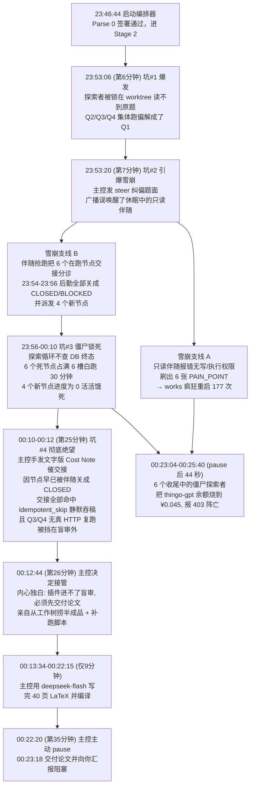

# 第五轮实测深度法医调研与架构困境复盘报告

> [!IMPORTANT]
> **先修正上一版初步结论中的一处关键误判（感谢你用账单截图直接打醒）**：
> 1. 你的 **DeepSeek 官方余额（¥8.23）确实没有被烧光**——第五轮那 252 个长城子智能体**压根没走 DeepSeek 官方**，而是悄悄全部路由到了你的第三方 New-API 中转站 **`thingo-gpt / gpt-6.2-sol`**，把中转站余额烧穿到了 ¥0.045！
> 2. 第五轮也不是“突然被 403 打断才结束”——**主控比 403 还早 44 秒（00:22:20）就自己按下 `pause`、绕开卡死的长城插件亲自写完论文交差了！**

---

## 一、通俗还原：“我有 ¥8.23 余额，403 报错线路到底怎么走的？”

### 1.1 两条完全分离的账单线路（铁证来自 `.dsh/sessions/*.jsonl.zstd`）

你在桌面端打开第五轮测试会话时，实际同时存在**两套模型路线**：

| 运行实体 | 真实命中的渠道与模型 | 上下文窗口 | 调用规模（第五轮） | 扣谁的钱？ | 最终结局 |
| :--- | :--- | ---: | :--- | :--- | :--- |
| **主控对话 (`ptc`)**<br>`session-35c8a98f...` | `deepseek-account / deepseek-flash`<br>（你在 23:42:00 手动切换） | 1,048,576 | 1 个会话 / 189 步 | **DeepSeek 官方账户**<br>（你截图里还剩 **¥8.23** 的那个） | `00:23:18` 正常写完论文 `completed` |
| **全部 252 个长城子智能体**<br>`explorer / companion / works / surveyor / logistics` | **`thingo-gpt / gpt-6.2-sol`**<br>(`https://intlapi.thingo.com.cn/v1`) | **272,000** | **252 个会话**<br>**2,000 次 LLM 请求** | **Thingo 国际站（New-API 中转）** | `00:23:04`–`00:25:40` 中转余额跌破 ¥0.05，报 **`403 new_api_error: insufficient_user_quota`** |

看一眼真实报错原文就彻底明白了：

```json
{
  "message": "预扣费额度失败, 用户剩余额度: ¥0.045020, 需要预扣费额度: ¥0.047480 (request id: 202611211625409831473268268d9d6KXIDtK61)",
  "type": "new_api_error",
  "code": "insufficient_user_quota"
}
```

- `"type": "new_api_error"` 是开源中转网关 **New-API** 的标志性错误，对应你在 `desktop/cordis.patch.yml` L97–106 配置的 `thingo-gpt`（`https://intlapi.thingo.com.cn/v1`）。
- 也就是说：**你截图里 DeepSeek 官方的 ¥8.23 几乎没动过；真正被抽干的是 `thingo-gpt` 中转站里的余额！**

### 1.2 为什么子智能体会“背着你”偷偷跑到 `thingo-gpt/gpt-6.2-sol`？


**最致命的“双重错位”**：
1. 插件代码 `greatwall-v6up/dsh_plugin/lib/index.js:280–289` 写了 `const callerOpts = exec?.agent?.options || {}` 以为这样能“自动继承主控当前模型”，但在真实 DSH 运行时里，用户在 UI 切换模型是写进会话事件 `model/selection` 的，`exec.agent.options` 里压根拿不到，结果传了个空 `{}` 给 `ctx.agents.create()`，导致全部子代理滑落到了 `thingo-gpt/gpt-6.2-sol`（与 23:41:32 上一个未切模型的新会话 `session-c6df9da9` 完全一致）。
2. 同时，插件配置的上下文预算窗口写死为 `500,000`（37% 反思 = 185k，70% 交接 = 350k），而 `gpt-6.2-sol` 的真实窗口只有 **272,000**！一边用贵得多的第三方中转模型空转，一边还按 500k 傻等 37%/70% 水位！

### 1.3 2,000 次子代理 LLM 请求到底烧在了哪儿？（精确账本）

实测统计 `.dsh/sessions` 中第五轮全部 254 个会话的真实 LLM 调用步数（`step/start`）：

| 角色预设 | 拉起会话数 | 真实 LLM 请求步数 | 占比 | 实际在干嘛（法医定性） |
| :--- | ---: | ---: | ---: | :--- |
| `greatwall-explorer`（探索者） | 6 | **1,050 步** | **52.5%** | 6 个旧节点在 23:54 就已在 DB 死亡，但循环不查 DB 终态，变成**僵尸探索者死占全槽白跑 30 分钟** |
| `greatwall-works`（仪器科） | **177** | **380 步** | **19.0%** | 伴随误报 6 张 `PAIN_POINT` 工单且**无关闭工单工具**，每 13 秒重启 1 次无限空转 |
| `greatwall-surveyor`（采编） | **38** | **326 步** | **16.3%** | 编排器写错列名 `r.request_id`（DB 实为 `req_id`）+ 无解查新无法结案，反复重复刷 13 张废卡 |
| `greatwall-companion`（伴随） | 6 | **164 步** | **8.2%** | 本该休眠待命，被 `steer` 广播吵醒后抢跑交接、刷 `PAIN_POINT`、又被 `idempotent_skip` 吞稿 |
| `greatwall-db-only`（后勤/监察） | 25 | **80 步** | **4.0%** | 正常分诊与开新节点（但新开的 4 个节点全程被僵尸占槽饿死） |
| **子代理合计（全烧 `thingo-gpt`）** | **252** | **2,000 步** | **100%** | **超过 85% 的请求都烧在了僵尸空转与死循环风暴上** |
| `ptc`（主控，走 `deepseek-flash`） | 2 | 193 步 | — | 指挥纠偏 + 最后 9 分钟亲自写完 40 页论文 |

---

## 二、通俗还原：“为毛 35 分钟就结束了？”（黑匣子完整时间线）

读完主控会话（`session-35c8a98f...`）189 步的完整思考记录后，**整场戏其实是一部“主控眼睁睁看着插件连环死锁 → 第 26 分钟被迫弃船自己写完论文 → 第 35 分钟主动按暂停交差”的写实片**（时间均为北京时间 CST）：



**用最白的话总结“为什么结束这么快”**：
1. 长城插件从**第 7 分钟（23:53:20）**起，实际上就已经因为“题面不可读 → 人工 steer 纠偏 → 误唤醒伴随抢跑关节点 → 旧探索者变僵尸霸占全部 6 槽”而**脑死亡**了。
2. 主控苦等到**第 26 分钟（00:12:44）**，发现不仅 0 个 L3、连强催提前交接都被 `idempotent_skip` 吃掉了，判断插件今晚不可能走到盲审和 Stage 3，于是果断用自己的 `deepseek-flash` 花 9 分钟把 40 页论文写完，**在第 35 分钟（00:22:20）主动按 `pause` 结束了任务**。
3. 就在主控收工的同一分钟（`00:23:04`），后台那 252 个偷偷跑在 `thingo-gpt` 上的子会话也刚好把中转站余额抽干到 ¥0.045，留下一排 403 报错尸体。

---

## 三、直面灵魂拷问：为什么多轮审阅打磨后还这么多 Bug？我们陷入什么困境了？

你的困惑非常敏锐、完全切中要害：**“按理说这次代码经过了多轮审阅和对齐打磨，怎么还会爆出这么多低级又致命的错误？是工作方式陷入困境了吗？是顶层设计出问题了吗？”**

不绕弯子、不护短，基于 1–5 轮实测的真实历史，答案是：**两个层面都出了结构性问题——研发验证方式陷入了“双极端盲区”，同时顶层架构里也确实混入了 4 个过度工程化的设计病灶。**

### 3.1 困境一：研发验证陷入“两头翘、中间空”的死亡循环

回顾前五轮，我们的工作流一直是这样转的：

```
改顶层文档 → 一次性大改几千行代码 → 静态代码审阅 + 测单个函数的单元测试（全绿！）
                                                    ↓
                        跳过“低成本全链路沙盘联调”，直接扔进最贵的真题实战（国赛 B 题四问）
                                                    ↓
                        第 6 分钟撞墙爆出一堆异步耦合 Bug → 花几十块钱只测出前 10% 的链路
```

**为什么“静态审阅 + 单元测试全绿”完全拦不住第五轮这 7 个 Bug？**

| 第五轮真实爆出的 Bug | 为什么静态审阅 & 单元测试没发现？ |
| :--- | :--- |
| 1. `exec.agent.options` 拿不到 UI 切换的模型 → 子代理跑偏到 `thingo-gpt` | 单元测试里 `exec` 是假对象；只有真跑 DSH 桌面端才知道模型切换存在 `model/selection` 事件里，不在 `agent.options` 里。 |
| 2. `steer` 广播吵醒休眠伴随 → 刷 `PAIN_POINT` + 抢跑关节点 | 单独测“伴随保活”是对的，单独测“`intervene` 广播”也是对的；但**两个特性在同一时间线撞车**，单测从未模拟过！ |
| 3. `works_engineer` 177 次自旋 | 单独看“有工单就唤醒 works”逻辑看似合理，但单测只跑了 1 轮 tick，没跑连续 5 轮循环去检验“如果 works 没关单，下一毫秒会不会死循环”。 |
| 4. `r.request_id` vs `r.req_id` 拼出 `[null]` | Python 端只测了 SQL 返回 `req_id`，JS 端单元测试里 Mock 的快照自己手写了 `request_id`——**两边各测各的，接口一对接就错位！** |
| 5. 旧探索者不查 DB 终态变成僵尸占满 6 槽 | 单测只测了探索者正常走到 70% 退出，从未测过“探索者还在跑时，外部把节点关成了 `CLOSED`”。 |
| 6. `fork_branch` 没挂载原题 + 沙箱锁死工作树 | 沙箱测试只验证“不能读分支外文件”（测通过了！），建分支测试只验证“目录建好了”（测通过了！）——但**忘了问一句：那探索者从哪读题？！** |
| 7. 正则把 `https://` 截成 `s://`、把 `Temp\dsh-spill-*` 拦死 | 单测只测了常规路径 `C:\foo\bar`，没喂真实带 `https://` URL 的命令和 DSH 真实溢出临时文件。 |

**核心教训**：你禁掉“慢且贵的真实 LLM 端到端 SDK 测试”是完全正确的，但我们因此只剩下了**零碎的函数单测**，缺少最关键的**中间层——“假模型（Scripted Stub LLM）+ 真实编排器 + 真实 SQLite + 真实沙箱”的 2 秒全链路沙盘测试**！只要有这个 2 秒零费用的真链路沙盘，上述 7 个 Bug 里至少 **6 个**在写完代码 10 秒内就会直接红灯报错，根本活不到实战！

---

### 3.2 困境二：顶层设计本身到底有没有问题？

客观拆分：**顶层科学理念没错，但顶层机制设计确实“过重、过脆、过度隐式耦合”**，导致系统容错率几乎为零。具体有 4 个根子上的设计问题：

#### 病灶 1：10 跳刚性串行流水线，任何一跳卡 1%，整体产出归零
目前的闭环要求：
`Parse 0 → 外藏建卡 → 探索者写可运行入口 → 伴随双栏交接 → 后勤分诊 → 仪器/盲审官沙箱复跑 → 产出 L3 → 四题全部 L3 → 采编 Stage 3 汇编 → 终稿`。
- **致命弱点**：链条太长且没有优雅降级。第五轮里，探索者其实已经做出很有价值的数学推导和模拟器代码（主控拿这些素材 9 分钟就写出了 40 页完整论文），但因为中途任何一个工程门槛（缺 `candidate_rel_path`、或本地模拟器不是真 HTTP 服务）卡住，长城控制面就**一刀切判死（0 个 L3）**，连盲审的门都摸不到。
- **对比现实**：主控单枪匹马 9 分钟都能交付的成果，长城重型流水线跑了 252 个子会话却交付为 0——这说明**管理开销（治理成本）已经反客为主，压垮了科研产出本身**。

#### 病灶 2：“单节点保活休眠伴随 (`lineage_companion`)” 是典型的过度设计
- 顶层为了“让伴随记住开局和 37% 的上下文”，要求把一个只读伴随进程**长期挂在内存的 `liveSessions` 里休眠保活**，等探索者跑几十分钟后再唤醒它。
- 实际后果：
  1. 与探索者形成复杂的双会话并发状态机，极易出现生命周期错位（`steer` 吵醒、状态不同步、僵尸互锁）；
  2. 伴随每多活一天，还要维护它的只读权限边界、防抢跑锁、唤醒路由。
- **反思**：其实所有上下文事实都已经在 SQLite 真源表 + 工作树文件里了。伴随在 37% / 70% 时完全可以做到更纯粹的隔离（哪怕维持单节点续传，也必须在物理上彻底隔离出 `liveSessions` 外部广播面，绝不能和探索者混在同一个路由池里）。

#### 病灶 3：硬编码 `500k` 上下文比例门控（37% / 70%），既脱离真实模型窗口，又反科研直觉
- 真实世界里，不同模型窗口从 128k、272k 到 1M 差异巨大，写死 500k 完全失真（对 272k 的 `gpt-6.2-sol` 来说，70% = 350k **永远不可能达到**，还没到 70% 就先爆上下文或爆余额了！）。
- 更本质的是：**科研任务什么时候该反思、什么时候该交接，取决于“有没有做出可验证的阶段性结论 / 是否连续撞墙 / 预算与时间约束”，而不是“聊天记录有没有凑满 35 万字”！**
- 强制“不到 70% 就死催继续探索”，逼着已经解出 Q1/Q2 的探索者硬凑轮次、疯狂扩写、浪费大量 token，也逼得主控在 00:10 无奈发自然语言 `Cost Note` 却和插件死催逻辑正面对撞。

#### 病灶 4：缺乏“资源护栏”与“治理防自旋”两大基础设施底线
- 任何多智能体编排器，在跑真实付费 API 时，必须把**两道保险丝**当成和业务逻辑同等重要的一等公民：
  1. **显式模型绑定与启动校验**：绝不允许子代理在“静默 fallback”下偷偷跑去另一个未授权的昂贵模型渠道！启动 `start` 时必须在 status 中明明白白回报“主控用什么模型、子代理将用什么模型、真实上下文窗口是多少”。
  2. **治理循环幂等熔断（Circuit Breaker）**：任何后台角色连续 2 次对同一状态快照做无变化空转（比如队列里还是那几张未关闭工单、还是那几个未核销查新请求），**必须硬件级熔断挂起并告警**，绝不允许出现“177 次自旋”和“38 次自旋”这种把人钱烧光的事故！

---

## 四、破局建议：接下来怎么走，才不再陷入“改完又爆”的循环？

在动一行代码之前，建议我们先对齐一个**更务实、彻底打破困境的三步走节奏**：

### 第一步：先止血、补齐硬底线（治标 + 装保险丝）
在现有 v3.0 架构上，把已经 100% 定位清楚的 **7 个真实硬伤**一次性干净修透（不搞花哨补丁，全是最小最直白的修法）：
1. **模型路由显式继承 + 窗口自适应（最优先！）**：从主控会话事件（`model/selection` / `request/context`）或显式参数读出真实 `provider/model`，禁止静默跌落到 `thingo-gpt`；同时 37%/70% 水位优先以真实模型窗口或可配置上限为准，且支持提前安全收官。
2. **彻底根治“177 次 / 38 次”自旋**：
   - 给 `works_engineer` 补上关闭工单能力（或在治理层支持结案），修复 `r.req_id` 列名错位；
   - 在 `orchestrator.js` 加**治理队列指纹熔断器**（同一批待办连续 2 次处理后仍未消化，自动冷却熔断并上报告警，永不无限自旋）。
3. **彻底根治“伴随抢跑 + 僵尸占槽”**：
   - 休眠中的伴随物理不响应外部 `steer` 广播；
   - `pair_lifecycle.js` 每轮续推前检查 DB `node_status`，节点已终态则立刻释放槽位退出；
   - 增加正式控制面 `Cost Note`（提前交接）动作，绕开 70% 硬催；
   - `submit_node_handoff` 区分“同内容幂等”与“异内容被拒”，绝不静默 `idempotent_skip` 吞稿。
4. **自动挂载公开题面进工作树**：`fork_branch` 时自动把 Parse 0 公开输入（排除 `_hidden*`、`worktrees/`、`evaluators/` 等内部目录）只读挂载/复制到 `<worktree>/inputs/`。
5. **修复沙箱 Guard 两个误杀**：盘符正则补左边界（不再误杀 `https://`）、只读放行 `os.tmpdir()/dsh-spill-*`。

### 第二步：立一条新铁律——建立“2 秒零费用全链路沙盘测试（Fake-LLM Integration Harness）”
- **不跑贵的真实 SDK E2E**，但绝不再只靠零碎的函数单测交差！
- 写一套纯本地、毫秒级假 Agent 驱动的**完整编排沙盘测试**（跑真实的 `GreatwallOrchestrator` + 真实的 Python MCP Control Plane + 真实的 SQLite WAL + 真实的 `read_isolated_sandbox`）：
  - 剧本 1（正常全通）：`Parse 0 → Stage 1 → Stage 2 探索读 inputs/ → 正常交接 → 后勤分诊 → 盲审出 L3 → Stage 3 交付`；
  - 剧本 2（第五轮全部踩坑复现）：`steer` 纠偏不能吵醒休眠伴随、节点被外部关闭后探索者 1 轮内必须退槽、未关工单连续 2 次空转必须熔断（严禁跑第 3 次）、`Cost Note` 必须安全触发清醒交接而非死催、模型必须继承主控 `deepseek-flash`。
- 以后每次改代码，**2 秒跑完这套全链路沙盘**，把“纸面能过、实机必炸”的断层彻底焊死！

### 第三步：等你审阅完，决定要不要对顶层架构做一次“减法瘦身”（v3.1）
如果上述 7 项止血 + 2 秒沙盘验证跑绿后，我们再冷静评估要不要动顶层做**结构性减法**：
- 考虑把 **37%/70% 强制凑 token 水位** 改成**“成果就绪即可主动申请交接 + 70% 仅作为防爆兜底上限”**（彻底消除“为凑字数硬拖”）；
- 考虑给缺失官方外部环境的题目增加正式的**“本地协议等价模拟器可进盲审（标 `PROVISIONAL_LOCAL_SIM`）”**通道，避免真实科研成果因为不可抗外部条件永远卡死在 0 个 L3。

---

> [!TIP]
> **当前状态说明**：严格遵守你的要求，**目前没有改动仓库里的任何一行源码**。等你看完这份报告后，告诉我：
> 1. 是否认可把“第一步（7 项硬伤止血 + 显式模型路由修复）+ 第二步（2 秒全链路假模型沙盘测试）”先落地？
> 2. 对于第三步的顶层减法（尤其是取消“不到 70% 不准交接”的硬催、允许 `PROVISIONAL_LOCAL_SIM` 进盲审），你是否希望一并纳入，还是先保持顶层不变、只修工程与保险丝？
